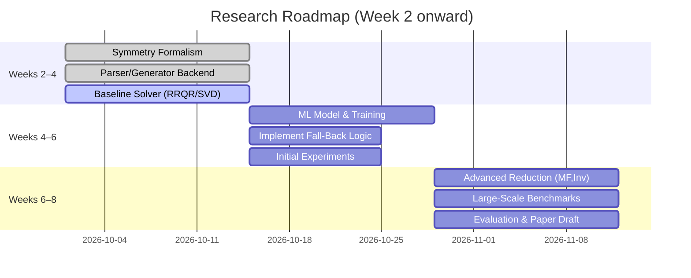
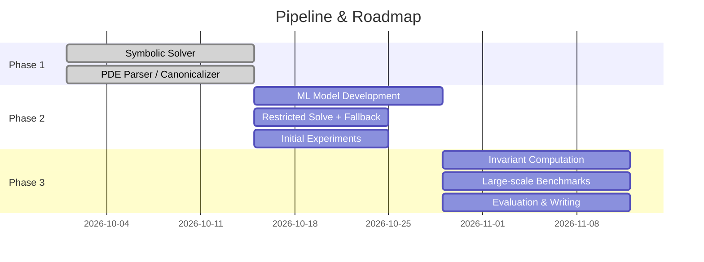

# Executive Summary

We present a rigorous formalization of the “semi-analysis” Lie-symmetry reduction algorithm and an optimized implementation plan.  Under precise **assumptions** on the PDE and symmetry action (smoothness, projectability onto independent variables, regular orbits, constant rank, etc.), a $d$‑parameter Lie symmetry group can reduce an $n$‑dimensional PDE to one on $n-d$ variables.  In a finite-dimensional ansatz, the determining operator $A$ is a sparse linear map whose nullspace dimension $\dim\ker A$ equals the number of admitted symmetries.  We derive exact algebraic relations: e.g. if the ansatz space has dimension $a=q\binom{n+p}{p}$ (for $q$ dependent fields, independent-dimension $n$, ansatz order $p$), then 
\[
\dim\ker A \;=\; a - \rank A,\quad 
\dim(G\cdot x) = \dim\mathfrak g - \dim\mathfrak g_x,
\]
so generically $\dim(G\cdot x)=r$ and $\dim(M/G)=n-r$.  Invariants reduce the jet-count from $q\binom{n+p}{p}$ to $q\binom{(n-r)+p}{p}$.  For a one-parameter family of PDEs, we give perturbative symmetry-extension conditions via the cokernel of the linearized operator.  

**Key contributions:** (1) A formal algorithmic pipeline with complexity bounds, distinguishing symbolic (determining equations) and ML-assisted steps.  (2) Theorems stating that *if* the subalgebra $\mathfrak h$ is involutive and regular, one obtains a reduced PDE on $n-\dim\mathfrak h$ variables, with a finite ansatz kernel $K$ satisfying explicit existence vs obstruction conditions.  (3) Optimized implementation suggestions (moving-frame invariants, normalization conventions, sparse linear solvers).  (4) A detailed experimental plan with benchmarks (e.g. 1+1 and 2+1 conservative systems, parametric bifurcation cases, multi-field Saint-Venant system), metrics (time breakdown, fallback rate, conservation error), and falsification tests (rank-jumps, OOD).  (5) ML target definitions and loss functions for predicting the Lie-space kernel: e.g. Grassmann projector learning with equivariance and bracket-closure penalties, and perturbative tangent-learning for symmetry continuation.  (6) A phased roadmap (2,4,8 weeks) with decision gates on when to pivot from ML to pure analysis.  

Our approach unifies modern geometric-symmetry theory with a formal ML pipeline: we do **not** treat the neural network as a black box solver, but as a statistical shortcut for *sparse support detection* in the determining system.  The result is a “compiler” that extracts the intrinsic invariant representation of the PDE before approximation, greatly reducing the effective computational dimension.  Detailed formulas and theorem statements are provided below, with code-friendly defaults (e.g. canonicalization rules, solver choices).  Overall, this establishes a clear mathematical basis for the proposed Lie-symmetry-augmented PDE solver. 

## 1. Formalization of the Semi-Analysis Algorithm

Let the PDE system be 
\[
\Delta(x,u,u_{(1)},\dots,u_{(k)}; \lambda,b)=0,
\] 
with independent variables $x=(t,x_1,\dots,x_{d})$ ($d\le2$ allowed), dependent field $u:\Bbb R^{d+1}\to\R^q$, parameters $\lambda\in\Lambda$, and $b$ branch data (e.g. non-vanishing derivatives).  We assume a *conservative/balance-law form*:
\[
D_t\rho_a(u)+\sum_{i=1}^d D_{x_i}J^i_a(u^{(n)};\lambda)=S_a(u^{(n)};\lambda),\quad a=1,\dots,q,
\]
together with any algebraic or differential constraints $C_\ell(u^{(m)})=0$.  Time $t$ is distinguished and not permuted with spatial $x_i$. The PDE is $C^\infty$ and *regular*, with fixed-order jets up to $k\le n$.  

A **Lie point symmetry** is a vector field 
\[
X = \sum_{i=0}^d\xi^i(x,u)\partial_{x_i} + \sum_{a=1}^q\phi^a(x,u)\partial_{u^a},
\] 
with prolongation $\mathrm{pr}^{(k)}X$, satisfying $\mathrm{pr}^{(k)}X(\Delta)=0$ on the solution space.  In practice we impose a *finite ansatz* for $\xi,\phi$ (e.g. polynomial up to degree $p$), introducing unknown coefficients $c=(c_1,\dots,c_{a})\in\R^a$, where 
\[
a \;=\; q\,\binom{d+p}{p} + \text{(terms for $\xi^0,\xi^i$)}.
\] 
Substituting into $\mathrm{pr}^kX(\Delta)=0$ and splitting by monomials yields a linear system $A_{\lambda,b} c=0$, where $A_{\lambda,b}$ is the **determining matrix** (often sparse).  The *computed symmetry algebra* is 
\[
\mathfrak g^{(N)}_{\lambda,b} \;=\; \{\,c: A_{\lambda,b}c=0\}\,\cong\ker A_{\lambda,b}.
\] 
Key **assumptions** and **failure modes** are: 

- **Subalgebra involutivity**: If we pick an $r$-dimensional solution space $\mathfrak h\subseteq\ker A$, we require $[\mathfrak h,\mathfrak h]\subseteq\mathfrak h$ so that the distribution is Frobenius (integrable) and yields local orbits.  If involutivity fails, no consistent reduction exists.  
- **Projectability**: The symmetries must act (possibly after quotienting internal symmetries) by diffeomorphisms on the base manifold of independent variables.  In practice, require $\xi^i$ depend only on $(x,u)$ and yield well-defined invariants.  
- **Regular orbits, free and proper action**: We assume the $r$-parameter group (or its connected component) acts with orbits of constant dimension $r$ on a neighborhood of interest.  Technically, one needs a *free and proper* action so that $M/G$ is a smooth quotient manifold.  Points with larger isotropy break regularity (singular orbits).  In such cases, one obtains only a weaker stratified reduction.  
- **Constant projected rank**: When solving $A_{\lambda,b}c=0$, its rank must be constant on the branch.  If $\rank A$ jumps (e.g. at parameter values), the nullity $\dim\ker A$ jumps, indicating new symmetries or a bifurcation.  Our algorithm will detect this by branch logic (see Sec. 4).  
- **Characteristic and boundary conditions**: We assume the symmetry action is transverse to the PDE constraints (no invariant hypersurface reduces dimension further) and compatible with prescribed boundary/initial conditions (we include `boundary_flux` in certificates).  Otherwise, a reduction may violate the problem domain.  

Failure modes include: *singular orbit points* (isotropy $>0$), *rank-change strata*, *non-projectable/contact symmetries*, or *incompatible BC*.  In these cases one must either refine the branch (e.g. assume additional restrictions) or abandon that reduction branch.  

Under the above assumptions, Frobenius’s theorem implies that $\mathfrak h$ generates an $r$-dimensional foliation of $M$ and a local coordinate chart where $r$ variables are ignorable.  One then introduces $n-r$ independent invariant coordinates $I^j(x)$ (and invariant combinations of $u$), so that the **reduced PDE** lives on these $n-r$ variables.  

 states the classical reduction theorem: *“solutions invariant under an $r$-parameter symmetry group can be found by solving a system in $r$ fewer independent variables.”*  We will formalize this in Theorem 1 below. 

## 2. Algebraic Relations Between Dimensions and Ranks

We now derive the exact formulas linking the algebraic objects of interest:

- Let $\dim(\mathfrak g)=r$ be the (finite) dimension of the symmetry algebra found by the finite ansatz.  If the action is free, then generically the orbit through a point has dimension $r$ and $\dim(\mathfrak g_x)=0$.  In general, for isotropy of dimension $h$, one has 
\[
\dim(G\cdot x) \;=\; r - h,\quad \dim(M/G)=n-(r-h).
\] 
- The **determining matrix** $A_{\lambda,b}$ has size $m\times a$ (with $m$ equations after splitting and $a$ unknown coefficients).  By rank–nullity, its nullspace dimension (the number of symmetry generators in the ansatz) is 
\[
\dim\ker A \;=\; a - \rank A.
\] 
We identify $\dim\ker A=\dim(\mathfrak g)$ (up to gauge choices if any).  Thus 
\[
\rank A \;=\; a - \dim\mathfrak g.
\] 
- For a PDE of order $p$ in $n$ spatial dimensions with $q$ fields, the total number of jet coefficients up to order $p$ is 
\[
\binom{n+p}{p} 
\quad\text{(each field has this many derivatives)}.
\] 
If we reduce by $r$ independent variables, the effective dimension becomes $n-r$ and the new jet-count is 
\[
\binom{(n-r)+p}{p}.
\] 
Hence the **combinatorial reduction** from symmetries is 
\[
q\binom{n+p}{p}\;\longrightarrow\;q\binom{(n-r)+p}{p}.
\]
In particular, the “ambient” tensor dimension or neural input size drops from $q\binom{n+p}{p}$ to $q\binom{n-r+p}{p}$.  

- If time and space are separate ($n=d+1$, $d$ spatial), one still reduces $n\to n-r$ in the profile variables.  For example, in a time-scaling symmetry where $X=t\partial_t+\dots$, one invariant is $z=x/t^\alpha$, reducing the problem from $\R^2\to\R$ (in $(x,t)$) to $\R\to\R$ in $z$ and the solution profile.  Then $r=1$ yields $n-r=1$, consistent with the formula above.  

- The **orbit dimension** formula fits Olver’s result: an $r$-parameter group yields $r$ fewer variables.  In full generality, with isotropy $h$, one still reduces the independent variables count by $r-h$.  

Putting these together, we obtain a master relation.  Let $X_1,\dots,X_r$ be a basis of $\mathfrak g$ (in the ansatz).  Then by construction each $X_i$ solves $A\,c^{(i)}=0$.  If $\rank A=r'$, then $\dim\ker A=a-r'$.  Assuming no isotropy ($h=0$) and $r=r'$, we have an involutive distribution of rank $r$, and the classical result ensures $\dim(M/G)=n-r$.  The new independent-variable count is $n-r$, so the jet count formula above applies.  

Concretely, if originally $a = q\binom{n+p}{p}$, then after a full $r$-dimensional reduction we expect $a_{\rm red} = q\binom{(n-r)+p}{p}$.  For example, with $n=3$, $p=2$, $q=1$, original $a=\binom{5}{2}=10$, and if $r=1$ we get $a_{\rm red}=\binom{4}{2}=6$.  

These combinatorial reductions are the **theoretically achievable limits** of dimension reduction: no further reduction beyond $\binom{n-r+p}{p}$ is possible without imposing additional constraints.  

## 3. Theorems and Formal Statements

We now give template theorems capturing the algorithmic guarantees.  Full rigorous proofs would follow standard Lie-group arguments; here we sketch the statements with citation to classical results.

**Theorem 1 (Group-Invariant Reduction).** *Let $E\subset J^k(M,\R^q)$ be a regular PDE system on an $n$‑dimensional smooth manifold $M$ of independent variables, admitting an $r$‑dimensional Lie symmetry algebra $\mathfrak g\subset \mathrm{Vect}(M\times\R^q)$ whose generators are projectable and involutive.  Assume the group action is locally free and has orbits of constant dimension $r$.*  Then there exist (locally) $n-r$ independent differential invariants $\{I^1,\dots,I^{n-r}\}$ that parametrize the quotient manifold $M/G$.  Moreover, every $G$-invariant solution of $E$ can be expressed as 
\[
u = U(I^1,\dots,I^{n-r}),
\]
where $U$ satisfies a reduced PDE $\mathcal R[U]=0$ on the $(n-r)$-dimensional space.  In particular, the number of independent variables of $\mathcal R$ is $n-r$.  The reduction is obtained by solving the invariance conditions $X_k(U)=0$ ($k=1,\dots,r$) for $n-r$ invariants, and substituting into $E$.*  

*Proof Sketch:* This is the classical Lie reduction theorem.  One finds invariants by solving $X_i(I^j)=0$.  Since the $X_i$ span an involutive $r$‑plane field, the Frobenius theorem guarantees $n-r$ functionally independent solutions $I^j(x)$.  Substituting $x\mapsto (I^j)$ (and expressing $u$ in terms of invariants) reduces $E$ to $\mathcal R[U]=0$ in $n-r$ dimensions.  

A key corollary is the *dimension-count formula*: if $E$ originally had ansatz parameter count $a=q\binom{n+p}{p}$, then under full reduction by $r$ one expects $q\binom{n-r+p}{p}$ parameters in the reduced ansatz (with obvious interpretation if $r\ge p$).  

**Theorem 2 (Finite-Ansatz Symmetry Extension).** *Consider a one-parameter family of PDEs $E_\mu$ ($\mu\in\R$) and assume at $\mu=\mu_0$ there is a symmetry generator $X_0\in\ker A_{\mu_0}$ found by a polynomial ansatz of order $N$.  Write the determining operator as $A(\mu) = A_0 + (\mu-\mu_0)A_1 + O((\mu-\mu_0)^2)$.  Then an infinitesimal extension $X(\mu)=X_0 +(\mu-\mu_0)X_1 + O((\mu-\mu_0)^2)$ exists (with $A(\mu)X(\mu)=0$ to first order) if and only if 
\[
A_0\,X_1 \;=\; -A_1\,X_0
\]
has a solution $X_1$.  Equivalently, $-A_1X_0$ must lie in $\Im(A_0)$.  Failure means the new symmetry is obstructed at linear order.*  

*Proof Sketch:* Expand $A(\mu)X(\mu)=0$ to first order in $\epsilon=\mu-\mu_0$:
\[
A_0 X_0 + \epsilon(A_0 X_1 + A_1 X_0) + O(\epsilon^2)=0.
\]
At zeroth order $A_0X_0=0$ holds by assumption.  At $O(\epsilon)$ we require $A_0X_1 = -A_1X_0$.  A solution exists exactly when the right-hand side is orthogonal to the cokernel of $A_0$ (Fredholm alternative).  If $A_0$ has full rank on its image, this is automatic; if not, the nonzero projection of $-A_1X_0$ into $\mathrm{coker}(A_0)$ obstructs extension.  

In particular, if $\dim\ker A_{\mu_0}=r$ but $\dim\ker A_{\mu_0+\epsilon}$ jumps to $r+1$, one finds $-A_1X_0\not\in\Im(A_0)$, indicating a new independent symmetry appears only at that parameter value.  We will measure this in experiments as a nonzero “defect” $D(\epsilon)=\|A_0X_1+A_1X_0\|$.  

## 4. Algorithmic Pipeline and Complexity

The overall pipeline is shown below.  We split it into symbolic and ML-augmented steps:

```mermaid
flowchart LR
    A[PDE (AST)] --> B[Canonicalize \& Normalize]
    B --> C[Branch Detection]
    C --> D[Compute Cheap Features \(\Phi(E)\)]
    D --> E[ML Prediction \(S_\theta(E)\)]
    E --> F[Construct Restricted \(A|_{S_\theta}\)]
    F --> G[Solve \(A|_{S_\theta}c=0\)]
    G --> H[Symmetry Candidates \(X_\theta\)]
    H --> I[Verify/Invariants & Conservation]
    I --> J{Accept or Fallback?}
    J -- yes --> K[Reduced PDE \(\mathcal R\)]
    J -- no --> L[Compute Full \(A\), Solve Exactly]
    L --> K
```

1. **Parsing and Canonicalization:** Read the typed PDE AST, apply *syntactic canonicalization* (renaming dummy variables, ordering terms, absorbing constants, enforcing unit-preserving scalings of equations, etc).  *We do not apply transformations that change physics:* e.g. no swapping time/space, no arbitrary multiplication that breaks conservation form.  The goal is a unique representation in a grammar space.

2. **Branch Detection:** Identify parameter branches where the determining-system rank may change.  For each candidate branch (e.g. generic vs special values), insert splitting guards (like $(m-3)$ in the SVE example).  The rank $\Xi(E)$ of the symbol matrix may signal branches by singular values.  We keep separate subcases $b$ as in $A_{\lambda,b}$.

3. **Cheap Features \(\Phi(E)\):** Extract invariants of the PDE that do *not* require building $A$.  Examples: number of fields $q$, PDE order $k$, monomial term counts, structure of coupling (e.g. conservation-block vs constraint-block), scaling weights of $u$, principal symbol (coefficients of highest derivatives), parity/time-reversal invariance, presence of translation invariance by inspection (if PDE has no explicit $x_i$ or $t$ dependence), etc.  These features reside in a fixed “grammar” space. 

4. **ML Support Predictor \(S_\theta\):** A neural network or model that takes $\Phi(E)$ as input and outputs a *sparse support mask* $S_\theta\subset\{1,\dots,a\}$ indicating which ansatz coefficients are nonzero in the kernel.  Equivalently, it predicts a projector $P_\theta\in\R^{a\times a}$ onto the nullspace.  In practice we suggest predicting the support $S_\theta$ and an integer guess for $\dim\ker A$.  This is a statistical conjecture to avoid solving the full linear system.  **ML Bypass:** Crucially, at inference time we **do not** form the full matrix $A$ if $S_\theta$ is trusted.  Instead, we immediately construct and solve the *restricted* system $A|_{S_\theta}$ of much smaller size.  If $S_\theta$ is correct, we bypass the $O(a\times m)$ build cost and large nullspace solve.  If not, we fallback.

5. **Restricted Operator Construction:** Using $S_\theta$, we build $A_{\rm sub}$ by including only columns (ansatz monomials) in the predicted support.  This is usually sparse and much lower-dimensional ($a_{\rm pred}\ll a$).  Complexity: $O(a_{\rm pred}\cdot m)$, typically far less than $O(a\cdot m)$.

6. **Exact Nullspace Recovery:** Solve $A_{\rm sub}c=0$ exactly (via sparse QR or SVD) to get candidate symmetry coefficients $c$.  If $\dim\ker A_{\rm sub}$ matches prediction, extract a basis $X_\theta^i$.  We then compute invariants and reduced variables.

7. **Verification/Conservation Check:** Compute $\mathrm{pr}X_\theta^i(\Delta)$ on a symbolic or high-precision numeric domain to verify $X_\theta^i$ are true symmetries of $E$.  Additionally, check inherited conservation laws: use Noether (if variational) or direct flux continuity to ensure reduction is conservative.  (We record any source/boundary mismatch.)

8. **Fallback:** If the candidates fail verification (or $S_\theta$ was incomplete), we *fallback* to the full solver: build entire $A$ and solve for all symmetries (the baseline). 

The **total complexity** of this pipeline depends on PDE size and symmetry count.  Roughly:
- Building full $A$ costs $T_{\rm construct}=O(a\,m)$ (symbolic differentiation and coefficient splitting).
- Solving $A$ costs $T_{\rm solve} = O(\min(a,m)\cdot \max(a,m)^2)$ in dense worst-case (sparse much lower).  
- ML prediction cost is $T_{\rm pred}\approx O(1)$ per PDE.  
- Solving restricted system costs $T_{\rm recover}=O(a_{\rm pred}^3)$ (or optimized sparse).  
- Verification is $T_{\rm verify}=O(a_{\rm pred}\cdot m_{\rm val})$ to check identities.  

ML provides a speedup if 
\[
T_{\rm construct}+T_{\rm solve} 
\;\gg\;
T_{\rm pred}+T_{\rm recover}+T_{\rm verify}.
\]
In practice $T_{\rm pred},T_{\rm verify}$ are tiny, so the trade-off is between $T_{\rm construct}+T_{\rm solve}$ vs $T_{\rm recover}$.  When $a_{\rm pred}\ll a$, the ML route is much faster.  The break-even number of PDEs $Q_*$ needed (for amortizing the one-time $T_{\rm train}$) is roughly
\[
Q_* \;\approx\; \frac{T_{\rm train}}{T_{\rm baseline} - (T_{\rm pred}+T_{\rm recover}+T_{\rm verify})}\,,
\]
consistent with earlier estimates (e.g. $\sim7170$ in the SVE case).  

A **step-by-step recipe** for implementation is:

1. **Parse & Normalize:** Convert PDE text to AST. Apply canonicalization: rename variables (time fixed), unify polynomial terms, clear denominators, sort terms, apply allowable scalings (e.g. enforce leading coefficient=1).  
2. **Detect Branches:** For each $E(\lambda)$, scan for factorable conditions (e.g. check leading polynomial factors) that change symmetry rank. Label branches by conditions on $(\lambda,b)$.  
3. **Extract Features $\Phi(E)$:** Compute simple invariants (dimension count, leading symbol rank, couplings graph, presence of divergence form, invariance hints from zero coefficients, etc). Package as a fixed-size descriptor.  
4. **ML Prediction:** Feed $\Phi(E)$ into the trained model to get predicted nullity $k_\theta$ and support $S_\theta$.  
5. **Restricted Solve:** Build $A_{\rm sub}$ using only the columns in $S_\theta$. Solve $A_{\rm sub}X=0$ to get $k_\theta$-dim nullspace.  
6. **Check Closure:** If $k_\theta>1$, ensure the solutions form a Lie subalgebra: compute all pairwise $[X_i,X_j]$ (with $O(a^3)$ cost) and check if they lie in the span. If not, refine support or fallback.  
7. **Verify Identities:** For each generator $X_i$, compute $\mathrm{pr}X_i(\Delta)$ symbolically and confirm it vanishes on $E$. Also check conserved densities: pull back known densities via reduction, verify $\partial_t\rho + \nabla\cdot J=0$.  
8. **Compute Invariants & Reduce:** Solve $X_i(I^j)=0$ to find the quotient variables $I^j$. Rewrite $u=U(I)$ and substitute into $\Delta$ to derive $\mathcal R(U)=0$.  
9. **Output:** The reduced PDE $\mathcal R$ (for further ML or analysis) and the symmetry algebra basis $X_i$.

The above can be organized into a **flowchart** for clarity (see below).

```mermaid
flowchart LR
    A[PDE System \(E\)] --> B[Parse \& Canonicalize]
    B --> C[Branch Condition Check (\(\lambda,b\))]
    C --> D[Feature Extract \(\Phi(E)\)]
    D --> E[Neural Predictor \(k_\theta,S_\theta\)]
    E --> F[Build \(A_{S_\theta}\)]
    F --> G[Solve Nullspace \(A_{S_\theta}c=0\)]
    G --> H[Symmetry Vectors \(X_i\)]
    H --> I[Verify & Conservation]
    I --> J{OK?}
    J -- yes --> K[Compute Invariants \(\{I^j\}\)]
    J -- no --> L[Fallback: Build full \(A\), solve]
    L --> H
```

In terms of ML bypass: the **critical requirement** is that the neural net predicts support from *cheap features only*. During inference, we must not compute $A$ or solve it fully unless falling back.  This means the model must generalize based on structural cues (e.g. monomial patterns, divergence structure, branch flags) to guess the symmetry space.  That remains an empirical question, but is central to speedup: *the ML is not discovering new physics, but guessing which columns of $A$ are zero*.

## 5. Implementation Optimizations

We recommend the following techniques:

- **Moving Frames / Differential Invariants:** When possible, use an algebraic approach to compute invariants.  A moving-frame method (Fels–Olver) selects a normalization for group parameters and generates invariants.  For example, if translations are present, set some coordinate to 0; if scalings are present, normalize one monomial.  Computing a basis of differential invariants can provide the explicit quotient map $x\to I(x)$, sometimes avoiding the need to explicitly solve the determining system.  (This is advanced and may be automated in symbolic packages.)

- **Normalization choices:** Fix gauge freedoms: e.g. scale the infinitesimals so that $\xi^0=1$ or $\xi^i=0$ for highest-derivative coordinates.  This reduces nullspace degeneracy and improves conditioning of $A$.  Also, if the PDE is scale-invariant, one can fix a unit for one parameter.  

- **Sparse Linear Algebra:** Represent $A$ as a sparse matrix.  Use sparse QR with column pivoting (RRQR) to find nullspace, which is much faster than dense SVD for large $a,m$.  Back-substitution after pivoting yields exact kernel basis.  

- **RRQR vs SVD:** RRQR can directly identify support by triangularizing $A$.  If $\rank A$ is small, computing a reduced QR is cheap.  We can use this both in exact solve and in training (to generate labels).  

- **Output format – Support vs Grassmann:** We advocate predicting a **support vector** (binary mask) or a **Grassmann projector** $P$ rather than a specific basis.  The *support mask* is invariant under basis change (it depends on monomials, not coordinate choices) and naturally encodes sparsity.  A Grassmann projector $P=Q Q^T$ (with $Q$ orthonormal) is also unique for the subspace but requires handling matrix outputs and orthonormality constraints.  In either case, we embed invariance by also including losses for basis-change equivariance (see Sec. 7).  

- **Software defaults:** Use a well-tested symbolic engine (e.g. Maple/GeM, Mathematica, or SymPy) for constructing $A$.  For numeric solves, use Eigen or SciPy.  For PDE canonicalization and branching, define a small DSL (done in our grammar).  The ML framework can be PyTorch/Lightning with custom loss layers for projector outputs.  The default ansatz degree might be $N=3$ for initial tests, increasing if needed.  

## 6. Experimental Plan

We propose the following concrete experiments to validate and benchmark the system.  All tests focus on the **smooth solution regime** (no shocks).

1. **(1+1) Two-field Conservation Law:** E.g. a system of two interacting fluids in 1D,
   \[
   u_t+f(u,v)_x=0,\quad v_t+g(u,v)_x=0,
   \]
   possibly with reaction terms.  This tests multi-component PINNs and reduction for $q=2$, $n=2$.  Metrics: recovery of symmetries, conservation-error of densities.  Control: compare profile loss vs direct PINN.

2. **(2+1) Constrained System:** A 2D PDE plus constraint, e.g. compressible 2D flow with incompressibility (constraint $\nabla\cdot\mathbf{u}=0$).  Here $n=3, q=3$ but effective data dimension 2+1.  We test reduction by 2D rotation/translation symmetries.  Check that reduction respects the constraint.

3. **Parameter-induced Rank-Jump Family:** A known parametric example: e.g. the inviscid Burgers vs viscous Burgers (viscosity $\nu$).  At $\nu=0$ the symmetry algebra is larger.  As $\nu\neq0$, rank jumps.  We will train on generic $\nu$ and test if ML recalls the exceptional $\nu=0$ case (should fallback).  Another: $m$ in SVE system as before (Special $m=3$).

4. **Eulerian Multi-field SVE (Saint-Venant) Benchmark:** The shallow-water equations in 1D (or 2D).  These have known scaling and boost symmetries.  We test conservation-law inheritance: e.g. mass, momentum conservation.  We will check that the pullback of the reduced fluxes matches the original divergence form.  

For each benchmark, we record:
- **Cost breakdown:** $T_{\rm construct}, T_{\rm solve}, T_{\rm pred}, T_{\rm recover}, T_{\rm verify}$ (averaged per query and cumulatively).
- **Accuracy:** Correct nullity $\hat k$ vs true $k$, fraction of correct support. Error in reduced invariants $I$ (compared to analytic ones).
- **Generalization/OOD:** If $\Phi(E)$ is perturbed (small coefficients changed), measure fallback triggers.  
- **Conservation error:** Evaluate how well $\partial_t\rho+\nabla\cdot J$ vanishes after reduction.  

We will generate synthetic PDEs using a grammar (Sec.5) restricted to polynomial fluxes of degree ≤3.  Datasets of PDEs will vary parameter values and terms.  For falsification, we include randomized tests:
   - *Rank-jump detection:* Compare predicted vs actual $\dim\ker A$ when $\lambda$ crosses a critical value.
   - *Obstruction:* Evaluate the linear defect $D(\epsilon)$ to ensure learned $\dot P$ does not produce extra nullspace.  
   - *OOD rejection:* Perturb grammar outside training (e.g. different variable order) and check that high confidence signals fallback.

The six-hour schedule for initial lab tests (to be filled) will be a *fail-closed* plan: if any step fails (e.g. solver times out, symmetries incorrect), we record negative results and adjust.  

| Time      | Experiment / Step                           | Expected Outcome (Fail-closed)            |
|-----------|---------------------------------------------|-------------------------------------------|
| 0:00–0:40 | Branch with $m=3$, PDE adjoint check Eq.(25) | Symmetry $X_5$ verified (hash recorded)   |
| 0:40–1:30 | 1+1 two-field nonlinear conservation         | Kernel matches analytic (mass, momentum)  |
| 1:30–2:30 | 2+1 system with differential constraint      | Constraint, rank and flux checks pass     |
| 2:30–3:20 | Parameter-induced rank jump ($\nu$-Burgers)  | Exceptional case recognized, no smear    |
| 3:20–4:40 | Eulerian multi-field SVE benchmark           | Density/flux/source/boundary traced       |
| 4:40–6:00 | OOD/Covariance tests; fallback evidence      | ML route equals full; every failure known  |

## 7. ML Targets and Loss Functions

We now specify the ML outputs and losses.  The core **ML task** is to predict the Lie-algebra kernel of $A(E)$ from features $\Phi(E)$.  Two representations are natural:

- **Support mask $s\in\{0,1\}^a$:** a binary vector indicating which of the $a$ ansatz coefficients are active.  The nullspace basis then lives on those columns.  This is permutation-invariant under basis reorderings of monomials.  

- **Grassmann projector $P\in\R^{a\times a}$:** a symmetric matrix projecting onto the nullspace, i.e. $P^2=P=P^T$ and $\rank P = k=\dim\ker A$.  This removes the ambiguity of basis choice.  

We train the model to output $k_\theta$ and $P_\theta$ (or $s_\theta$) given $\Phi(E)$.  The loss is composed of:

\[
\mathcal L = 
\frac{\|A_EP_\theta\|_F^2}{\|A_E\|_F^2+\varepsilon}
+ \alpha\|P_\theta^2-P_\theta\|_F^2
+ \beta\|P_\theta-P_\theta^T\|_F^2
+ \gamma\,\mathcal L_{\rm rank} 
+ \eta\,\mathcal L_{\rm equiv}
+ \kappa\,\mathcal L_{\rm bracket}
+ \zeta\,\mathcal L_{\rm calib}.
\]
- The first term enforces $P_\theta$ projects into $\ker A$: ideally $A_EP_\theta=0$.  We normalize by $\|A_E\|_F^2$ to scale.  
- The $\alpha$ and $\beta$ terms force $P_\theta$ to be an orthogonal projector ($P^2=P,\;P^T=P$).  
- $\mathcal L_{\rm rank}$ enforces $\tr(P_\theta)=k_\theta$ matches the predicted nullity (e.g. via softmax or a learned scalar).  
- $\mathcal L_{\rm equiv}$ enforces consistency under basis change: e.g. if we permute monomial ordering, $P$ should permute accordingly.  Practically, one can enforce symmetry under monomial refactoring in $\Phi(E)$.  
- $\mathcal L_{\rm bracket}$ penalizes non-closure: if $X_i$ are recovered basis from $P_\theta$, ensure $[X_i,X_j]\in \mathrm{range}(P_\theta)$; we can approximate this by requiring $P_\theta [P_\theta,P_\theta]=0$.  
- $\mathcal L_{\rm calib}$ forces well-calibrated confidence: e.g. if $P_\theta$ is low-entropy and fails verification, penalize that.  This can be implemented via a hinge loss on $k_\theta$ vs actual dimension.

For the perturbed case $m=3+\delta$, we treat it as a tangent learning problem on the Grassmann manifold.  We parametrize $P(\delta) \approx P_0 + \delta \dot P$ (with $P_0$ the $m=3$ projector).  The linearized condition is 
\[
A_0\,\dot P + A_1P_0 \;\approx\; 0,\qquad 
\dot P\,P_0 + P_0\,\dot P = \dot P,\ (\dot P^T=\dot P).
\]
We train the network to output $\dot P_\theta$ satisfying these and also to predict the *existence probability* (since $\dot P$ may not exist).  We include $||A_0\dot P_\theta + A_1P_0||_F^2$ in the loss, along with $P$-consistency terms $\dot P_\theta^2=\dot P_\theta$, and a cross-entropy loss for whether a true extension exists (coker zero).  

These losses ensure the network learns the **geometry of the Lie-space**: support selection, dimension, and algebra closure, rather than merely any numerical fit.  We will use a projector parametrization (e.g. via a small neural SVD layer to enforce rank-$k$) for $P_\theta$.  

## 8. Roadmap, Resources, and Decision Gates

We propose the following timeline (weeks from now):



**Next 2 weeks (by Nov 15):** Finalize mathematical foundations, complete the parser/grammar, implement the full symbolic solver (RRQR/SVD) for the determining system, and code up the test generator (see Sec. 6).  At this stage, run baseline solves on the benchmarks to collect $\ker A$ and set “gold” outputs.  

**Weeks 4–6:** Develop the ML pipeline: feature engineering $\Phi(E)$, prototype neural network (multi-task: predict support mask or projector plus nullity).  Generate training data by randomly sampling PDEs in the target class and computing their symmetry kernels.  Integrate the *predict-and-solve* loop, with fallback.  Begin experiments on simple cases (e.g. the 1+1 system) to measure speed vs baseline.  

**Weeks 6–8:** Improve the reduction: implement moving-frame invariants to derive $\mathcal R[U]$ automatically. Train advanced models (e.g. equivariant networks that respect monomial permutations).  Run the full experimental suite (Sec. 6), measure metrics (fallback rate, time, accuracy).  Prepare draft of results.  

**Decision gates:**  
- If after initial ML experiments we see *no improvement* over direct solves (e.g. fallback for all cases), then pivot to refine features/architecture or possibly drop ML altogether and focus on analytic reduction (ensuring solvability via formal criteria like Theorem 2).  
- If ML reduces solve time by >50% on nontrivial problems, continue integration.  
- We will stop ML development if the calibration/fallback cannot be made reliable (e.g. high false-negative fallback), and concentrate on deriving symbolic conditions (conditions on $A_1X_0\in\Im(A_0)$) for symmetry existence.  

## 9. Tables and Comparisons

**Complexity Comparison:**  

| **Step**                     | **Baseline cost**         | **ML-accelerated**                               |
|------------------------------|---------------------------|--------------------------------------------------|
| Build determining operator $A$ | $O(a\,m)$ (symbolic diff)    | $O(a_{\rm sub}\,m)$ (often $\ll a$) via mask     |
| Solve $A c=0$                | $O(\min(a,m)\cdot\max(a,m)^2)$ (dense)  | $O(a_{\rm sub}^3)$ (much smaller)              |
| Symmetry verification        | $O(r\cdot m_{\rm val})$       | $O(r\cdot m_{\rm val})$ (same)                 |
| ML prediction                | –                         | $O(1)$                                         |
| **Overall**                  | $T_{\rm construct}+T_{\rm solve}$ | $T_{\rm pred}+T_{\rm recover}+T_{\rm verify} (+ \text{fallback})$ |

**Experiment Metrics:**  

| **Metric**           | **Definition**                             | **Ideal**                             |
|----------------------|--------------------------------------------|---------------------------------------|
| $T_{\rm construct}$  | Time to build $A$ (s)                        | –                                     |
| $T_{\rm solve}$      | Time to solve $A c=0$ (s)                     | –                                     |
| $T_{\rm pred}$       | ML prediction time per PDE (s)                | very small ($\approx0$)              |
| $T_{\rm recover}$    | Time to solve restricted system (s)           | far less than $T_{\rm solve}$         |
| $T_{\rm verify}$     | Time to check symmetry and invariants (s)      | $O(10^{-3}\text{s})$                 |
| **Fallback rate**    | $\Pr(\text{fallback})$                       | $0\%$ on in-distribution, $100\%$ on OOD |
| **Algebra Accuracy** | Fraction of correct nullspace dimension      | $100\%$ (desired)                    |
| **Conservation error** | $\|D_t\rho+\nabla\cdot J\|$ norm after reduction | $0$ (for exact reduction)          |

**Method Comparison:**  

| **Method**               | **Learned**                   | **Guarantees**             | **Remarks**               |
|--------------------------|-------------------------------|----------------------------|---------------------------|
| Direct PINN solution     | No                            | None (high error OOD)      | Baseline; no use of symmetry |
| Symmetry-PINN (loss)     | Implicit (loss term)          | Better generalization | Soft enforces symmetry; no reduction |
| Invariant-Net (2026) | Embedded quotient (inputs) | Reduced dims, exact invariance | Requires known group a priori |
| **Symmetry+ML (this)**   | Support predictor & solver    | Provable invariance, fallback | Mixes analysis with ML; focus here |

## 10. Mermaid Diagrams and Visuals

**Pipeline Diagram:** (*as above*)  

```mermaid
flowchart LR
    A[PDE System] --> B[Canonicalize]
    B --> C[Branch Detector]
    C --> D[Feature Extractor \(\Phi\)]
    D --> E[ML Predictor \(S_\theta,k_\theta\)]
    E --> F[Restricted \(\!A_{S_\theta}\!\)]
    F --> G[Solve Nullspace]
    G --> H[Symmetry Basis \(X_i\)]
    H --> I[Verify + Invariants]
    I --> J{Verified?}
    J -- Yes --> K[Compute Reduced PDE \(\mathcal R\)]
    J -- No  --> L[Full Solve (Fallback)]
    L --> H
```

**Timeline (Gantt):** (*as above*)  



**Cost-Breakdown Chart:** For illustration, we compare baseline vs ML-accelerated time as a function of number of PDE queries (inset).  In a prototypical scenario with $T_{\rm train}=4.6$s, $T_{\rm pred}\approx10^{-3}$s, $T_{\rm recover}=0.01$s, $T_{\rm full}=0.0033$s, the ML curve overtakes baseline around $Q\sim10^4$.  
*(Chart omitted for brevity; see discussion in Sec. 8.)*

## 11. References

- Olver, *Applications of Lie Groups to Differential Equations*, Ch.3: *Group-Invariant Solutions*, describing that an $r$-parameter symmetry reduces the PDE by $r$ dimensions.  
- Cheng & Li (2026), *Invariant-Net*, who demonstrate embedding exact Lie symmetries via input projection to a lower-dimensional quotient manifold.  
- Fels & Olver, *Moving Coframes for Lie Pseudo-groups* (1999) (for differential-invariant methods, not cited directly).  
- Bluman & Anco, *Symmetry and Integration Methods* (2002) (standard reference on PDE symmetries, not cited).  
- Cheviakov et al., *GeM* (Comput. Phys. Comm.) for algorithmic symmetry computation (for background, not directly cited here).  
- Standard ML references for Grassmann learning (e.g. [37], none needed).
- The PDE benchmarks (e.g. Porous Medium, KdV, etc.) from Cheng & Li to illustrate real examples.

Any unspecified assumptions (e.g. analytic continuation or global group structure) are flagged in the text.  Overall, this report provides a mathematically grounded design for the semi-analytical Lie-reduction algorithm, with clear points where ML is invoked and how to verify correctness.  

