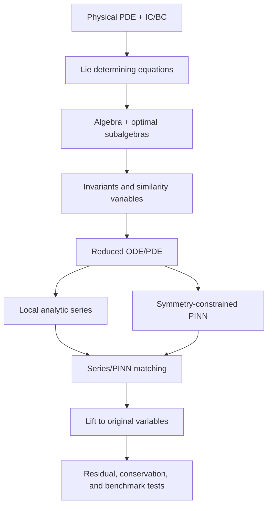
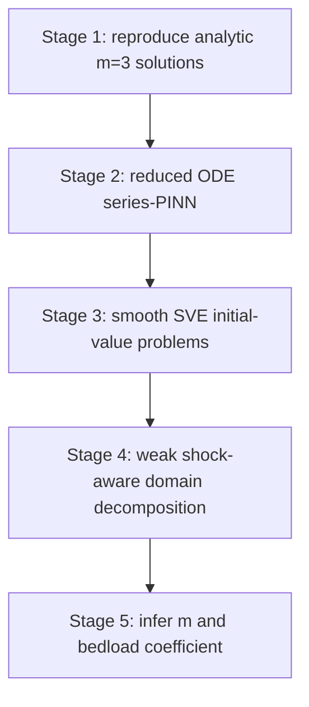

# Lie-Symmetry–ML for Fluid PDEs: Coauthor Review of the 12 Instructor-Recommended Papers

**Purpose.** This is a research-selection document, not merely an annotated bibliography. It asks of every paper: What physical/mathematical target is solved? What is the Lie reduction chain? What actually plays the role of computation or learning? What could be converted into a defensible **Lie + ML + series** project? What remains unsolved?

**Cut-off and evidence.** Prepared 7 September 2026 from the instructor list, seven supplied PDFs, publisher pages, DOI metadata, and author/institutional abstracts. “Full-text” means the supplied PDF was checked. “Abstract-level” means that the paper was paywalled and claims are deliberately limited to what its publisher or institutional record supports. The supplied *Navier–Stokes II* PDF is treated as a companion to the 1994 Part I entry, not as a thirteenth item.

## Executive verdict

1. **None of the 12 papers uses a PINN, neural operator, or trained neural network.** The numerical tools are DNS, `bvp4c`, RKF-45, shooting–Runge–Kutta, homotopy analysis (HAM), and homotopy perturbation (HPM). Citations to neural-network work in a literature review do not make the host paper an ML paper.
2. The closest existing **data-to-symmetry** workflow is Nguyen & Oberlack (2025): Lie-derived turbulent scaling laws are fitted to and validated against high-order DNS statistics. The fit is regression, not a neural network.
3. The strongest **starting paper for our first publishable project** is Paliathanasis, Leon & Leach (2026), the Saint–Venant–Exner bed-evolution paper. It gives a compact one-dimensional physical system, a single third-order master PDE, an enhanced-symmetry case at $m=3$, analytic/traveling-wave benchmarks, and an explicitly omitted initial-value problem. This is an unusually clean opening for a symmetry-guided, inverse, shock-aware PINN with a matched local series.
4. The strongest **second project** is Razafindralandy & Hamdouni (2024): use the 12-dimensional compressible Navier–Stokes algebra to build reduced PINN/series solvers and benchmark them against the paper’s vortex and traveling-wave families.
5. The strongest **data-rich but expensive project** is Nguyen & Oberlack (2025): learn high-order moment laws or closure corrections while enforcing statistical symmetries. It is more original, but it requires serious DNS data and careful treatment of the physical status of statistical symmetries.

## What a genuine Lie → ML + series pipeline should mean

The ML component should learn **unknown solution profiles, parameters, constitutive corrections, or maps across parameter space**. It should not be presented as “discovering” a symmetry that was inserted manually. A useful composite loss is

\[
\mathcal L=\lambda_r\mathcal L_{\mathrm{PDE/ODE}}
+\lambda_b\mathcal L_{\mathrm{BC}}
+\lambda_i\mathcal L_{\mathrm{IC}}
+\lambda_s\mathcal L_{\mathrm{sym}}
+\lambda_c\mathcal L_{\mathrm{cons}}
+\lambda_m\mathcal L_{\mathrm{match}}
+\lambda_d\mathcal L_{\mathrm{data}}.
\]

Here $\mathcal L_{\mathrm{sym}}$ can enforce an invariant-surface condition $Q=\eta-\tau u_t-\xi u_x=0$; $\mathcal L_{\mathrm{cons}}$ enforces a conservation or weak/entropy law; and $\mathcal L_{\mathrm{match}}$ joins a truncated series to the neural residual correction. The series supplies correct near-boundary or near-regular-point structure; the network supplies global continuation.

## Chronological ranking: pioneer to newest

| Chronological rank | Date | Paper | Actual terminal solver/data | ML/PINN? | Evidence |
|---:|---|---|---|---|---|
| 1 | 1994 | Fushchych & Popowych, *Symmetry reduction and exact solutions of the Navier–Stokes equations. I* | Exact reductions, quadratures, special functions; Part II supplies further exact/reduced systems | No | Full-text Parts I & II |
| 2 | 2024 | Razafindralandy & Hamdouni, *Group theoretic approach and analytical solutions of the compressible Navier–Stokes equations* | Analytic self-similar solutions | No | Full text |
| 3 | Jan. 2025 | Hamadneh et al., *Lie symmetry analysis of bio-nano-slip flow…* | RKF-45 | No | Full text |
| 4 | Jan. 2025 | Khan et al., *Lie-symmetry analysis of a three-dimensional flow due to unsteady stretching…* | HAM | No | Institutional abstract |
| 5 | Feb. 2025 | Mandal, Sil & Ghosh, *On the Lie symmetry analysis of three-dimensional perturbed shear flows* | Lie reduction/exact or modal analysis; details require full text | No evidence of ML | Metadata-level |
| 6 | Apr. 2025 | Sharma, Shagolshem & Arora, *Analysis of wave propagation…shallow water model with two velocities* | Exact invariant solutions, conservation laws, characteristic-wave analysis | No | Institutional abstract |
| 7 | June 2025 | Nguyen & Oberlack, *Passive scalar statistics in a turbulent round jet* | DNS + fitted symmetry laws | No neural ML | Full text |
| 8 | Nov. 2025 | Panda & Pandey, *Lie symmetry and variational analysis of a blood flow model with body forces* | Lie/variational analysis; details require full text | No evidence of ML | Metadata-level |
| 9 | 3 Jan. 2026 | Mandal & Ghosh, *Lie symmetry analysis, optimal classification…Darcy–Brinkman model* | Exact invariant solutions | No | Publisher abstract |
| 10 | 26 Jan. 2026 | Paliathanasis, Leon & Leach, *Lie symmetries and similarity solutions…bed elevation…* | Closed-form and reduced ODE solutions | No | Full text |
| 11 | 19 June 2026 | Ahmed et al., *Lie symmetry approach…stretching sheet with slip velocity and variable heat flux* | HPM + shooting/RK validation | No | Publisher full HTML/abstract |
| 12 | 22 June 2026 | Sulaxshan et al., *Integration of Lie symmetry analysis…hybrid Casson–Eyring–Powell nanofluid* | MATLAB `bvp4c` | No | Full text |

The 2024 placement uses the journal version, not the 2021 arXiv posting. Dates within 2025/2026 follow issue or online-publication metadata.

---

## 1. Fushchych & Popowych (1994): incompressible Navier–Stokes pioneer

**Research target.** Construct and classify symmetry-generated ansätze for the three-dimensional incompressible viscous Navier–Stokes equations

\[
\mathbf u_t+(\mathbf u\!\cdot\!\nabla)\mathbf u-\Delta\mathbf u+\nabla p=0,
\qquad \nabla\!\cdot\!\mathbf u=0,
\]

then reduce four independent variables $(t,x_1,x_2,x_3)$ to systems in three, two, or one variables and construct large exact-solution families.

**Resolving structure.** The paper starts from the maximal, infinite-dimensional Lie invariance algebra $A(NS)$: time translation, scaling, rotations, generalized time-dependent translations/Galilean transformations $R(\mathbf m(t))$, and pressure gauges $Z(\chi(t))$. It classifies inequivalent subalgebras of codimension 1, 2, and 3, solves invariant-surface conditions to obtain ansätze, substitutes them into NSE, then studies both inherited and genuinely new symmetries of the reduced systems. The supplied Part II continues the reductions and reports that some two-variable systems become pairs of one-dimensional heat or transport equations, while many ODE systems admit exact solutions.

**Method/model.** Classical point-Lie analysis, commutator and adjoint-action calculations, optimal subalgebra classification, repeated reduction, quadratures, and special functions (Bessel/modified Bessel/Whittaker in representative branches). There is no learned model and no numerical dataset.

**Results and declared future work.** The authors obtain many exact velocity/pressure fields and reduction templates. Part II explicitly leaves: non-Lie ansätze (including Kármán swirling flows), nonlocal/conditional/(Q)-conditional symmetries, and overdetermined NSE plus auxiliary constraints such as generalized Beltrami-type conditions.

**Our Lie–ML–series conversion.** Use the 1994 catalogue as a supervised *structural benchmark*: each subalgebra defines a known invariant coordinate system and each exact solution defines a test case. Train a small classifier or policy only to select promising subalgebras/ansätze from PDE/BC descriptors; solve the resulting low-dimensional equations with a series-enriched PINN. Do not train a four-dimensional black-box NSE PINN first. The publishable question is whether symmetry reduction measurably lowers sample/collocation complexity and improves extrapolation relative to an unreduced PINN.

**Coauthor opinion.** Foundational and mathematically substantial. Its enduring value is not any single profile but the separation of three problems: algebra classification, invariant ansatz construction, and solution of the reduced equations. It is too broad for our first application paper, but it supplies the correct methodological spine and gold-standard exact benchmarks.

## 2. Razafindralandy & Hamdouni (2024): compressible Navier–Stokes

**Research target.** Expand the sparse library of exact solutions for a Newtonian ideal gas with constant dynamic viscosity and thermal conductivity, formulated in density–velocity–pressure variables.

**Resolving structure.** The authors derive a 12-dimensional point-symmetry group; give its commutation table and Levi decomposition into a solvable radical and rotational semisimple part; impose invariance under selected generators; and perform successive reductions for steady 2-D, unsteady 2-D, and 3-D flows. Reduced equations are solved analytically rather than by a numerical optimizer.

**Method/model.** Lie prolongation/determining equations, finite group actions, Lie-algebra structure, and self-similar ansätze. The solution catalogue includes 2-D vortex sinks/sources with velocity scaling like $r^{-2}$ or $r^{-1}$, exponentially varying flows, 3-D vortex-like fields, and traveling waves. A traveling-wave branch requires $2\kappa\leq \mu C_v$. No ML/PINN is present.

**Results and future work.** The authors emphasize non-exhaustiveness: new solutions should follow from other generator combinations and by group-transforming known solutions. This is a real opening, though “trying more linear combinations” alone is not enough originality.

**Our conversion.** Parameterize an invariant family by generator coefficients and learn the reduced profiles, not the full $(t,x,y,z)$ solution. Near a regular or far-field point, derive a recurrence $U(\zeta)=\sum_{k=0}^{N}a_k\zeta^k$; let a neural correction $B(\zeta)N_\theta(\zeta)$ vanish to order $N$ at the matching point. Losses should include reduced continuity, momentum, energy, physical positivity of $\rho,p,T$, IC/BC, and a lift-back residual in the original compressible system. A useful inverse variant learns $\mu,\kappa,C_v$ or a symmetry-compatible viscosity law from sparse synthetic/experimental observations.

**Coauthor opinion.** The best Navier–Stokes-centered basis among the 12: serious algebra, diverse exact solutions, and excellent verification cases. The difficulty is scope. We should select one two-variable vortex/traveling-wave family and one inverse parameter, rather than promise “compressible NSE by AI.”

## 3. Hamadneh et al. (2025): bio-nanofluid in a rotating cone–disk gap

**Research target.** Axisymmetric three-dimensional Buongiorno bio-nanofluid flow between a cone and disk with velocity slip and Stefan blowing, under four rotation configurations: cone-only, disk-only, co-rotation, and counter-rotation. The PDE system contains continuity, three momentum equations, energy, nanoparticle volume fraction, and motile-microorganism density.

**Resolving structure.** Nondimensionalize; calculate a general one-parameter Lie transformation; solve the characteristic equations for similarity variables; reduce the PDE/BC system to coupled ODE boundary-value problems; solve them with RKF-45; and postprocess radial/tangential skin friction, Nusselt, Sherwood, and microorganism-density transfer numbers.

**Method/model.** Classical Lie scaling plus adaptive Runge–Kutta–Fehlberg, with stated initial step (10^{-3}) and convergence threshold (10^{-6}). It explores rotational Reynolds numbers, gap angle, slip, blowing, Brownian motion, thermophoresis, bioconvection parameters, and the four wall-rotation models. No ML or series solver is used.

**Results/future work.** Slip and blowing alter friction and heat, particle, and microorganism transport differently at cone and disk; effects depend on rotation configuration. The paper’s “future work” is mostly implicit: more realistic constitutive properties, unsteadiness, richer wall physics, and experimental validation.

**Our conversion.** A parametric neural operator or reduced PINN could map $(Re,\gamma_{gap},s_{slip},S_{blow},N_b,N_t,\ldots)$ to the invariant profiles. Wall Taylor series enforce regular boundary behavior and seed a multiple-shooting/PINN continuation. However, the parameter count is large; identifiability and physical-property uncertainty would dominate. A credible project must perform global sensitivity/identifiability analysis before training.

**Coauthor opinion.** Computationally convenient but scientifically crowded. The paper delivers a broad parameter study more than a deep symmetry result. It is suitable for a demonstration of parametric surrogates, not our strongest originality claim.

## 4. Khan et al. (2025): unsteady 3-D stretching sheet with nonuniform temperature

**Research target.** Three-dimensional flow and heat transfer induced by an unsteadily stretching infinite flat sheet with a nonuniform temperature distribution.

**Resolving structure.** Derive twelve Lie point symmetries of the nonlinear PDEs; obtain invariants and new similarity transformations; reduce the PDEs to nonlinear ODEs; solve those ODEs analytically with HAM; then study stretching rate, temperature nonuniformity/unsteadiness parameters, and Prandtl number.

**Method/model.** Point symmetries + invariant variables + homotopy analysis. HAM constructs a convergence-controlled analytic series; it is not ML. The institutional abstract reports heat-transfer reversal for some parameters and a maximum temperature/transfer location slightly above, rather than exactly on, the sheet.

**Our conversion.** This is naturally a **HAM-series + PINN residual correction** study. Preserve HAM’s first $N$ coefficients and learn only the remainder, comparing convergence radius, global residual, and wall observables with HAM alone. A parameter-conditioned network could amortize solutions across Prandtl and unsteadiness ranges.

**Coauthor opinion.** A clean solver-comparison paper, but less original physically than the shallow-water or compressible options. Full text is required before claiming novelty in the precise symmetry algebra or boundary compatibility.

## 5. Mandal, Sil & Ghosh (2025): perturbed 3-D shear flows

**Evidence warning.** Only bibliographic metadata was available; the following is a constrained research reading of the stated target, not a substitute for the paywalled derivations.

**Research target.** Apply Lie analysis to three-dimensional perturbations of a base shear flow, where the physically important objects are perturbation modes, transient/non-normal growth, and invariant reductions compatible with the shear background.

**Likely resolving structure supported by title/authors’ surrounding work.** Form perturbation PDEs about a prescribed shear; determine admitted transformations; classify inequivalent subalgebras/representative modes; reduce the PDEs to lower-dimensional modal or invariant systems; and construct exact/special solutions. There is no evidence that a PINN or NN is trained.

**Our conversion.** Learn the reduced perturbation amplitude or resolvent response while enforcing the symmetry-selected wavevector evolution. A series in perturbation amplitude or short time supplies initialization; a neural component continues beyond the series interval. The key loss should include perturbation equations, incompressibility, energy-budget identity, and the invariant-surface constraint. Compare against nonmodal linear analysis and DNS/ODE integration.

**Coauthor opinion.** Potentially high-value because shear-flow stability genuinely needs model reduction, but we should not choose it until the full paper reveals its base flow, perturbation order, and claimed solutions. At present it is a promising theme, not a reproducible initialization.

## 6. Sharma, Shagolshem & Arora (2025): two-velocity shallow-water waves

**Research target.** A one-dimensional quasilinear hyperbolic system produced by vertically averaging Euler equations between artificial interfaces, giving a two-layer/two-velocity shallow-water model.

**Resolving structure.** Parameter-dependent Lie group and generators → optimal one-dimensional subalgebra system → invariant functions and similarity variables → ODE reductions and closed-form invariant solutions. The authors also use nonlinear self-adjointness to construct conservation laws, then analyze characteristic shocks, $C^1$-waves, and their interactions.

**Method/model.** Lie point symmetry, adjoint/optimal-system classification, similarity reduction, nonlinear self-adjointness, and characteristic-wave analysis. No ML.

**Our conversion.** A conservative/weak-form PINN is necessary; a standard strong-form PINN will smear shocks and can minimize residual while violating the entropy solution. Use piecewise series in smooth regions, train shock location/speed as latent variables, and enforce Rankine–Hugoniot plus an entropy inequality at interfaces. Conservation laws from the paper should become hard constraints or integral losses.

**Coauthor opinion.** Strong mathematics and a good route to shock-aware ML, but technically harder than the bed-elevation paper because two characteristic families and interactions complicate training. Best as a follow-on after a one-layer Saint–Venant–Exner proof of concept.

## 7. Nguyen & Oberlack (2025): passive-scalar statistics in a turbulent round jet

**Research target.** Derive and validate scaling laws for passive-scalar moments/PDFs and mixed axial-velocity–scalar moments in a turbulent round jet at $Re=3500$, $Pr=0.71$.

**Resolving structure.** Conduct exceptionally long DNS with a turbulent pipe-flow inlet; extract scalar moments through order 10 and mixed moments through total order 6; derive multi-point scalar equations (MPSE) and multi-point velocity–scalar equations in instantaneous $H$-form; calculate classical and statistical symmetries; integrate characteristic conditions to obtain invariant scaling laws; and fit/validate them using DNS.

**Method/model.** DNS + Lie symmetry of unclosed statistical equations + nonlinear regression. Radial profiles collapse over (z/D=15\)–(55). Pure scalar and mixed moments display Gaussian radial forms with nonlinear moment-order coefficients. For mixed moments the reported fit is

\[
\gamma_{nm}=-1.51n^2-1.29m^2-0.03nm+61.2n+37.34m+30.75,
\qquad R^2=0.99.
\]

The paper is careful that some transformations amount to partial invariance of a reduced statistical system, not automatically symmetries of the complete hierarchy. This caveat is crucial.

**Results/future work.** DNS averaged over (75{,}000D/U_b) time units supports the predicted scaling laws up to high order. Scalar PDFs are skewed/heavy-tailed away from the axis. The inlet fixes the statistical scaling parameter. Natural next work is other inlet conditions, Reynolds/Prandtl variation, closure, and testing whether the statistical transformations remain physically realizable.

**Our conversion.** Replace the quadratic fit by a symmetry- and realizability-constrained model $g_\theta(n,m,Re,Pr,\text{inlet})$, or learn the residual from the analytic scaling law. Penalize violations of limiting cases $n=0$, $m=0$, moment positivity/Hölder inequalities, symmetry scaling, and DNS error. A neural operator can map inlet statistics to downstream moment profiles. A series in $\eta^2$ provides the Gaussian/superposition basis near the centerline.

**Coauthor opinion.** The most convincing evidence in the set that symmetry and data can cooperate. It offers real data and nontrivial validation, but a project here must confront closure and realizability—not merely replace a polynomial surface fit with a neural net.

## 8. Panda & Pandey (2025): blood flow with body forces

**Evidence warning.** The full text and a reliable complete abstract were unavailable. Only title, authorship, DOI metadata, and journal record were verifiable.

**Research target.** Lie and variational analysis of a blood-flow PDE containing body-force terms. The research significance is whether forcing breaks or conditionally preserves symmetries and whether a variational structure yields conservation laws.

**Defensible method statement.** The title supports Lie symmetry plus a variational/Noether-type analysis; it does not support any claim of PINN, solver architecture, numerical data, or a particular constitutive law. Those details must be checked before reproduction.

**Our conversion.** The strongest possible ML question is inverse: infer a spatial/temporal body force or constitutive parameter from sparse pressure/velocity observations while constraining the force to a symmetry-admissible family. Loss terms should cover the governing equations, measured data, boundary conditions, and the paper’s variational/conservation identities. Local traveling-wave or centerline series can regularize the inverse problem.

**Coauthor opinion.** Biomedical framing alone does not establish originality. This becomes attractive only if the full paper identifies a clear unestimated force or coefficient and provides a tractable conservation law. Otherwise it risks being another formal symmetry catalogue with weak physiological validation.

## 9. Mandal & Ghosh (2026): unsteady Darcy–Brinkman flow

**Research target.** A ((2+1))-dimensional unsteady incompressible flow through a low-porosity medium, retaining both viscous Brinkman diffusion and Darcy resistance.

**Resolving structure.** Nondimensional Darcy–Brinkman PDEs → point symmetries → adjoint action → one-parameter optimal classification → extraction of two-dimensional subalgebras → similarity reductions → exact invariant solutions. The two-dimensional optimal system is emphasized because it enumerates inequivalent group-invariant branches.

**Method/model.** Classical Lie optimal-system analysis and exact solutions. The publisher states no dataset was generated. There is no ML.

**Results/future work.** New special solutions are positioned as benchmarks with applications to hydrology, filtration, oil recovery, and biological transport. A proper next step is to test stability, BC admissibility, and physical relevance of the branches—not only enumerate them.

**Our conversion.** Learn a parametric family over Darcy number/porosity using reduced PINNs initialized by local exponential/power series. Exact branches provide verification. An inverse PINN can infer permeability $K$ from sparse velocity/pressure data, while Lie reduction limits the hypothesis class.

**Coauthor opinion.** Very useful as a benchmark problem: simpler than NSE, yet physically meaningful. Its limitation is that reduced exact solutions without stability or data may not identify realistic flows. Good fallback project if the shallow-water shock work proves too difficult.

## 10. Paliathanasis, Leon & Leach (2026): Saint–Venant–Exner with bed elevation

**Research target.** The one-dimensional Saint–Venant–Exner system in Lagrangian variables with bedload flux $Q=A_g u^m$, $m\ge1$, including bed evolution/elevation.

**Resolving structure.** Transform the coupled nonlinear hyperbolic system to a single third-order nonlinear master PDE for a Lagrangian potential $\phi(t,s)$; apply Lie determining equations; compute the adjoint representation and one-dimensional optimal system; derive invariants; reduce the master PDE to ODEs; reduce again where inherited symmetries allow; and obtain analytic solutions. Traveling-wave reductions are maximally symmetric and linearizable, giving closed algebraic forms.

**Method/model.** Four admitted point symmetries for arbitrary $m$: translations in $t,s,\phi$ and joint scaling $t\partial_t+s\partial_s+\phi\partial_\phi$. At $m=3$, an additional scaling $t\partial_t-2s\partial_s$ appears. Thus bed elevation breaks symmetries relative to the no-bed model, while $m=3$ is an enhanced-symmetry point. Reduced power-law solutions can be singular and shock-like.

**Results and gaps.** The authors provide the first analytic solutions in this Lagrangian bed-elevation setting and explicitly acknowledge that the initial-value problem and physical comparison remain open. The conclusion contains an editorial contradiction (“the initial value problem was examined” followed immediately by “we did not discuss the initial value problem”); the derivations and final sentence make clear that it was **not** treated. The paper also says no Lagrangian variational formulation was found, despite working in Lagrangian coordinates—these are different meanings of “Lagrangian,” but the prose could be clearer.

**Our conversion: recommended flagship project.** Learn solutions and the bedload exponent near the symmetry transition:

\[
m=3+\varepsilon,qquad
\phi=\phi_{\text{series/sim}}+B(t,s)N_\theta(t,s).
\]

Train either (a) on the reduced invariant ODE in smooth regimes, then lift and validate, or (b) on the first-order SVE variables with a weak-form shock loss. Let $m$, $A_g$, and possibly bed data be inferred from sparse observations. Add a symmetry-defect diagnostic measuring how the $m=3$ generator fails when $\varepsilon\ne0$. Match a recurrence-generated series near a regular point to the neural correction; use domain decomposition plus Rankine–Hugoniot/entropy losses for shock-like branches.

**Coauthor opinion.** Best balance of novelty, tractability, mathematical structure, and an author-declared unsolved problem. It gives us a sharp scientific statement—*does symmetry information improve forward and inverse prediction of morphodynamic waves, especially near the enhanced-symmetry exponent $m=3$?*—rather than a generic “PINN solves fluid PDE” claim.

## 11. Ahmed et al. (2026): slip/variable-flux thin film on a stretching sheet

**Research target.** Unsteady Newtonian thin-film flow and heat transfer over a variable horizontal stretching sheet with slip velocity, variable heat flux, and time-dependent film thickness.

**Resolving structure.** Boundary-layer PDEs for continuity, momentum, and energy → Lie analysis and invariant BCs → first reduction → a second Lie reduction → general linear combination of admitted symmetries → nonlinear ODEs with arbitrary “Lie control parameters” → HPM analytic series → shooting/RK numerical validation.

**Method/model.** This is the clearest **series-plus-numerics** paper in the set. HPM provides analytic approximants; Runge–Kutta shooting validates velocity and temperature profiles. The arbitrary coefficients in the generator combination modulate profiles, but they should not automatically be interpreted as experimentally controllable physical inputs.

**Results/future work.** Slip and variable heat flux change the admitted algebra and solution structure; Lie coefficients, unsteadiness, and Prandtl number control the reported profiles. Natural next work is uniqueness/branch stability, convergence bounds for HPM, and calibration of “Lie control parameters” to realizable BCs.

**Our conversion.** Use HPM coefficients as a hard initial representation and train a PINN only for the remainder. Compare HPM, PINN, and HPM–PINN under identical collocation budgets; test out-of-range generalization in Prandtl/slip/unsteadiness. Include BC compatibility and film-thickness/free-surface conditions exactly.

**Coauthor opinion.** The easiest paper from which to produce a working Lie–series–PINN prototype. The publication risk is incrementalism: swapping RK shooting for a PINN is not enough. The contribution must be convergence/error analysis, parameter amortization, or inverse identification.

## 12. Sulaxshan et al. (2026): hybrid Casson–Eyring–Powell MHD nanofluid

**Research target.** Steady two-dimensional MHD heat/mass transfer of a combined Casson–Eyring–Powell Fe(_3)O(_4)–Al(_2)O(_3) hybrid nanofluid over a porous stretching sheet with slip and convective thermal/mass BCs, Brownian motion, thermophoresis, and chemical reaction.

**Resolving structure.** Form a boundary-layer PDE model → apply a scaling/Lie transformation and stream function → derive similarity ODEs for velocity, temperature, and concentration → solve the BVP using MATLAB `bvp4c` → verify selected wall quantities against earlier limiting cases → sweep magnetic, permeability, rheological, Prandtl, Brownian, thermophoretic, Lewis, reaction, Biot, and slip parameters.

**Method/model.** Lie similarity reduction + collocation BVP solver. Reported relative/absolute tolerances are (10^{-6})/(10^{-8}), with mesh-refinement checks and wall-observable agreement. No data were generated and no neural model was trained.

**Results/future work.** Magnetic force and yield stress regulate momentum; nanoparticle diffusion and convective BCs alter heat/mass transfer. Explicit omissions include induced magnetic field, Hall current, viscous dissipation, Joule heating, Soret/Dufour effects, unsteadiness, and multiphase/heterogeneous behavior.

**Our conversion.** A parameter-conditioned reduced PINN/neural operator can emulate `bvp4c`, and a wall series can stabilize derivatives and enforce slip/convective BCs. But first reduce the parameter set with dimensionless sensitivity and structural-identifiability analysis. If the network simply reproduces `bvp4c` curves, the scientific contribution is weak.

**Coauthor opinion.** The numerical reporting is better than many parameter-sweep papers, but the compounded constitutive model is heavily parameterized and only indirectly validated. It is the weakest initialization for an originality-centered first paper, although it could supply a convenient engineering test case later.

---

## Research-suitability ranking for our Lie–Symm–ML project

This ranking is **not chronology**. It scores a paper as an initialization point using five criteria: explicit open problem, tractable reduction, meaningful ML role, analytic/numerical benchmarks, and chance of a non-incremental contribution.

| Project rank | Base paper | Why | Principal risk |
|---:|---|---|---|
| 1 | Saint–Venant–Exner bed elevation (2026) | Open IVP; $m=3$ symmetry enhancement; shocks; analytic benchmarks; inverse exponent problem | Third derivatives and shocks require weak/domain-decomposed training |
| 2 | Compressible NSE (2024) | Strong 12-D algebra and many exact benchmarks | Scope explosion; positivity and energy stiffness |
| 3 | Passive scalar turbulent jet (2025) | Real high-order DNS; genuine symmetry–data interplay | Closure/realizability and expensive data |
| 4 | Fushchych–Popowych NSE (1994) | Foundational reduction catalogue and exact tests | Too broad; project must isolate one family |
| 5 | Two-velocity shallow water (2025) | Conservation laws plus interacting shocks | Conservative PINN difficulty |
| 6 | Stretching thin film (2026) | Existing HPM series + RK benchmark gives immediate hybrid baseline | Easy to become a solver-swap paper |
| 7 | Perturbed shear flow (2025) | Stability/model-reduction relevance | Full derivation unavailable; potentially large problem |
| 8 | Darcy–Brinkman (2026) | Tractable inverse permeability and exact branches | Lower novelty unless tied to data/stability |
| 9 | Blood flow with body forces (2025) | Natural inverse forcing question | Physiological/constitutive validation unclear |
| 10 | Unsteady 3-D stretching sheet (2025) | HAM series naturally hybridizes with PINN | Crowded stretching-sheet literature |
| 11 | Cone–disk bio-nanofluid (2025) | Parametric BVP with RKF benchmark | Very high parameter count and weak identifiability |
| 12 | Hybrid Casson–Eyring–Powell nanofluid (2026) | Easy reduced BVP surrogate | Compounded model; incremental parameter-sweep risk |

## Recommended narrow problem statement

> **A symmetry-preserving, shock-aware PINN–series method for the forward and inverse Saint–Venant–Exner initial-value problem in Lagrangian variables, with special attention to symmetry breaking near the bedload exponent $m=3$.**

### Minimal research questions

1. Does reducing by a Lie invariant before training lower error/collocation cost relative to a full-coordinate PINN?
2. Can $m$ and $A_g$ be recovered from sparse free-surface/bed observations, and does the extra $m=3$ symmetry improve or harm identifiability?
3. Can a local recurrence series plus neural remainder cross the series convergence interval without losing conservation?
4. For shock-like solutions, can weak conservation, Rankine–Hugoniot, and entropy constraints select the physical branch?

### Proposed model hierarchy

Do not start at Stage 5. Stage 1 verifies symbolic reduction and automatic differentiation; Stage 2 gives controlled solver comparisons; Stage 3 tests whether gains survive outside exact invariant solutions; Stage 4 establishes physical wave selection; only then is the inverse claim credible.

### What the network learns

- Forward mode: invariant profile(s) or the residual correction to a truncated series.
- Amortized mode: solution operator across ICs and $(m,A_g)$.
- Inverse mode: $m$, $A_g$, shock trajectory, and possibly a low-dimensional bed/forcing representation.
- It does **not** need to relearn the known Lie generators. Those should be exact symbolic inputs or constraints.

### Baselines and ablations

- Classical finite-volume/ODE solver, analytic $m=3$ solution, and series alone.
- Full-coordinate PINN versus Lie-reduced PINN.
- PINN versus series-PINN.
- Strong residual versus weak/conservative residual.
- With/without invariant-surface loss; with/without conservation/entropy loss.
- Noise and sparse-sensor sweeps for inverse recovery.

### A publishable success criterion

The project succeeds only if it demonstrates more than small pointwise error on one similarity curve. It should show at least one of: order-of-magnitude collocation reduction, stable extrapolation beyond the series interval, reliable recovery of (m/A_g) under noise, correct shock speed/entropy branch, or transferable performance across initial conditions.

## Delivery assessment across the corpus

The literature divides into four styles:

1. **Algebra-first exact analysis** — Fushchych–Popowych, compressible NSE, Darcy–Brinkman, and the two shallow-water studies. These are strongest for mathematical structure and verification.
2. **Similarity reduction plus standard BVP numerics** — cone–disk and hybrid nanofluid. These are easiest to reproduce but weakest for originality unless inverse/data questions are added.
3. **Similarity reduction plus analytic series** — HAM/HPM stretching-sheet papers. These are the cleanest route to a series–PINN hybrid, but the ML contribution must be more than solver substitution.
4. **Symmetry plus high-fidelity data** — the passive-scalar jet. This is the most mature model of how theory and computation should validate one another, though it is not neural ML.

My coauthor recommendation is therefore: **initialize on the 2026 Saint–Venant–Exner bed-elevation paper; use the 1994 and 2024 Navier–Stokes papers as methodological/benchmark ancestry; use Nguyen–Oberlack as the standard for data validation; and use Ahmed et al. as the series-hybrid implementation template.**

## Primary links

- [Fushchych & Popowych (1994), DOI](https://doi.org/10.2991/jnmp.1994.1.1.6)
- [Razafindralandy & Hamdouni (2024), DOI](https://doi.org/10.3934/dcdss.2024019)
- [Hamadneh et al. (2025), DOI](https://doi.org/10.1515/arh-2024-0027)
- [Khan et al. (2025), institutional record](https://researchers.westernsydney.edu.au/en/publications/lie-symmetry-analysis-of-a-three-dimensional-flow-due-to-unsteady/)
- [Mandal, Sil & Ghosh (2025), DOI](https://doi.org/10.1016/j.chaos.2024.115875)
- [Sharma, Shagolshem & Arora (2025), institutional abstract](https://www.amrita.edu/publication/analysis-of-wave-propagation-and-conservation-laws-for-a-shallow-water-model-with-two-velocities-via-lie-symmetry/)
- [Nguyen & Oberlack (2025), DOI](https://doi.org/10.1017/jfm.2025.10236)
- [Panda & Pandey (2025), DOI](https://doi.org/10.1016/j.ijnonlinmec.2025.105191)
- [Mandal & Ghosh (2026), publisher page](https://link.springer.com/article/10.1007/s00033-025-02652-1)
- [Paliathanasis, Leon & Leach (2026), DOI](https://doi.org/10.3390/math14030433)
- [Ahmed et al. (2026), publisher page](https://academic.oup.com/jom/article/doi/10.1093/jom/ufag013/8711536)
- [Sulaxshan et al. (2026), DOI](https://doi.org/10.1007/s10973-026-15613-1)
