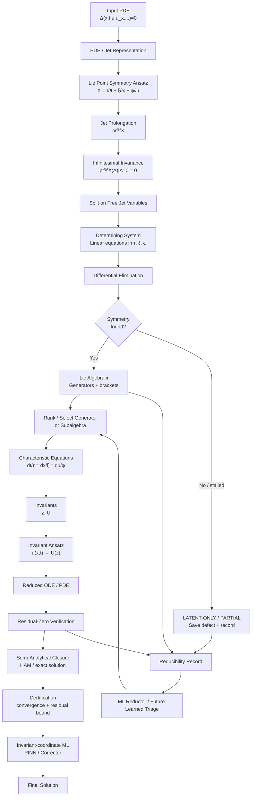
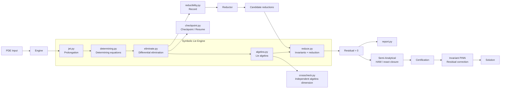
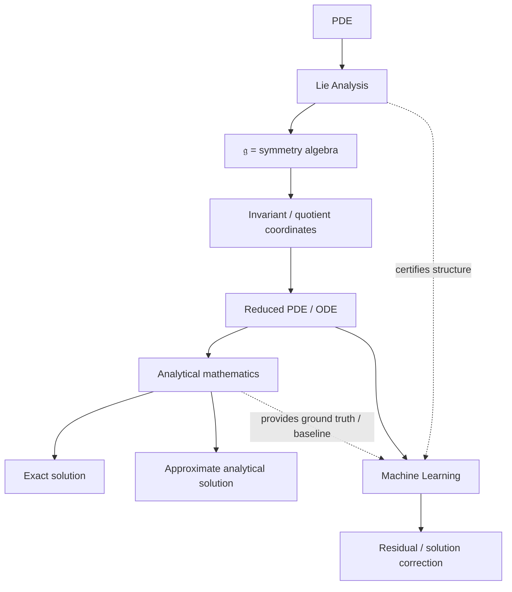
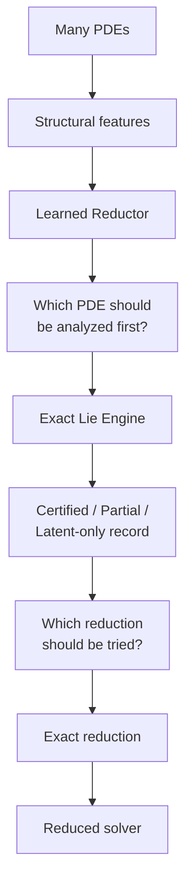
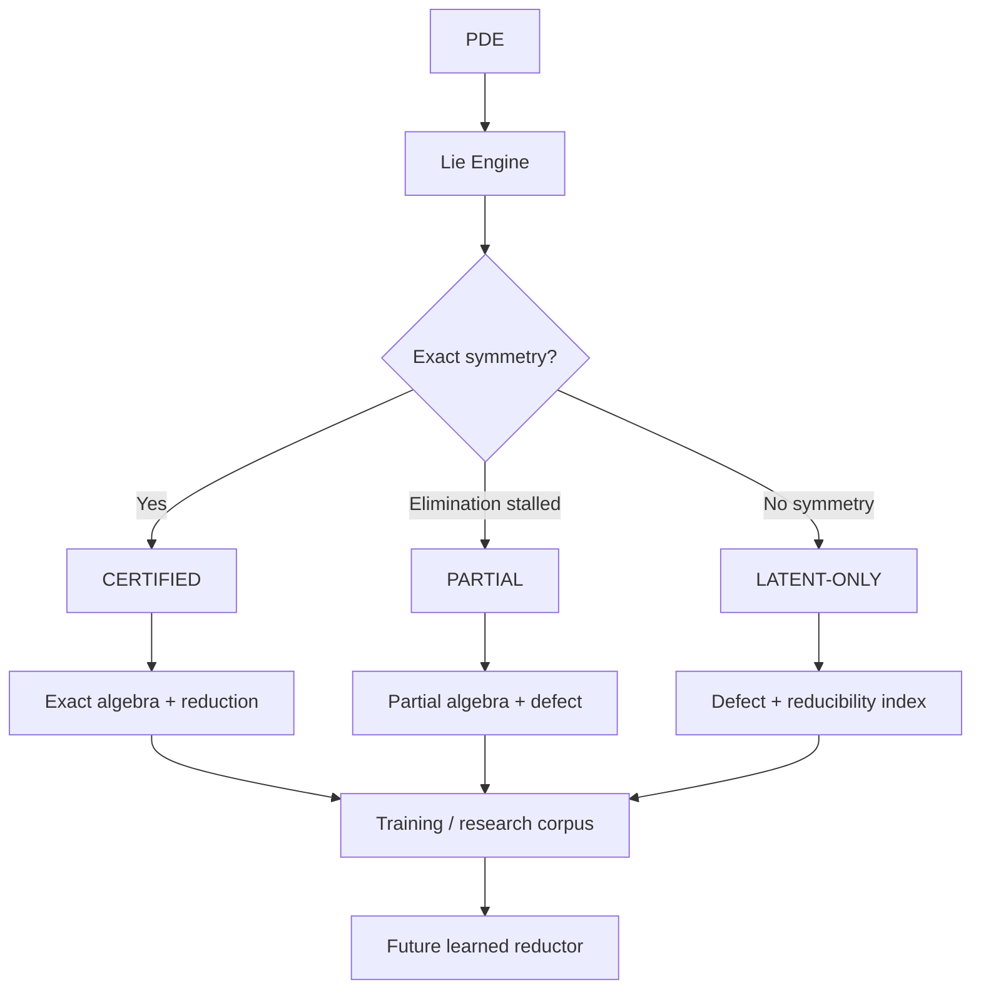
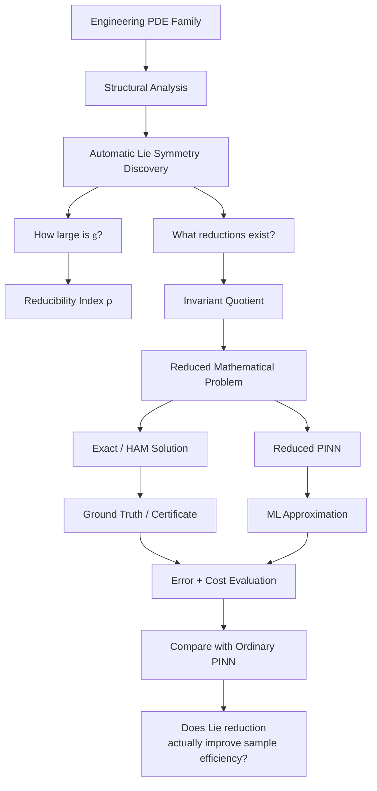
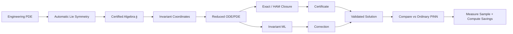

Yes. Based on the old `Lie-ML_PDES` specification, I would visualize the project as a **certified symbolic front-end feeding an ML back-end**, rather than as "a PINN with a Lie-symmetry loss."

## 1. Overall project flow



The essential conceptual flow is:

$$
\boxed{
\text{PDE}
\rightarrow
\text{Lie algebra}
\rightarrow
\text{invariants}
\rightarrow
\text{dimension reduction}
\rightarrow
\text{analytical closure}
\rightarrow
\text{ML correction}
}
$$

The old specification explicitly defines the engine's flow as PDE → determining system → iterative elimination/checkpointing → algebra → per-generator reduction → reducibility record → report. 

---

# 2. The engineering architecture

I would visualize the actual software architecture separately:



This corresponds quite closely to the old module design: `jet.py`, `determining.py`, `eliminate.py`, `algebra.py`, `reduce.py`, `reducibility.py`, `checkpoint.py`, `crosscheck.py`, `engine.py`, and `report.py`. 

---

# 3. The most important conceptual separation

I would actually put this diagram near the beginning of your project documentation:



This is important because your old proposal deliberately rejects the architecture

```text
PDE
 ↓
ordinary PINN
 +
symmetry loss
```

in favor of

```text
PDE
 ↓
Lie reduction
 ↓
smaller mathematical problem
 ↓
ML
```

The draft calls this **“symmetry as reduction, not bias.”** 

That distinction is probably the strongest conceptual feature of the project.

---

# 4. Where ML actually enters

The old specification has a surprisingly disciplined ML role.



The key rule is:

$$
\boxed{\text{ML may suggest; mathematics must verify.}}
$$

Your curriculum makes this particularly explicit: the machine should **not** decide whether a generator is valid. Validity is determined by

$$
\operatorname{pr}^{(k)}X(\Delta)\big|_{\Delta=0}=0.
$$

ML can instead help with decisions such as which PDE to analyze first, which subalgebra to prioritize, and which quotient coordinates to expose downstream. 

That is a very good research boundary.

---

# 5. The "failure is data" branch

One of the more unusual ideas in your old design deserves its own visualization:



This is conceptually strong.

Instead of

> "the solver failed"

you record

> "this PDE lies in a region of PDE space with low Lie reducibility."

The specification explicitly makes `LATENT-ONLY` a saved state rather than a discarded failure, so those examples can later become labelled data for the learned reductor. 

The draft summarizes the philosophy very well:

> **“Unsolvable becomes a coordinate, not a discard.”** 

I would keep that idea.

---

# 6. Suggested revised project flow

The old design is somewhat **engine-centric**. For a research paper, I would reorganize it around the scientific question:



And this gives you the **scientific hypothesis**:

$$
\boxed{
\text{Lie reduction lowers the effective complexity of PDE learning.}
}
$$

Then measure:

$$
\text{accuracy},\quad
N_{\text{collocation}},\quad
N_{\text{parameters}},\quad
T_{\text{training}},\quad
\text{OOD error}.
$$

Your old plan already proposed exact-solution comparisons and a Fisher–KPP end-to-end pipeline, which is the right direction. 

---

# 7. My suggestions for the old spec

### Suggestion 1 — Make the scientific hypothesis more prominent

The old project spends a lot of attention on the engine itself.

I would elevate:

$$
\boxed{
\textbf{Does symmetry reduction reduce the computational/sample complexity of PDE learning?}
}
$$

to the central research question.

The engine then becomes the **instrument** needed to test that question.

---

### Suggestion 2 — Separate three levels of claims

Use this hierarchy:

```text
LEVEL 1 — Mathematical correctness
    Does the engine find valid Lie symmetries?

LEVEL 2 — Reduction usefulness
    Does the symmetry actually reduce the PDE?

LEVEL 3 — ML advantage
    Does the reduced problem require less
    data/computation than an ordinary PINN?
```

Do not jump from Level 1 directly to Level 3.

---

### Suggestion 3 — Don't over-sell the reducibility index

Your specification correctly recognizes that

$$
\dim_D
$$

and algebra type are exact within the declared polynomial window, while

$$
\delta,\rho
$$

have metric/ansatz dependence. 

I would therefore present

$$
\boxed{\dim_D,\;\text{algebra type}}
$$

as the **mathematical backbone**, and

$$
\boxed{\delta,\rho}
$$

as **engineering diagnostics**.

That's more defensible.

---

### Suggestion 4 — Make the PDE benchmark ladder explicit

I would use:

$$
\boxed{
\text{Heat}
\rightarrow
\text{Fisher}
\rightarrow
\text{Burgers}
\rightarrow
\text{KdV}
\rightarrow
\text{Porous Medium}
\rightarrow
\text{Reaction-Diffusion System}
}
$$

with different purposes:

* **Heat:** infinite-dimensional symmetry stress test.
* **Fisher:** main end-to-end demonstration.
* **Burgers:** large algebra + nonlinear shock.
* **KdV:** third-order / soliton structure.
* **Porous medium:** scaling and parameter-dependent symmetry.
* **Reaction-diffusion:** transition toward real engineering systems.

This matches the application arc already present in your project plan. 

---

### Suggestion 5 — Treat Maple as an escape hatch, not the engine

Your old architecture's strongest feature is that the core engine is pure SymPy and independently testable.

Keep:

```text
Your engine
   ↓
exact low-order Lie computation
   ↓
certificate
```

and reserve:

```text
Hard PDE
   ↓
Maple / DifferentialGeometry / RIF / Rosenfeld-Gröbner
```

for completeness escalation.

That preserves the research contribution instead of turning the project into a Maple wrapper.

---

## The one-line version

If you eventually need a README-level visualization, I would use this:



**That is the project I think you should now present—not simply “a Lie symmetry engine,” but an automated pipeline for testing whether exact geometric reduction can make PDE learning cheaper and more reliable.**
