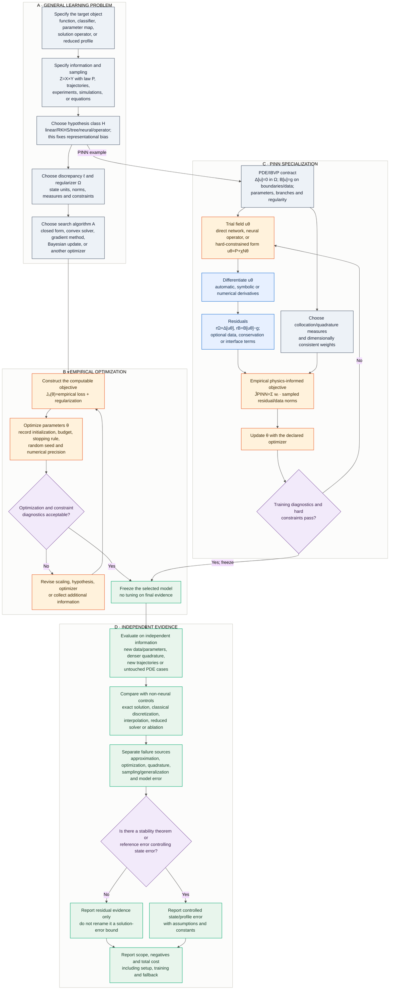

# Project map: certificate-gated Lie reduction and machine learning

The 19 October 2026 [autonomous run](../build/sve-autonomous-20261019/REPORT.md)
adds reviewed source/model checks, 29 symbolic configurations, original-system
numerics, and a completed negative 23-run neural assessment. See the canonical
[Lie reduction account](Lie_reduction.md) and the integrated manuscript.
Historical scalar execution uses the [hash-checked recovery adapter](../build/sve-autonomous-20261019/recovery/README.md);
the current reproduction entrypoint does not match its scalar release manifest.
This dated update supersedes the older deferral of profile-hybrid experiments.

**Writing order updated 2026-10-13.** Lead with the
[SVE replication](../research_artifacts/SVE-reproduced-20261012/README.md),
corrected ODE solutions and discoveries. Derive the infinitesimal point
generators from the master equation, then investigate ML-assisted ODE order
reduction through verified nontrivial first integrals or ODE symmetries.
The latter is a proposed research stage; existing neural profile fits do not
establish order reduction. The three interests are the Lagrange coordinate
option, parameter and distribution of symmetry-breaking, and trivial-symmetry
filtration. Hybrid structure design and conservation analogies are later work.
The detailed [revision contract](../research_artifacts/SVE-reproduced-20261012/SERIES_PLAN.md)
sets this order; the older evidence maps below remain useful records of the
completed mathematical and numerical infrastructure.

This document is the visual map for the LieML research program. It separates three objects that must not be conflated:

1. a **learned proposal**, which may rank or propose a symmetry candidate but proves nothing;
2. a **symbolically verified symmetry and reduction**, which supplies a local mathematical certificate under recorded branch and chart assumptions;
3. a **learned profile approximation**, which approximates an unresolved reduced object after the reduction has already been justified.

The diagrams are deliberately fail-closed. A timeout, exhausted search budget, failed chart, or failed numerical gate remains a recorded negative or unresolved result; it is never silently promoted to a theorem.

The primary reading path is [`../draft/main.tex`](../draft/main.tex), this map, and the current [experiment index](../research_artifacts/sve-progress-20261010/docs/EXPERIMENT_INDEX.md). From the repository root:

```bash
python scripts/project.py workflow --out build/workflow
python scripts/project.py data-flux --out build/data-flux
```

The first command produces the manuscript evidence report and workflow diagram. The second verifies the constructed common-scaling family with \(g=1,\kappa=1/30\), \(\phi/t=2,\phi_s=1/2,t\phi_{ss}=1/10\) on \(s/t=1\). Both retain the distinction between these verified scalar identities/data and unresolved arbitrary initial-boundary data or the full bed-field system.

## Notation contract

| Symbol | Meaning | What it may authorize |
|---|---|---|
| \(p\) | Number of independent variables in the original PDE system | The starting base dimension |
| \(V_k\) | Declared finite search space for generator coefficients | A finite-scope search only |
| \(\widehat d_k\) | Learned prediction of symmetry-space dimension in \(V_k\) | Search prioritization only |
| \(d_k=\dim\ker(A_\lambda|_{V_k})\) | Exact nullity after solving the full finite determining system in \(V_k\) | A result exact within \(V_k\), not maximal classification; a restricted proposal solve gives only verified generators or a lower bound |
| \(H\) | Verified local subgroup selected for reduction | Reduction only after closure, rank, chart, and data checks |
| \(\ell_H=\operatorname{rank}[\xi_a^{\,i}]\) | Constant rank of the subgroup's projection to the independent-variable base | The number of independent variables removed locally |
| \(d=p-\ell_H\) | Number of reduced independent variables | \(d=1\) means an ODE/DAE profile problem |
| \(\kappa_{\mathrm{obs}}\) | First certified order at which regular symmetry continuation is obstructed | The order of symmetry breaking in the declared category; the subscript avoids collision with physical parameters |
| \(N\) | Highest verified order of a formal approximate continuation | A defect statement \(O(\delta^{N+1})\), not exact persistence |

Two central identities have different logical roles:

\[
\underbrace{
\left.\operatorname{pr}^{(n)}X(\Delta_\lambda)\right|_{\mathcal E_\lambda}=0
}_{\text{equation symmetry: verified on the equation manifold}},
\qquad
\underbrace{
Q_X[\mathcal T_HF]=0
}_{\text{graph invariance: verified for the reconstructed ansatz}}.
\]

A learned \(\widehat d_k\) never authorizes reduction. Neither does \(d_k\) by itself. Reduction requires verified generators, a bracket-closed subgroup, constant projected orbit rank, an admissible local chart, compatible data, and a checked pullback of the original problem.

---

## Certified first-order obstruction and next gate

The project has closed one bounded research question and now separates that result from the remaining global and full-system analysis. Freeze the nondimensional printed scalar benchmark

\[
E_m[\phi]
=D_t\!\left(\phi_s\phi_{tt}-g\frac{\phi_{ss}}{\phi_s^2}\right)
-gm\kappa D_s\!\left(\phi_t^{m-1}\frac{\phi_{ts}}{\phi_s}\right)=0,
\qquad m=3+\delta,
\]

with fixed \(g,\kappa>0\) and \(\beta_{\rm tr}=m\kappa\). All displayed variables are nondimensional (bars are dropped); in particular
\(v:=\phi_t=(\partial_{t_{\rm phys}}\phi_{\rm phys})/U_*\). Work locally on the declared regular branch
\[
t>0,\qquad s>0,\qquad \phi_s>0,
\qquad v=\phi_t>0,
\]
This is a mathematical benchmark contract, not a claim that the printed scalar equation is already equivalent to the full physical SVE system. Because \(\phi_s>0\), the third-order equation is locally solvable for \(\phi_{ttt}\). For analytic coefficients and analytic data on a noncharacteristic initial slice, Olver's analytic normal-form result supplies local analytic solution germs and justifies splitting with respect to the remaining free jets. It does not establish global existence, smooth-data well-posedness, or shock-free continuation.

At \(\delta=0\), set
\[
X_0=X_5=t\partial_t-2s\partial_s,
\qquad M_0=-1,
\qquad \operatorname{pr}^{(3)}X_0(E_0)=M_0E_0.
\]
The tested regular point-symmetry continuation category permits the **unrestricted** first correction
\[
X_\delta=X_0+\delta Y_1+O(\delta^2),
\qquad
Y_1=\tau_1(t,s,\phi)\partial_t
     +\xi_1(t,s,\phi)\partial_s
     +\eta_1(t,s,\phi)\partial_\phi,
\]
and a smooth multiplier \(M_\delta=M_0+\delta M_1+O(\delta^2)\). (The symbol \(Y_1\) avoids collision with the source's translation generator named \(X_1\).) Expand the off-shell identity
\[
\operatorname{pr}^{(3)}X_\delta(E_\delta)=M_\delta E_\delta.
\]
Here
\[
E_\delta=E_0+\delta E_1+O(\delta^2),\qquad
E_1=-g\kappa D_s\!\left[H(1+3\log v)\right],
\qquad H=\phi_t^2\frac{\phi_{ts}}{\phi_s}.
\]
The decisive first-order problem is
\[
\boxed{
\mathcal D_0(Y_1,M_1)
:=\operatorname{pr}^{(3)}Y_1(E_0)-M_1E_0
=-\left(\operatorname{pr}^{(3)}X_0(E_1)-M_0E_1\right)
=-3g\kappa D_s\!\left(\phi_t^2\frac{\phi_{ts}}{\phi_s}\right).}
\]
It must be coefficient-split and differentially completed without first imposing a polynomial, affine, or diagonal-scaling form on \(\tau_1,\xi_1,\eta_1\). Equivalently, one may eliminate a regular leading jet and solve the full on-shell determining system, provided every division and branch is recorded.

The completed first-order methodology and its downstream gate are therefore
\[
\boxed{
\text{frozen PDE/branch}
\to\text{unrestricted first-order determining operator}
\to\text{exact compatibility or cokernel certificate}
\to\text{continued lift or certified obstruction}
\to\text{data/flux-compatible reduction}
\to\text{optional ML}.}
\]

### Claim/evidence/status ledger

| Claim | Evidence that can authorize it | Current status |
|---|---|---|
| \(X_5\) is admitted at \(m=3\) on the frozen scalar branch | Direct symbolic multiplier identity on the original third-order residual | **Exact: verified anchor** |
| The first-order lift fails in the diagonal-scaling class \(Y_1=a_1t\partial_t+b_1s\partial_s+c_1\phi\partial_\phi\) | Weight equations plus an independent prolonged-residual identity | **Exact in that restricted class** (`obstruction-verified-scaling`); retained as a historical cross-check |
| No unrestricted regular point correction \(Y_1\) exists | Define \(\mathrm{const}_1:=3g\kappa>0\); eliminate the regular leading jet, split the on-shell identity in free jets, and independently recover \([p^2q^2](q^3\partial_{\phi_{tss}}\Omega)=\mathrm{const}_1\) | **Certified at first order in the declared local smooth point category**; \(\kappa_{\mathrm{obs}}=1\) for both declared scalar models |
| An \(X_5\)-based near-cubic symmetry reduction is admissible | Exact continued or residual subgroup; bracket closure; constant projected rank; chart; PDE/constraint/data/boundary-flux pullbacks | **Not admitted:** the required regular first-order \(X_5\) lift is obstructed |
| The general-\(m\) common-scaling subgroup gives a local reduction | Exact multiplier identity; characteristic and differential consequences; projected orbit rank; invariant chart; direct PDE and scalar balance-law pullbacks | **Exact on the declared \(t,\phi_t,\phi_s>0\) chart**; the normalized-ray family below is verified separately from arbitrary initial-boundary-value data |
| The two declared scalar currents and boundary-covector fluxes pull back correctly | In \((T,z)=(t,s/t)\), Jacobian-weighted density \(tA\), flux \(J-(s/t)A\), and transformed divergence \(tE_m\); exact zero remainder for both models | **Exact for these scalar balance laws**; the boundary current is paired with \(dz\), without a metric unit-normal convention or arbitrary-data claim |
| Constructed normalized-ray data and flux are compatible | \(g=1,\kappa=1/30\); \(\phi/t=2,\phi_s=1/2,t\phi_{ss}=1/10\) on \(s/t=1\); \(\det D(t,s)/D(T,z)=T\); positive-\(z\) boundary current \(I_0/T\) | **Verified for both scalar models and symbolic real \(m\) on the recorded positive branch**; no arbitrary IBVP existence/uniqueness theorem |
| ML may approximate a reduced or correction object | The preceding exact gates plus a named unresolved object, classical control, held-out validation and total-cost accounting | **Deferred/downstream**; historical fixed-\(m=3\) runs are separate evidence |

### Completed bounded computation and next gate

The completed obstruction computation was deliberately limited to one perturbation order, the two declared scalar equations, the regular branch above, and local point generators. It does **not** include generalized/nonclassical symmetries, singular parameter dependence, profile training, a maximal classification, or a physical full-system claim.

1. The perturbation derivative, forcing, leading-jet elimination, and every division were recorded on the positive regular branch.
2. For arbitrary sufficiently smooth \(\tau_1,\xi_1,\eta_1\), free-jet splitting produced the nonzero coefficient \(\mathrm{const}_1:=3g\kappa>0\); no finite-dimensional ansatz was imposed.
3. A separate principal-symbol calculation reproduced the same coefficient for both the printed and advectively corrected scalar models.
4. The resulting exit is `obstruction-certified`, with \(\kappa_{\mathrm{obs}}=1\) in this declared category.

The scalar current/Jacobian, boundary-covector flux, and constructed normalized-ray data gates are complete. `data-flux` verifies both exact symbolic model paths and five negative controls. Separately, 12 classical cases pass the \(10^{-9}\) cross-solver/first-integral-drift gate (maximum \((F,F',F'')\) disagreement \(3.33\times10^{-15}\), drift \(1.80\times10^{-14}\)). Existing rational tube bounds certify only the reference family with \(g=1,\kappa=1/30,m\in[1,4],z\in[1,7/5]\); sampled diagnostics do not replace those bounds. Full bed-field, arbitrary-data, FS, global smoothness, shock, and weak-solution questions remain separate.

The fail-closed exit vocabulary remains:

| Exit | Required meaning | Research conclusion |
|---|---|---|
| `continued-first-order` | An unrestricted \((Y_1,M_1)\) passes direct exact substitution on every declared regular branch | First-order continuation only; order two remains open |
| `obstruction-certified` | A branch-complete exact compatibility/cokernel identity rules out the full smooth point correction | First obstruction certified at order one in the declared category |
| `branch-partial` | Only a restricted ansatz or a proper subset of regular branches was completed | Unresolved outside the completed scope |
| `backend-unavailable` | Required differential completion could not be executed or independently checked | Unresolved; absence of output is not obstruction |
| `inconsistent` | Independent derivations or direct substitution disagree | No theorem claim; repair the formulation or implementation |

A finite-ansatz failure, timeout, memory limit, or unavailable completion backend has conclusion **unresolved**. It must never be relabeled `obstruction-certified`. Only the first two exits permit movement along the theorem chain, and neither by itself authorizes reduction or ML.

---

## Chart 1. Complete paper methodology

This broader workflow contains the now-completed first-order obstruction as one instance; it is not a list of coequal current projects. The current path is the exact common-scaling reduction plus data/flux compatibility, while learning remains conditional on those certificates. The complete workflow contains three nested loops:

- an outer **proposal–verification loop** for symmetry discovery;
- an **order-adaptive continuation loop** for exceptional symmetries under parameter perturbation;
- an inner **profile-approximation loop** after a reduction or correction problem has been justified.

```mermaid
%%{init: {"theme":"base","themeVariables":{"fontFamily":"Segoe UI, Arial, sans-serif","primaryTextColor":"#0b0b0b","lineColor":"#52514e","clusterBkg":"#fcfcfb","clusterBorder":"#c3c2b7"},"flowchart":{"curve":"basis","nodeSpacing":22,"rankSpacing":32,"htmlLabels":true}}}%%
flowchart TB

  subgraph P0["0 · PROBLEM AND CLAIM CONTRACT"]
    direction TB
    A0["Specify Pλ completely<br/>Δλ=0; constraints; parameters; domain;<br/>data, BC and flux; function spaces"]
    A1["Fix the claim category<br/>point/contact/nonclassical; local/global;<br/>exact/approximate; equivalence rules"]
    A2["Declare regular branches and parameter paths<br/>λ=λ₀+δv; generic and exceptional strata"]
    A0 --> A1 --> A2
  end

  subgraph P1["I · SYMMETRY DISCOVERY — ML PROPOSES; EXACT IDENTITIES CERTIFY"]
    direction TB
    B0["Derive the full determining PDE<br/>DλX=0 without dividing away branch factors"]
    B1["Choose a finite search scope Vₖ<br/>basis, normalization and gauge convention"]
    B2["Learned proposal from cheap canonical features<br/>predict d̂ₖ, a subspace/projector,<br/>candidate generators and confidence"]
    B3["Restricted exact solve in the proposed scope<br/>ML output is only a search heuristic"]
    B4["Exact solve in all of Vₖ<br/>label generator, audit baseline or fallback"]
    B5["Candidate queue with provenance<br/>scope, parameter stratum and guards"]
    B6["Direct symbolic test on the original PDE<br/>pr⁽ⁿ⁾X(Δλ)=0 on the regular equation manifold"]
    B7{"Candidate status?"}
    B8["Verified-generator registry<br/>identity, assumptions and parameter branch"]
    B9["Rejected candidate<br/>retain the failed identity or counterexample"]
    B10["Unresolved candidate<br/>retain the missing computation"]
    B11{"Expand exact search within budget?"}
    B12["Increase k, change ansatz, or escalate to<br/>formal completion / an independent exact CAS"]
    B13["Incomplete-discovery certificate<br/>verified subset only; no maximality claim"]
    B14["Build the verified algebra<br/>remove dependence; compute and verify brackets"]
    B15["Count ledger<br/>d̂ₖ is learned; dₖ=dim ker(Aλ restricted to Vₖ)<br/>only after a full exact Vₖ solve; otherwise record a verified lower bound"]

    B0 --> B1
    B1 --> B2 --> B3
    B1 --> B4
    B3 --> B5
    B4 --> B5
    B5 --> B6 --> B7
    B7 -->|Verified| B8 --> B14
    B7 -->|Rejected| B9 --> B11
    B7 -->|Unresolved| B10 --> B11
    B11 -->|Yes| B12 --> B1
    B11 -->|No| B13 -->|carry only verified generators| B14
    B14 --> B15
    B8 -. exact labels and negatives .-> B2
  end

  A2 --> B0

  subgraph P2["II · ORDER-ADAPTIVE CONTINUATION / OBSTRUCTION"]
    direction TB
    C0{"Exceptional generator X₀ and<br/>symmetry-breaking parameter direction selected?"}
    C1["Expand Dδ=ΣδʳDᵣ and Xδ=ΣδʲXⱼ<br/>within the declared symmetry category"]
    C2["Initialize j=1; choose a normalization<br/>but retain all lower-order homogeneous freedom<br/>that may affect later compatibility"]
    C3["Form bⱼ=−Σ from r=1 to j of DᵣXⱼ₋ᵣ<br/>using the full admissible family of earlier lifts"]
    C4["Solve the unrestricted order-j equation<br/>D₀Xⱼ=bⱼ jointly with remaining lift parameters;<br/>complete the differential system and preserve branches"]
    C5{"Order-j status?"}
    C6["Verify the truncated identity directly<br/>DδXδ^[j]=O(δʲ⁺¹)"]
    C7{"Continue the hierarchy?"}
    C8["Certified first obstruction κ_obs=j<br/>an explicit incompatibility identity;<br/>no regular continuation in this category"]
    C9["Continuation unresolved at order j<br/>resource failure is not an obstruction"]
    C10["Set j←j+1"]
    C11["Continuation ledger<br/>exact / through N / obstructed at κ_obs / unresolved;<br/>record residual algebra and broken forcing"]
    C12["Formal continuation through N<br/>defect O(δᴺ⁺¹); no exact-persistence claim"]
    C13["Exact parameter-dependent generator<br/>proved separately and directly verified"]

    C0 -->|Yes| C1 --> C2 --> C3 --> C4 --> C5
    C5 -->|Lift exists| C6 --> C7
    C5 -->|Obstruction certified| C8 --> C11
    C5 -->|Unresolved| C9 --> C11
    C7 -->|Next order| C10 --> C3
    C7 -->|Stop at declared N| C12 --> C11
    C7 -->|Exact family proved separately| C13 --> C11
  end

  B14 --> C0

  subgraph P3["III-A · EXACT SYMBOLIC REDUCTION"]
    direction TB
    D0["Select exact subgroup H from the verified algebra<br/>normally the residual subgroup after breaking"]
    D1["Verify projectability, closure and projected distribution ΞH=[ξₐⁱ]<br/>constant rank, domain, data, BC and flux compatibility"]
    D2{"Exact subgroup and projected orbits<br/>admissible on a regular chart?"}
    D3{"Another exact subgroup or chart?"}
    D4["Construct orbit coordinates y and invariants (z,v)<br/>give local inverse, Jacobian and nonzero guards"]
    D5["Invariant-solution ansatz u=T_HF<br/>verify Q_X[T_HF]=0 for every X in H"]
    D6["Pull back every jet, equation, constraint and datum<br/>including measure and boundary-flux factors"]
    D7{"Exact factorization / equivalence and<br/>data compatibility verified?"}
    D8["Compute projected orbit rank ℓ_H<br/>and reduced dimension d=p−ℓ_H"]
    D9["ℓ_H=0: no base-variable reduction<br/>a vertical symmetry may still constrain fields"]
    D10["No exact reduction available<br/>retain the original PDE and exact negative record"]

    C0 -->|No continuation question| D0
    C11 -->|use exact residual algebra| D0
    D0 --> D1 --> D2
    D2 -->|Yes| D4 --> D5 --> D6 --> D7
    D2 -->|No| D3
    D7 -->|No| D3
    D3 -->|Yes| D0
    D3 -->|No| D10
    D7 -->|Yes| D8
    D8 -->|ℓ_H=0| D9 --> D10
  end

  subgraph P4["III-B · DEFECT-CONTROLLED PERTURBATIVE ANSATZ — NOT AN EXACT QUOTIENT"]
    direction TB
    DA0["Take a verified truncation Xδ^[N]<br/>from the continuation ledger"]
    DA1["Construct candidate approximate invariants<br/>and reconstruction Tδ^[N] order by order"]
    DA2["Directly verify all defects<br/>Q=O(δᴺ⁺¹); PDE pullback defect;<br/>data, BC, flux and branch defects"]
    DA3{"Every stated defect bound verified<br/>on the declared parameter neighborhood?"}
    DA4["Perturbative reduced/correction problem<br/>with explicit O(δᴺ⁺¹) remainder"]
    DA5["Reject perturbative reduction<br/>use the exact residual subgroup or original PDE"]

    C11 -->|formal continuation through N| DA0 --> DA1 --> DA2 --> DA3
    DA3 -->|Yes| DA4
    DA3 -->|No| DA5
    C11 -->|obstructed or unresolved| DA5
    DA5 --> D0
  end

  subgraph P5["IV · ANALYSIS AND OPTIONAL NEURAL APPROXIMATION"]
    direction TB
    E0["d=0: algebraic / consistency system"]
    E1["d=1: reduced ODE/DAE system"]
    E2["2≤d&lt;p: lower-dimensional PDE/DAE system"]
    E3["Analytical front end<br/>normal form; existence; first integrals;<br/>singularities; conditioning; exact profiles/series; hard data lift"]
    E4["Independent classical reference/control<br/>on the reduced or original problem"]
    E5{"After analytical and classical controls,<br/>is a learned unresolved object justified?"}
    E6["ML omitted<br/>retain the analytical/classical candidate and cost"]
    E7["Reduced-profile approximation<br/>Fθ=P_N+χ_NNθ; exact H-graph invariance<br/>comes from reconstruction, not a soft loss"]
    E8["Broken-direction correction<br/>preserve only the exact residual subgroup;<br/>do not impose the broken parent symmetry"]
    E9["Reduced objective<br/>reduced residual + remaining data + transformed measure"]
    E10["Correction objective<br/>declared defect/original residual + exact-subgroup constraints"]
    E11["Freeze a reduced or correction candidate<br/>and map it to the original variables;<br/>differentiate that map independently"]
    E12["Direct-PDE PINN/operator comparator<br/>no symmetry-reduction claim"]
    E13["Original-coordinate classical candidate<br/>no reconstruction or symmetry-reduction claim"]

    D8 -->|d=0| E0 --> E3
    D8 -->|d=1| E1 --> E3
    D8 -->|2≤d&lt;p| E2 --> E3
    DA4 --> E3
    D10 --> E13
    D10 --> E12
    E3 --> E4
    E3 --> E5
    E5 -->|No| E6 --> E11
    E5 -->|Invariant profile remainder| E7 --> E9
    E9 -->|update θ| E7
    E9 -->|freeze at declared stopping rule| E11
    E5 -->|Symmetry-breaking correction| E8 --> E10
    C11 -. certified forcing / obstruction .-> E8
    E10 -->|update θ| E8
    E10 -->|freeze at declared stopping rule| E11
    E4 --> E11
  end

  subgraph P6["V · INDEPENDENT ORIGINAL-PROBLEM VALIDATION"]
    direction TB
    F0["Validate on the original problem<br/>PDE + constraints + data/BC/flux + branch guards;<br/>conservation; reference error; lift consistency; total cost"]
    F1{"All declared mathematical, numerical<br/>and evidence gates pass?"}
    F2{"Diagnose the failed layer"}
    F3["Final evidence package<br/>coverage; Vₖ and dₖ; discovery status;<br/>κ_obs or N; H, ℓ_H and d; defects/errors;<br/>guards, negatives, artifacts and total cost"]

    E11 --> F0
    E12 --> F0
    E13 --> F0
    F0 --> F1
    F1 -->|Yes| F3
    F1 -->|No| F2
    F2 -->|Approximation / optimization| E7
    F2 -->|Broken correction| E8
    F2 -->|Analysis / conditioning| E3
    F2 -->|Chart / data| D3
    F2 -->|Missing symmetry| B11
    F2 -->|Problem / source model| A0
  end

  classDef specification fill:#edf2f7,stroke:#475569,color:#172033,stroke-width:1.2px;
  classDef learned fill:#fff2dc,stroke:#eb6834,color:#402600,stroke-width:1.4px;
  classDef symbolic fill:#e7f0ff,stroke:#2a78d6,color:#102b50,stroke-width:1.4px;
  classDef analysis fill:#e8f5ec,stroke:#1baf7a,color:#163c27,stroke-width:1.4px;
  classDef decision fill:#f2eafa,stroke:#8054a1,color:#39204c,stroke-width:1.2px;
  classDef record fill:#f7f7f5,stroke:#898781,color:#292824,stroke-width:1.2px;
  classDef failure fill:#fff1f1,stroke:#d03b3b,color:#501919,stroke-width:1.2px;

  class A0,A1,A2,D10,F3 specification;
  class B2,E7,E8,E9,E10,E12 learned;
  class B0,B1,B3,B4,B5,B6,B8,B12,B14,B15,C1,C2,C3,C4,C6,C8,C10,C11,C12,C13,D0,D1,D4,D5,D6,D8,DA0,DA1,DA2,DA4,E11 symbolic;
  class E0,E1,E2,E3,E4,E6,E13,F0 analysis;
  class B7,B11,C0,C5,C7,D2,D3,D7,DA3,E5,F1,F2 decision;
  class B10,B13,C9 record;
  class B9,DA5 failure;
```



**Figure 1. Certificate-gated, order-adaptive Lie reduction and neural approximation.** Orange nodes are learned computations, blue nodes are exact symbolic or identity-checking computations, and green nodes are analytical or independent validation computations. The learned symmetry stage may propose a finite-scope count or candidate subspace; it never certifies a generator. Exact reduction uses only an exact verified subgroup. A truncated approximate symmetry enters a separate defect-controlled branch and never masquerades as an exact quotient. The inner neural loop begins only after analytical and classical controls identify a genuinely unresolved object.

### What Figure 1 claims—and does not claim

- A finite-scope result \(d_k\) is exact only after the full determining problem in the declared \(V_k\) has been solved; a restricted proposal solve does not determine \(d_k\).
- Exhausting a budget yields **incomplete discovery**, not “no symmetry.”
- A certified obstruction at order \(\kappa_{\mathrm{obs}}\) is different from an unresolved determining system.
- Formal continuation through order \(N\) gives an \(O(\delta^{N+1})\) defect statement, not an exact group action.
- Only the projected orbit rank \(\ell_H\), not \(\dim H\) and not \(d_k\), determines the number of reduced independent variables.
- A small residual is not automatically a state-error certificate; an appropriate stability estimate is required.

---

## Chart 2. Mathematical principle of machine learning, with PINN as an example

Machine learning is a choice of observation space, hypothesis class, objective, regularization, and search algorithm, followed by evidence on information not used to choose the parameters. A PINN is one specialization in which differential equations supply part of the training signal.



**Figure 2. Machine learning as specification, empirical optimization, and independent evidence; PINN as one specialization.** A neural network is not logically necessary for machine learning. In the PINN branch, the differential equation determines residual terms, but collocation, quadrature, weighting, architecture, and optimization remain approximation choices. The model is frozen before final validation. A small sampled PDE residual is reported as residual evidence unless a stability argument or reference solution turns it into a state-error statement.

For a PINN, a typical continuous objective is

\[
J(\theta)=
 w_\Omega\|\Delta[u_\theta]\|_{L^2(\mu_\Omega)}^2
 +w_{\partial}\|B[u_\theta]-g\|_{L^2(\mu_{\partial})}^2
 +w_D\|u_\theta-u_D\|_{L^2(\mu_D)}^2
 +\lambda\Omega(\theta),
\]

while training actually minimizes a quadrature or Monte Carlo approximation \(\widehat J(\theta)\). These are not identical objects. The gap between them is part of the quadrature/generalization error.

---

## Chart 3. Principle of Lie symmetry reduction

This chart separates the **group action**, the **generator-search ansatz**, the **invariant-solution ansatz**, and the later **profile-approximation ansatz**.

```mermaid
%%{init: {"theme":"base","themeVariables":{"fontFamily":"Segoe UI, Arial, sans-serif","primaryTextColor":"#0b0b0b","lineColor":"#52514e","clusterBkg":"#fcfcfb","clusterBorder":"#c3c2b7"},"flowchart":{"curve":"basis","nodeSpacing":24,"rankSpacing":34,"htmlLabels":true}}}%%
flowchart TB

  subgraph L0["A · EQUATION AND LOCAL GROUP ACTION"]
    direction TB
    A0["PDE/IBVP system<br/>Δα(x,u⁽ⁿ⁾;λ)=0 with constraints,<br/>domain, data and branch guards"]
    A1["Local group action<br/>gε:(x,u)↦(x̃(x,u;ε),ũ(x,u;ε))"]
    A2["Infinitesimal generator<br/>X=ξⁱ(x,u)∂xⁱ+φα(x,u)∂uα<br/>with local flow gε=exp(εX)"]
    A3["Prolong the action to jets<br/>pr⁽ⁿ⁾X acts on x,u and derivatives through order n"]
    A4["Equation-symmetry condition<br/>pr⁽ⁿ⁾X(Δ)=0 on the equation manifold<br/>or a verified multiplier identity prX(Δ)=MΔ"]
    A0 --> A1 --> A2 --> A3 --> A4
  end

  subgraph L1["B · HOW THE GENERATOR IS FOUND"]
    direction TB
    B0{"Discovery mode"}
    B1["Unrestricted determining PDE<br/>solve for the coefficient functions ξ and φ"]
    B2["Generator-search ansatz<br/>choose Vₖ=span{B₁,…,B_N};<br/>X_c=Σ cⱼBⱼ"]
    B3["Substitute and split on free jets/monomials<br/>obtain Aλc=0 with all branch factors retained"]
    B4["Exact finite-scope kernel<br/>ker(Aλ restricted to Vₖ); exact only within Vₖ"]
    B5["Directly verify every candidate<br/>in the original prolonged PDE identity"]
    B6{"Verified?"}
    B7["Verified local Lie algebra 𝔤λ<br/>basis, brackets, parameter strata and guards"]
    B8["Reject or mark unresolved<br/>do not infer absence outside Vₖ"]

    A4 --> B0
    B0 -->|Full functional solve| B1 --> B5
    B0 -->|Finite ansatz| B2 --> B3 --> B4 --> B5
    B5 --> B6
    B6 -->|Yes| B7
    B6 -->|No / incomplete| B8
  end

  subgraph L2["C · SUBGROUP, ORBITS AND INVARIANT ANSATZ"]
    direction TB
    C0["Choose a local subgroup H whose Lie algebra<br/>h⊂gλ is bracket-closed and compatible with domain and data"]
    C1["Verify projectability and project generators to the base<br/>ΞH=[ξₐⁱ]; verify constant rank ℓ_H"]
    C2{"Regular projected orbit chart exists?"}
    C3["Integrate the regular subgroup distribution<br/>solve Xₐ(zᴬ)=0 for invariants;<br/>choose local orbit coordinates y and dependent invariants v"]
    C4["Check functional independence and inverse map<br/>determinants, isotropy, denominators and signs"]
    C5["Invariant-solution ansatz<br/>u=T_H[F](x), where F depends on z only"]
    C6["Graph-invariance check<br/>Q_X[T_HF]=φα−ξⁱuᵅ_i=0 for every X in H"]
    C7["No admissible exact reduction with this H<br/>choose another subgroup/chart or retain original PDE"]

    B7 --> C0 --> C1 --> C2
    C2 -->|Yes| C3 --> C4 --> C5 --> C6
    C2 -->|No| C7
  end

  subgraph L3["D · PULLBACK AND DIMENSION REDUCTION"]
    direction TB
    D0["Pull back all jets by the chain rule<br/>and transform equations, constraints, data,<br/>measures and boundary fluxes"]
    D1["Verify exact factorization/equivalence<br/>Δ[T_HF]=P_H · R_H[F]<br/>with declared nonzero factors and guards"]
    D2{"Pullback, branch and data checks pass?"}
    D3["Reduced base dimension<br/>d=p−ℓ_H"]
    D4["d=0<br/>algebraic / consistency conditions"]
    D5["d=1<br/>ODE/DAE profile problem"]
    D6["2≤d&lt;p<br/>lower-dimensional PDE/DAE"]
    D7["Reduction rejected or unresolved<br/>the candidate ansatz is not a certificate"]
    D8["d=p because ℓ_H=0<br/>no independent-variable reduction;<br/>record any vertical field constraint separately"]

    C6 --> D0 --> D1 --> D2
    D2 -->|Yes| D3
    D2 -->|No| D7
    D3 -->|d=0| D4
    D3 -->|d=1| D5
    D3 -->|2≤d&lt;p| D6
    D3 -->|d=p| D8
  end

  subgraph L4["E · ANALYSIS, APPROXIMATION AND RECONSTRUCTION"]
    direction TB
    E0["Analyze the reduced problem first<br/>normal form, existence, first integrals,<br/>singularities, conditioning and exact solutions"]
    E1["Classical numerical approximation<br/>ODE/PDE solver with convergence and refinement checks"]
    E2["Semi-analytical approximation<br/>local series, Padé, HAM/ADM or transforms<br/>only under method-specific validity conditions"]
    E3["Profile-approximation ansatz<br/>Fθ=P_N+χ_NNθ or another declared trial class"]
    E4["Reduced residual/data optimization<br/>the network approximates F; it does not certify H"]
    E5["Reconstruct original variables<br/>ũ=T_H[F̃] and differentiate the reconstruction"]
    E6["Independent original-PDE verification<br/>equations, data, guards, conservation and reference error"]
    E7{"Declared gates pass?"}
    E8["Report local invariant solution<br/>scope, chart, errors, guards and cost"]
    E9["Return to analysis, approximation,<br/>subgroup or original problem"]

    D4 --> E0
    D5 --> E0
    D6 --> E0
    D8 --> E9
    E0 --> E1
    E0 --> E2
    E0 --> E3 --> E4
    E1 --> E5
    E2 --> E5
    E4 --> E5
    E5 --> E6 --> E7
    E7 -->|Yes| E8
    E7 -->|No| E9
    E9 --> E0
    E9 --> C0
  end

  classDef specification fill:#edf2f7,stroke:#475569,color:#172033,stroke-width:1.2px;
  classDef learned fill:#fff2dc,stroke:#eb6834,color:#402600,stroke-width:1.4px;
  classDef symbolic fill:#e7f0ff,stroke:#2a78d6,color:#102b50,stroke-width:1.4px;
  classDef analysis fill:#e8f5ec,stroke:#1baf7a,color:#163c27,stroke-width:1.4px;
  classDef decision fill:#f2eafa,stroke:#8054a1,color:#39204c,stroke-width:1.2px;
  classDef failure fill:#fff1f1,stroke:#d03b3b,color:#501919,stroke-width:1.2px;

  class A0,A1,C7,D7,D8 specification;
  class E3,E4 learned;
  class A2,A3,A4,B1,B2,B3,B4,B5,B7,C0,C1,C3,C4,C5,C6,D0,D1,D3,E5 symbolic;
  class E0,E1,E2,E6,E8 analysis;
  class B0,B6,C2,D2,E7 decision;
  class B8,E9 failure;
```



**Figure 3. Local Lie point-symmetry reduction from group action to verified reconstruction.** The group acts first on variables and then, by prolongation, on jets. A finite generator ansatz converts the determining PDE to a finite kernel problem but limits discovery to \(V_k\). After direct verification, a local subgroup is selected through its bracket-closed Lie algebra. Its projected orbit rank \(\ell_H\)—not the number of algebra generators—determines the base-dimension reduction. The invariant-solution ansatz is exact on the certified chart. Numerical, semi-analytical, and neural profile approximations occur only after the reduced equation has been independently obtained.

### The three ansätze

| Ansatz | Formula | Purpose | Logical limitation |
|---|---|---|---|
| Generator-search ansatz | \(X_c=\sum_{j=1}^N c_jB_j\in V_k\) | Make the determining problem finite | Can miss symmetries outside \(V_k\) |
| Invariant-solution ansatz | \(u=\mathcal T_HF\), with \(Q_X[u]=0\) for \(X\in\mathfrak h\) | Parameterize local \(H\)-invariant solution graphs | Describes a special solution class, not generic data |
| Profile-approximation ansatz | \(F_\theta=P_N+\chi_NN_\theta\) | Approximate the unresolved reduced profile while preserving chosen data jets | Does not prove that \(X\) is a symmetry or that the reduction is valid |

---

## Logical interfaces among the three charts

The project is not

\[
\text{PDE}\longrightarrow\text{ordinary PINN}+\text{symmetry penalty}.
\]

Its preferred exact branch is

\[
\boxed{
\text{problem contract}
\longrightarrow
\text{verified symmetry}
\longrightarrow
\text{admissible invariant chart}
\longrightarrow
\text{verified reduced problem}
\longrightarrow
\text{analysis/classical controls}
\longrightarrow
\text{optional learned profile}
\longrightarrow
\text{original-problem validation}.
}
\]

The parameter-breaking branch adds

\[
\text{exceptional generator}
\longrightarrow
\text{order-by-order continuation equations}
\longrightarrow
\begin{cases}
\text{first certified obstruction order }\kappa_{\mathrm{obs}},\\
\text{or a verified truncation through order }N,
\end{cases}
\]

and then either uses the exact residual subgroup or a separately verified defect-controlled perturbative ansatz. It does not hard-impose a broken parent symmetry.

## Project evidence boundary

- The current executable reducer verifies a **supplied projectable one-generator chart**; it does not compute a maximal symmetry classification. See [`pde_formalization_and_reduction.md`](pde_formalization_and_reduction.md).
- Existing fixed-\(m=3\) Lie/ML results and their negative controls are historical evidence, not results of the new prospective experiment. See [archive details](archive.md).
- The near-cubic program has \(\kappa_{\mathrm{obs}}=1\) for arbitrary sufficiently smooth local point corrections in the two declared scalar models. This is not a maximal classification and says nothing about singular parameter dependence, FS, generalized symmetries, the full bed-field system, or global/weak solutions. See [`../checklist.md`](../checklist.md).
- The current scalar certificates include \(Q_c\), its order-two differential consequences, both orbit ranks, chart Jacobians, both independent obstruction derivations, scalar density/current/boundary-covector pullbacks, and compatible normalized-ray data for the constructed family. This completed compatibility gate is not a general IBVP theorem.
- The broad claims in [archive details](archive.md) are not used as theorem statements here; that document still requires a separate corrected edition.

---

## General continuation framework

The completed first-order contract above is the paper's first concrete instance of the following order-adaptive framework. For a declared parameter path \(\lambda(\delta)=\lambda_0+\delta v\), write

\[
\mathcal D_\delta
=\mathcal D_0+\delta\mathcal D_1+\delta^2\mathcal D_2+\cdots,
\qquad
X_\delta=X_0+\delta X_1+\delta^2X_2+\cdots .
\]

Matching coefficients gives the hierarchy

\[
\mathcal D_0X_0=0,
\qquad
\mathcal D_0X_j
=-\sum_{r=1}^{j}\mathcal D_rX_{j-r}
\quad (j\geq1).
\]

The order-\(j\) problem must be solved with all lower-order homogeneous freedom that can affect compatibility. If the order-\(j\) equation is incompatible after differential completion, then

\[
\kappa_{\mathrm{obs}}(X_0;v)
=
\min\{j\geq1:\text{the order-}j\text{ continuation equation is incompatible}\}
\]

is the first certified obstruction order in the declared symmetry category. Failure of a finite ansatz, timeout, or unavailable completion backend is **unresolved**, not an obstruction. If order one fails, no choice of \(X_2\) can cancel its \(O(\delta)\) defect; if order one passes, order two remains a new compatibility test.

For the near-cubic benchmark, the front-matter first-order problem has exited with \(\kappa_{\mathrm{obs}}=1\) in the declared local smooth point category. The earlier diagonal-scaling calculation remains only an independent restricted cross-check. The reusable approximate-symmetry benchmark is supporting infrastructure; real-world shallow-water demonstrations, the full bed-field system, and global analysis are validation or follow-on studies. None enlarges the scope of the certified local obstruction.

## Four symmetry questions that must remain separate

Let a regular small-parameter PDE be

\[
F_\varepsilon[u]
=F_0[u]+\varepsilon F_1[u]+o(\varepsilon).
\]

The following methods do not return interchangeable certificates.

| Object | Construction | Question answered | Certificate and limitation |
|---|---|---|---|
| Exact admitted symmetry | Solve and directly verify \(\operatorname{pr}X(F_\varepsilon)=0\) on the exact equation manifold | Which transformations map exact solutions of this fixed equation to exact solutions? | May authorize exact local reduction only after subgroup, rank, chart, and data checks |
| BGI approximate symmetry | Expand the generator, \(X_\varepsilon=X_0+\varepsilon X_1+\cdots\), and require invariance modulo the stated order | Does an exact symmetry \(X_0\) of \(F_0\) occur as the leading part of a BGI approximate symmetry of the perturbed equation? | Existence of such a lift makes \(X_0\) BGI-stable; the correction \(X_1\) need not be nonzero. A generator \(\varepsilon X_1\) with \(X_0=0\) is a trivial BGI approximate symmetry when \(X_1\) is an exact symmetry of \(F_0\). It is not an exact quotient |
| FS approximate symmetry | Expand the field, \(u=v+\varepsilon w+o(\varepsilon)\), form \(G_1[v]=F_0[v]=0\) and \(G_2[v,w]=DF_0[v]w+F_1[v]=0\), then compute exact symmetries of the triangular system | What exact Lie symmetries does the coefficient system for \((v,w)\) possess? | Genuine FS generators may mix \(v\) and \(w\) and need not have BGI counterparts |
| Nearby-equation approximate algebra | Define approximate invariance by the existence of a nearby equation \(\widetilde F\) with an exact algebra; computationally apply SVD and approximate involutive completion to prolonged determining-system matrices | Does the determining system locally support a reliable nearby Lie-algebra inference? | Depends on base point, norm, tolerance, completion, closure, and Jacobi checks. The reported algorithm does not reconstruct \(\widetilde F\), and a good algebra fit at loose tolerance does not prove that a sufficiently close nearby equation exists |

Tarayrah, Pitzel, and Cheviakov show that BGI and FS classifications can differ for PDEs; the project must not collapse them into one label such as “approximate symmetry found.” Deng and Reid instead define approximate symmetry through exact symmetry of a nearby equation. Their local method samples base points on a grid and partitions the base space into regions with different locally stable approximate algebra types, separated by unstable transition regions. Such regions record where the numerical algebra inference is stable; they do not create a new “loose-form PDE.”

The regular-perturbation track also excludes cases in which the small parameter changes the highest differential order or PDE type. Such singular perturbations require their own asymptotic and numerical contract. In particular, a probe in which \(\varepsilon\) multiplies the highest derivative is not, without further work, a regular BGI certificate.

A benchmark must consequently keep algebraic and solution evidence in two tracks:

\[
\begin{aligned}
E_{\mathrm{inv}}^{\mathrm{exact}}
&=\|\operatorname{pr}X(F)\|_{\mathcal E},\\
E_{\mathrm{BGI}}^{(1)}
&=\left\|
\left.[\varepsilon]\bigl(\operatorname{pr}X_\varepsilon F_\varepsilon
-M_\varepsilon F_\varepsilon\bigr)\right|_{\mathcal E_0}
\right\|,\\
E_{\mathrm{FS}}
&=\|\operatorname{pr}Z(G_1,G_2)\|_{\{G_1=G_2=0\}},\\
E_{\mathrm{sol}}(\varepsilon,T)
&=\|u_{\mathrm{approx}}-u_{\mathrm{reference}}\|.
\end{aligned}
\]

The first three assess different symmetry objects. The last assesses a solution approximation. No scalar “overall winner” may hide a poor algebraic certificate behind good solution error, or vice versa.

## Staged target ladder

The program advances by increasing both physical structure and algebraic difficulty. Here \(1+1\) means one spatial coordinate plus time, and \(2+1\) means two horizontal coordinates plus time. A multilayer model may still be \(2+1\): the layer index is discrete internal structure, not a third spatial coordinate.

| Stage | Target and role | Mathematical gate | Physical/numerical evidence gate | ML role |
|---|---|---|---|---|
| 0. Exact controls | Heat/wave-type linear homogeneous IBVPs and simple nonlinear PDE controls | Known exact algebra, chart, and reconstructed solution family | Analytical solution or converged classical reference | Reproduce a control; LieSolver-style symmetry bricks are relevant only in their stated linear homogeneous scope |
| 1. \(1+1\) fixed-bed Saint--Venant | Smooth shallow-water balance law before mobile sediment | Full point determining system on declared branches; data-compatible subgroups; reduction and reconstruction | Physically dimensioned parameters, conservation and refinement; later an analytical runup control such as Carrier--Greenspan | Compare direct and reduced solvers after exact certification |
| 2. \(1+1\) Saint--Venant--Exner | Coupled flow and bed evolution; the immediate physical family | Closure and bed-variable audit; exceptional strata; unrestricted continuation/obstruction; flux-compatible reduction | Mobile-bed laboratory data or transparent digitization, solver convergence, closure uncertainty and identifiability | Reduced profile/emulator only after the theorem and reference solver; never judge symmetry by fit |
| 3. \(2+1\) shallow water and SVE | Two horizontal coordinates, wet/dry boundaries and nontrivial topography | Recompute the algebra; do not lift a \(1+1\) classification by analogy; check projected rank and boundary geometry | Well-balanced wet/dry reference, public bathymetry/wave/gauge/runup data, uncertainty accounting | Optional surrogate or operator comparator; trivial data-compatible symmetry is a valid negative result |
| 4. Two-velocity, vertical-moment and bilayer-derived models | More internal physics while often remaining \(1+1\) or \(2+1\) | Larger coupled determining systems, closure parameters, singular strata and equivalence questions | Parameters derived from a stated closure and independently converged simulation/experiment | Structure-aware model only where a verified action changes coordinates or hypothesis class |
| 5. Selected \(3+1\) families | True three-spatial-dimensional Euler/Navier--Stokes or primitive-equation reductions | Restrict to declared invariant families; use completion and exact backends; no universal classification claim | High-cost reference computation, conservation, stability and uncertainty gates | Learned correction or emulator is secondary to analysis and validation |
| 6. Multilayer/multiphase morphodynamics | Long-term coupled water, sediment and internal-layer program | Semidirect/product actions, interfacial constraints, closure and identifiability | Real datasets, calibrated parameters, ablations and out-of-distribution tests | Geometric Lie×ML becomes plausible only after the action and inter-layer transformation laws are explicit |

As the target becomes harder, numerical effort shifts **toward** analysis: model derivation, nondimensionalization, branch accounting, reference convergence, data provenance, closure calibration, sensitivity, and uncertainty consume a larger fraction of the budget. More expensive neural training is not a substitute for those gates.

## From standalone methods to Lie + ML and Lie × ML

The progression concerns logical coupling, not typography. The labels are nested rather than automatically exclusive: any reduced-profile learner is compositional **Lie + ML**, and its reconstruction also restricts the original-coordinate function class. To reserve **Lie × ML** for a stronger, falsifiable claim, this project requires an additional architecture-level group law or intertwining/equivariance certificate.

1. **Standalone Lie and standalone ML.** The Lie pipeline independently classifies or verifies generators, reduces the problem, and reconstructs solutions. The ML baseline independently learns in the original variables. Each must be understood and tested before fusion.
2. **Lie + ML (compositional coupling).** Exact Lie reduction is completed first; ML then approximates an unresolved reduced profile or correction. Removing ML leaves a valid analytical/classical reduced solver. Removing Lie leaves a direct-coordinate ML comparator. The current fixed-\(m=3\) profile correction is in this category.
3. **Lie × ML (certified geometric coupling).** In addition to reduction, a verified group action enters the trainable architecture or operator through an explicit representation law, equivariant layer, canonicalization map, or intertwiner, and that law is tested independently. Removing the Lie action changes the architecture's admissible transformation law, not merely its coordinates, input dimension, or loss weight. The current profile network does not yet meet this stronger gate.

A candidate geometric chain is

\[
H
\longmapsto
(z,\mathcal T_H,W_H,\text{guards})
\longmapsto
F_\theta
\longmapsto
\widehat u_\theta
\longmapsto
\Delta[\widehat u_\theta].
\]

Here \(H\) must be exact and verified; \(z\) and \(\mathcal T_H\) come from an admissible orbit chart; \(W_H\) is the transformed measure or weighting; and the final residual is evaluated independently in the original variables. A hard-data profile network versus a direct full-coordinate network tests the value of Lie reduction within **Lie + ML**. It supports a **Lie × ML** claim only when the learned architecture also satisfies and is tested against a declared group representation or intertwining law. Comparing two networks on the same reduced coordinates but with different Taylor/series priors tests **analysis + ML**, not Lie × ML.

## Relation to prior work and non-duplication

| Prior work or project artifact | What it reports or provides | What this project may still test | What must not be claimed |
|---|---|---|---|
| Paliathanasis--Leon--Leach shallow-water source | A reported point-symmetry classification and similarity solutions for the printed Lagrangian scalar model, including an exceptional cubic case | Independently audit the printed equation/reduction; retain the certified first-order local point obstruction; enforce data and reconstruction gates for the surviving common-scaling subgroup | Discovery of the reported source algebra or exceptional generator; maximal classification, global analysis, or independent certification of every printed reduction before the source discrepancy is resolved |
| Tarayrah--Pitzel--Cheviakov | BGI and FS definitions, conditional relations, distinct PDE classifications, and approximate-solution/wave-breaking comparisons | Reproduce selected controls and apply both frameworks to a declared regular SVE perturbation | That BGI and FS are interchangeable, or that an approximate generator alone gives an accurate solution |
| Deng--Reid | A local SVD/approximate-completion framework for inferring nearby Lie algebras, including closure/reliability questions | Use as a distinct numerical-reliability track and compare its stable regions with formal perturbative results; separately quantify equation proximity if needed | Exact symmetry of the observed PDE, or reconstruction/proximity of a nearby equation, from a small singular value alone |
| LieSolver v2 (2026) | Symmetry-generated solution bricks fitted to IB data for linear homogeneous PDEs, using superposition; the supplied v2 states well-posedness/Lipschitz error-control arguments and demonstrates a heat-equation case | Use linear controls and compare its architectural and version-qualified error-estimation principles with certified nonlinear reduction | Direct extension by superposition or transfer of its bounds to nonlinear SVE without a new stability proof |
| Existing `symm/reductor` corpus | Finite-feature PDE-family triage and nullity/dimension prediction | Use as a search-prior baseline after exact labels exist | Learned generator synthesis or exact classification |
| Existing `symm/generic.PDEsReductor` pilot | Ranks pre-enumerated candidates using strict zero prolonged-residual and orbit-rank features | Use as a candidate-queue baseline | Discovery outside the queue; recognition of relative/multiplier symmetries \(\operatorname{pr}X(F)=MF\); or any certificate upgrade |
| Existing `symm/generic.reduce_in_chart` path | Separately checks a supplied multiplier identity, local chart/inverse, graph invariance, and reduction data | Use as a verifier for a supplied projectable one-generator chart | Candidate discovery, maximal classification, or proof that the supplied chart covers singular branches |
| Historical three-layer/SVE experiments | Fixed-cubic reduced-profile, direct, classical and ablation evidence with recorded negatives | Reuse as historical controls after matching provenance is available | New theorem evidence, unrestricted near-cubic persistence, or general KAN advantage |
| SAC-NO probes | Numerical equivariance and orbit-sheet interpolation controls | Motivate later geometric architectures | Exact PDE symmetry or robust extrapolation |
| Fluid baselines | Classical finite-time shallow-water and Oseen/Navier--Stokes controls | Supply reference-solver and conservation practices | A demonstrated Lie--ML speedup |

## Evidence and citation boundary

The methodology above is a design contract, not a report that all stages have been executed. Every result record should use one of the following evidence labels:

| Evidence label | Required meaning |
|---|---|
| **Exact** | An algebraic or differential identity has been checked symbolically under recorded guards; this label alone does not imply search completeness |
| **Certified** | The stated theorem/certificate follows from explicit assumptions and a reproducible verification chain |
| **Conditional** | The statement follows only if a named external classification, regularity condition, stability estimate, or other premise holds |
| **Numerically verified** | A declared finite numerical test, convergence/refinement study, or tolerance check passed; this is not an exact identity |
| **Empirical** | A measured result from data or repeated computation, with dataset/split/seeds/cost recorded |
| **Candidate** | A proposal awaiting exact or independent verification; it authorizes no reduction claim |
| **Unsupported / out of scope** | The required source, computation, regularity regime, or claim category is absent from the present study |

These labels describe different evidence types and may be combined when appropriate—for example, **Exact within a declared finite ansatz; Conditional for unrestricted maximality**. Source status for the central claims is:

- ✅ **Opened and checked locally:** Paliathanasis, Leon, and Leach, *Lie Symmetries and Similarity Solutions for a Shallow-Water Model with Bed Elevation in Lagrange Variables* (2026), DOI `10.3390/math14030433`.
- ✅ **Opened and checked locally:** Tarayrah, Pitzel, and Cheviakov, *Two approximate symmetry frameworks for nonlinear partial differential equations with a small parameter: Comparisons, relations, approximate solutions* (2023), DOI `10.1017/S0956792522000407`.
- ✅ **Opened and checked locally:** Deng and Reid, *Contributions to the Algorithmic Foundations of Approximate Lie Symmetry Algebras of Differential Equations* (arXiv:2410.20608v1, 2024).
- ✅ **Opened and checked locally:** Klausen et al., *LieSolver: PDE-Constrained Learning for IBVPs via Lie Symmetries* (arXiv:2510.25731v2, 2026).
- ✅ **Project evidence:** the fixed-cubic certificate, the unrestricted first-order local point obstruction for both declared scalar models, the common-scaling orbit/invariant and scalar conservation-pullback certificates, historical experiment manifests, and their negative controls are linked below.
- 🟡 **Prospective:** public real-world datasets and additional physical demonstrations remain proposed until the exact data files, licenses, parameter mappings, and reference-solver convergence records are acquired.

A quantum-physics idea enters the methodology only when four objects are specified:

\[
(\text{state space},\ \text{group/action},\ \text{preserved or broken structure},\ \text{testable PDE consequence}).
\]

Spectral projections, perturbative sector leakage, slow-mode reductions, and moment/cumulant closure are possible mathematical inspirations. “Decoherence breaks symmetry,” CPT analogies, or other verbal transfers are not evidence for a classical shallow-water mechanism.
