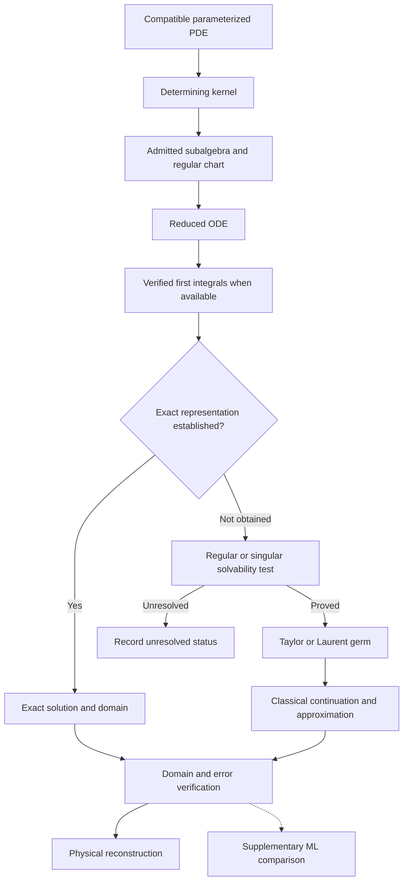

# Dissertation: Current Research Understanding

**Author's handwritten research map — 27 November 2026**

Based on IMG_6146.jpeg and checked against the [compact dissertation](https://github.com/CarlXerophilem/Lie-ML_PDES/blob/a841729a09ce83dbe855504f9d2222cce0123c89/draft/dissertation_wku_compact.pdf). The [original handwritten page](https://github.com/CarlXerophilem/Lie-ML_PDES/blob/8a98887d27e777d8794c3894fcaf3117f27f521e/draft/figures/handwritten/IMG_6146.jpeg) is preserved without modification. Section and equation numbers refer to that manuscript, not the shorter review version. This note organizes the author's understanding and editorial suggestions; it does not change the dissertation.

## 1. Goal, method and result

| | Research statement |
|---|---|
| Goal | Understand how parameters change Lie symmetries, reduce the governing PDE when possible, and determine the existence and valid domains of exact or convergent series solutions. |
| Method | Start from a compatible equation, determine point symmetries, choose a regular invariant graph, reduce the PDE, extract symbolic first integrals and apply regular or singular solvability tests. Use classical approximation and error bounds when needed. |
| Result | Parameter-dependent symmetry algebras, exact bed-drift and similarity profiles, convergent Taylor/Laurent series, an analytic planar saddle-crossing theorem and reproducible numerical comparisons. ML is supplementary: no end-to-end advantage over classical methods has been established. |

The two primary mathematical objects are the **parameter-dependent symmetry algebra** and the **reduced differential equation**. Their degeneracies are different.

## 2. Analytical layer: the SymPy core

### 2.1 Choose the equation and its domain

Let the independent variables (including time) be
$$
 x=(x^1,\ldots,x^d)\in\Omega\subset\mathbb R^d,\qquad U:\Omega\to\mathbb R^r.
$$

The multi-index $J\in\mathbb N_0^d$ labels partial derivatives $U_J^a$. For an order-$n$ PDE, write
$$
 \Delta_\mu(j^n U(x))=0,\qquad
 \mathcal S_{\Delta_\mu}=\{q\in J^n(E):\Delta_\mu(q)=0\}.
$$

Here $\mu$ is the parameter vector and $E\subset\Omega\times\mathbb R^r$ is a local point chart. Assume sufficient smoothness and a regular equation locus.

The suggestion to try the Lagrangian form first means: use a compatible material-coordinate equation when it simplifies the calculation and permits reconstruction. It is not mandatory for every PDE. Distinguish the Eulerian $\mathcal E_1$, the printed scalar $\mathcal E_P$, and the compatible scalar $\mathcal E_L$. The latter gives the local physical reconstruction of Proposition 2.3:
$$
 x=\phi(t,s),\qquad h(t,\phi)=1/\phi_s,\qquad u(t,\phi)=\phi_t,\qquad db=\omega_{\mathcal E_L}.
$$
The map needs $\phi_s>0$, positive velocity on the declared chart, and a bed primitive (globally, its periods must vanish). A $C^2$ velocity flux $Q$ is sufficient for the regular bed-drift construction; analytic series require analyticity.

### 2.2 Determine admitted point symmetries

Start with
$$
 X=\sum_{i=1}^d\xi^i(x,U)\partial_{x^i}
 +\sum_{a=1}^r\eta^a(x,U)\partial_{U^a}.
$$
The first test is tangency to the **equation locus**, not invariance of a particular graph:
$$
 \operatorname{pr}^{(n)}X(q)\in T_q\mathcal S_{\Delta_\mu}
 \iff
 \operatorname{pr}^{(n)}X(\Delta_\mu)(q)=0
 \quad(q\in\mathcal S_{\Delta_\mu}).
$$
This defines the linear determining operator:
$$
 \mathscr D_\mu X=\left.\operatorname{pr}^{(n)}X(\Delta_\mu)\right|_{\Delta_\mu=0},
 \qquad \boxed{\mathfrak g_\mu=\ker\mathscr D_\mu}.
$$
Compute and verify admitted generators **before** selecting a reduction. The determining equation does not itself produce an ODE.

Theorem 2.8 gives the parameter-to-algebra map for the three one-dimensional models with $\mu=(g,\kappa,m)$, $g,\kappa>0$ and every real $m\ge1$ (not merely integers). In the declared candidate bases,
$$
 A_1(m)=A_L(m)=(0,0,0,0,m-3),\qquad
 A_P(m)=\begin{pmatrix}0&0&0&0&m-3&0\\0&0&0&0&0&m-1\end{pmatrix}.
$$

| Parameter | $\dim\mathfrak g_1$ | $\dim\mathfrak g_L$ | $\dim\mathfrak g_P$ |
|---|---:|---:|---:|
| $m\notin\{1,3\}$ | 4 | 4 | 4 |
| $m=1$ | 4 | 4 | 5 |
| $m=3$ | 5 | 5 | 5 |

The cubic exponent adds a scaling; the linear exponent adds a boost only to the printed scalar. The kernel has local analytic frames on constant-rank analytic strata, but its full dimension can jump at exceptional parameters. This is not a theorem that every nonlinear PDE has a useful admitted symmetry.

### 2.3 Choose an admissible reduction

The second test is the invariant-surface equation:
$$
 Q_X^a=\eta^a-\sum_i\xi^iU_i^a,\qquad Q_{X_j}[\ell[F]]=0.
$$

Choose a finite-dimensional subalgebra $\mathfrak h$ of admitted projectable fields. Require equal constant base and point orbit ranks $k$ on the regular chart, with a transverse section $x_\Sigma(z)$. The profile $F(z)$ lives on the section; $\ell[F]$ extends it along the orbits.

- The number of remaining independent variables is $d-k$. If $d-k=1$, we obtain ODEs; if $d-k>1$, a lower-dimensional PDE.
- A purely vertical generator may admit no invariant graph: $Q_{\partial_B}^B=1$.
- One-dimensional subalgebras are lines in $\mathbb P(\mathfrak g_\mu)$. Classify adjoint representatives only where needed for the computation.
- Examples: common scaling gives $z=s/t$; cubic material scaling gives $\sigma=st^2$; rotation leaves $r=\sqrt{x^2+y^2}$ and time until a second symmetry is imposed.

Equation (2.7) defines the reduced residual:
$$
 \boxed{\mathcal R_{\mathfrak h}[\Delta_\mu](F)(z)
 =c_\Sigma(z)\Delta_\mu(j^n\ell[F](x_\Sigma(z))),\quad c_\Sigma(z)\ne0.}
$$

For affine-flow charts, verify the invariant-surface equations, a nonzero chart Jacobian on the chosen domain, and the exact residual identity (2.8) with a nonsingular weight matrix. Figure 2.2 shows the local geometry.

**Symbolic output (JSON):** parameters, generators, chosen subalgebra, invariant graph, chart conditions, reduced residual, verified first integrals, reconstruction map and status. Search failure is not a proof of nonexistence.

## 3. Direct symbolic order reduction

Before any approximation, attempt to find a total derivative or a verified integrating factor. If $\mathcal R=D_z I$, the reduced equation gives $I=C$. For an integrating factor $a\ne0$, verify $D_z I=a\mathcal R$ throughout the chart.

The common scaling in §2.4 gives
$$
 t^2\mathcal E_L[\phi]=(LF'')'=0
 \ \Longrightarrow\ LF''=I_0,\qquad
 F'=p,\quad p'=I_0/L.
$$
Division requires $L\ne0$; a finite $F''$ at $L=0$ requires $I_0=0$.

For the common bed-drift generator $\partial_t+\alpha\partial_B$, the first integrals are
$$
 HU=C,\quad U^2/(2g)+H+Z=E,\quad
 Q(U(x))=Q(U_0)-\alpha(x-x_0).
$$

When $Q'(U_0)\ne0$, regular inversion gives a unique local solution on the monotone chart. For $Q(U)=\kappa U^m$,
$$
 U(x)=\left(U_0^m-\frac{\alpha}{\kappa}(x-x_0)\right)^{1/m},
 \quad H=C/U,\quad Z=E-H-U^2/(2g).
$$
The bracket must be positive. This is an exact invariant family for the declared velocity-flux law, not an arbitrary-data PDE solver.

## 4. Planar model and physically consistent singular radial equation

The new model in Chapter 3 adds one space variable and bed-slope transport:
$$
\begin{aligned}
 h_t+\nabla\cdot(h\mathbf w)&=0,\\
 \mathbf w_t+(\mathbf w\cdot\nabla)\mathbf w+g\nabla(h+B)+f\mathcal J\mathbf w&=0,\\
 B_t+\nabla\cdot\mathbf Q&=0,\\
 \mathbf Q&=|\mathbf w|^{m-1}(K\mathbf w-G\nabla B).
\end{aligned}
$$

Here $\mathcal J(u,v)=(-v,u)$ is a quarter-turn, **not a Jacobian matrix**. Take $g,K,G>0,\ f\ge0,\ m\ge1$, positive depth and nonzero speed on an annulus. The bed-slope term introduces diffusion into the Exner balance. The two-field potential formulation also requires zero absolute vorticity and fixed circulation.

Real SVE applications, HEC-RAS and published flume data may motivate the choice of transport and bed-slope parameters. They do not automatically calibrate the present $K,G$.

Rotation $R$ and time–bed drift $T_c$ give a rank-two reduction:
$$
 h=H(r),\quad \mathbf w=V(r)\mathbf e_r+W(r)\mathbf e_\theta,\quad B=Z(r)+ct.
$$
The mass, azimuthal momentum and Exner balances integrate exactly:
$$
 rHV=C_1,\quad rW+fr^2/2=C_2,\quad rQ_r+cr^2/2=C_3.
$$
For $C_1\ne0$, define
$$
 V=C_1/(rH),\quad W=C_2/r-fr/2,\quad Q_r=C_3/r-cr/2,\quad S=V^2+W^2,
$$
$$
 P_Z=(KV-Q_r S^{-(m-1)/2})/G,\qquad \Delta_c=gH-V^2,\quad N=H(S/r+fW-gP_Z).
$$
The radial system is
$$
 \boxed{\Delta_c H'=N,\qquad Z'=P_Z.}
$$
All parent balances are recovered by the lift. The singularity is physically consistent **within the declared model**, because $\Delta_c=0$ means the radial Froude number $|V|/\sqrt{gH}=1$, not a numerical artifact. Nonzero radial mass flux requires open annular boundaries, not impermeable banks. The bed shape is fixed in time with a drifting datum.

### 4.1 Saddle criterion and parameter continuation

At a compatible critical point $\Delta_c=N=0$, define
$$
 \mathbf J_*=D_{(r,H)}(\Delta_c,N)\big|_{(r_*,H_*)}.
$$

Theorem 3.2 gives exactly two local analytic $C^1$ crossings when $\det\mathbf J_*<0$. In the anchored family $g=C_1=C_2=r_*=H_*=1$, $S_0=1+(1-f/2)^2$, with $C_3$ chosen for compatibility,
$$
 \det\mathbf J_*=\frac{3c}{G S_0^{(m-1)/2}}+\Phi_f(m,K/G).
$$
The remainder is recorded in Appendix A.8. For $f=0$, use $k=K/G$, $\gamma=c/G$, and $\delta=\gamma_*-\gamma$:
$$
 \gamma_*=\frac{2^{(m+1)/2}}3[k(m-2)-2(m+1)],\qquad
 \det\mathbf J_*=-3\,2^{(1-m)/2}\delta.
$$
Hence $\delta>0$ selects the saddle region. The compatible critical point and centered germs depend analytically on nearby parameters. This does not establish a crossing at $\delta=0$ or universal global continuation.

| Discriminant | Meaning |
|---|---|
| Rank of $\mathscr D_\mu$ | Which symmetry directions are available |
| Determinant of $\mathbf J_*$ | Whether the local saddle-crossing criterion applies on a chosen quotient |

## 5. Conditions for analytical solvability

A first integral helps reduce order; it does not always yield an elementary closed form.

| Condition | Result |
|---|---|
| Explicitly invertible first integral on an admissible chart | Explicit closed form; e.g. power-law bed drift |
| Regular quadrature with monotone locally invertible primitive | Exact implicit solution; e.g. $\int^p L_i(v)\,dv=Iz+C$, with $p,u>0,\ L_i\ne0$ |
| Cubic scaling, $m=3,\ 4g\kappa<1$ | Positive-depth exact similarity wave on $x,t>0$ |
| Analytic $MY'=N$, $\det M(z_0,Y_0;\mu)\ne0$ | Unique convergent local Taylor series for the prescribed trace |
| Singular $M$, $N\notin\operatorname{im}M$ | No $C^1$ solution through those data |
| Adapted holomorphic equation $\rho w'=f_0(\rho,w)$, $f_0(0,0)=0$, no positive integer eigenvalue of $\partial_w f_0(0,0)$ | Convergent Briot–Bouquet Taylor germ |
| Radial saddle: $\Delta_c=N=0,\ \det\mathbf J_*<0$ | Two local analytic crossing germs |
| Compatible cubic equation, $m=3,\ g\kappa=1/4,\ w_0>0$ | Convergent simple-pole Laurent branch |
| No justified normal form or convergence argument | Unresolved, not proved impossible |

A regular series is local until further continuation is verified. The cubic Laurent branch starts with
$$
 F(\sigma)=F_0-\frac{w_0}{\sigma}
 -\frac{g\sigma^3}{24w_0^2}-\frac{g^2\sigma^7}{512w_0^5}
 +O(\sigma^{11}),
 \qquad 0<|\sigma|<(w_0^3/(4g))^{1/4}.
$$

Keep the exact convex-bed control as a short reference: for $V=0,\ f>0,\ W=-fr/2,\ C_3=0$, the bed follows from integrating $Z'\propto r^{2-m}$. Positive depth on a chosen finite annulus follows by choosing the integration constant sufficiently large. For $c>0,\ 1\le m<2$ the bed is strictly convex. This is a separate family from the throughflow saddle.

## 6. Classical computation first; supplementary ML last

Use exact closed forms when available. Taylor recurrences obtain local germs. Chebyshev collocation constructs longer candidates. Continuation and interval barriers establish reached domains and continuous error bounds under the stated chart and enclosure assumptions.

Keep the saddle branch as the main nonlinear ML target. Let $\nu=(m,k,\delta)$, $\rho=r-1$, and let the positive-eigenvalue slope $\ell_+(\nu)$ be computed analytically. Learn only the remainder:
$$
 \widehat H(r;\nu)=1+\ell_+(\nu)\rho+\rho^2 R_\theta(\widehat\rho,\widehat\nu).
$$

**Input:** normalized radial coordinate and parameters. **Output:** remainder, candidate profile and exportable coefficients; record branch, reached domain, bound and status after verification. New parameters supply candidates, not newly discovered existence theorems or branches. The current singular planar handoff is model-specific.

| Held-out test | Chebyshev | PINN | Random features | Gated |
|---|---:|---:|---:|---:|
| Full adaptive coverage, $r\in[0.9,1.1]$ | 8/8 | 8/8 | 8/8 | 8/8 |
| Full adaptive coverage, $r\in[0.5,2]$ | 7/8 | 0/8 | 4/8 | 6/8 |
| Full coverage and adaptive depth bound $\le0.05$ on the wide interval (review audit) | 7/8 | 0/8 | 0/8 | 4/8 |

The first two rows are reach, not common-accuracy acceptance. The last row was postprocessed from adaptive bounds in the earlier review, not the different fixed-width test in the original Table 4.3. Recorded interval results are conditional on valid arithmetic inclusions; they do not cover the whole parameter box. Chebyshev is strongest overall. Warm starts can reduce residual evaluations, but no verified equal-certified-tolerance end-to-end speed advantage has been established.

## 7. Unified workflow

## 8. Editorial notes from the handwritten page

These are proposed presentation changes, not changes made to the manuscript.

| Location (original compact PDF) | Handwritten intent / organized recommendation |
|---|---|
| §2.2, Proposition 2.6, Figure 2.2 | Define the profile, its domain and orbit ranks first; distinguish equation tangency from graph invariance. |
| §2.3, Theorem 2.8, Table 2.1 | Retain the parameter-to-kernel theorem and real parameter range; simplify repeated classification detail. |
| §2.3.1–2.3.2 implementation | Keep detailed implementation and JSON output in a footnote or reproducibility note. Show first integration explicitly. |
| Chapter 3 | State model, necessary restrictions, two symmetries, first integrals, saddle theorem. Refer to exact SymPy checks and manual derivation; distinguish quarter-turn from critical Jacobian. |
| “Remove bend?” | Open editorial decision: remove misleading real-bend framing, not the useful open annular throughflow model. Retain a real-world application reference only as motivation. |
| p. 20, §4.1–4.5 | Put exact solution and series criteria first. Keep Taylor/Laurent analysis; use only the saddle germ for the main nonlinear ML comparison. Remove the lengthy learned control of an already exact solution from the main narrative. |
| Tables 4.1–4.2 | Keep the main comparison table; summarize the local parameter-neighbourhood tests briefly with conditions. |
| Table 5.1 | Replace the large status table with continuous sentences in simple language: what is proved, what is observed, what remains open. |
| References | Include a real-world SVE application to motivate parameters. Do not assign an exact reference number from the handwritten margin; numbering changes between versions. |
| Appendix A.5 | Show one worked connected-adjoint classification step; leave unused catalogue details to the reproduction code. |
| Appendix A.6 | Retain the precise source-equation discrepancies for 2022 and 2026 and their qualified corrections. |
| Appendix A.9 | Shorten the regular series proof without removing convergence conditions. |
| Appendix A.11 / pp. 39–44 | Retain necessary cancellation-free formulas, interval assumptions and reproduction settings; trim repeated historical controls and tables. The small bottom-right margin annotation is not fully legible. |

**Defense message:** Parameters determine the available symmetries; selected symmetries determine the dimension of the reduced equation; analytical conditions determine the form of solution that can be constructed. Classical computation and error checks extend solutions to stated domains. ML is tested only afterward, and it has not outperformed classical methods overall.
