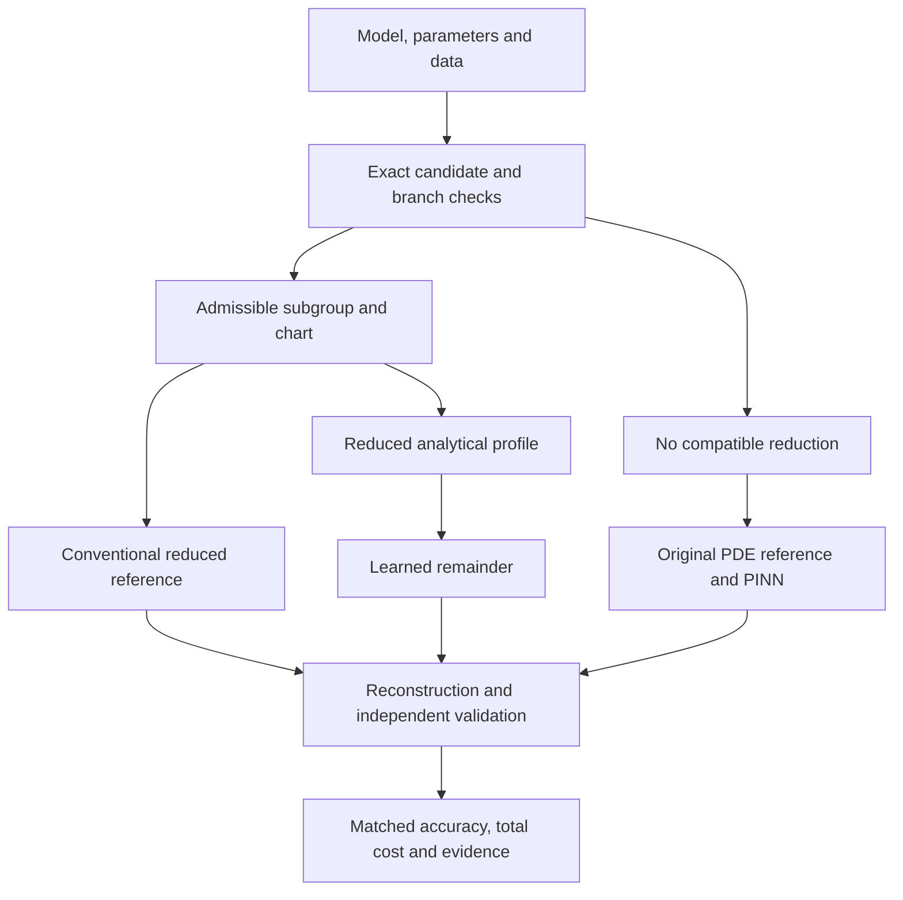

# Next work and project architecture

Updated 2026-10-06. Historical paper: [main(1).tex](manuscript_history/main(1).tex).
The next mathematical question is whether the exceptional cubic generator
has a first-order continuation or obstruction at `m = 3 + delta`.
Recover missing source/evidence before treating the entire current paper as
reproducible from this archive.

## Architecture and the manuscript

| Layer | Manuscript location | Recovered implementation | Output and acceptance gate |
|---|---|---|---|
| Model contract | Formal PDE-system input; model and admissibility | `code/lie_kan_workflow/lie_analyzer.py`, `code/sve_liepinn_benchmark/models.py`; newer `symm.generic` absent | Coordinates, fixed parameters, equations, guards, data surfaces; do not silently drop an equation |
| Jet/prolongation and candidate search | Preliminaries; reproducible SymPy workflow | `code/repository/symm/sym_engine/`; standalone analyzer | Exact determining residual, declared polynomial ansatz, branches and timing; finite ansatz is not maximality |
| Algebra and subgroup selection | Complete classification; representations | Legacy engine and supplied candidates | Verified generators, brackets, rank and data compatibility; one orbit direction removes at most one independent variable |
| Supplied-chart reduction | Verified reduction in a supplied chart | Scalar reduction/control recovered; generic API not recovered | Off-shell multiplier identity, inverse chart, graph invariance, exact pullback, nonzero factors, separate data status |
| Analytical profile and conventional reference | Explicit reduction anchor; continuation | `code/scalar_sve/base_LieReduct.py`, `code/sve_liepinn_benchmark/scalar_master_control.py` | Reduced equation and reconstructed PDE agree; leading-coefficient and positive-depth guards retained; tolerance/reference refinement |
| Learned correction | ML construction; fused prototype | `code/scalar_sve/test.py`, `base_PINN.py`; `code/lie_kan_workflow/series_kan.py` | Analytical part plus parameter-conditioned remainder; declared data enforcement, seeds, derivative order, independent residual checks |
| Eulerian SWE/SVE benchmark | Distinct later baseline extension | `code/sve_liepinn_benchmark/` | Smooth periodic 2+1 system, four fields with Exner; classical convergence, positivity, conservation; distinguish from scalar master equation |
| Reporting and visualization | Comparison design; next gates | `pde_scene.py`, `code/sve_animation/`, package report/visualization scripts | JSON/CSV/checkpoints and reproducible plots; accuracy versus total cost; negatives retained |
| Generic v0.2 and three-layer evidence | Implemented three-layer baseline; data-compatible family | Described by paper and 2026-10-05 checklist; matching implementation/evidence absent | Recover exact revision and result artifacts before revalidating its tables/certificate |

## Export and recovery checklist

- [x] Preserve all 58 files from the resolved project folder, including supplied PDF duplicates and earlier manuscript versions.
- [x] Preserve and expand four existing executable archives under `code/`.
- [x] Preserve the public repository snapshot and its source corpus.
- [x] Externalize the supplied manuscript bibliography with stable citation keys and local PDF/URL mappings.
- [x] Save all seven project sessions visible in the supplied history, plus this export request, as explicitly partial Markdown records.
- [x] Keep retrieved context summaries separate from visible chat text.
- [x] Add this architecture/checklist and `AGENT.md`.
- [ ] Import the native ChatGPT account/project export to recover complete user/assistant turns, exact session identities, omitted sessions, and attachment associations. Current `chats/` cannot establish full session coverage.
- [ ] Recover the newer repository revision containing `symm/generic/` and `docs/pde_formalization_and_reduction.md`. The public snapshot lacks these paths.
- [ ] Recover `docs/three_layer_baselines.md`, its ML-only/Lie-only/fusion CLIs, and `research_artifacts/three-layer-baselines-20260927/`.
- [ ] Recover the strict v0.2 certificate, conditional initial-curvature network/checkpoints, seven training values/four held-out values, and all seeds supporting the current paper.
- [ ] Recover `docs/fluid_baseline_accomplishments.md`, `docs/fluid_baseline_novelty.md`, `docs/live_simulation.md`, and their `research_artifacts/` directories if the remote fluid/live track remains in scope.
- [ ] Resolve historical sandbox outputs and unavailable images against their original sessions. Never manufacture replacements and label them recovered originals.
- [ ] Replace provisional publication metadata with verified primary records where `references.bib` notes uncertainty; identify the source book for the page scans if needed.

## P0 — Near-cubic continuation or obstruction

- [ ] Freeze the printed Lagrangian master equation, fixed `kappa=A_g*xi`, `beta_tr=m*kappa`, multiplier convention, jet order, nondimensionalization, and regular sign branch (`phi_s>0`, positive velocity for logarithms).
- [ ] Independently audit the published scalar reduction versus direct substitution. Preserve the reported source discrepancy; do not silently substitute a printed formula for the verified one.
- [ ] Derive `E_delta = E_0 + delta*E_1 + O(delta^2)` including the exponent and transport-coefficient change.
- [ ] Define the unrestricted determining problem for `X_delta=X5+delta*X1`; derive `pr(X1)E0 + pr(X5)E1 - c0*E1 = 0` on `E0=0`, with `c0=-1` in the current convention.
- [ ] Keep a finite-ansatz pilot separate from the unrestricted differential problem. Fix gauge freedom of `X1` modulo known cubic generators.
- [ ] Split every exceptional parameter, denominator and rank branch before division. A finite matrix cokernel is only a certificate within its declared ansatz.
- [ ] Complete the compatibility calculation, using a mature CAS oracle when required and available.
- [ ] Emit one explicit exit: `continuation-verified`, `obstruction-verified`, `ansatz-inconclusive`, or `regularity-failed`.
- [ ] If continuation is verified, derive approximate invariants, bracket closure and reduced equations; verify reconstruction and original residual through `O(delta^2)`.
- [ ] If obstructed/inconclusive, use a surviving subgroup or retain the extra independent variable. Do not assume the correction is `F1(s*t^2)`.
- [ ] Use two-sided delta refinement as secondary numerical evidence only. Analyze compatible data/existence/error separately from generator persistence.

## P1 — Physical data, closure and conservation

- [ ] Re-derive the Eulerian-to-Lagrangian transformation of bed elevation: the material time derivative includes `phi_t*b_x`. Verify reconstructed solutions in all original balances before claiming physical equivalence of the scalar master equation.
- [ ] Choose a physically sourced smooth initial/boundary family; compute its admitted data-compatible subgroup and chart.
- [ ] Check densities, fluxes, sources, constraints, coordinate-Jacobian weights and boundary fluxes; emit a separate `conservation_status`.
- [ ] Analyze singular exits `t=0`, `F'=0`, and the zero leading third-derivative coefficient rather than dividing them away.
- [ ] Treat a trivial data-compatible subgroup as a valid negative outcome and retain the unreduced numerical route.
- [ ] Keep time-dependent coefficients distinct from constant-exponent continuation, and keep time-dependent data as a separate compatibility question.
- [ ] Exclude shocks/dry beds from the current smooth v1 claims; a later extension requires weak/conservative residuals and an independently converged finite-volume reference.
- [ ] Introduce true multilayer physics only with additional layer balances and interface conditions; chained neural layers do not define a multilayer fluid.

## P2 — Generic systems and differential completion

- [ ] Recover and review the approved generic implementation/specification before extending it. Do not infer its presence from the older public `AGENTS.md`.
- [ ] Preserve `p` independent variables, `q` fields, `r` equations, `n` differential order, and arbitrary multi-index jets; permit `r != q`.
- [ ] Preserve legacy scalar APIs and generator tuple `(tau, xi, phi)` through an explicit adapter.
- [ ] Add branch-aware completion semantics, rankings, inequations, divisions and uncovered branches.
- [ ] Compare Maple DifferentialThomas/PDEtools and REDUCE CRACK/LIEPDE when installed; report `backend-unavailable`, `timeout`, `branch-partial`, `unsupported` honestly.
- [ ] Distinguish exact point algebras, approximate symmetries, equivalence transformations, conditional/potential/generalized symmetries, and disconnected group components.
- [ ] State and prove any local reconstruction theorem with explicit rank/chart/domain/data hypotheses. Do not extend it to existence, global coverage or maximal classification without separate proofs.

## P3 — ML evaluation and certificates

- [ ] Restore and rerun the three-layer and v0.2 experiments before strengthening their manuscript claims.
- [ ] Compare analytical-only, reduced PINN, analytical-plus-correction, direct PDE PINN, symmetry-loss PINN and conventional reference on the same admissible problem.
- [ ] Preserve all seeds and all failures; separate training from held-out parameters and keep symmetry-related profiles in the same split.
- [ ] Record profile and derivative errors, raw/normalized reduced residuals, lifted original residuals, data mismatch, positivity and total cost. Residual and solution-error rankings may differ.
- [ ] Before applying KAN to the third-order scalar residual, verify activation/spline derivative regularity through the required order.
- [ ] Study whether local series, rational continuation or matched expansions fit the reduced singularity structure; compare their added value against equally budgeted networks.
- [ ] Validate parameter derivatives separately. Accurate parameter interpolation does not establish a sensitivity operator.
- [ ] Prove a conditional finite-time residual-to-solution bound only with controlled stability/Lipschitz constants, a common existence interval and positive-depth/reconstruction margins; add interval residual bounds if a computable certificate is claimed.
- [ ] Measure sampling and loss-weight sweeps; Lie residual weighting equivalence in the existing pilot is a result to explain, not a general sample-efficiency theorem.
- [ ] Count symbolic preprocessing, training, per-query inference, verification and fallback in amortization. The draft's 7,170-query estimate is historical, excludes deployment costs and is not a speedup proof.
- [ ] Explore exact-gated structural ML only after exact determining labels and repeated-query timing justify it. Predict candidate support/subspaces; recover and certify exactly with a full-solve fallback.

## Paper integration

- [ ] Map every numerical table to its exact script/configuration/results path and source hash.
- [ ] Keep the scalar master-equation study, Eulerian Grass benchmark, KAN review and older Fisher/HAM/SAC-NO track explicitly separate.
- [ ] Rewrite the main contribution around the verified continuation/obstruction outcome and measured neural correction benefit once those gates close.
- [ ] Preserve the proposal-specific 4–6-page, 12-point Times, double-space requirement for `proposal.tex`; it does not automatically apply to the longer research manuscript.
- [ ] Compile with BibTeX, resolve citations, inspect equations/tables/figures and record the final source-to-PDF relationship.

See [AGENT.md](AGENT.md) for the handoff contract, [EXPORT_STATUS.md](EXPORT_STATUS.md)
for recovery limits, and each code folder's README for runnable commands.
