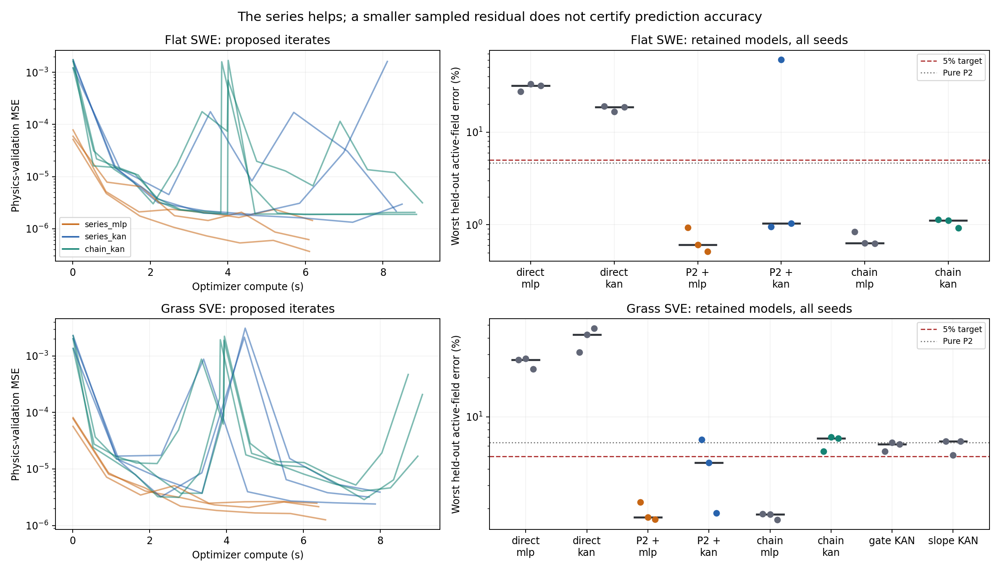

# Basic Lie analysis and series-first learning: review and measured results

The standalone ML-free analyzer completes a verified reduction/reconstruction for a compatible flat-SWE family. The learning pilot shows that a coupled quadratic time series is the strongest improvement under this short budget. Smooth KAN corrections are implemented and tested, but neither KAN architecture nor residual backtracking consistently beats the MLP controls. Parameter interpolation accuracy also does not imply accurate parameter derivatives.

## Start from the basic level

Use `python lie_analyzer.py --builtin swe2d --out results/my_analysis.json`. Only SymPy is required. The default model has depth h and two velocities u,v: one mass-conservation equation and two momentum equations. In 2D the independent variables are (t,x,y), with t>0. The accepted spatial dimensions are integers 1 and 2; the three-field 1D example retains transverse velocity. Full 2D Grass SVE adds bed b and its conservation equation as an explicitly enabled four-equation extension.

The seven steps are: declare the regular PDE chart; prolong and determine; split/solve the chosen generator ansatz; verify and compute brackets; construct flows/invariant charts; reduce; reconstruct and substitute into the original PDE. The JSON contains every stage and timings. A generic custom input can finish with an unsupported reduction or unsolved reduced PDE: exact symmetry verification does not by itself solve an arbitrary initial-boundary problem.

## Symbolic complexity and time

Let n=d+1 independent variables, m fields, r jet order, and q generator-ansatz degree. There are m*binomial(n+r,r) dependent jet coordinates, including the fields. The polynomial ansatz has K=(n+m)*binomial(n+m+q,q) unknown coefficients. With M split rows, dense numerical elimination would cost roughly O(M K^2+K^3) arithmetic operations and O(MK) storage; this is only a comparison scale. Exact symbolic expression growth, rational bit lengths, denominator branches, and simplification can dominate. No overall polynomial-runtime bound is asserted for symbolic PDE classification.

| Model | Degree | Unknown coefficients | Split matrix | Rank / nullity | Full workflow (s) |
|---|---:|---:|---:|---:|---:|
| 1D three-field SWE | 1 | 30 | 33 x 30 | 23 / 7 | 1.448 |
| 2D three-field SWE | 1 | 42 | 68 x 42 | 34 / 8 | 14.573 |

The 2D step costs, in seconds, are:

| Stage | Seconds |
|---|---:|
| 1 model and chart | 0.0449 |
| 2 prolong and determine | 0.0795 |
| 3 exact split and solve | 14.1930 |
| 4 verify and bracket | 0.0889 |
| 5 flows invariants admissibility | 0.0383 |
| 6 reduce | 0.0754 |
| 7 reconstruct and check | 0.0531 |

These are observed single runs on an AMD EPYC 9V74 CPU with SymPy 1.14/Python 3.12, not portable time guarantees. Symbolic series construction took 2.546 s and produced 353 counted operations before lambdification/CSE. Learning used CPU float64 and one thread. Degree 2 increases the 2D ansatz from 42 to 168 unknowns and is optional; its cost is not measured here.

The 1D/2D affine nullities are 7/8. Each basis vector is substituted back exactly. A quadratic projective candidate is verified separately in 2D, outside the affine search. Thus the affine kernel is not a maximal point-symmetry classification. Generic symbolic parameters, nonpolynomial powers, and constrained non-involutive charts have explicit limitations. Exceptional parameter values must be recomputed: the cubic SVE scaling candidate passes at m=3 and fails at m=3.1 with fixed parameters.

## Exact reduction, series, and a function-iteration certificate

For rho=1+a*t, a>=0, the commuting generators Tx+a*Gx and Ty+a*Gy have the required spatial rank two. Their compatible ansatz reduces SWE to H'=-2aH/rho, U'=-aU/rho, V'=-aV/rho. Reconstruction gives h=H0/rho^2, u=(a*x+U0)/rho, v=(a*y+V0)/rho, with zero original residuals. The compatible linear-velocity data are nonperiodic; this reduction cannot be imposed on the benchmark's nonuniform periodic initial data. One x-translation alone leaves a 1+1 PDE in 2D.

For the reduced linear ODE, the Volterra/Picard map acts on C([0,T];R^3) with the sup norm. A sufficient contraction bound is kappa=d*log(1+a*T)<1. At a=.5,T=.25,d=2, kappa=0.235566; iteration 6 has depth error 7.76e-09 at T for H0=1. The geometric sup-norm depth bound is 5.27e-05. This certificate applies to this reduced ODE. Spatial derivatives obstruct simply assuming a C0-to-C0 Lipschitz full-PDE map. It proves neither full-PDE nor learned-chain convergence. The exact rational solution needs no neural model.

For the full smooth coupled evolution U_t=F(U;p), the half-way approximation is P2=U0+t*F(U0;p)+t^2*DF(U0;p)[F(U0;p)]/2. All water/velocity/bed coefficients are coupled. With constant initial velocity the first bed coefficient vanishes, while the second is generally nonzero. The series is local; no general convergence radius is certified. The KAN remainder uses U=P2+(t^3/T^2)*S(p)*sum(alpha_k*C_k). Each C_k composes smooth Gaussian/linear edge layers. This preserves U0 and the first two time derivatives, and respects periodicity through Fourier inputs.

Earlier correction blocks freeze. A new block is optimized against the full nonlinear residual. Backtracking uses separate physics points of training cases, tries 1,.5,.25,.125,0, and preserves the prior iterate when rejected. The default gate checks total validation loss; the optional gate checks every equation separately. A residual decrease on these sampled points is not an error estimate.

## Controlled learning pilot

Each main method used 600 Adam steps, 128 fixed collocation points per training case, six training parameter pairs, two disjoint test pairs, T=.25, and seeds 0,1,2. Flat SWE trains (f,A) with f in 0,.1,.2 and A in .02,.04; tests f=.05,.15,A=.03. Grass SVE trains m=2.9,3,3.1 with the same amplitudes; tests m=2.95,3.05,A=.03. These are finite-parameter conditional field solvers, not arbitrary-function operators. Two-stage chains split the same total step budget, and have twice the total capacity. One MLP/KAN block has 2628/2588 parameters. An MLP chain is included to isolate chaining from architecture.

Error is normalized by the *evolution* of each field, rather than its large stationary background. For each seed, aggregate errors average the two cases; the reported maximum-field error is the worst active field over both cases. Tables give medians across seeds and retain aggregate-error ranges. Passing means both cases satisfy <=5% in every active field, positive depth, and reference guards. Three seeds and two tests are a pilot, without statistical generalization guarantees.

### Flat SWE

| Method | Aggregate error, median [range] | Max-field error, median | Passing seeds | Train compute / wall (s) | Inference (ms) |
|---|---:|---:|---:|---:|---:|
| direct_mlp | 16.460% [14.447, 17.861] | 31.59% | 0/3 | 3.25 / 3.59 | 0.97 |
| direct_kan | 8.166% [7.383, 8.556] | 18.69% | 0/3 | 4.65 / 4.92 | 1.29 |
| series_mlp | 0.207% [0.183, 0.327] | 0.61% | 3/3 | 6.10 / 6.44 | 1.14 |
| series_kan | 0.704% [0.300, 16.681] | 1.03% | 2/3 | 8.34 / 8.81 | 1.56 |
| chain_mlp | 0.244% [0.217, 0.267] | 0.64% | 3/3 | 6.66 / 7.61 | 1.80 |
| chain_kan | 0.329% [0.298, 0.579] | 1.12% | 3/3 | 8.86 / 10.17 | 2.52 |

### Evolving-bed Grass SVE

| Method | Aggregate error, median [range] | Max-field error, median | Passing seeds | Train compute / wall (s) | Inference (ms) |
|---|---:|---:|---:|---:|---:|
| direct_mlp | 7.408% [7.311, 8.236] | 27.17% | 0/3 | 3.45 / 3.70 | 0.99 |
| direct_kan | 16.504% [14.349, 16.861] | 42.32% | 0/3 | 5.00 / 5.28 | 1.37 |
| series_mlp | 0.380% [0.294, 0.584] | 1.71% | 3/3 | 6.40 / 6.76 | 1.14 |
| series_kan | 0.763% [0.397, 1.046] | 4.47% | 2/3 | 7.87 / 8.30 | 1.51 |
| chain_mlp | 0.349% [0.303, 0.366] | 1.80% | 3/3 | 6.59 / 7.53 | 1.76 |
| chain_kan | 1.915% [1.173, 1.934] | 6.84% | 0/3 | 8.98 / 10.25 | 2.46 |

Pure P2 requires no learning and has worst active-field error 4.66% for flat SWE and 6.37% for Grass SVE. It already meets the basic flat-SWE target. The SVE bed limits its accuracy. P0/P1/P2 per-case results are retained in JSON.

### Additional diagnostic trials

| Method | Aggregate error, median [range] | Max-field error, median | Passing seeds | Train compute / wall (s) | Inference (ms) |
|---|---:|---:|---:|---:|---:|
| chain_kan (per-equation gate) | 1.687% [1.173, 2.031] | 6.19% | 0/3 | 8.97 / 10.95 | 2.85 |
| series_kan (sensitivity loss) | 2.552% [2.412, 3.595] | 6.48% | 0/3 | 24.08 / 24.71 | 1.51 |

The per-equation KAN gate rejects several proposed stages; seed 1 retains pure P2. None of its three seeds passes the sediment target. The optional sensitivity term penalizes a central difference of the full residual at m+epsilon and m-epsilon (epsilon=.01, weight 1); it changes coefficients and predictions together. It uses no numerical sensitivity labels. Extra residual/derivative evaluations increase cost, and this untuned weight worsens field accuracy under 600 steps. These follow-up trials were triggered by observed failures; they are diagnostic extensions rather than a prespecified superiority test. Within-stage plots show proposals, whereas accepted-stage records and final errors describe retained models.

The unexpected result is reproducible: a single series-KAN flat run has 60.3% worst-field error, while damped chaining passes all three flat seeds. In SVE, total-loss chaining lowers sampled validation losses yet every seed misses the bed target. The matched MLP series and MLP-chain controls pass both families at this budget. The evidence supports testing a series/remainder decomposition; it does not support asserting a general KAN advantage.

## Parameter sensitivity is a separate test

Post-hoc central differences use steps .01 and .005 around f=.1 or m=3 at A=.03, with n=24 tight numerical solutions. Saved checkpoints reproduce predictions exactly (maximum replay discrepancy zero across all 42 runs). These tests never select stage weights.

| Parameter / trial | Method | Aggregate derivative relative error | Bed derivative relative error | Depth derivative absolute RMS error |
|---|---|---:|---:|---:|
| Flat f | series_mlp | 0.001289 | 0 | 1.59e-05 |
| Flat f | series_kan | 0.003569 | 0 | 5.05e-05 |
| Flat f | chain_kan | 0.001116 | 0 | 2.04e-05 |
| SVE m | series_mlp | 103.7 | 0.07927 | 3.63e-05 |
| SVE m | series_kan | 552.5 | 0.473 | 0.000123 |
| SVE m | chain_kan | 132.6 | 0.1394 | 8.02e-05 |
| SVE m: gate | chain_kan | 120.7 | 0.09204 | 5.84e-05 |
| SVE m: slope loss | series_kan | 39.3 | 0.06051 | 1.19e-05 |

Values in this table are ratios, not percentages. For m, the reference derivative RMS is about 9.75e-9 (depth), 7.82e-8 (each velocity), and 9.62e-7 (bed). Consequently large fluid derivative ratios accompany small absolute errors, but also reveal uncontrolled parameter dependence. Accurate interpolated fields do not validate a parameter-gradient operator. The sensitivity term reduces the median bed-derivative error from 47.3% to 6.05% and aggregate derivative-error ratio from 552.5 to 39.3, while worsening field accuracy and tripling optimizer compute. It demonstrates a tradeoff rather than a validated parameter operator. Reference step differences are about 3.36e-11 in max norm for m and 4.99e-8 for f. The sensitivity-loss option is a finite-difference physics proxy; it is not a certified gradient estimator. Full per-field scales and absolute errors are included in `sensitivity.json`.

## Numerical solver review and cost comparison

Independent controls pass with maximum errors: uniform rotation/drag 5.55e-17; lake-at-rest change 2.22e-16; Fourier interpolation roundtrip 6.66e-16; expanded Grass divergence versus a finite difference of the vector flux 5.48e-15. The 12/18/24 grid ladder and independent tolerance refinement agree at roughly 1e-11 on tested cases. Mass/bed means remain near roundoff; sampled hyperbolicity and positive-depth guards pass. These are checks of a smooth periodic reference, not proofs for shocks, dry beds, or long times.

The numerical method is conservative Fourier collocation with nonlinear-output filtering and DOP853 time integration. Its rough per-RHS work is O(N^2 log N) for an N-by-N grid; storage is O(N^2). Per-case fine numerical solves took 0.018–0.022 s. Neural training times in the tables cover a six-case conditional model per seed; inference times cover a warm 16-by-16 grid at three time snapshots. They must not be presented as equivalent setup costs. The numerical solve itself is fast enough for the current target, and no end-to-end ML speedup is demonstrated. Neural inference may help repeated queries after training, but amortization and deployment throughput remain unmeasured.

The previous Lie-PINN loss identity, where the tested squared infinitesimal-dot penalty becomes residual weighting, remains a necessary cheaper control. This experiment goes beyond adding that penalty by deriving coupled series, exact compatible reduction, a reduced-ODE Picard certificate, frozen residual corrections, and parameter-sensitivity tests.

## Recommended order of work

1. Fix the PDE, positive/singular branches, parameter stratum, and data/domain.
2. Verify algebra and data-compatible group actions. Classify model strata, not samples inferred from a Taylor fit.
3. Use an exact reduction when legal; otherwise compute a coupled local series in full coordinates.
4. Check pure-series per-field accuracy and stop if it meets the target.
5. Train only the remainder, retaining MLP and pure-series controls. Record rejected corrections and compute cost.
6. Check unseen parameters, per-field conservation/error, derivative sensitivity, and longer-time/domain limits.
7. Only then enlarge to function-space operators with explicit input functions, norms, discretization tests, and appropriate convergence/regularity analysis.

The current physical coupling is water/sediment coupling. Composing network layers does not create a multilayer-fluid PDE. A true multilayer extension needs extra layer balances, interface conditions, and new classical references before learning claims.

## Source audit and reproduction

The user's `main.tex` informed exact prolongation/finite-ansatz safeguards and exceptional-parameter handling; the previous `week3_01_flatbed_swe.py` informed exact expansion checks. The uploaded NS manuscript's section 9 informed the abstract pattern of inverse/correction/residual/constraint checks only. Its specialized 3D oscillatory construction, residual-gain exponents, and claimed blowup theorem were not validated or transferred to SWE.

Inspected primary author sources: [DeepOKAN paper](https://arxiv.org/abs/2405.19143), [DeepOKAN code](https://github.com/DiabAbu/DeepOKAN), [pykan](https://github.com/KindXiaoming/pykan), [SymPy ODE Lie documentation](https://docs.sympy.org/latest/modules/solvers/ode.html), and [LPSDA](https://github.com/brandstetter-johannes/LPSDA). DeepOKAN supplies the Gaussian edge-function inspiration, while this conditional series/correction implementation is independent. LPSDA is related symmetry augmentation and is not identified as the Lie-PINN code. No verified official Lie-PINN code release was located in the inspected sources. `SOURCE_AUDIT.json` records observed commits and inspected file hashes; unlicensed author code is not redistributed.

Run `lie_analyzer.py --self-test`, `series_kan.py --verify-only`, and `solver_checks.py`. The analyzer tests exact 1D/2D reconstruction, the separately supplied projective generator, rejected near-cubic/source candidates, third-order translation checks, nonautonomous coefficients, safe expressions, and dimensional/chart boundaries. Learning verification compares symbolic a1/a2 against independent autograd (errors 3.47e-18/3.47e-18), checks KAN first/second derivatives, finite third derivatives, and preserved time jets with a nonzero correction. The exact uniform parameter-sensitivity residual is 0.

The README gives full run commands and limitations. `requirements-tested.txt` fixes the tested environment. JSON/CSV histories, rejected/accepted weights, predictions, refinement diagnostics, checkpoints, and summary tables are included. Run `python make_review.py` to rebuild this report and figures from results. This work does not establish a maximal Lie algebra, generic-m scalar-master elimination, shock/dry-bed solution theory, full-PDE fixed-point convergence, arbitrary-function operator learning, or a universal KAN advantage.
