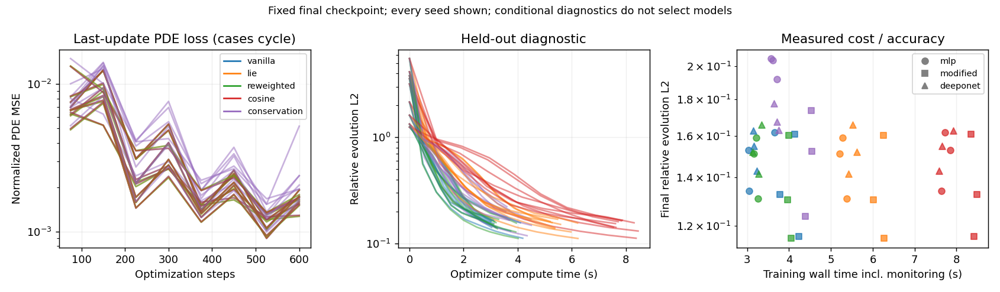
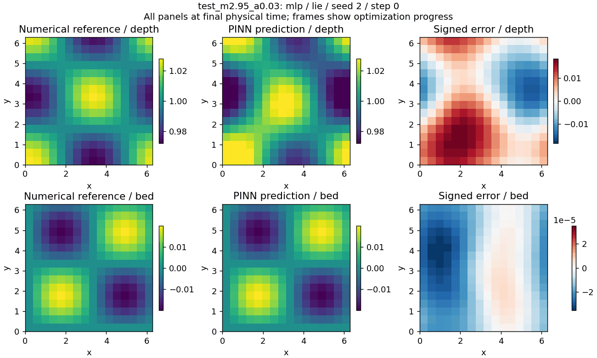

# SWE/SVE Lie-PINN baseline: measured pilot

Start with the flat-bed single-PDE experiment in README.md. The main experiment has two spatial coordinates plus time, four coupled fields, a smooth periodic domain, and a short horizon T=0.25. A separate 1+1 scalar control verifies the exceptional subgroup in the supplied manuscript.

**What was executed:** 63 single-case runs (7 cases × 3 seeds × 3 losses) and 45 conditional-family runs (3 architectures × 3 seeds × 5 losses). Each uses 600 Adam steps and 128 paired collocation points per training case. The family trains six parameter/initial-amplitude pairs and tests two unseen pairs plus one translated structural check. No test-based checkpoint selection was used.

## Symbolic cost and scope

| Case | PDE operation count | Scaling nullity | Audit seconds: median [min, max] |
|---|---:|---:|---:|
| flat | 19 | 2 | 0.0351 [0.0341, 0.1224] |
| topography | 19 | 2 | 0.0328 [0.0321, 0.0338] |
| rotation_drag | 27 | 1 | 0.0554 [0.0502, 0.0858] |
| sve_m2.9 | 51 | 1 | 0.2295 [0.2132, 0.3060] |
| sve_m3 | 42 | 2 | 0.0692 [0.0675, 0.1154] |
| sve_m3.1 | 48 | 1 | 0.2445 [0.2230, 0.2901] |
| sve_m4 | 48 | 1 | 0.2253 [0.2149, 0.2741] |

The audit uses a 19-coordinate first-order jet, a 4×19 residual Jacobian, seven supplied candidate generators, and a five-coefficient scaling ansatz. Repeated in-process timings retain cache effects and the first trial. This does not time or prove a maximal Lie classification.

Cubic active Grass transport has the additional V scaling; nearby noncubic cases reject it. Fixed Coriolis/drag breaks D. Continuous bulk rotations/scalings do not act globally on the fixed square torus; they enter only as local residual identities.

## Conditional neural comparison

| Architecture | Loss | Parameters | Evolution L2: seed median [min,max] | Maximum field error: median | Training compute: median s |
|---|---|---:|---:|---:|---:|
| mlp | vanilla | 2628 | 0.1528 [0.1340, 0.1618] | 0.6208 | 3.014 |
| mlp | lie | 2628 | 0.1510 [0.1308, 0.1591] | 0.6168 | 5.269 |
| mlp | reweighted | 2628 | 0.1510 [0.1308, 0.1591] | 0.6168 | 3.197 |
| mlp | cosine | 2628 | 0.1528 [0.1340, 0.1618] | 0.6208 | 7.710 |
| mlp | conservation | 2628 | 0.2040 [0.1918, 0.2051] | 0.8612 | 3.597 |
| modified | vanilla | 2596 | 0.1327 [0.1158, 0.1608] | 0.7028 | 4.097 |
| modified | lie | 2596 | 0.1303 [0.1151, 0.1602] | 0.7357 | 6.213 |
| modified | reweighted | 2596 | 0.1303 [0.1151, 0.1602] | 0.7357 | 3.948 |
| modified | cosine | 2596 | 0.1327 [0.1158, 0.1608] | 0.7029 | 8.374 |
| modified | conservation | 2596 | 0.1524 [0.1235, 0.1737] | 0.8040 | 4.487 |
| deeponet | vanilla | 2641 | 0.1550 [0.1431, 0.1627] | 0.7715 | 3.120 |
| deeponet | lie | 2641 | 0.1521 [0.1416, 0.1660] | 0.7553 | 5.474 |
| deeponet | reweighted | 2641 | 0.1521 [0.1416, 0.1660] | 0.7553 | 3.228 |
| deeponet | cosine | 2641 | 0.1549 [0.1431, 0.1627] | 0.7719 | 7.611 |
| deeponet | conservation | 2641 | 0.1675 [0.1630, 0.1776] | 0.8466 | 3.661 |

Aggregate evolution errors average the two genuinely unseen test cases. Maximum field errors also inspect bed evolution. Seed ranges are not confidence intervals.

The MLP Lie-loss median is 0.1510, versus 0.1528 for vanilla. Its exact algebraic weighting reaches the same result: maximum paired evolution-error difference 1.41e-11. The weighting uses 3.197 s versus 5.269 s for explicit prolongation, a measured 39.3% reduction in optimizer compute in this pilot.

The modified MLP has aggregate median error 0.1327 versus 0.1528 for the plain MLP, but its median maximum field error is 0.7028 versus 0.6208. Architecture rankings therefore depend on the field/metric and seed. The paper's worse-modified-MLP result is not asserted as universal or reproduced in this different PDE experiment.

The MLP conservation variant has aggregate median error 0.2040. Final training-batch PDE/extra-gradient cosines over all conservation runs range from 0.043 to 0.865. All are positive at this sampled final checkpoint, so these diagnostics do not support gradient conflict as the explanation. Weight, quadrature, capacity, and sampling ablations are required before judging conservation penalties generally.

The family pilot’s first panel logs last-update PDE losses from cycling training cases; it is not a fixed-case loss trajectory. Held-out evolution errors use the same diagnostic case throughout. Future runs additionally log PDE residuals at fixed independent points. GIF frames show training progress at fixed final physical time.

## Single-case baselines

| Case | Loss | Evolution L2 median | Maximum field error median | Matched seeds / 3 |
|---|---|---:|---:|---:|
| flat | vanilla | 0.1440 | 0.2441 | 0/3 |
| flat | lie | 0.1421 | 0.2309 | 0/3 |
| flat | reweighted | 0.1421 | 0.2309 | 0/3 |
| topography | vanilla | 0.1077 | 0.2415 | 0/3 |
| topography | lie | 0.1096 | 0.2325 | 0/3 |
| topography | reweighted | 0.1096 | 0.2325 | 0/3 |
| rotation_drag | vanilla | 0.0468 | 0.2213 | 0/3 |
| rotation_drag | lie | 0.0486 | 0.2166 | 0/3 |
| rotation_drag | reweighted | 0.0486 | 0.2166 | 0/3 |
| sve_m2.9 | vanilla | 0.1036 | 0.4557 | 0/3 |
| sve_m2.9 | lie | 0.0963 | 0.4554 | 0/3 |
| sve_m2.9 | reweighted | 0.0963 | 0.4554 | 0/3 |
| sve_m3 | vanilla | 0.1114 | 0.4457 | 0/3 |
| sve_m3 | lie | 0.1212 | 0.4422 | 0/3 |
| sve_m3 | reweighted | 0.1212 | 0.4422 | 0/3 |
| sve_m3.1 | vanilla | 0.1144 | 0.4569 | 0/3 |
| sve_m3.1 | lie | 0.1076 | 0.4627 | 0/3 |
| sve_m3.1 | reweighted | 0.1076 | 0.4627 | 0/3 |
| sve_m4 | vanilla | 0.1230 | 1.9641 | 0/3 |
| sve_m4 | lie | 0.1126 | 2.0644 | 0/3 |
| sve_m4 | reweighted | 0.1126 | 2.0644 | 0/3 |

## Classical comparison and limits

Finest-grid classical solve times range from 0.0150 to 0.0178 s for the seven cases. Grid/tolerance construction is logged separately. Reference uncertainty estimates range from 8.37e-12 to 1.1e-11 in maximum absolute field difference.

None of the 45 conditional runs passes the preset 5% maximum per-field evolution-error target. Thus this pilot establishes **no matched-accuracy neural speedup or finite amortization break-even**. Neural grid inference is cheap, but numerical trajectories are also cached for repeated field queries. The possible amortization target is many new parameter/initial-data solves, after independent accuracy validation.

The supported advantages are exact hard initial conditions/periodicity, exact translation-family canonicalization, parameter-conditioned interpolation, and a verified cheaper implementation of a redundant Lie loss. Better accuracy than classical solving is not demonstrated.

## Next experiments beyond Lie classification

1. Run fixed-step collocation-count and loss-weight ablations with independent validation/test families; preserve every seed and failure.
2. Improve sediment-dynamics accuracy with coupled equation balancing, residual-adaptive points, and gradient diagnostics.
3. Extend the initial-condition family before claiming operator generalization; include a separate extrapolation test.
4. Use a sourced energy-compatible/slope-aware SVE closure before introducing energy constraints.
5. Add a well-balanced finite-volume reference and weak/conservative neural residual before studying shocks or dry beds.
6. Compare conditional/equivariant architectures and inverse-parameter identification with the Lie-PINN baseline retained.

All statements apply to the recorded CPU pilot and declared regular model branch. The scalar printed-master control remains mathematically distinct from the 2+1 Grass system. Sources and exact commands are in README.md.
