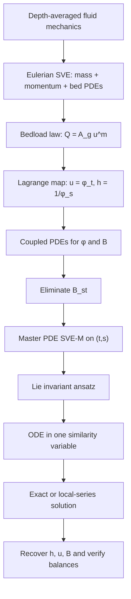
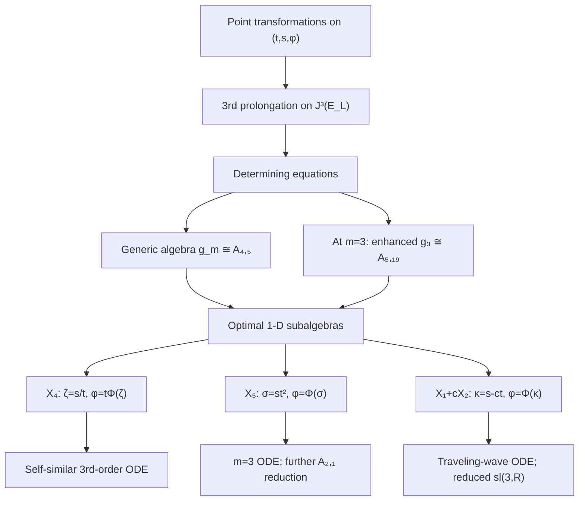
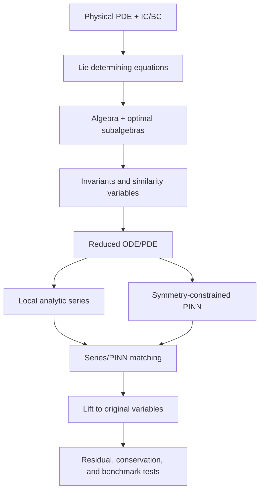
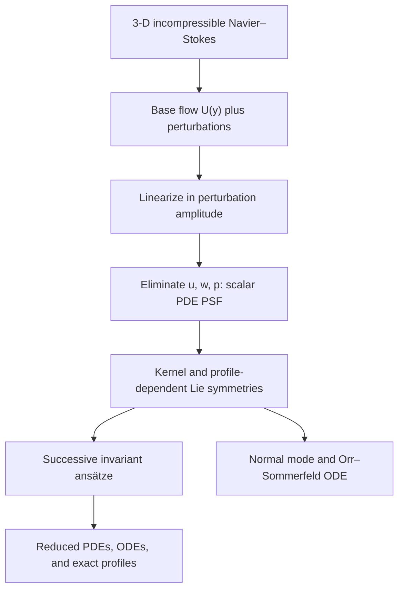
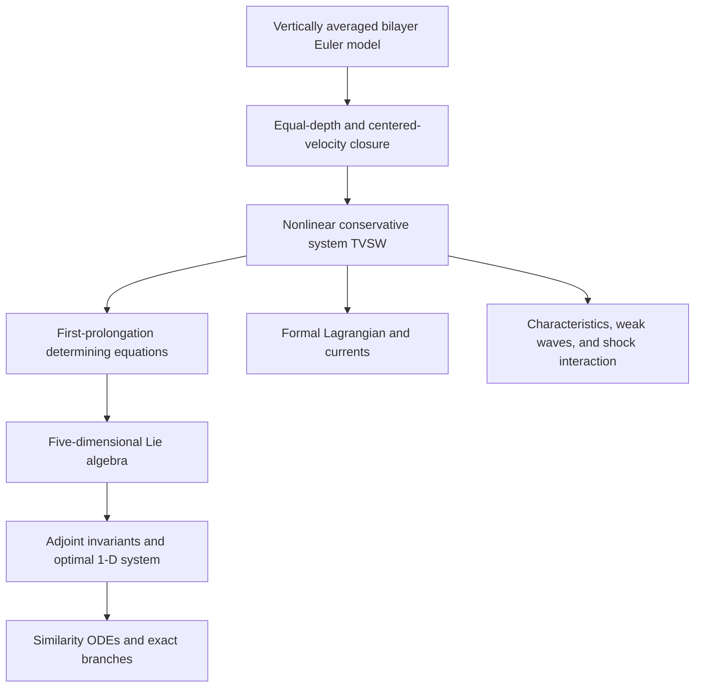
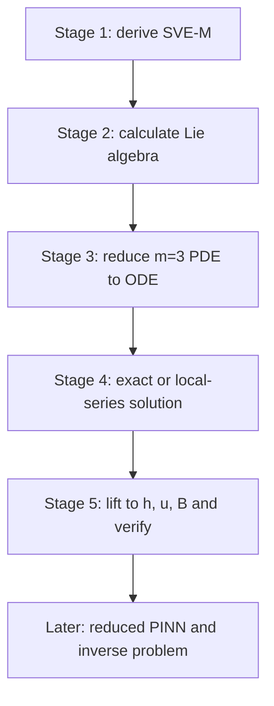

# Lie-Symmetry–ML for Fluid PDEs: Coauthor Review of the 12 Instructor-Recommended Papers

**Purpose.** This is a research-selection document, not merely an annotated bibliography. It asks of every paper: What physical/mathematical target is solved? What is the Lie reduction chain? What actually plays the role of computation or learning? What could be converted into a defensible **Lie + ML + series** project? What remains unsolved?

**Cut-off and evidence.** Prepared 7 September 2026 and revised 8 September 2026 after the instructor’s proposal guidance and the upload of the two previously missing 2025 papers. Sources are the instructor list, nine supplied PDFs, publisher pages, DOI metadata, and author/institutional abstracts. “Full-text” means the supplied PDF was checked. “Abstract-level” means that the paper was paywalled and claims are deliberately limited to what its publisher or institutional record supports. The supplied *Navier–Stokes II* PDF is treated as a companion to the 1994 Part I entry, not as a thirteenth item.

## Executive verdict

1. **None of the 12 papers uses a PINN, neural operator, or trained neural network.** The numerical tools are DNS, `bvp4c`, RKF-45, shooting–Runge–Kutta, homotopy analysis (HAM), and homotopy perturbation (HPM). Citations to neural-network work in a literature review do not make the host paper an ML paper.
2. The closest existing **data-to-symmetry** workflow is Nguyen & Oberlack (2025): Lie-derived turbulent scaling laws are fitted to and validated against high-order DNS statistics. The fit is regression, not a neural network.
3. The strongest **starting paper** is Paliathanasis, Leon & Leach (2026), the Saint–Venant–Exner bed-evolution paper. For the proposal’s first task, however, we should postpone ML and first reproduce the analysis: derive its highly nonlinear PDE in two independent variables, verify the Lie algebra, and reduce one scaling branch to an ODE. Only after that analytical spine is secure should we attach a series or PINN solver.
4. The newly supplied full texts clarify the nearest alternative. Sharma, Shagolshem & Arora (2025) has a genuinely nonlinear first-order $1+1$-D shallow-water system and a complete advertised Lie-to-ODE pipeline, but it has three dependent fields and its shock and self-adjointness claims require correction before reuse. Mandal, Sil & Ghosh (2025), despite nonlinear shear profiles, performs its Lie analysis on a **linearized** $3+1$-D perturbation PDE; it is therefore not the requested nonlinear beginning hook.
5. The strongest **second project** is Razafindralandy & Hamdouni (2024): use the 12-dimensional compressible Navier–Stokes algebra to build reduced PINN/series solvers and benchmark them against the paper’s vortex and traveling-wave families.
6. The strongest **data-rich but expensive project** is Nguyen & Oberlack (2025): learn high-order moment laws or closure corrections while enforcing statistical symmetries. It is more original, but it requires serious DNS data and careful treatment of the physical status of statistical symmetries.

## Proposal adjustment: an analysis-first shallow-water hook

### Exact choice and what “2-D” means here

We choose Paliathanasis, Leon & Leach (2026), *Lie Symmetries and Similarity Solutions for a Shallow-Water Model with Bed Elevation in Lagrange Variables*. The model is derived from depth-averaged Euler/Navier–Stokes reasoning and describes a moving free surface coupled to a sediment bed.

The phrase **2-D PDE** must be used carefully in the proposal. The physical model is one-dimensional in space, but its master equation has **two independent variables**, time and Lagrangian mass coordinate:

\[
(t,s)\longmapsto \phi(t,s).
\]

It is therefore a $1+1$-dimensional nonlinear PDE, not a two-horizontal-spatial-dimensional shallow-water model. This is exactly the right size for learning Lie analysis manually: it is small enough to compute, but its third-order rational and power nonlinearities are substantial.

### The connected PDE genealogy

The Eulerian state is water depth $h(t,x)$, horizontal velocity $u(t,x)$, and bed elevation $B(t,x)$. The Saint–Venant–Exner balance laws are

\[
\begin{aligned}
h_t+(uh)_x&=0,\\
(uh)_t+\left(hu^2+\tfrac12gh^2\right)_x+ghB_x&=0,\\
B_t+\xi Q_x&=0,
\qquad Q=A_g u^m,
\qquad \beta=mA_g\xi.
\end{aligned}
\]

Introduce the Lagrangian particle map $\phi(t,s)$ through

\[
u=\phi_t,
\qquad h=\frac{1}{\phi_s}.
\]

The continuity equation is then built into the coordinates. Momentum and Exner evolution become

\[
\phi_{tt}-g\frac{\phi_{ss}}{\phi_s^3}+\frac{g}{\phi_s}B_s=0,
\qquad
B_t+\beta(\phi_t)^{m-1}\frac{\phi_{ts}}{\phi_s}=0.
\]

Eliminating $B_{st}$ gives the selected two-variable master PDE:

\[
\boxed{
\partial_t\!\left(
\phi_s\phi_{tt}-g\frac{\phi_{ss}}{\phi_s^2}
\right)
-g\beta\,\partial_s\!\left(
(\phi_t)^{m-1}\frac{\phi_{ts}}{\phi_s}
\right)=0
}
\tag{SVE-M}
\]

This derivation is more than background: after solving the master PDE, we must lift $\phi$ back to $(h,u,B)$ and verify the original three balance laws. A low residual for (SVE-M) alone does not guarantee a physically admissible solution; in particular, $\phi_s>0$ is required for positive finite depth.

### Spaces and algebras encountered while solving

| Layer | Object | What lives there | Why it is needed |
|---|---|---|---|
| Eulerian base | $M_E=\{(t,x)\}$ | time and fixed spatial position | Physical conservation laws |
| Eulerian field bundle | $E_E\to M_E$ | $(h,u,B)$ over each $(t,x)$ | Original fluid/bed state |
| Lagrangian base | $M_L=\{(t,s)\}$ | time and material/mass label | Continuity is absorbed into coordinates |
| Lagrangian field bundle | $E_L\to M_L$ | $(\phi,B)$, later only $\phi$ | Compact coupled and master equations |
| Third jet space | $J^3(E_L)$ | $(t,s,\phi,\phi_t,\phi_s,\ldots,\phi_{sss})$ | The third prolongation acts here |
| Generic symmetry algebra | $\mathfrak g_m$ | $X_1,X_2,X_3,X_4$ | All $m\ge1$ |
| Enhanced algebra | $\mathfrak g_3$ | $\mathfrak g_m$ plus $X_5$ | Exists only at $m=3$ |
| Optimal system | one-dimensional subalgebras | inequivalent generator choices | Avoids solving equivalent reductions repeatedly |
| Reduced jet space | $J^3(\mathbb R,\mathbb R)$ | similarity variable and profile derivatives | The PDE has become an ODE |

For arbitrary $m$, the paper finds

\[
X_1=\partial_t,
\quad X_2=\partial_s,
\quad X_3=\partial_\phi,
\quad X_4=t\partial_t+s\partial_s+\phi\partial_\phi.
\]

The translation algebra $\langle X_1,X_2,X_3\rangle\simeq3A_1$ is Abelian. The nonzero brackets with the dilation are

\[
[X_1,X_4]=X_1,
\qquad [X_2,X_4]=X_2,
\qquad [X_3,X_4]=X_3.
\]

The full four-dimensional algebra is recorded in the paper as a member of the Patera class $A_{4,5}^{ab}$. At the special exponent $m=3$, it gains

\[
X_5=t\partial_t-2s\partial_s,
\]

and enlarges to a five-dimensional algebra in the class $A_{5,19}^{apq}$. Also

\[
[X_1,X_5]=X_1,
\qquad [X_2,X_5]=-2X_2,
\qquad [X_3,X_5]=0,
\qquad [X_4,X_5]=0.
\]

The paper’s one-dimensional optimal system contains representatives generated by

\[
X_1, X_2, X_3, X_1+a_2X_2+a_3X_3, X_4, X_5, X_4+aX_5,
\]

with the last two available only in the enhanced $m=3$ case.

The labels $A_{4,5}^{ab}$ and $A_{5,19}^{apq}$ are classification names, not new coordinate spaces. By contrast, $J^3(E_L)$ really is a geometric space containing derivative coordinates. Keeping “algebra,” “subalgebra,” “group orbit,” “invariant,” and “jet space” separate will prevent much of the usual conceptual confusion.

### The manual Lie calculation we should complete first

Let

\[
X=\tau(t,s,\phi)\partial_t
+\xi(t,s,\phi)\partial_s
+\eta(t,s,\phi)\partial_\phi.
\]

Because (SVE-M) contains third derivatives, form $\operatorname{pr}^{(3)}X$ and impose

\[
\left.\operatorname{pr}^{(3)}X(F)\right|_{F=0}=0.
\]

Expanding and splitting with respect to independent derivative monomials produces a **linear** overdetermined system for $\tau,\xi,\eta$, even though $F=0$ is strongly nonlinear. Solve that system, verify the five generators above, compute their brackets, and only then use the adjoint action to understand the optimal subalgebras.

For a beginning exercise, we do not need to expand every third-prolongation coefficient immediately. We can first verify the two key scalings by weights:

| Quantity | Weight under $X_4$ | Weight under $X_5$ |
|---|---:|---:|
| $(t,s,\phi)$ | $(1,1,1)$ | $(1,-2,0)$ |
| $\partial_t,\partial_s$ | $(-1,-1)$ | $(-1,2)$ |
| $\phi_t,\phi_s$ | $(0,0)$ | $(-1,2)$ |
| First term of (SVE-M) | $-2$ | $-1$ |
| Second term of (SVE-M) | $-2$ | $2-m$ |

Both terms always have equal $X_4$-weight, so $X_4$ is a symmetry for every $m$. Under $X_5$, equality requires

\[
-1=2-m \quad\Longleftrightarrow\quad m=3.
\]

This one-line weight balance explains the exceptional exponent before the full determining-equation calculation.

### What to do when a self-similar solution is detected

A self-similar solution is not yet a solved solution. It is a symmetry-invariant **ansatz** that removes one independent variable.

For $X_4$, solve the characteristic equations

\[
\frac{dt}{t}=\frac{ds}{s}=\frac{d\phi}{\phi}.
\]

Two invariants are

\[
\zeta=\frac{s}{t},
\qquad \frac{\phi}{t}=\Phi(\zeta),
\]

so

\[
\boxed{\phi(t,s)=t\,\Phi(s/t)}.
\]

Substitute this ansatz and all required derivatives into (SVE-M). Every explicit power of $t$ factors out, leaving a third-order ODE for $\Phi(\zeta)$ (equation (24) of the paper). At $m=3$, the inherited $X_5$ symmetry reduces this ODE again and yields a power-law branch $\Phi=\Phi_0\zeta^{1/3}$, subject to the paper’s algebraic coefficient condition. That fractional exponent is a **power-law self-similar solution**, not a fractional Lie symmetry.

The invariant-surface condition says the same thing directly:

\[
Q_{X_4}=\eta-\tau\phi_t-\xi\phi_s
=\phi-t\phi_t-s\phi_s=0.
\]

Later, a symmetry-built network can enforce the ansatz exactly, $\phi_\theta=tN_\theta(s/t)$, or a general network can receive $\|Q_{X_4}\|^2$ as a loss. For Phase I, however, we should perform the substitution and reduction by hand and verify it symbolically.

### Does “fractional symmetry” exist here?

There are three easily confused ideas:

1. **Fractional differential symmetry:** Lie analysis for a PDE containing a Caputo, Riemann–Liouville, or other non-integer derivative. The selected SVE model has only integer-order derivatives, so this is **not present**.
2. **Fractional power:** $m$ may be real and a self-similar solution may contain powers such as $\zeta^{1/3}$. This does not make the equation a fractional PDE or create a “fractional Lie group.”
3. **Partial/statistical symmetry:** a transformation may preserve only part of a statistical hierarchy, as discussed in the turbulent-jet paper. This is also different and is not the symmetry used in the SVE reduction.

If we later introduce fractional time memory into sediment transport, the prolongation rules become nonlocal and the initial data change qualitatively. That could be a later project, but using it now would obscure the proposal’s first goal: learning and verifying ordinary point-Lie reduction.

### First analytical deliverable

The first task should be stated as follows:

> **Independently derive and verify the Lie point symmetries of the third-order Saint–Venant–Exner master PDE, then use the exceptional $m=3$ scaling generator to reduce the $(t,s)$-PDE to a one-variable nonlinear ODE and reconstruct a physically admissible shallow-water solution.**

The concrete checklist is:

1. Re-derive (SVE-M) from the Eulerian balance laws and the Lagrange map.
2. Verify $X_1,\ldots,X_4$ for general $m$, and $X_5$ only for $m=3$.
3. Reproduce the commutator table and identify the Abelian translation subalgebra.
4. Solve the characteristic system for $X_5$: $\sigma=st^2$, $\phi=\Phi(\sigma)$.
5. Derive the reduced ODE term by term and compare it with equation (25) of the paper.
6. Use the inherited reduced symmetries to lower its order; reproduce at least one exact power-law branch.
7. Recover $u=\phi_t$, $h=1/\phi_s$, and $B$; check $h>0$, singular sets, dimensions, and all three Eulerian balances.
8. Only after steps 1–7, construct a Taylor/Frobenius series or introduce a reduced PINN for ODE branches not available in closed form.

This is a credible beginning hook because it contains the whole Lie workflow—model transformation, prolongation, algebra, invariants, PDE-to-ODE reduction, exact solution, and physical lift-back—without hiding the analysis inside a neural solver.

## What a genuine Lie → ML + series pipeline should mean

The ML component should learn **unknown solution profiles, parameters, constitutive corrections, or maps across parameter space**. It should not be presented as “discovering” a symmetry that was inserted manually. A useful composite loss is

\[
\mathcal L=\lambda_r\mathcal L_{\mathrm{PDE/ODE}}
+\lambda_b\mathcal L_{\mathrm{BC}}
+\lambda_i\mathcal L_{\mathrm{IC}}
+\lambda_s\mathcal L_{\mathrm{sym}}
+\lambda_c\mathcal L_{\mathrm{cons}}
+\lambda_m\mathcal L_{\mathrm{match}}
+\lambda_d\mathcal L_{\mathrm{data}}.
\]

Here $\mathcal L_{\mathrm{sym}}$ can enforce an invariant-surface condition $Q=\eta-\tau u_t-\xi u_x=0$; $\mathcal L_{\mathrm{cons}}$ enforces a conservation or weak/entropy law; and $\mathcal L_{\mathrm{match}}$ joins a truncated series to the neural residual correction. The series supplies correct near-boundary or near-regular-point structure; the network supplies global continuation.

## Chronological ranking: pioneer to newest

| Chronological rank | Date | Paper | Actual terminal solver/data | ML/PINN? | Evidence |
|---:|---|---|---|---|---|
| 1 | 1994 | Fushchych & Popowych, *Symmetry reduction and exact solutions of the Navier–Stokes equations. I* | Exact reductions, quadratures, special functions; Part II supplies further exact/reduced systems | No | Full-text Parts I & II |
| 2 | 2024 | Razafindralandy & Hamdouni, *Group theoretic approach and analytical solutions of the compressible Navier–Stokes equations* | Analytic self-similar solutions | No | Full text |
| 3 | Jan. 2025 | Hamadneh et al., *Lie symmetry analysis of bio-nano-slip flow…* | RKF-45 | No | Full text |
| 4 | Jan. 2025 | Khan et al., *Lie-symmetry analysis of a three-dimensional flow due to unsteady stretching…* | HAM | No | Institutional abstract |
| 5 | Feb. 2025 | Mandal, Sil & Ghosh, *On the Lie symmetry analysis of three-dimensional perturbed shear flows* | Successive Lie reductions; exact elementary/hypergeometric profiles; Orr–Sommerfeld eigenproblem identified but not solved | No | Full text |
| 6 | Apr. 2025 | Sharma, Shagolshem & Arora, *Analysis of wave propagation…shallow water model with two velocities* | Exact invariant solutions, formal conservation currents, and analytic characteristic-wave transport | No | Full text |
| 7 | June 2025 | Nguyen & Oberlack, *Passive scalar statistics in a turbulent round jet* | DNS + fitted symmetry laws | No neural ML | Full text |
| 8 | Nov. 2025 | Panda & Pandey, *Lie symmetry and variational analysis of a blood flow model with body forces* | Lie/variational analysis; details require full text | No evidence of ML | Metadata-level |
| 9 | 3 Jan. 2026 | Mandal & Ghosh, *Lie symmetry analysis, optimal classification…Darcy–Brinkman model* | Exact invariant solutions | No | Publisher abstract |
| 10 | 26 Jan. 2026 | Paliathanasis, Leon & Leach, *Lie symmetries and similarity solutions…bed elevation…* | Closed-form and reduced ODE solutions | No | Full text |
| 11 | 19 June 2026 | Ahmed et al., *Lie symmetry approach…stretching sheet with slip velocity and variable heat flux* | HPM + shooting/RK validation | No | Publisher full HTML/abstract |
| 12 | 22 June 2026 | Sulaxshan et al., *Integration of Lie symmetry analysis…hybrid Casson–Eyring–Powell nanofluid* | MATLAB `bvp4c` | No | Full text |

The 2024 placement uses the journal version, not the 2021 arXiv posting. Dates within 2025/2026 follow issue or online-publication metadata.

---

## 1. Fushchych & Popowych (1994): incompressible Navier–Stokes pioneer

**Research target.** Construct and classify symmetry-generated ansätze for the three-dimensional incompressible viscous Navier–Stokes equations

\[
\mathbf u_t+(\mathbf u\!\cdot\!\nabla)\mathbf u-\Delta\mathbf u+\nabla p=0,
\qquad \nabla\!\cdot\!\mathbf u=0,
\]

then reduce four independent variables $(t,x_1,x_2,x_3)$ to systems in three, two, or one variables and construct large exact-solution families.

**Resolving structure.** The paper starts from the maximal, infinite-dimensional Lie invariance algebra $A(NS)$: time translation, scaling, rotations, generalized time-dependent translations/Galilean transformations $R(\mathbf m(t))$, and pressure gauges $Z(\chi(t))$. It classifies inequivalent subalgebras of codimension 1, 2, and 3, solves invariant-surface conditions to obtain ansätze, substitutes them into NSE, then studies both inherited and genuinely new symmetries of the reduced systems. The supplied Part II continues the reductions and reports that some two-variable systems become pairs of one-dimensional heat or transport equations, while many ODE systems admit exact solutions.

**Method/model.** Classical point-Lie analysis, commutator and adjoint-action calculations, optimal subalgebra classification, repeated reduction, quadratures, and special functions (Bessel/modified Bessel/Whittaker in representative branches). There is no learned model and no numerical dataset.

**Results and declared future work.** The authors obtain many exact velocity/pressure fields and reduction templates. Part II explicitly leaves: non-Lie ansätze (including Kármán swirling flows), nonlocal/conditional/(Q)-conditional symmetries, and overdetermined NSE plus auxiliary constraints such as generalized Beltrami-type conditions.

**Our Lie–ML–series conversion.** Use the 1994 catalogue as a supervised *structural benchmark*: each subalgebra defines a known invariant coordinate system and each exact solution defines a test case. Train a small classifier or policy only to select promising subalgebras/ansätze from PDE/BC descriptors; solve the resulting low-dimensional equations with a series-enriched PINN. Do not train a four-dimensional black-box NSE PINN first. The publishable question is whether symmetry reduction measurably lowers sample/collocation complexity and improves extrapolation relative to an unreduced PINN.

**Coauthor opinion.** Foundational and mathematically substantial. Its enduring value is not any single profile but the separation of three problems: algebra classification, invariant ansatz construction, and solution of the reduced equations. It is too broad for our first application paper, but it supplies the correct methodological spine and gold-standard exact benchmarks.

## 2. Razafindralandy & Hamdouni (2024): compressible Navier–Stokes

**Research target.** Expand the sparse library of exact solutions for a Newtonian ideal gas with constant dynamic viscosity and thermal conductivity, formulated in density–velocity–pressure variables.

**Resolving structure.** The authors derive a 12-dimensional point-symmetry group; give its commutation table and Levi decomposition into a solvable radical and rotational semisimple part; impose invariance under selected generators; and perform successive reductions for steady 2-D, unsteady 2-D, and 3-D flows. Reduced equations are solved analytically rather than by a numerical optimizer.

**Method/model.** Lie prolongation/determining equations, finite group actions, Lie-algebra structure, and self-similar ansätze. The solution catalogue includes 2-D vortex sinks/sources with velocity scaling like $r^{-2}$ or $r^{-1}$, exponentially varying flows, 3-D vortex-like fields, and traveling waves. A traveling-wave branch requires $2\kappa\leq \mu C_v$. No ML/PINN is present.

**Results and future work.** The authors emphasize non-exhaustiveness: new solutions should follow from other generator combinations and by group-transforming known solutions. This is a real opening, though “trying more linear combinations” alone is not enough originality.

**Our conversion.** Parameterize an invariant family by generator coefficients and learn the reduced profiles, not the full $(t,x,y,z)$ solution. Near a regular or far-field point, derive a recurrence $U(\zeta)=\sum_{k=0}^{N}a_k\zeta^k$; let a neural correction $B(\zeta)N_\theta(\zeta)$ vanish to order $N$ at the matching point. Losses should include reduced continuity, momentum, energy, physical positivity of $\rho,p,T$, IC/BC, and a lift-back residual in the original compressible system. A useful inverse variant learns $\mu,\kappa,C_v$ or a symmetry-compatible viscosity law from sparse synthetic/experimental observations.

**Coauthor opinion.** The best Navier–Stokes-centered basis among the 12: serious algebra, diverse exact solutions, and excellent verification cases. The difficulty is scope. We should select one two-variable vortex/traveling-wave family and one inverse parameter, rather than promise “compressible NSE by AI.”

## 3. Hamadneh et al. (2025): bio-nanofluid in a rotating cone–disk gap

**Research target.** Axisymmetric three-dimensional Buongiorno bio-nanofluid flow between a cone and disk with velocity slip and Stefan blowing, under four rotation configurations: cone-only, disk-only, co-rotation, and counter-rotation. The PDE system contains continuity, three momentum equations, energy, nanoparticle volume fraction, and motile-microorganism density.

**Resolving structure.** Nondimensionalize; calculate a general one-parameter Lie transformation; solve the characteristic equations for similarity variables; reduce the PDE/BC system to coupled ODE boundary-value problems; solve them with RKF-45; and postprocess radial/tangential skin friction, Nusselt, Sherwood, and microorganism-density transfer numbers.

**Method/model.** Classical Lie scaling plus adaptive Runge–Kutta–Fehlberg, with stated initial step (10^{-3}) and convergence threshold (10^{-6}). It explores rotational Reynolds numbers, gap angle, slip, blowing, Brownian motion, thermophoresis, bioconvection parameters, and the four wall-rotation models. No ML or series solver is used.

**Results/future work.** Slip and blowing alter friction and heat, particle, and microorganism transport differently at cone and disk; effects depend on rotation configuration. The paper’s “future work” is mostly implicit: more realistic constitutive properties, unsteadiness, richer wall physics, and experimental validation.

**Our conversion.** A parametric neural operator or reduced PINN could map $(Re,\gamma_{gap},s_{slip},S_{blow},N_b,N_t,\ldots)$ to the invariant profiles. Wall Taylor series enforce regular boundary behavior and seed a multiple-shooting/PINN continuation. However, the parameter count is large; identifiability and physical-property uncertainty would dominate. A credible project must perform global sensitivity/identifiability analysis before training.

**Coauthor opinion.** Computationally convenient but scientifically crowded. The paper delivers a broad parameter study more than a deep symmetry result. It is suitable for a demonstration of parametric surrogates, not our strongest originality claim.

## 4. Khan et al. (2025): unsteady 3-D stretching sheet with nonuniform temperature

**Research target.** Three-dimensional flow and heat transfer induced by an unsteadily stretching infinite flat sheet with a nonuniform temperature distribution.

**Resolving structure.** Derive twelve Lie point symmetries of the nonlinear PDEs; obtain invariants and new similarity transformations; reduce the PDEs to nonlinear ODEs; solve those ODEs analytically with HAM; then study stretching rate, temperature nonuniformity/unsteadiness parameters, and Prandtl number.

**Method/model.** Point symmetries + invariant variables + homotopy analysis. HAM constructs a convergence-controlled analytic series; it is not ML. The institutional abstract reports heat-transfer reversal for some parameters and a maximum temperature/transfer location slightly above, rather than exactly on, the sheet.

**Our conversion.** This is naturally a **HAM-series + PINN residual correction** study. Preserve HAM’s first $N$ coefficients and learn only the remainder, comparing convergence radius, global residual, and wall observables with HAM alone. A parameter-conditioned network could amortize solutions across Prandtl and unsteadiness ranges.

**Coauthor opinion.** A clean solver-comparison paper, but less original physically than the shallow-water or compressible options. Full text is required before claiming novelty in the precise symmetry algebra or boundary compatibility.

## 5. Mandal, Sil & Ghosh (2025): perturbed 3-D shear flows

**Research target and actual equation analyzed.** The paper starts from the three-dimensional incompressible Navier–Stokes equations and a parallel base flow $(U(y),0,0)$. It writes the full perturbation equations for $(u,v,w,p)$, but then discards products of perturbations and eliminates $u,w,p$. The object subjected to Lie analysis is therefore the **linear** scalar equation for the wall-normal velocity perturbation $v$,

\[
\boxed{
(\partial_t+U(y)\partial_x)\Delta v-U''(y)v_x
=\nu\Delta^2v,
\qquad
\Delta=\partial_x^2+\partial_y^2+\partial_z^2.
}
\tag{PSF}
\]

It is fourth order when $\nu\ne0$ and has four independent variables $(t,x,y,z)$. A nonlinear *base profile* $U(y)$ does not make (PSF) nonlinear in $v$. This distinction rules the paper out as our requested “two-variable PDE with much nonlinearity,” although it remains a useful linear-stability benchmark.

**Lie method and algebra.** Classical point-symmetry analysis uses the fourth prolongation. For arbitrary $U(y)$ the finite-dimensional kernel is

\[
X_1=\partial_x,
\quad X_2=\partial_z,
\quad X_3=\partial_t,
\quad X_4=v\partial_v.
\]

Because (PSF) is linear and homogeneous, it also has the infinite-dimensional solution-superposition ideal

\[
X_0[\varphi]=\varphi(t,x,y,z)\partial_v,
\qquad \mathcal L_U[\varphi]=0.
\]

Thus the paper’s wording “five symmetries” should not be read as a five-dimensional algebra: it is a four-dimensional finite kernel plus an arbitrary-solution ideal. The authors omit $X_0$ from their reductions and complexify linear combinations of $X_1,\ldots,X_4$ to obtain exponential modes. Three successive invariant reductions recover

\[
v=f(y)e^{i(\alpha_xx+\alpha_zz-\omega t)},
\qquad k^2=\alpha_x^2+\alpha_z^2,
\]

and the three-dimensional Orr–Sommerfeld eigen-equation

\[
(U-c)(D_y^2-k^2)f-U''f
=\frac{\nu}{i\alpha_x}(D_y^2-k^2)^2f,
\qquad c=\omega/\alpha_x.
\]

The paper identifies $c$ as the eigenvalue once physical boundary conditions are supplied, but it does not solve this eigenproblem.

The group classification produces the following extra finite generators for special base profiles:

| Regime and base profile | Extra admitted generator(s) |
|---|---|
| Inviscid, $U=A_1y+B_1$ | $X_5=A_1t\partial_x+\partial_y$; $X_6=y\partial_y+z\partial_z+(x-B_1t)\partial_x$ |
| Inviscid, $U=A_2\ln(y+B_2)+C_2$ | $X_7=t\partial_t+z\partial_z+(x+A_2t)\partial_x+(y+B_2)\partial_y$ |
| Inviscid, $U=A_3(y+B_3)^{C_3}+D_3$ | $X_8=(C_3-1)t\partial_t+(C_3D_3t-x)\partial_x-(y+B_3)\partial_y-z\partial_z$ |
| Inviscid, $U=A_4e^{B_4y}+C_4$ | $X_9=B_4t\partial_t+B_4C_4t\partial_x-\partial_y$ |
| Viscous, $U=A_5y+B_5$ | $X_{10}=A_5t\partial_x+\partial_y$ |
| Viscous, $U=A_6/(y+B_6)+C_6$ | $X_{11}=2t\partial_t+(C_6t+x)\partial_x+(y+B_6)\partial_y+z\partial_z$ |

This is a profile classification followed by selected generator combinations; unlike the two-velocity shallow-water paper, it does **not** construct a one-dimensional optimal system under the adjoint action.

**Reduction and solution catalogue.** The authors repeatedly solve characteristic equations, substitute the invariant ansatz, calculate new symmetries of each reduced equation, and continue until an ODE or explicit profile appears.

| Case | Terminal reduction/result | What the displayed plots show |
|---|---|---|
| Inviscid linear shear | With time translation, (PSF) is reduced from four variables to two and then to a third-order ODE. Without time translation, a further parameter choice gives an elementary rational–exponential solution (their Eq. 18). | A singular surface at the chosen initial time disappears in later plotted frames; this is a property of that parameterized expression, not a stability theorem. |
| Inviscid logarithmic shear | Scaling variables reduce the PDE; two subalgebras yield power/logarithmic closed forms (Eqs. 21–22). | Time-changing wave-shaped surfaces. |
| Inviscid algebraic shear | For the explicit quadratic choice $C_3=2$, separated power laws solve third-order reduced ODEs (Eqs. 25–26). | A pole at $y=-B_3$, interpreted by the authors as a possible critical layer. |
| Inviscid exponential shear | Repeated exponential ansätze give a third-order ODE solved in Maple by generalized hypergeometric functions; the lifted solution is Eq. 30. | No spectral or boundary-value validation is supplied. |
| Viscous linear shear | Excluding time translation gives a first-order ODE and exponential closed forms (Eqs. 36, 38). Including time translation gives a fourth-order ODE; restricted separation constants yield exponential and oscillatory families (Eqs. 45–46). | One family decays toward the $x$–$y$ plane; another develops larger plotted undulations with time. |
| Viscous quotient shear | The scaling ansatz reduces the four-variable equation only to a complicated PDE in three similarity variables (Eq. 48). | The authors cannot reduce it further. |

**Results, omissions, and future work.** The real result is a large catalogue of invariant solutions for linearized shear perturbations, including a clean symmetry derivation of the normal-mode/Orr–Sommerfeld form. For the unreduced quotient case, the authors explicitly suggest nonclassical or nonlocal symmetry and numerical solution after parameter specialization. More generally, the paper does not impose wall/far-field conditions on most exact profiles, compute an instability spectrum, evaluate perturbation-energy growth, compare with DNS/experiment, or establish admissibility of its singular solutions. Although Kelvin modes motivate the paper, the full text gives the normal-mode derivation and new invariant families but no equally explicit Kelvin-mode or transient-growth benchmark.

**PINN/ML and series status.** No PINN, neural network, training data, or learned closure appears. Maple is used to express one reduced ODE solution in hypergeometric form; the remaining computation is symbolic algebra and plotting.

**Our Lie–ML–series conversion.** A defensible later project would select one bounded channel profile and turn the reduced Orr–Sommerfeld equation into a complex-valued eigen-PINN or series–PINN. The network would learn $(f,c)$ with normalization and physical wall conditions (for a no-slip channel, the usual $f=f'=0$), while a Frobenius/Chebyshev expansion supplies the local or spectral backbone. The benchmark must be a standard matrix eigen-solver, with errors in $c$, the eigenfunction, and the original PDE residual. A more original extension would address the non-normal issue invoked but not calculated in the paper: learn a symmetry-compatible propagator or resolvent and verify transient energy amplification against direct linear evolution. The unreduced quotient-profile PDE is another ML target, but it is still linear and too large for our first analysis exercise.

**Coauthor opinion.** The paper now becomes reproducible and useful, but not for our opening nonlinear problem. Its strongest contribution is the base-profile symmetry table and the bridge from Lie invariance to Orr–Sommerfeld modes. Its weakest point is the gap between formal exact profiles and hydrodynamic stability: plots of unconstrained or singular solutions do not establish growing modes, physical boundary compatibility, or transition. We should use it later as a linear eigenproblem benchmark, not as the project’s nonlinear foundation.

## 6. Sharma, Shagolshem & Arora (2025): two-velocity shallow-water waves

**Research target and model closure.** Starting from a vertically averaged bilayer Euler model with four balance laws and six unknowns, the authors impose equal layer thicknesses $h_1=h_2=h/2$ and the centered interface velocity $U_{in}=(u_1+u_2)/2$. They introduce

\[
u=\frac{u_1+u_2}{2},
\qquad
v=\frac{u_1-u_2}{2},
\]

so $u$ is the layer-mean velocity and $v$ measures the oriented interlayer velocity contrast. On flat topography the closed $1+1$-D conservative system is

\[
\boxed{
\begin{aligned}
h_t+(hu)_x&=0,\\
(hu)_t+\left[h(u^2+v^2)+\frac{g}{2}h^2\right]_x&=0,\\
v_t+(uv)_x&=0.
\end{aligned}}
\tag{TVSW}
\]

For Lie calculations it is written in quasilinear form,

\[
\begin{aligned}
h_t+uh_x+hu_x&=0,\\
u_t+uu_x+2vv_x+\left(\frac{v^2}{h}+g\right)h_x&=0,\\
v_t+uv_x+vu_x&=0.
\end{aligned}
\]

This is genuinely nonlinear and has only two independent variables $(t,x)$, but it is a **three-field PDE system**, not one scalar PDE. It is inviscid, flat-bed, and tied to a specific equal-layer/centered-interface closure.

**Lie algebra and finite transformations.** Solving the first-prolongation determining equations gives

\[
\begin{aligned}
X_1&=x\partial_x+2h\partial_h+u\partial_u+v\partial_v,\\
X_2&=t\partial_x+\partial_u,\\
X_3&=\partial_x,\\
X_4&=t\partial_t-2h\partial_h-u\partial_u-v\partial_v,\\
X_5&=\partial_t.
\end{aligned}
\]

These generate spatial/dynamical scaling, a Galilean boost, space translation, temporal scaling, and time translation. The nonzero brackets reported in the commutator table include

\[
[X_1,X_2]=-X_2,
\quad [X_1,X_3]=-X_3,
\quad [X_2,X_4]=-X_2,
\quad [X_2,X_5]=-X_3,
\quad [X_4,X_5]=-X_5.
\]

It follows from that table that the algebra is solvable: its derived series is $\mathfrak g^{(1)}=\langle X_2,X_3,X_5\rangle$, $\mathfrak g^{(2)}=\langle X_3\rangle$, $\mathfrak g^{(3)}=0$. The authors compute an adjoint matrix, the general invariant $\Theta=\Theta^*(\alpha_1,\alpha_4)$, and the Killing form

\[
K(X,X)=2(\alpha_1^2+\alpha_4^2-\alpha_1\alpha_4).
\]

Their advertised optimal system of one-dimensional subalgebras is

\[
\begin{aligned}
Y_{1,\mu}&=X_1+\mu X_4, &&\mu\notin\{0,1\},\\
Y_{2,\nu}&=\nu X_3+X_4,&
Y_{3,\nu}&=X_1+\nu X_3,\\
Y_{4,\nu}&=X_2+\nu X_3,&
Y_{5,\nu}&=\nu X_3+X_5,
&&\nu\in\{-1,0,1\}.
\end{aligned}
\]

The derivation uses invariant functions and adjoint actions to normalize coefficients. For reproduction, we should independently check completeness: the printed proof of Theorem 4.1 is strongest on inequivalence of the listed representatives and is terse about exhaustiveness.

**Similarity reductions and exact solutions.** Every representative turns (TVSW) into three ODEs for $(F,G,H)$; the paper solves selected parameter branches rather than the most general reduced systems.

| Subalgebra | Invariant ansatz | Reported terminal result |
|---|---|---|
| $Y_{1,\mu}$ | $\zeta=xt^{-1/\mu}$; $h=t^{2(1-\mu)/\mu}F$, $(u,v)=t^{(1-\mu)/\mu}(G,H)$ | At $\mu=2$: $h=x^2/(9gt^2)$, $u=2x/(3t)$, $v=a_1/x$. |
| $Y_{2,\nu}$ | $\zeta=x-\nu\ln t$; $h=t^{-2}F$, $(u,v)=t^{-1}(G,H)$ | A coupled ODE system is obtained; no comparable closed-form branch is supplied. |
| $Y_{3,\nu}$ | $\zeta=t$; $h=(x+\nu)^2F$, $(u,v)=(x+\nu)(G,H)$ | For $g=0$: $h=a_1(x+\nu)^2/t^{3/2}$, $u=(x+\nu)/(2t)$, $v=(x+\nu)/(4t)$. |
| $Y_{4,\nu}$ | $\zeta=t$; $h=F$, $u=G+x/(t+\nu)$, $v=H$ | $h=a_1/(t+\nu)$, $u=(x+a_2)/(t+\nu)$, $v=a_3/(t+\nu)$. |
| $Y_{5,\nu}$ | Traveling coordinate $\zeta=x-\nu t$; $(h,u,v)=(F,G,H)$ | $h=f(\zeta)$, $u=\nu$, $v=\sqrt{2f(\zeta)[2a_1-gf(\zeta)^2]}/[2f(\zeta)]$, subject to positivity and a real radicand. |

The authors also reduce two general parameter combinations: an accelerating coordinate $x-(c_2t^2+2c_3t)/(2c_5)$ with an arbitrary profile and quadrature, and an $x/t$ branch that has a closed form when $g=0$. For the traveling family they insert $f=e^{\tanh\zeta}$, $e^{\operatorname{sech}\zeta}$, and $e^{-\sin\zeta}$ and label the resulting plots kink-, peakon-, and sinusoidal-wave types. These labels describe plotted shapes; the paper does not prove that the profiles are weak peakons or entropy-admissible shocks.

**Nonlinear self-adjointness and reported conservation laws.** With residuals $A_1,A_2,A_3$, the formal Lagrangian is $\mathcal L=\mu^1A_1+\mu^2A_2+\mu^3A_3$. The paper claims nonlinear self-adjointness under

\[
\mu^1=uf_1(x,t)+\frac{v}{h}f_2(x,t)+f_3(x,t),
\quad
\mu^2=hf_1(x,t),
\quad
\mu^3=\ln(h)f_2(x,t)+f_4(x,t).
\]

It then specializes $f_i=c_i$ and applies Ibragimov’s formula to all five $X_i$. For $c_2\ne0$, it classifies the currents from $X_1,X_2,X_4,X_5$ as nontrivial and that from $X_3$ as type-II trivial; for $c_2=0$, only the $X_1$ and $X_4$ currents are called nontrivial. These are formal analytic currents; there is no numerical conservation test.

There is a reproducibility issue: the claim that the displayed substitution works for **arbitrary** functions $f_i(x,t)$ appears too broad. On a constant solution of (TVSW), the adjoint equations still contain uncancelled $f_{i,t}$ and $f_{i,x}$ terms unless the functions satisfy additional conditions. The later constant choice may remain usable, but Theorem 7.1 should be rederived symbolically before its currents become ML constraints.

**Characteristic structure and wave results.** In state $q=(h,u,v)^T$, the quasilinear matrix has eigenvalues

\[
\lambda_1=u-\Phi,
\qquad \lambda_2=u,
\qquad \lambda_3=u+\Phi,
\qquad \Phi=\sqrt{3v^2+gh}.
\]

The middle field is linearly degenerate. The paper posits a characteristic shock moving with $S=u$, with $[h]=[u]=0$ and $[v]=\Psi(t)$. Inserting the $Y_4$ solution with $\nu=0$ into its transport equation gives

\[
\Psi(t)=\frac{c_1}{t}.
\]

This is **algebraic**, not exponential, decay; the prose calling it exponential is incorrect. A $C^1$ weak discontinuity on the fastest $\lambda_3$ characteristic has derivative-jump amplitude $\Pi$ satisfying a Bernoulli/Riccati transport law

\[
\frac{d\Pi}{dt}+\Psi_1(x,t)\Pi^2+\Psi_2(x,t)\Pi=0.
\]

The reported quadrature predicts decay of expansive/subcritical waves and finite-time steepening when a compressive initial jump exceeds a critical magnitude. At collision with the characteristic shock, the authors solve algebraic relations for reflected amplitude $\beta$, transmitted amplitude $\tau$, and the jump in shock acceleration.

There is also a more serious conservation check. Applying Rankine–Hugoniot directly to (TVSW), the assumptions $S=u$, $[h]=[u]=0$ make the momentum jump condition require

\[
h[v^2]=0.
\]

With the paper’s right state $v$ and left state $v-\Psi$, this is $h\Psi(2v-\Psi)=0$. Hence an arbitrary nonzero $\Psi$ is not admissible; it must satisfy an additional state relation. The shock-interaction subsection should therefore be rederived before its amplitudes are treated as ground truth.

**Declared future work.** The authors propose two-horizontal-dimensional and multilayer extensions, data-informed closure relations, symbolic computation for larger determining systems, and discontinuous Galerkin, finite-volume, or other high-order numerical methods for sharp gradients. No data are used in the present paper.

**PINN/ML and series status.** No PINN, neural network, numerical PDE solver, or learned model appears. The exact work consists of classical Lie analysis, ODE integration in special cases, a formal-adjoint construction, and analytic discontinuity transport.

**Our Lie–ML–series conversion.** This paper is an excellent **manual Lie exercise** if the instructor accepts a system rather than one scalar PDE: first prolongation is much easier than the third prolongation of the SVE master equation, and $Y_{1,\mu}$ visibly produces self-similar variables. We should first reproduce the five generators, commutators, one optimal branch, and one exact solution by direct substitution. A local Taylor/Frobenius series for the unsolved $Y_{2,\nu}$ ODE system would then be a meaningful analytic extension. Only after correcting the adjoint and shock calculations should we train a reduced model. In the smooth regime, hard-code the similarity ansatz and learn $(F,G,H)$; for discontinuities, use a conservative weak-form/domain-decomposed PINN or a finite-volume/DG baseline, impose $h>0$, preserve hyperbolicity, learn interface location, and enforce all Rankine–Hugoniot and entropy conditions. A single global Taylor series or strong-form PINN must not be expected to cross a shock correctly.

**Coauthor opinion.** The paper is much more relevant than its abstract-level entry suggested: its core nonlinear system, five generators, and similarity table make a clear teaching path. However, breadth outruns verification. Several exact branches use $g=0$, singular/arbitrary profiles, or no IC/BC domain; the discussion invokes viscous thinning even though the model is inviscid; the “peakon” regularity is not demonstrated; and the self-adjoint/shock issues above are substantive. It is a valuable algebraic alternate and a source of corrected research questions, but the 2026 bed-elevation paper remains the safer flagship because its central reduction—not a questionable shock calculation—is what we need first.

## 7. Nguyen & Oberlack (2025): passive-scalar statistics in a turbulent round jet

**Research target.** Derive and validate scaling laws for passive-scalar moments/PDFs and mixed axial-velocity–scalar moments in a turbulent round jet at $Re=3500$, $Pr=0.71$.

**Resolving structure.** Conduct exceptionally long DNS with a turbulent pipe-flow inlet; extract scalar moments through order 10 and mixed moments through total order 6; derive multi-point scalar equations (MPSE) and multi-point velocity–scalar equations in instantaneous $H$-form; calculate classical and statistical symmetries; integrate characteristic conditions to obtain invariant scaling laws; and fit/validate them using DNS.

**Method/model.** DNS + Lie symmetry of unclosed statistical equations + nonlinear regression. Radial profiles collapse over (z/D=15\)–(55). Pure scalar and mixed moments display Gaussian radial forms with nonlinear moment-order coefficients. For mixed moments the reported fit is

\[
\gamma_{nm}=-1.51n^2-1.29m^2-0.03nm+61.2n+37.34m+30.75,
\qquad R^2=0.99.
\]

The paper is careful that some transformations amount to partial invariance of a reduced statistical system, not automatically symmetries of the complete hierarchy. This caveat is crucial.

**Results/future work.** DNS averaged over (75{,}000D/U_b) time units supports the predicted scaling laws up to high order. Scalar PDFs are skewed/heavy-tailed away from the axis. The inlet fixes the statistical scaling parameter. Natural next work is other inlet conditions, Reynolds/Prandtl variation, closure, and testing whether the statistical transformations remain physically realizable.

**Our conversion.** Replace the quadratic fit by a symmetry- and realizability-constrained model $g_\theta(n,m,Re,Pr,\text{inlet})$, or learn the residual from the analytic scaling law. Penalize violations of limiting cases $n=0$, $m=0$, moment positivity/Hölder inequalities, symmetry scaling, and DNS error. A neural operator can map inlet statistics to downstream moment profiles. A series in $\eta^2$ provides the Gaussian/superposition basis near the centerline.

**Coauthor opinion.** The most convincing evidence in the set that symmetry and data can cooperate. It offers real data and nontrivial validation, but a project here must confront closure and realizability—not merely replace a polynomial surface fit with a neural net.

## 8. Panda & Pandey (2025): blood flow with body forces

**Evidence warning.** The full text and a reliable complete abstract were unavailable. Only title, authorship, DOI metadata, and journal record were verifiable.

**Research target.** Lie and variational analysis of a blood-flow PDE containing body-force terms. The research significance is whether forcing breaks or conditionally preserves symmetries and whether a variational structure yields conservation laws.

**Defensible method statement.** The title supports Lie symmetry plus a variational/Noether-type analysis; it does not support any claim of PINN, solver architecture, numerical data, or a particular constitutive law. Those details must be checked before reproduction.

**Our conversion.** The strongest possible ML question is inverse: infer a spatial/temporal body force or constitutive parameter from sparse pressure/velocity observations while constraining the force to a symmetry-admissible family. Loss terms should cover the governing equations, measured data, boundary conditions, and the paper’s variational/conservation identities. Local traveling-wave or centerline series can regularize the inverse problem.

**Coauthor opinion.** Biomedical framing alone does not establish originality. This becomes attractive only if the full paper identifies a clear unestimated force or coefficient and provides a tractable conservation law. Otherwise it risks being another formal symmetry catalogue with weak physiological validation.

## 9. Mandal & Ghosh (2026): unsteady Darcy–Brinkman flow

**Research target.** A ((2+1))-dimensional unsteady incompressible flow through a low-porosity medium, retaining both viscous Brinkman diffusion and Darcy resistance.

**Resolving structure.** Nondimensional Darcy–Brinkman PDEs → point symmetries → adjoint action → one-parameter optimal classification → extraction of two-dimensional subalgebras → similarity reductions → exact invariant solutions. The two-dimensional optimal system is emphasized because it enumerates inequivalent group-invariant branches.

**Method/model.** Classical Lie optimal-system analysis and exact solutions. The publisher states no dataset was generated. There is no ML.

**Results/future work.** New special solutions are positioned as benchmarks with applications to hydrology, filtration, oil recovery, and biological transport. A proper next step is to test stability, BC admissibility, and physical relevance of the branches—not only enumerate them.

**Our conversion.** Learn a parametric family over Darcy number/porosity using reduced PINNs initialized by local exponential/power series. Exact branches provide verification. An inverse PINN can infer permeability $K$ from sparse velocity/pressure data, while Lie reduction limits the hypothesis class.

**Coauthor opinion.** Very useful as a benchmark problem: simpler than NSE, yet physically meaningful. Its limitation is that reduced exact solutions without stability or data may not identify realistic flows. Good fallback project if the shallow-water shock work proves too difficult.

## 10. Paliathanasis, Leon & Leach (2026): Saint–Venant–Exner with bed elevation

**Research target.** The one-dimensional Saint–Venant–Exner system in Lagrangian variables with bedload flux $Q=A_g u^m$, $m\ge1$, including bed evolution/elevation.

**Resolving structure.** Transform the coupled nonlinear hyperbolic system to a single third-order nonlinear master PDE for a Lagrangian potential $\phi(t,s)$; apply Lie determining equations; compute the adjoint representation and one-dimensional optimal system; derive invariants; reduce the master PDE to ODEs; reduce again where inherited symmetries allow; and obtain analytic solutions. Traveling-wave reductions are maximally symmetric and linearizable, giving closed algebraic forms.

**Method/model.** Four admitted point symmetries for arbitrary $m$: translations in $t,s,\phi$ and joint scaling $t\partial_t+s\partial_s+\phi\partial_\phi$. At $m=3$, an additional scaling $t\partial_t-2s\partial_s$ appears. Thus bed elevation breaks symmetries relative to the no-bed model, while $m=3$ is an enhanced-symmetry point. Reduced power-law solutions can be singular and shock-like.

**Results and gaps.** The authors provide the first analytic solutions in this Lagrangian bed-elevation setting and explicitly acknowledge that the initial-value problem and physical comparison remain open. The conclusion contains an editorial contradiction (“the initial value problem was examined” followed immediately by “we did not discuss the initial value problem”); the derivations and final sentence make clear that it was **not** treated. The paper also says no Lagrangian variational formulation was found, despite working in Lagrangian coordinates—these are different meanings of “Lagrangian,” but the prose could be clearer.

**Our conversion: recommended flagship project.** Learn solutions and the bedload exponent near the symmetry transition:

\[
m=3+\varepsilon,qquad
\phi=\phi_{\text{series/sim}}+B(t,s)N_\theta(t,s).
\]

Train either (a) on the reduced invariant ODE in smooth regimes, then lift and validate, or (b) on the first-order SVE variables with a weak-form shock loss. Let $m$, $A_g$, and possibly bed data be inferred from sparse observations. Add a symmetry-defect diagnostic measuring how the $m=3$ generator fails when $\varepsilon\ne0$. Match a recurrence-generated series near a regular point to the neural correction; use domain decomposition plus Rankine–Hugoniot/entropy losses for shock-like branches.

**Coauthor opinion.** Best balance of novelty, tractability, mathematical structure, and an author-declared unsolved problem. It gives us a sharp scientific statement—*does symmetry information improve forward and inverse prediction of morphodynamic waves, especially near the enhanced-symmetry exponent $m=3$?*—rather than a generic “PINN solves fluid PDE” claim.

## 11. Ahmed et al. (2026): slip/variable-flux thin film on a stretching sheet

**Research target.** Unsteady Newtonian thin-film flow and heat transfer over a variable horizontal stretching sheet with slip velocity, variable heat flux, and time-dependent film thickness.

**Resolving structure.** Boundary-layer PDEs for continuity, momentum, and energy → Lie analysis and invariant BCs → first reduction → a second Lie reduction → general linear combination of admitted symmetries → nonlinear ODEs with arbitrary “Lie control parameters” → HPM analytic series → shooting/RK numerical validation.

**Method/model.** This is the clearest **series-plus-numerics** paper in the set. HPM provides analytic approximants; Runge–Kutta shooting validates velocity and temperature profiles. The arbitrary coefficients in the generator combination modulate profiles, but they should not automatically be interpreted as experimentally controllable physical inputs.

**Results/future work.** Slip and variable heat flux change the admitted algebra and solution structure; Lie coefficients, unsteadiness, and Prandtl number control the reported profiles. Natural next work is uniqueness/branch stability, convergence bounds for HPM, and calibration of “Lie control parameters” to realizable BCs.

**Our conversion.** Use HPM coefficients as a hard initial representation and train a PINN only for the remainder. Compare HPM, PINN, and HPM–PINN under identical collocation budgets; test out-of-range generalization in Prandtl/slip/unsteadiness. Include BC compatibility and film-thickness/free-surface conditions exactly.

**Coauthor opinion.** The easiest paper from which to produce a working Lie–series–PINN prototype. The publication risk is incrementalism: swapping RK shooting for a PINN is not enough. The contribution must be convergence/error analysis, parameter amortization, or inverse identification.

## 12. Sulaxshan et al. (2026): hybrid Casson–Eyring–Powell MHD nanofluid

**Research target.** Steady two-dimensional MHD heat/mass transfer of a combined Casson–Eyring–Powell Fe(_3)O(_4)–Al(_2)O(_3) hybrid nanofluid over a porous stretching sheet with slip and convective thermal/mass BCs, Brownian motion, thermophoresis, and chemical reaction.

**Resolving structure.** Form a boundary-layer PDE model → apply a scaling/Lie transformation and stream function → derive similarity ODEs for velocity, temperature, and concentration → solve the BVP using MATLAB `bvp4c` → verify selected wall quantities against earlier limiting cases → sweep magnetic, permeability, rheological, Prandtl, Brownian, thermophoretic, Lewis, reaction, Biot, and slip parameters.

**Method/model.** Lie similarity reduction + collocation BVP solver. Reported relative/absolute tolerances are (10^{-6})/(10^{-8}), with mesh-refinement checks and wall-observable agreement. No data were generated and no neural model was trained.

**Results/future work.** Magnetic force and yield stress regulate momentum; nanoparticle diffusion and convective BCs alter heat/mass transfer. Explicit omissions include induced magnetic field, Hall current, viscous dissipation, Joule heating, Soret/Dufour effects, unsteadiness, and multiphase/heterogeneous behavior.

**Our conversion.** A parameter-conditioned reduced PINN/neural operator can emulate `bvp4c`, and a wall series can stabilize derivatives and enforce slip/convective BCs. But first reduce the parameter set with dimensionless sensitivity and structural-identifiability analysis. If the network simply reproduces `bvp4c` curves, the scientific contribution is weak.

**Coauthor opinion.** The numerical reporting is better than many parameter-sweep papers, but the compounded constitutive model is heavily parameterized and only indirectly validated. It is the weakest initialization for an originality-centered first paper, although it could supply a convenient engineering test case later.

---

## Research-suitability ranking for our Lie–Symm–ML project

This ranking is **not chronology**. It scores a paper as an initialization point using five criteria: explicit open problem, tractable reduction, meaningful ML role, analytic/numerical benchmarks, and chance of a non-incremental contribution.

| Project rank | Base paper | Why | Principal risk |
|---:|---|---|---|
| 1 | Saint–Venant–Exner bed elevation (2026) | Open IVP; $m=3$ symmetry enhancement; shocks; analytic benchmarks; inverse exponent problem | Third derivatives and shocks require weak/domain-decomposed training |
| 2 | Compressible NSE (2024) | Strong 12-D algebra and many exact benchmarks | Scope explosion; positivity and energy stiffness |
| 3 | Passive scalar turbulent jet (2025) | Real high-order DNS; genuine symmetry–data interplay | Closure/realizability and expensive data |
| 4 | Fushchych–Popowych NSE (1994) | Foundational reduction catalogue and exact tests | Too broad; project must isolate one family |
| 5 | Two-velocity shallow water (2025) | Genuinely nonlinear $1+1$-D system; explicit algebra, optimal branches, and exact tests | Self-adjointness and Rankine–Hugoniot sections require independent correction |
| 6 | Stretching thin film (2026) | Existing HPM series + RK benchmark gives immediate hybrid baseline | Easy to become a solver-swap paper |
| 7 | Darcy–Brinkman (2026) | Tractable inverse permeability and exact branches | Lower novelty unless tied to data/stability |
| 8 | Perturbed shear flow (2025) | Exact linear-stability reductions and an Orr–Sommerfeld benchmark | Linearized $3+1$-D target; physical BC/stability validation absent |
| 9 | Blood flow with body forces (2025) | Natural inverse forcing question | Physiological/constitutive validation unclear |
| 10 | Unsteady 3-D stretching sheet (2025) | HAM series naturally hybridizes with PINN | Crowded stretching-sheet literature |
| 11 | Cone–disk bio-nanofluid (2025) | Parametric BVP with RKF benchmark | Very high parameter count and weak identifiability |
| 12 | Hybrid Casson–Eyring–Powell nanofluid (2026) | Easy reduced BVP surrogate | Compounded model; incremental parameter-sweep risk |

## Recommended narrow problem statement

> **Phase I proposal:** Lie point-symmetry classification and self-similar reduction of the two-variable Saint–Venant–Exner master PDE, focusing on the exceptional bedload exponent $m=3$, followed by exact or local-series analysis of the reduced ODE and reconstruction of the physical variables.

> **Phase II extension:** After the analysis is independently verified, develop a symmetry-preserving PINN–series solver for non-closed-form branches and, later, the forward/inverse initial-value problem.

### Minimal research questions

1. How is the nonlinear master PDE derived from the Eulerian conservation laws, and what admissibility conditions are introduced by the Lagrange map?
2. Why are $X_1,\ldots,X_4$ admitted for arbitrary $m$, while $X_5$ requires exactly $m=3$?
3. How do the characteristic equations for $X_4$ or $X_5$ remove one independent variable, and which reduced ODE is most useful analytically?
4. Which reduced solutions give positive depth and finite physical variables after lift-back?
5. After Phase I, does a Lie-reduced series/PINN outperform a full-coordinate solver on genuinely non-closed-form branches?

### Proposed model hierarchy

The first proposal should stop at Stage 5. The final node is the planned continuation, not part of the initial analytical claim. This ordering lets us understand exactly what the symmetry contributes before asking a network to solve anything.

### What the network learns

This subsection belongs to Phase II; there is no trained network in the first analytical task.

- Forward mode: invariant profile(s) or the residual correction to a truncated series.
- Amortized mode: solution operator across ICs and $(m,A_g)$.
- Inverse mode: $m$, $A_g$, shock trajectory, and possibly a low-dimensional bed/forcing representation.
- It does **not** need to relearn the known Lie generators. Those should be exact symbolic inputs or constraints.

### Baselines and ablations

- Classical finite-volume/ODE solver, analytic $m=3$ solution, and series alone.
- Full-coordinate PINN versus Lie-reduced PINN.
- PINN versus series-PINN.
- Strong residual versus weak/conservative residual.
- With/without invariant-surface loss; with/without conservation/entropy loss.
- Noise and sparse-sensor sweeps for inverse recovery.

### A publishable success criterion

**Phase I succeeds** when we can reproduce the master equation, its generic and exceptional symmetries, one complete PDE-to-ODE reduction, one exact/series branch, and a physically admissible lift-back without relying on the paper’s intermediate algebra as a black box.

**Phase II succeeds** only if it demonstrates more than small pointwise error on one similarity curve. It should show at least one of: order-of-magnitude collocation reduction, stable extrapolation beyond the series interval, reliable recovery of $m/A_g$ under noise, correct shock speed/entropy branch, or transferable performance across initial conditions.

## Delivery assessment across the corpus

The literature divides into four styles:

1. **Algebra-first exact analysis** — Fushchych–Popowych, compressible NSE, Darcy–Brinkman, and the two shallow-water studies. These are strongest for mathematical structure and verification.
2. **Similarity reduction plus standard BVP numerics** — cone–disk and hybrid nanofluid. These are easiest to reproduce but weakest for originality unless inverse/data questions are added.
3. **Similarity reduction plus analytic series** — HAM/HPM stretching-sheet papers. These are the cleanest route to a series–PINN hybrid, but the ML contribution must be more than solver substitution.
4. **Symmetry plus high-fidelity data** — the passive-scalar jet. This is the most mature model of how theory and computation should validate one another, though it is not neural ML.

My coauthor recommendation is therefore: **initialize on the 2026 Saint–Venant–Exner bed-elevation paper; use the 1994 and 2024 Navier–Stokes papers as methodological/benchmark ancestry; use Nguyen–Oberlack as the standard for data validation; and use Ahmed et al. as the series-hybrid implementation template.**

## Primary links

- [Fushchych & Popowych (1994), DOI](https://doi.org/10.2991/jnmp.1994.1.1.6)
- [Razafindralandy & Hamdouni (2024), DOI](https://doi.org/10.3934/dcdss.2024019)
- [Hamadneh et al. (2025), DOI](https://doi.org/10.1515/arh-2024-0027)
- [Khan et al. (2025), institutional record](https://researchers.westernsydney.edu.au/en/publications/lie-symmetry-analysis-of-a-three-dimensional-flow-due-to-unsteady/)
- [Mandal, Sil & Ghosh (2025), DOI](https://doi.org/10.1016/j.chaos.2024.115875)
- [Sharma, Shagolshem & Arora (2025), DOI](https://doi.org/10.1016/j.cnsns.2025.108637)
- [Nguyen & Oberlack (2025), DOI](https://doi.org/10.1017/jfm.2025.10236)
- [Panda & Pandey (2025), DOI](https://doi.org/10.1016/j.ijnonlinmec.2025.105191)
- [Mandal & Ghosh (2026), publisher page](https://link.springer.com/article/10.1007/s00033-025-02652-1)
- [Paliathanasis, Leon & Leach (2026), DOI](https://doi.org/10.3390/math14030433)
- [Ahmed et al. (2026), publisher page](https://academic.oup.com/jom/article/doi/10.1093/jom/ufag013/8711536)
- [Sulaxshan et al. (2026), DOI](https://doi.org/10.1007/s10973-026-15613-1)
