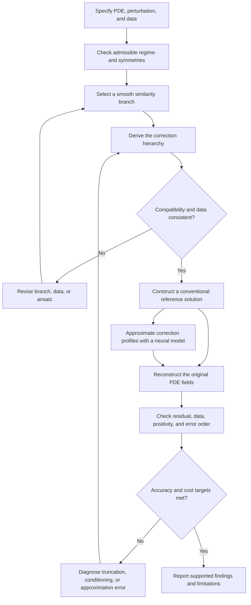
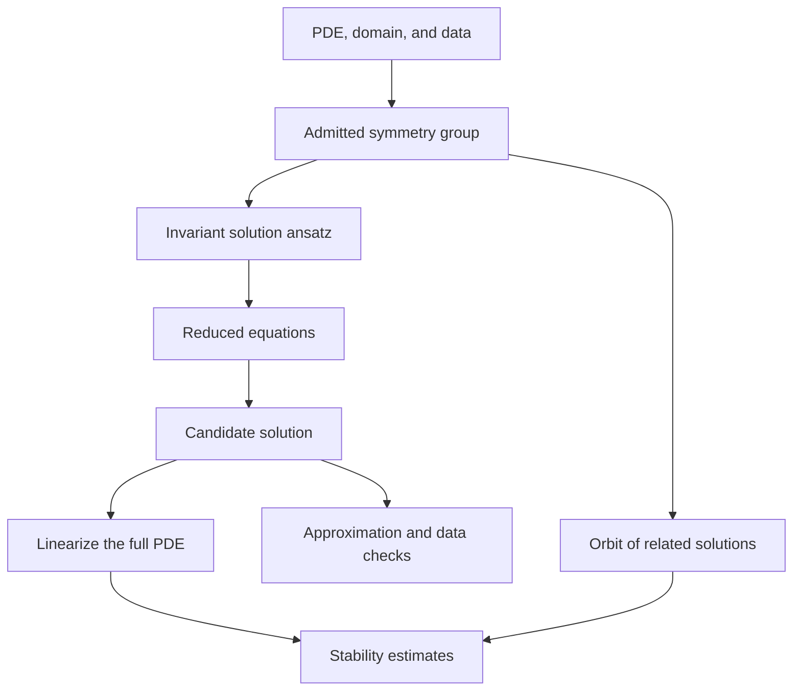

# Lie symmetry, perturbation, and neural PDE approximation

Brainstorming progress and proposal handoff · 10 September 2026

## 1. Current position

The project began with **Lie-Theoretic Reduction and Semi-Analytical Neural Approximation of Symmetry-Constrained Nonlinear PDEs: A Saint–Venant–Exner-Informed Study**. Its core aim is to combine exact mathematical structure with a limited, testable role for neural approximation.

The discussion has converged toward a **recommended working direction**, not a user-confirmed final specification:

> Study a hierarchy of similarity-based corrections for one weakly perturbed Saint–Venant–Exner model, derive the conditions that make the corrections admissible, and compare conventional and neural approximations of those corrections.

Suggested working title: **Perturbation-Consistent Similarity Reduction and Neural Correction for a Weakly Damped Saint–Venant–Exner Model**.

Suggested research question:

> Can a hierarchy of similarity-based correction equations approximate a specified family of weakly damped Saint–Venant–Exner solutions with predictable error order, and does neural approximation improve its computational performance?

The two-day deadline changes the scope: retain the Saint–Venant–Exner baseline already selected, rather than immediately adopting the larger moment–Exner model. Treat the latter as a later extension.

**Current status:** conceptual distinctions, candidate equations, and formal reductions have been developed. No neural training, numerical convergence study, complete boundary-value construction, stability theorem, or verified novelty claim has been completed in this brainstorming.

## 2. Main method flowchart

The checks are part of the method. In particular, a network cannot repair an inconsistent similarity ansatz or supply a missing physical admissibility condition.

## 3. How the ideas developed

| Stage | Main idea | Result of the discussion |
| --- | --- | --- |
| Initial project | Lie reduction followed by series and neural approximation | Preserve this as the core workflow |
| Algebraic exploration | Connect Hopf algebras, Lie algebras, and differential Galois groups | Related structures, but they have different roles |
| PDE exploration | Search eight neighbors of Saint–Venant | Research targets were identified; they are not eight certified unsolved equations |
| Perturbation brainstorming | Expand transformations, equations, losses, and initial conditions | Separate the expansion parameters and derivative operators |
| Systematic hierarchy | Generate increasingly refined models from previous calculations | Formulate recursive correction equations with compatibility and error checks |
| Deadline-driven narrowing | Finalize a concrete proposal in two days | One baseline model, one perturbation, one smooth family, first-order correction |

The baseline reading remains [Paliathanasis, Leon, and Leach (2026), Lie Symmetries and Similarity Solutions for a Shallow-Water Model with Bed Elevation in Lagrange Variables](https://www.mdpi.com/2227-7390/14/3/433). The original repository reference is [Lie-ML_PDES](https://github.com/CarlXerophilem/Lie-ML_PDES); this summary does not claim to inspect or update that repository.

## 4. Mathematical distinctions to preserve

### 4.1 Different small changes need different notation

| Mechanism | Notation | Meaning |
| --- | --- | --- |
| Group motion | \(s\) | Move along a symmetry orbit |
| Physical perturbation | \(\epsilon\) | Change friction, forcing, or a constitutive term |
| Initial-data perturbation | \(\delta\) | Select a nearby solution of a fixed PDE |
| Optimization update | \(\Delta\theta\) | Change the approximation parameters |

For a local flow generated by \(X\),

\[
\Phi_s^*f=f+sXf+\frac{s^2}{2}X^2f+\cdots.
\]

The generator is an exact derivative at \(s=0\). Approximation enters when a finite transformation is truncated. A Lie derivative is therefore not inherently a physical perturbation.

### 4.2 Lie derivative, PDE linearization, and optimization derivative

| Operator | What is differentiated? | Role |
| --- | --- | --- |
| \(\mathcal L_X\) | An object along a vector-field flow | Symmetry action |
| \(DF[u]\) | The PDE operator with respect to the unknown field | Correction equations and linearized dynamics |
| \(\nabla_\theta\mathcal L\) | A loss with respect to network parameters | Training |

These operators may appear in one algorithm, but they are not the same operation.

### 4.3 What “symmetry-closed” could mean

1. **Algebraic closure:** commutators remain within the admitted generators to the retained order.
2. **Reduction compatibility:** the ansatz and prescribed data are consistent with the equation to that order.
3. **Approximation consistency:** the reconstructed solution has the claimed residual order.

For example,

\[
[X_0+\epsilon X_1,Y_0+\epsilon Y_1]
=[X_0,Y_0]+\epsilon([X_0,Y_1]+[X_1,Y_0])+O(\epsilon^2).
\]

Adding symmetry constraints generally selects a smaller solution family. Adding perturbation orders may improve accuracy. These are different senses of “refinement”; neither automatically generates new physical models.

Approximate Lie symmetry theory already exists. The relevant starting reference is [Di Salvo, Gorgone, and Oliveri, A Consistent Approach to Approximate Lie Symmetries of Differential Equations](https://arxiv.org/abs/2108.02169), published in *Nonlinear Dynamics* in 2018.

## 5. Roles of Lie, Hopf, and Galois structures

| Structure | Appropriate role in this project | Limitation |
| --- | --- | --- |
| Lie symmetry algebra | Determine admissible transformations and invariant ansätze | Does not generally describe every solution |
| Universal enveloping Hopf algebra | Organize compositions and product actions of known generators | Does not automatically create new point symmetries |
| Differential Galois group | Analyze suitable linear reduced equations or variational systems | Is not generally the Lie point-symmetry group of the original PDE |

For a Lie algebra \(\mathfrak g\), its enveloping algebra has the canonical Hopf structure

\[
\Delta(X)=X\otimes1+1\otimes X,
\qquad \varepsilon_H(X)=0,
\qquad S(X)=-X.
\]

Here \(\varepsilon_H\) denotes the Hopf counit, not the physical perturbation parameter. The coproduct encodes the product rule, for example

\[
X(hu^2)=(Xh)u^2+2hu(Xu).
\]

Products such as \(X^2\) are generally higher-order operators, not new point-symmetry vector fields. References: [MIT enveloping-algebra notes](https://ocw.mit.edu/courses/18-745-lie-groups-and-lie-algebras-i-fall-2020/mit18_745_f20_lec12.pdf) and [Morgan on primitive elements and coproducts](https://www.math.columbia.edu/~jmorgan/LieGroups2025/2025LGLecture4.pdf).

Differential Galois analysis belongs after a suitable reduction or linearization, with the differential base field specified. See [Blázquez-Sanz, Morales-Ruiz, and Weil, Differential Galois Theory and Lie Symmetries](https://arxiv.org/abs/1503.09023).

**Proposal decision:** retain these connections as background or optional analysis. They are not required deliverables for the initial two-day proposal scope.

## 6. Invariance, conservation, and stability

An equation symmetry maps solutions to solutions. An invariant solution is fixed by a selected action. For a point generator, its invariant-surface condition is

\[
Q^\alpha=\eta^\alpha-\xi^i u_i^\alpha=0.
\]

A stability perturbation need not satisfy this constraint. Consequently, stability within an invariant family does not imply stability against general PDE perturbations.

Symmetry-generated solution families do provide particular solutions of the linearized equation. For traveling waves, translation introduces a phase direction; orbital stability measures distance to the symmetry orbit rather than to one fixed phase.

Conservation laws may help establish estimates, but conservation alone is not stability. Noether's theorem requires an appropriate variational structure. A small numerical residual is also distinct from a small solution error: conditioning, data errors, and stability estimates matter.

## 7. Recommended working model and first reduction

### 7.1 Equations and provisional regime

Use the nondimensional weakly damped Saint–Venant–Exner system

\[
\begin{aligned}
h_t+(hu)_x&=0,\\
u_t+uu_x+g(h+b)_x&=-\epsilon u,\\
a b_t+(A_bu^3)_x&=0,
\end{aligned}
\qquad a=1-p>0,\quad A_b>0.
\]

The coefficient \(A_b\) is the bedload coefficient, renamed to distinguish it from the transport matrix below. Linear drag is a controlled model perturbation, not a universal friction law.

Start with a smooth characteristic branch, positive water depth, a strictly hyperbolic state region, and a fixed finite time interval \(0<t_0\leq t\leq T\) with \(|\epsilon T|\ll1\). Exact branch data, parameter values, and matching conditions remain to be specified. The first study does not include shocks, dry fronts, or a proof of general nonlinear stability.

### 7.2 Matrix form

Let

\[
W=(h,u,b)^T,\qquad W_t+\mathsf A(W)W_x=\epsilon S(W),
\]

where

\[
\mathsf A(W)=
\begin{pmatrix}
u&h&0\\
g&u&g\\
0&3A_bu^2/a&0
\end{pmatrix},
\qquad
S(W)=\begin{pmatrix}0\\-u\\0\end{pmatrix}.
\]

### 7.3 Exact baseline symmetry versus parameter equivalence

At \(\epsilon=0\), simultaneous scaling of \(t,x\) admits \(\zeta=x/t\). For fixed nonzero \(\epsilon\), that scaling is broken.

The family of equations is preserved by

\[
(t,x,\epsilon)\mapsto(\lambda t,\lambda x,\epsilon/\lambda).
\]

This is an equivalence transformation between parameter values. It is not a symmetry of one fixed damped equation.

Introduce

\[
\zeta=x/t,\qquad \sigma=\epsilon t,\qquad W=V(\zeta,\sigma).
\]

Substitution gives

\[
\boxed{(\mathsf A(V)-\zeta I)V_\zeta+\sigma V_\sigma=\sigma S(V).}
\]

This still has two independent variables. Variable reduction occurs order by order through the additional expansion

\[
V=W_0(\zeta)+\sigma W_1(\zeta)+\sigma^2W_2(\zeta)+\cdots.
\]

### 7.4 First two profile equations

\[
\boxed{(\mathsf A(W_0)-\zeta I)W_0'=0,}
\]

\[
\boxed{
(\mathsf A(W_0)-\zeta I)W_1'
D\mathsf A(W_0)[W_1]W_0'
W_1=S(W_0).
}
\]

Writing \(W_j=(H_j,U_j,B_j)^T\), the matrix derivative is explicitly

\[
D\mathsf A(W_0)[W_1]=
\begin{pmatrix}
U_1&H_1&0\\
0&0&0\\
0&6A_bU_0U_1/a&0
\end{pmatrix}.
\]

For a nonconstant base branch, \(\mathsf A(W_0)-\zeta I\) is singular. Each left-null vector \(\ell\) imposes the necessary condition

\[
\boxed{
\ell^T\left[S(W_0)-W_1-D\mathsf A(W_0)[W_1]W_0'\right]=0.
}
\]

The first correction may therefore be a differential-algebraic problem. Admissible data and compatibility must be resolved before training. This calculation establishes a formal research starting point, not existence or uniqueness of the intended correction profile.

## 8. Recursive corrections and the neural component

For a generic perturbed operator

\[
F_\epsilon[u]=F_0[u]+\epsilon F_1[u],
\qquad u=u_0+\epsilon u_1+\epsilon^2u_2+\cdots,
\]

coefficient matching yields

\[
F_0[u_0]=0,\qquad DF_0[u_0]u_1=-F_1[u_0],
\]

\[
DF_0[u_0]u_2=
-\tfrac12D^2F_0[u_0](u_1,u_1)-DF_1[u_0]u_1.
\]

Lower-order solutions generate the next forcing term. This is a recursive approximation hierarchy; convergence and long-time validity do not follow automatically.

### Loss scaling

If

\[
F_\epsilon[u_0+\epsilon u_1]=\epsilon r_1+O(\epsilon^2),
\]

then its squared residual is

\[
\|F_\epsilon[u_0+\epsilon u_1]\|^2
=\epsilon^2\|r_1\|^2+O(\epsilon^3).
\]

A small physical parameter can conceal an inaccurate correction. Train on the coefficient residual itself, with appropriately scaled data and compatibility terms.

The proposed network learns admissible correction profiles, possibly parameterized by a small number of physical coefficients. It does not learn a new physical law unless an inverse problem is explicitly added. A series-plus-network representation can preserve known coefficients, but smoothness, local convergence, and endpoint treatment must be checked.

### Evaluation design

| Comparator or check | Purpose |
| --- | --- |
| Conventional reduced solver | Establish an independent numerical reference |
| Analytic or series approximation alone | Measure the benefit of the correction strategy |
| Neural reduced approximation alone | Separate the effect of analytic constraints |
| Analytic plus neural correction | Test the proposed hybrid |
| Reconstructed original-PDE residual and data errors | Detect errors hidden by reduction |
| Errors across decreasing perturbation values | Test the predicted order on a fixed admissible domain |
| Accuracy versus training and evaluation cost | Establish whether the network adds practical value |

When consistent first-order coefficients and data are available, the formal target is a second-order residual in \(\epsilon\) on fixed domains away from \(t=0\). A matching solution-error bound requires additional estimates. Do not report residual order as a proved solution-error order.

Existing [Lie Point Symmetry and Physics Informed Networks](https://arxiv.org/abs/2311.04293) work rules out novelty claims based only on combining Lie symmetry with PINNs.

## 9. Eight neighboring PDE targets retained for later work

The earlier literature exploration distinguished explicit research gaps from proposed extensions. These statuses record that discussion, not a fresh exhaustive verification of what remains open.

| Target | Direction discussed | Evidence and present priority |
| --- | --- | --- |
| Saint–Venant–Exner with bed-slope transport | Sediment profiles and hydraulic critical crossings | Proposed extension; a simpler secondary development case |
| Moment–Exner with erosion/deposition | Equilibria, steady states, and stability | Explicit future work in the [coupled moment model](https://arxiv.org/html/2505.22278v2); defer the larger system |
| Two-dimensional Saint–Venant roll waves | Transverse nonlinear stability and bifurcation | Explicit directions in the [multidimensional study](https://arxiv.org/pdf/2309.08870); beyond the initial scope |
| Two-layer shallow water | Characteristic branches near dry layers or hyperbolicity loss | Proposed extension beyond [existing local theory](https://arxiv.org/abs/1402.3194) |
| Flat-bottom Serre–Green–Naghdi | Multiple solitary-wave interactions and long-time behavior | Conjectural direction in [SGN interaction work](https://arxiv.org/pdf/2405.07182); single solitary waves are known benchmarks |
| Green–Naghdi shoreline | Similarity structure and continuation near a wet/dry boundary | Proposed extension beyond [existing shoreline theory](https://arxiv.org/abs/1710.03651) |
| Rotating shallow water | Sharper thresholds beyond separated families | Existing [singularity and separated-solution results](https://arxiv.org/abs/2008.03899); novelty of an extension is unverified |
| Viscous Saint–Venant | Large-data regularity beyond symmetry restrictions | Broader challenge with [recent radial progress](https://arxiv.org/pdf/2512.15029); not a two-day proposal deliverable |

### Lessons from the exploratory reductions

- Pure inviscid Exner traveling-wave reductions can generically collapse to algebraic constraints; a neural solver cannot create a missing nonconstant profile.
- Bed-slope transport can yield a scalar separable profile equation, making quadrature an essential baseline.
- Moment–Exner critical states require left-null compatibility with source terms.
- Constructing a roll wave is different from proving its transverse stability.
- A single traveling coordinate cannot describe several waves with different speeds throughout their interaction.
- A formally valid shoreline scaling can conflict with global mass conservation.
- Separated rotating profiles and an implicit viscous similarity profile can serve as controls, without being novelty claims.

## 10. Proposal assembly and unresolved decisions

The requested proposal format is **4–6 pages, Times New Roman, 12 pt, double-spaced**, covering the research problem, objectives, methodology, expected outcomes, and references.

Preserve the selected planning sentence:

> Fix the equations, perturbation, smooth solution regime, and research question.

| Time block | Reviewable output |
| --- | --- |
| Day 1, first half | Fix the model, perturbation, smooth regime, and question |
| Day 1, second half | Present the first correction hierarchy and specify admissible data |
| Day 2, first half | Define baselines, error measures, feasibility, and expected outcomes |
| Day 2, second half | Finalize the proposal text, citations, and limitations |

Before implementation, settle the characteristic branch, initial or boundary matching conditions, physical parameter ranges, finite validation domain, and compatibility treatment. Keep the first-order study as the required scope; higher orders, full-PDE stability, more elaborate closures, Hopf-based algorithms, and Galois diagnostics are optional extensions.

For AI4math positioning, emphasize verifiable derivation, reproducible comparisons, and transparent limits. A result showing that a conventional reduced solver is preferable can still be scientifically useful.

The attached Navier–Stokes document was not needed for these reductions and was not evaluated as evidence of a breakthrough. No conclusion here depends on its claims.

## 11. Compact handoff

**What we are proposing:** one controlled perturbation of a familiar fluid model; a mathematically consistent hierarchy of reduced correction equations; careful treatment of singular compatibility; and a measured comparison of conventional and neural approximations.

**What remains to establish:** admissible profile data, solvability, error behavior, practical neural benefit, and precise originality relative to prior work.

**Core operations:** expand → collect orders → linearize → check compatibility → solve → reconstruct → validate.
