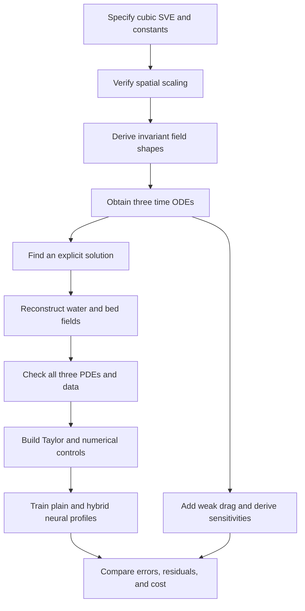

# A fully worked (1+1)-dimensional Saint–Venant–Exner example with Lie-symmetry reduction

**For Carl · WKU MATH 4890 · Expanded derivation edition**

This companion to `proposal.tex` follows the workflow **define the model → verify a symmetry → derive a solution form → reduce → solve → reconstruct → check → approximate → perturb**. It starts with the coupled equations, so it does not assume that an eliminated equation in another paper is equivalent to this model.

**Reading convention.** Here “(1+1)” means one time coordinate \(t\) plus one spatial coordinate \(x\). There are three dependent fields \(h,u,B\). The first Lie reduction leaves time as the only independent variable in three coupled ODEs. A second, explicitly identified invariant restriction produces one exact profile. The subsequent Taylor, neural, and drag calculations address different approximation questions; they do not replace the exact reduction.

Read Sections 2–8 in order for the core proof. Section 9 explains initial and boundary data; Section 10 derives the moving coordinates; Sections 11–14 expand the approximation and perturbation calculations. Section 17 includes executable numerical code and an explanation of its arrays and operations.

The principal result is the explicit, nondimensional solution

\[
\boxed{h(t,x)=\frac{x^2}{15t^2},\qquad
u(t,x)=\frac{2x}{3t},\qquad
B(t,x)=\frac{2x^2}{45t^2}.}
\]

It has positive water depth and velocity for \(x,t>0\), a nonconstant bed, nonzero sediment transport, and a bed that changes with time. All three PDE residuals are checked below. This is a derived teaching benchmark, **not a claim of a previously unknown solution**.

The accompanying numerical experiment also solves a nearby profile with different initial data, trains small neural approximations, and tests a first-order weak-damping correction. The reproducible code is included at the end. These are small controlled experiments, not a claim of state-of-the-art neural performance or full-PDE stability.

## 1. Translate the unfamiliar words

| Expression in the proposal | Plain meaning | Example here |
| --- | --- | --- |
| Eulerian coordinates | Observe the water at a fixed location | \(h(t,x)\) is depth at the location \(x\) |
| Material or Lagrangian coordinates | Follow a labelled moving water element | \(s\) labels the element; its position is \(\phi(t,s)\) |
| Parcel map | The function that gives that moving position | \(x=\phi(t,s)\) |
| Pull back a field | Evaluate the old field at the moving position | \(\widehat B(t,s)=B(t,\phi(t,s))\) |
| Ansatz | A proposed form for the unknown functions | \(u=xv(t),\ h=x^2H(t),\ B=x^2C(t)\) |
| Invariant ansatz | A form derived by requiring a solution to keep a chosen symmetry | The spatial scaling in Section 4 produces this form |
| Symmetry-constrained | Restricted to a chosen symmetry-preserving solution family | This family has linear velocity and quadratic depth/bed in \(x\) |
| Material-constrained | Not a defined solution class in this proposal | Do not use it as a synonym for material coordinates or symmetry-constrained |
| Reconstruction | Recover the original fields from the reduced unknowns | Multiply \(v,H,C\) by \(x,x^2,x^2\) respectively |
| Residual | What remains after inserting an approximate solution into an equation | Zero for an exact solution |

“Material” here refers to following water elements. It does not mean imposing a special material-property constraint on the solution. A moving water element also does not carry the bed as though the bed were a passive water property.

## 2. Define the model and every physical symbol

One-dimensional means **one spatial coordinate**, not one unknown function. The PDE has two independent variables, time \(t\) and position \(x\), and three unknown fields:

\[
\begin{aligned}
h_t+(hu)_x&=0, &&\text{water mass balance},\\
u_t+u u_x+g(h_x+B_x)&=0, &&\text{water momentum balance},\\
B_t+\chi(A_g u^3)_x&=0, &&\text{sediment-bed balance}.
\end{aligned}\tag{1}
\]

| Symbol | Definition |
| --- | --- |
| \(t\) | Time |
| \(x\) | Horizontal position along the channel |
| \(h(t,x)>0\) | Water depth above the bed |
| \(u(t,x)\) | Depth-averaged horizontal water velocity |
| \(B(t,x)\) | Bed elevation relative to a chosen height reference |
| \(h+B\) | Free-surface elevation |
| \(g>0\) | Gravity coefficient; its nondimensional value will be one |
| \(p\in[0,1)\) | Bed porosity, the void fraction |
| \(a=1-p\) | Solid fraction of the bed |
| \(\chi=1/a\) | Porosity factor |
| \(A_g>0\) | Coefficient in the cubic sediment-flux law |
| \(q_s=A_g u^3\) | Sediment volume flux per unit channel width |
| \(\kappa=\chi A_g\) | Combined sediment coefficient |
| Subscript \(t\) or \(x\) | Partial derivative holding the other coordinate fixed |

The third equation can equivalently be written \(aB_t+(q_s)_x=0\). A positive outgoing sediment-flux gradient lowers the bed.

We choose the exponent \(m=3\). The particular scaling verified below relies on this exponent; it is not a maximal symmetry classification. The cubic law is an idealized closure. The equations contain no friction in the main example, no rainfall or water exchange, and no suspended-sediment concentration variable.

All numerical values below are nondimensional. For example, with length scale \(L\) and time scale \(T_*\), set dimensional \(x=Lx_*\), \(h=Lh_*\), \(B=LB_*\), \(t=T_*t_*\), and \(u=(L/T_*)u_*\). Then the dimensionless gravity is \(g_{\rm dim}T_*^2/L\), and the dimensionless cubic transport coefficient is \(A_{g,\rm dim}L/T_*^2\). We drop the stars after choosing scales. This prevents the numerical choice \(g=1\) from being confused with a measured gravitational acceleration.

### 2.1 Expand the balances and state the solution regime

Throughout the analytical construction \(t>0,x>0\), and all fields are differentiable as many times as each calculation requires. We use classical derivatives, not derivatives across shocks. On the compact validation rectangle later specified, the displayed solution is smooth and its depth is bounded away from zero.

The product rules in (1) are

\[
(hu)_x=u h_x+h u_x,\qquad (u^3)_x=3u^2u_x.
\]

Since \(A_g\) and \(\chi\) are constants, neither is differentiated. Define the three left sides, or residual functions,

\[
F_h=h_t+u h_x+h u_x,\quad
F_u=u_t+u u_x+g h_x+g B_x,\quad
F_B=B_t+3\kappa u^2u_x.
\]

The PDE means \(F_h=F_u=F_B=0\) at every point in the chosen domain. In the symmetry calculation we will treat coordinates and first derivatives as separate arguments of these functions.

To connect the velocity form to the usual conservative shallow-water momentum equation, start with

\[
(hu)_t+\left(hu^2+\frac12 gh^2\right)_x=-ghB_x.
\]

Expand every term and move the right side left:

\[
u h_t+h u_t+u^2h_x+2huu_x+ghh_x+ghB_x=0.
\]

Now group it as

\[
u\underbrace{(h_t+u h_x+h u_x)}_{F_h}
+h\underbrace{(u_t+u u_x+g h_x+gB_x)}_{F_u}=0.
\]

Thus the conservative momentum residual equals \(uF_h+hF_u\). Once mass balance holds and \(h>0\), dividing by \(h\) gives the velocity equation in (1). At a shock this calculation is not a license to replace conservative weak equations by pointwise products.

### 2.2 Show the nondimensional substitution

Use subscripts “dim” for dimensional quantities in this paragraph only. Choose positive length and time scales \(L,T_*\), and set

\[
x_{\rm dim}=Lx,\ t_{\rm dim}=T_*t,\quad
h_{\rm dim}=Lh,\ B_{\rm dim}=LB,\quad
u_{\rm dim}=\frac L{T_*}u.
\]

Consequently \(\partial_{t_{\rm dim}}=T_*^{-1}\partial_t\) and \(\partial_{x_{\rm dim}}=L^{-1}\partial_x\). The dimensional mass equation becomes

\[
\frac L{T_*}h_t+\frac1L\frac{L^2}{T_*}(hu)_x
=\frac L{T_*}[h_t+(hu)_x]=0.
\]

Momentum becomes

\[
\frac L{T_*^2}u_t+\frac L{T_*^2}uu_x
+g_{\rm dim}(h+B)_x=0.
\]

Divide by \(L/T_*^2\): the new gravity coefficient is \(g=g_{\rm dim}T_*^2/L\). Similarly the bed equation becomes

\[
\frac L{T_*}B_t+\chi A_{g,\rm dim}\frac{L^2}{T_*^3}(u^3)_x=0.
\]

After division by \(L/T_*\), the new coefficient is \(A_g=A_{g,\rm dim}L/T_*^2\). Choosing \(T_*=\sqrt{L/g_{\rm dim}}\) sets \(g=1\). Scaling units is a separate operation from applying a symmetry with the already fixed coefficients.

## 3. The method, including its checks



An invariant family is a selected subset of PDE solutions. Reducing it to three ODEs does not turn every solution of SVE into an ODE solution. Similarly, verifying a candidate exactly does not prove uniqueness among all possible PDE solutions with unspecified data.

## 4. Verify a symmetry instead of guessing a formula

### 4.1 Find the scaling weights from the equations

Rather than proposing the powers without explanation, begin with the restricted scaling search

\[
t^*=\lambda^a t,\quad x^*=\lambda^b x,\quad
u^*=\lambda^c u,\quad h^*=\lambda^d h,\quad B^*=\lambda^e B.
\]

In this paragraph \(a,b,c,d,e\) are **scaling exponents**, not the solid fraction \(a=1-p\) used in Section 2. They are temporary symbols only. Keep \(g\) and \(\kappa\) fixed. Differentiation in time subtracts weight \(a\); differentiation in space subtracts weight \(b\).

For the mass terms to have a common weight,

\[
d-a=d+c-b\quad\Longrightarrow\quad c=b-a.
\]

For momentum the four weights must agree:

\[
c-a=2c-b=d-b=e-b.
\]

The first equality repeats \(c=b-a\); the others give

\[
d=c-a+b=2(b-a),\qquad e=2(b-a).
\]

For bed balance, the weights are \(e-a\) and \(3c-b\). Substitution gives

\[
e-a=2b-3a=3c-b,
\]

so no additional condition arises. Our scaling search therefore yields a two-parameter family of weights, indexed by \(a,b\). This is a search within a specified scaling form, not a derivation of every Lie point symmetry of the PDE.

Choose \(a=0,b=1\). Then \(c=1,d=e=2\): time is fixed, velocity has weight one, and depth and bed have weight two. We now return \(a\) to its original meaning as solid fraction.

For a positive scaling factor \(\lambda\), consider

\[
t^*=t,\quad x^*=\lambda x,\quad
u^*=\lambda u,\quad h^*=\lambda^2h,\quad B^*=\lambda^2B.\tag{2}
\]

For fields viewed at a fixed coordinate \(x\), the transformed solution is

\[
h_\lambda(t,x)=\lambda^2h(t,x/\lambda),\quad
u_\lambda(t,x)=\lambda u(t,x/\lambda),\quad
B_\lambda(t,x)=\lambda^2B(t,x/\lambda).
\]

The chain rule supplies one factor \(\lambda^{-1}\) for an \(x\)-derivative. Therefore:

| Equation | Scaling of its terms |
| --- | --- |
| Water mass | \(h_t\) scales as \(\lambda^2\); \((hu)_x\) as \(\lambda^{2+1-1}=\lambda^2\) |
| Momentum | \(u_t\), \(uu_x\), and \(g(h+B)_x\) each scale as \(\lambda\) |
| Bed balance | \(B_t\) scales as \(\lambda^2\); \((u^3)_x\) as \(\lambda^{3-1}=\lambda^2\) |

Each complete equation is multiplied by a nonzero factor. Thus zero residual remains zero: this is a symmetry of (1), with fixed \(g,\chi,A_g\).

For a general power \(u^m\), the sediment term would scale as \(\lambda^{m-1}\); this particular fixed-parameter transformation agrees with the bed term when \(m=3\).

### 4.2 Derive the derivative transformations and group properties

For clarity let \(\bar x=x/\lambda\). Then

\[
\partial_t h_\lambda=\lambda^2h_t(t,\bar x),\qquad
\partial_x h_\lambda=\lambda^2 h_x(t,\bar x)\frac1\lambda
=\lambda h_x(t,\bar x).
\]

Likewise,

\[
(u_\lambda)_t=\lambda u_t,\quad (u_\lambda)_x=u_x,\quad
(B_\lambda)_t=\lambda^2B_t,\quad (B_\lambda)_x=\lambda B_x,
\]

where all right sides are evaluated at \((t,\bar x)\). Thus, without suppressing the evaluation point,

\[
F_h[h_\lambda,u_\lambda,B_\lambda](t,x)
=\lambda^2 F_h[h,u,B](t,x/\lambda),
\]
\[
F_u[h_\lambda,u_\lambda,B_\lambda](t,x)
=\lambda F_u[h,u,B](t,x/\lambda),
\]
\[
F_B[h_\lambda,u_\lambda,B_\lambda](t,x)
=\lambda^2 F_B[h,u,B](t,x/\lambda).
\]

This proves the claim for every smooth solution on the transformed domain. Multiplication by a nonzero factor preserves the zero set; the residual need not have the same numerical value away from that zero set.

Denote the coordinate transformation by \(T_\lambda\). Applying \(T_\mu\) and then \(T_\lambda\) multiplies \(x,u\) by \(\lambda\mu\), and \(h,B\) by \((\lambda\mu)^2\). Hence

\[
T_\lambda T_\mu=T_{\lambda\mu},\quad T_1=\mathrm{id},\quad
T_\lambda^{-1}=T_{1/\lambda}.
\]

The formulas are smooth for \(\lambda>0\). With \(\lambda=e^\rho\), multiplication becomes addition of real parameters: \(T_\rho T_\sigma=T_{\rho+\sigma}\). These are the group and smoothness properties of this one-parameter Lie action.

### 4.3 Differentiate the action to obtain the vector field

Write \(\lambda=e^\rho\), where \(\rho\) is the group parameter. Differentiating (2) at \(\rho=0\) gives the generator

\[
\boxed{X=x\partial_x+u\partial_u+2h\partial_h+2B\partial_B.}\tag{3}
\]

Here \(\partial_u\) means a coordinate direction in the space of variables \((t,x,u,h,B)\); it is not the derivative \(u_x\). The coefficient of \(\partial_t\) is zero, so time is unchanged. No small physical perturbation has been introduced.

The differentiations defining (3) are

\[
\left.\frac{dt^*}{d\rho}\right|_0=0,\quad
\left.\frac{dx^*}{d\rho}\right|_0=x,\quad
\left.\frac{du^*}{d\rho}\right|_0=u,\quad
\left.\frac{dh^*}{d\rho}\right|_0=2h,\quad
\left.\frac{dB^*}{d\rho}\right|_0=2B.
\]

Conversely, integrating the generator means solving the flow equations

\[
\frac{dt_\rho}{d\rho}=0,\ \frac{dx_\rho}{d\rho}=x_\rho,\
\frac{du_\rho}{d\rho}=u_\rho,\
\frac{dh_\rho}{d\rho}=2h_\rho,\
\frac{dB_\rho}{d\rho}=2B_\rho,
\]

with values \((t,x,u,h,B)\) at \(\rho=0\). Their solutions are exactly (2) with \(\lambda=e^\rho\). A first-order expansion such as \(x_\rho=x+\rho x+O(\rho^2)\) describes this exact group infinitesimally; it does not approximate the physical PDE by a new drag model.

### 4.4 Prolong the generator to first derivatives

A PDE contains derivatives, so the vector field must also specify how those derivatives change. This extension is called **prolongation**. Write a general point generator as

\[
X=\tau\partial_t+\xi\partial_x+
\eta^u\partial_u+\eta^h\partial_h+\eta^B\partial_B.
\]

For any dependent field \(q\in\{u,h,B\}\), the coefficient of \(\partial_{q_i}\), for \(i=t,x\), is

\[
\eta_i^q=D_i\eta^q-q_tD_i\tau-q_xD_i\xi.
\]

Here \(D_i\) is a total derivative: it differentiates explicit coordinates and the dependence through the fields. For a function \(f(t,x,u,h,B)\),

\[
D_tf=f_t+u_tf_u+h_tf_h+B_tf_B,\qquad
D_xf=f_x+u_xf_u+h_xf_h+B_xf_B.
\]

For a function that also depends on derivatives, further terms involving second derivatives are added. No such extra terms are needed to compute the coefficients here.

For our generator \(\tau=0,\xi=x,\eta^u=u,\eta^h=2h,\eta^B=2B\). Therefore \(D_t\xi=0,D_x\xi=1\), and \(D_i\tau=0\). Consequently

\[
\eta_t^u=u_t,\quad \eta_x^u=u_x-u_x=0,
\]
\[
\eta_t^h=2h_t,\quad \eta_x^h=2h_x-h_x=h_x,
\]
\[
\eta_t^B=2B_t,\quad \eta_x^B=2B_x-B_x=B_x.
\]

The complete first prolongation is

\[
\operatorname{pr}^{(1)}X=X+u_t\partial_{u_t}
+2h_t\partial_{h_t}+h_x\partial_{h_x}
+2B_t\partial_{B_t}+B_x\partial_{B_x}.
\]

The omitted \(\partial_{u_x}\) term has coefficient zero. First prolongation suffices because the PDE has only first derivatives.

Apply this differential operator to each expanded residual using the product rule:

\[
\begin{aligned}
\operatorname{pr}^{(1)}X(F_h)
&=2h_t+[u h_x+u h_x]+[2h u_x+h\cdot0]\\
&=2(h_t+u h_x+h u_x)=2F_h,\\
\operatorname{pr}^{(1)}X(F_u)
&=u_t+[u u_x+u\cdot0]+g h_x+g B_x=F_u,\\
\operatorname{pr}^{(1)}X(F_B)
&=2B_t+3\kappa[2u\cdot u\cdot u_x+u^2\cdot0]\\
&=2(B_t+3\kappa u^2u_x)=2F_B.
\end{aligned}
\]

On the equation set \(F_h=F_u=F_B=0\), all three expressions vanish. This is the infinitesimal invariance criterion, verified explicitly rather than asserted. It agrees with the finite factors \(\lambda^2,\lambda,\lambda^2\).

### 4.5 What Lie algebra structure is used here?

The one-dimensional space spanned by \(X\) closes under the commutator: \([cX,dX]=0\) for constants \(c,d\). That is already a Lie algebra. No Hopf-algebra or differential-Galois construction is needed for this reduction. A larger algebraic framework would require a separate object and research question; it does not automatically add solution formulas or stability guarantees.

## 5. Derive the invariant solution form

A symmetry maps solutions to solutions. We now impose the extra requirement that our chosen solution is unchanged by (2). Differentiating that requirement yields

\[
u-xu_x=0,\qquad 2h-xh_x=0,\qquad 2B-xB_x=0.\tag{4}
\]

These are the invariant-surface conditions. They are additional conditions selecting our solution family.

### 5.1 Derive, rather than assume, the invariant-surface conditions

An invariant solution must satisfy \(u_\lambda(t,x)=u(t,x)\) for every allowed \(\lambda\). Differentiating at \(\lambda=1\), with \(t,x\) fixed, gives

\[
0=\left.\frac{d}{d\lambda}[\lambda u(t,x/\lambda)]\right|_1
=u(t,x)+\left.\lambda u_x(t,x/\lambda)
\left(-\frac{x}{\lambda^2}\right)\right|_1
=u-xu_x.
\]

For depth the same calculation gives

\[
0=\left.\frac{d}{d\lambda}[\lambda^2h(t,x/\lambda)]\right|_1
=2h-xh_x.
\]

Replacing \(h\) by \(B\) gives \(2B-xB_x=0\). More generally the invariant-surface expression for a field \(q\) is \(\eta^q-\tau q_t-\xi q_x\). The negative derivative terms appear because the independent coordinates move too.

### 5.2 Integrate the constraints without dividing by a field

At fixed \(t\), solve the first one:

\[
xu_x=u\quad\Longrightarrow\quad
\frac{\partial}{\partial x}\left(\frac ux\right)=0
\quad\Longrightarrow\quad u=xv(t).
\]

The constant of integration may depend on \(t\), because we integrated only in \(x\). Likewise,

\[
\boxed{h=x^2H(t),\qquad u=xv(t),\qquad B=x^2C(t).}\tag{5}
\]

Here are the two previously compressed integrations:

\[
\partial_x(h/x^2)=h_x/x^2-2h/x^3
=(xh_x-2h)/x^3=0,
\]
\[
\partial_x(B/x^2)=B_x/x^2-2B/x^3
=(xB_x-2B)/x^3=0.
\]

Therefore \(h/x^2=H(t)\) and \(B/x^2=C(t)\). Similarly,
\(\partial_x(u/x)=(xu_x-u)/x^2=0\) gives \(u/x=v(t)\).
These calculations divide by \(x\), which is positive on our domain, but never by \(u\) or \(B\); zero values of those fields are allowed in the invariant family.

### 5.3 Obtain the same invariants from group orbits

Along a group orbit parameterized by \(\rho\), \(dt/d\rho=0\), so \(t\) is invariant. Direct differentiation gives

\[
\frac{d}{d\rho}(u/x)=\frac{ux-ux}{x^2}=0,\quad
\frac{d}{d\rho}(h/x^2)=\frac{2h}{x^2}-\frac{2h x}{x^3}=0,
\]

and the same calculation holds for \(B/x^2\). Thus the four orbit invariants are

\[
t,\qquad u/x,\qquad h/x^2,\qquad B/x^2.
\]

On an invariant solution graph the last three can depend only on the independent invariant \(t\). This explains (5) geometrically and also shows why the reduction removes one independent variable, not one dependent field.

The new unknowns \(v,H,C\) are time-dependent coefficients. The physical bed is \(B\); \(C\) is the coefficient multiplying \(x^2\). The water depth is \(h\); \(H\) is its coefficient. This distinction matters when interpreting errors or positivity.

The action has one independent-variable direction, \(x\partial_x\), of rank one on \(x>0\). Equation (5) removes the independent spatial variable from the unknown profiles. At \(x=0\), that rank condition changes and this example has zero depth; our study excludes that point.

## 6. Substitute into all three equations

Use a dot to mean \(d/dt\), an ordinary derivative.

For water mass,

\[
h_t=x^2\dot H,\qquad hu=x^3Hv,\qquad (hu)_x=3x^2Hv.
\]

Since \(x>0\), divide by \(x^2\):

\[
\boxed{\dot H=-3vH.}\tag{6a}
\]

For momentum,

\[
u_t=x\dot v,\quad u_x=v,\quad uu_x=xv^2,
\quad h_x=2xH,\quad B_x=2xC.
\]

Dividing by \(x\) gives

\[
\boxed{\dot v=-v^2-2g(H+C).}\tag{6b}
\]

For bed evolution,

\[
B_t=x^2\dot C,\qquad
\chi(A_gu^3)_x=\kappa(x^3v^3)_x=3\kappa x^2v^3.
\]

Thus

\[
\boxed{\dot C=-3\kappa v^3.}\tag{6c}
\]

### 6.1 Display the factorization before dividing

In these derivatives \(x\) is held fixed for \(\partial_t\), while \(t\), and therefore \(v,H,C\), are held fixed for \(\partial_x\). For example,

\[
\partial_x[x^2H(t)\,xv(t)]
=H(t)v(t)\partial_x x^3=3x^2H(t)v(t).
\]

The complete substituted equations are

\[
x^2[\dot H+3vH]=0,\qquad
x[\dot v+v^2+2g(H+C)]=0,\qquad
x^2[\dot C+3\kappa v^3]=0.
\]

Since neither \(x\) nor \(x^2\) vanishes, each bracket must vanish. Conversely, if all three brackets vanish, substitution proves the reconstructed fields solve the original PDE. This is a two-way equivalence **within the invariant family**.

Set \(Y=(v,H,C)^T\), where superscript \(T\) means transpose into a column. Then

\[
\dot Y=f(Y),\qquad
f(Y)=\begin{pmatrix}-v^2-2g(H+C)\\-3vH\\-3\kappa v^3\end{pmatrix}.
\]

Initial values \(Y(t_0)=(v_0,H_0,C_0)^T\) correspond to the restricted PDE data \(u(t_0,x)=xv_0,h(t_0,x)=x^2H_0,B(t_0,x)=x^2C_0\). Arbitrary functions of \(x\) are not represented by three numbers.

### 6.2 Depth positivity and local solvability

The derivative of the vector field with respect to \(Y\) is

\[
Df(Y)=\begin{pmatrix}
-2v&-2g&-2g\\
-3H&-3v&0\\
-9\kappa v^2&0&0
\end{pmatrix}.
\]

Its entries are continuous, hence bounded on a bounded closed neighborhood of initial data. This gives a local Lipschitz bound and local uniqueness for the ODE. A useful stronger positivity identity follows directly from \(\dot H=-3vH\). Define \(I(t)=\exp(3\int_{t_0}^t v(r)\,dr)\). Then

\[
\frac d{dt}[I(t)H(t)]=I(t)[3vH+\dot H]=0,
\]

and therefore

\[
H(t)=H_0\exp\left(-3\int_{t_0}^t v(r)\,dr\right)>0
\]

whenever \(H_0>0\) and the integral is finite. Here \(r\) is an integration variable. Positivity holds on a regular finite existence interval; this does not rule out finite-time blow-up of the coupled profiles.

This is a regular, coupled system of three first-order ODEs, not a single scalar ODE. Its right side is polynomial and therefore locally Lipschitz: specified initial values determine a unique local profile solution. This fact does not guarantee that depth stays positive for arbitrarily long times.

The derivative matrix here is the identity. This is **different from our earlier \(x/t\) characteristic reduction**, whose derivative matrix can be singular. A singularity in one reduction is not a property of every reduction of the same PDE.

## 7. Solve a nontrivial profile exactly

### 7.1 Derive the time powers using a second scaling

There is a reason to try the particular powers in (7). For the reduced ODE define

\[
t^*=\mu t,\qquad v^*=\mu^{-1}v,\qquad
H^*=\mu^{-2}H,\qquad C^*=\mu^{-2}C,\qquad \mu>0.
\]

At a fixed time argument, \(v_\mu(t)=\mu^{-1}v(t/\mu)\), so \(\dot v_\mu=\mu^{-2}\dot v(t/\mu)\). Its right side also has factor \(\mu^{-2}\) because both \(v^2\) and \(H+C\) have weight minus two. Likewise, \(\dot H\) and \(vH\) both have factor \(\mu^{-3}\); \(\dot C\) and \(v^3\) have that same factor. The reduced ODE is invariant.

The corresponding generator is

\[
Z=t\partial_t-v\partial_v-2H\partial_H-2C\partial_C.
\]

An invariant profile satisfies

\[
-v-t\dot v=0,\qquad -2H-t\dot H=0,\qquad -2C-t\dot C=0.
\]

The first equation says \(d(tv)/dt=v+t\dot v=0\), hence \(tv=\alpha\). The second says \(d(t^2H)/dt=t(2H+t\dot H)=0\), hence \(t^2H=\beta\). Similarly \(t^2C=\gamma\). This derives (7).

This second scaling comes from the weights \(a=1,b=0\) in Section 4.1, and can also be imposed directly on the PDE alongside \(X\). The two diagonal scaling generators commute. We use it as an additional invariant restriction after the first reduction, not as a claim that all solutions of the three ODEs have these powers.

### 7.2 Solve the algebraic compatibility equations

Seek a power-law profile with constants \(\alpha,\beta,\gamma\):

\[
v(t)=\frac\alpha t,\qquad H(t)=\frac\beta{t^2},\qquad
C(t)=\frac\gamma{t^2}.\tag{7}
\]

This second trial is an additional choice inside the already reduced family. It does not claim to solve every initial condition of (6).

From (6a),

\[
-\frac{2\beta}{t^3}=-\frac{3\alpha\beta}{t^3}.
\]

For positive depth \(\beta>0\), divide by \(\beta/t^3\), giving \(\alpha=2/3\).

From (6c),

\[
-2\gamma=-3\kappa\alpha^3
\quad\Longrightarrow\quad
\gamma=\frac32\kappa\left(\frac23\right)^3=\frac{4\kappa}{9}.
\]

Finally, (6b) gives

\[
-\alpha=-\alpha^2-2g(\beta+\gamma)
\quad\Longrightarrow\quad
\beta+\gamma=\frac1{9g}.
\]

Consequently,

\[
\boxed{\alpha=\frac23,\qquad
\beta=\frac{1/g-4\kappa}{9},\qquad
\gamma=\frac{4\kappa}{9}.}\tag{8}
\]

For completeness, the constant arithmetic is

\[
-2\beta=-3\alpha\beta\ \Longrightarrow\
2=3\alpha\ \Longrightarrow\ \alpha=2/3,
\]
\[
\gamma=\frac{3\kappa}{2}\frac8{27}
=\frac{24\kappa}{54}=\frac{4\kappa}{9},
\]
\[
2g(\beta+\gamma)=\alpha-\alpha^2
=\frac23-\frac49=\frac29,
\]
\[
\beta=\frac1{9g}-\gamma
=\frac1{9g}-\frac{4\kappa}9=\frac{1/g-4\kappa}{9}.
\]

We divided by \(\beta\) only after requiring positive depth. The branch \(\beta=0\) was excluded; it cannot be recovered by that division. Since \(g>0\), the inequality \(\beta>0\) is equivalent to \(1-4g\kappa>0\).

### 7.3 Choose constants and reconstruct all fields

Positive depth requires \(g\kappa<1/4\). Choose

\[
g=1,\qquad p=\frac25,\qquad \chi=\frac53,
\qquad A_g=\frac3{50},\qquad \kappa=\frac1{10}.
\]

Then \(\beta=1/15\), \(\gamma=2/45\), giving the explicit fields at the beginning of this document.

Specifically,

\[
a=1-p=1-2/5=3/5,\quad \chi=1/a=5/3,\quad
\kappa=\frac53\frac3{50}=\frac1{10},
\]
\[
\beta=\frac{1-4/10}{9}=\frac{3/5}{9}=\frac1{15},\quad
\gamma=\frac{4/10}{9}=\frac2{45}.
\]

Multiplying the profiles by their spatial factors in (5) gives

\[
u=x\frac{2}{3t},\qquad
h=x^2\frac1{15t^2},\qquad B=x^2\frac2{45t^2}.
\]

The free surface is \(h+B=(3+2)x^2/(45t^2)=x^2/(9t^2)\). The singularity at \(t=0\) is why initial data are set at \(t_0=1\). Time translation of the undamped autonomous equations also permits shifted profiles in \(t-t_c\), on intervals avoiding \(t=t_c\); we keep \(t_c=0\) throughout this example.

One concrete observation: at \(t=3/2,x=2\),

\[
h=\frac{16}{135}\approx0.118519,\quad
u=\frac89\approx0.888889,\quad
B=\frac{32}{405}\approx0.0790123.
\]

At fixed \(x>0\), depth and velocity decrease with time; the bed also lowers. Spatially, velocity grows linearly and depth and bed elevation grow quadratically. This is a local benchmark on a finite window, not a globally finite-mass river profile on the entire half-line.

## 8. Verify the original PDEs explicitly

For the chosen numerical constants,

\[
h_t=-\frac{2x^2}{15t^3},\qquad
(hu)_x=\partial_x\left(\frac{2x^3}{45t^3}\right)
=\frac{2x^2}{15t^3}.
\]

The mass residual is zero.

For momentum,

\[
u_t=-\frac{2x}{3t^2},\quad
uu_x=\frac{4x}{9t^2},\quad
(h+B)_x=\partial_x\left(\frac{x^2}{9t^2}\right)=\frac{2x}{9t^2}.
\]

Their sum is \((-6+4+2)x/(9t^2)=0\).

For the bed,

\[
B_t=-\frac{4x^2}{45t^3},\qquad
\kappa(u^3)_x=\frac1{10}\partial_x\left(\frac{8x^3}{27t^3}\right)
=\frac{4x^2}{45t^3}.
\]

This residual is also zero. Sediment transport is not being suppressed: \(q_s=A_gu^3=4x^3/(225t^3)\) is positive and has a nonzero spatial derivative.

A separate symbolic calculation of these three residuals returned exactly \([0,0,0]\). The derivation above is the mathematical verification; the symbolic check guards against transcription and algebra errors.

### 8.1 Expand the derivative arithmetic

The only differentiation rules required here are \(\partial_t t^{-n}=-nt^{-n-1}\), \(\partial_x x^n=nx^{n-1}\), the product rule, and the fact that the other independent variable is held fixed. Thus

\[
h_t=\frac{x^2}{15}(-2t^{-3}),\quad
hu=\frac{x^2}{15t^2}\frac{2x}{3t}=\frac{2x^3}{45t^3},\quad
(hu)_x=\frac{2}{45t^3}(3x^2).
\]

For momentum,

\[
u_t=\frac{2x}{3}(-t^{-2}),\quad
u_x=\frac{2}{3t},\quad
uu_x=\frac{2x}{3t}\frac2{3t}=\frac{4x}{9t^2},
\]
\[
h_x+B_x=\frac{2x}{15t^2}+\frac{4x}{45t^2}
=\frac{6x+4x}{45t^2}=\frac{2x}{9t^2}.
\]

For bed evolution,

\[
B_t=\frac{2x^2}{45}(-2t^{-3}),\quad
u^3=\left(\frac{2x}{3t}\right)^3=\frac{8x^3}{27t^3},
\]
\[
\kappa(u^3)_x=\frac1{10}\frac8{27t^3}(3x^2)
=\frac{24x^2}{270t^3}=\frac{4x^2}{45t^3}.
\]

Finally,

\[
q_s=\frac3{50}\frac{8x^3}{27t^3}=\frac{4x^3}{225t^3},\qquad
(q_s)_x=\frac{4x^2}{75t^3}.
\]

Multiplying the bed derivative by solid fraction gives
\(aB_t=(3/5)(-4x^2/(45t^3))=-4x^2/(75t^3)\), which cancels \((q_s)_x\) in the alternative Exner form as well.

## 9. Specify data and explain the finite window

Use the validation rectangle

\[
1\leq t\leq\frac32,\qquad 1\leq x\leq2.
\]

The initial profile at \(t=1\) is

\[
h(1,x)=x^2/15,\quad u(1,x)=2x/3,\quad B(1,x)=2x^2/45.
\]

Boundary traces are obtained by evaluating the exact solution at \(x=1\) and \(x=2\). For a hyperbolic PDE solver, impose the appropriate incoming characteristic data; do not blindly prescribe all three fields at both boundaries. The traces describe a compatible exact restriction, not a proof that arbitrary Dirichlet data form a well-posed problem.

The full half-line is preserved by spatial scaling; the fixed interval \([1,2]\) is not. We use the symmetry to construct a solution first, then restrict it to the validation rectangle. We do not claim that this finite boundary-value problem has the entire scaling group.

### 9.1 List the actual traces and regularity bounds

| Position | Depth \(h\) | Velocity \(u\) | Bed \(B\) |
| --- | --- | --- | --- |
| \(x=1\) | \(1/(15t^2)\) | \(2/(3t)\) | \(2/(45t^2)\) |
| \(x=2\) | \(4/(15t^2)\) | \(4/(3t)\) | \(8/(45t^2)\) |

Every denominator is nonzero on the rectangle. Depth is smallest at \(x=1,t=3/2\) and largest at \(x=2,t=1\), so

\[
\frac4{135}\leq h\leq\frac4{15}.
\]

The profile values at \(t=1\) are \(Y(1)=(2/3,1/15,2/45)^T\). Since the explicit profiles solve the regular ODE with those initial values, ODE uniqueness identifies them with that initial-value solution wherever it exists. This proves uniqueness within the invariant family, not uniqueness for an unspecified PDE boundary problem.

### 9.2 Derive the open-window mass balance

Water mass in this fixed interval is

\[
M(t)=\int_1^2h\,dx=\frac7{45t^2},\qquad
M'(t)=-\frac{14}{45t^3}.
\]

This decrease is consistent with conservation because the boundaries are open:

\[
M'(t)=-[hu]_{x=1}^{x=2}=-\frac{14}{45t^3}.
\]

Here \([f]_1^2=f(2)-f(1)\). “Conservation” includes boundary flux; it does not mean mass inside an open window must remain constant.

To expand the integral and its boundary terms,

\[
M(t)=\frac1{15t^2}\int_1^2x^2\,dx
=\frac1{15t^2}\left[\frac{x^3}{3}\right]_1^2
=\frac{8-1}{45t^2}=\frac7{45t^2}.
\]

Differentiation gives \(M'=-14/(45t^3)\). Alternatively integrate the mass PDE:

\[
\int_1^2h_t\,dx=-\int_1^2(hu)_x\,dx
=-\left(\frac{16}{45t^3}-\frac2{45t^3}\right)
=-\frac{14}{45t^3}.
\]

The interchange of differentiation and integration is justified here by smoothness on a fixed compact interval. The right boundary exports more water than enters at the left boundary.

## 10. Make the parcel map and pullback concrete

### 10.1 Construct a label from mass conservation

We seek a scalar \(s(t,x)\) with

\[
s_x=h,\qquad s_t=-hu.
\]

The consistency condition for mixed partial derivatives is

\[
(s_x)_t=(s_t)_x\quad\Longleftrightarrow\quad h_t=-(hu)_x,
\]

which is precisely the mass equation. For the explicit solution integrate \(s_x=\beta x^2/t^2\) in \(x\):

\[
s(t,x)=\frac{\beta x^3}{3t^2}+k(t).
\]

Then

\[
s_t=-\frac{2\beta x^3}{3t^3}+k'(t),\qquad
-hu=-\frac{\alpha\beta x^3}{t^3}=-\frac{2\beta x^3}{3t^3}.
\]

Equality requires \(k'(t)=0\). The arbitrary constant only chooses the zero of the label; set it to zero.

A convenient mass coordinate is

\[
s(t,x)=\frac{\beta x^3}{3t^2}=\frac{x^3}{45t^2}.
\]

It satisfies \(s_x=h\) and \(s_t=-hu\), so along a water trajectory \(dx/dt=u\),

\[
\frac{ds}{dt}=s_t+u s_x=0.
\]

Thus \(s\) really is constant on the labelled water element. Inverting the relation gives its position:

\[
\boxed{\phi(t,s)=(45s)^{1/3}t^{2/3}.}\tag{9}
\]

### 10.2 Derive the inverse-map identities

Because \(s_x=h>0\), the map from \(x\) to \(s\) is strictly increasing for each fixed time. Solve \(45st^2=x^3\) for the positive real root to obtain (9).

More generally, the inverse relation is \(s(t,\phi(t,s))=s\). Differentiate it at fixed label on the right:

\[
0=s_t(t,\phi)+s_x(t,\phi)\phi_t
=-hu+h\phi_t.
\]

Divide by \(h>0\) to obtain \(\phi_t=u(t,\phi)\). Differentiating in the label instead gives

\[
1=s_x(t,\phi)\phi_s=h(t,\phi)\phi_s,
\]

so \(\phi_s=1/h(t,\phi)\). The same letter \(s\) denotes the original label function and its value used as the new independent coordinate; the displayed arguments distinguish these roles.

Two immediate checks are

\[
\phi_t=\frac{2\phi}{3t}=u(t,\phi),\qquad
\phi_s=\frac{\phi}{3s}=\frac1{h(t,\phi)}>0.
\]

For example, the element at \(x=1,t=1\) has label \(s=1/45\). Later its position is \(x=t^{2/3}\). The mass label differs from the instantaneous position.

Pulling back the bed means only substitution:

\[
\widehat B(t,s)=B(t,\phi(t,s))
=\gamma(45s)^{2/3}t^{-2/3}.
\]

At a fixed location, \(B_t=-2B/t\). Along a labelled moving element, \(\widehat B_t=-2\widehat B/(3t)\). These differ because the element moves toward larger \(x\), where the bed is higher.

For any differentiable field \(f\), define \(\widehat f(t,s)=f(t,\phi(t,s))\). The ordinary chain rule yields

\[
\widehat f_t=f_t+\phi_t f_x,\qquad
\widehat f_s=\phi_s f_x.
\]

Solving these for the old derivatives,

\[
f_x=\frac{\widehat f_s}{\phi_s},\qquad
f_t=\widehat f_t-\frac{\phi_t}{\phi_s}\widehat f_s.
\]

Therefore the correctly transformed bed equation is

\[
\widehat B_t-\frac{\phi_t}{\phi_s}\widehat B_s
+\frac{\kappa}{\phi_s}\partial_s(\phi_t^3)=0.\tag{10}
\]

For this exact solution, its three terms are respectively

\[
-\frac{2\widehat B}{3t},\qquad
-\frac{4\widehat B}{3t},\qquad
+\frac{2\widehat B}{t},
\]

which sum to zero. Omitting the middle term would produce a wrong equation for this model. This demonstrates the bookkeeping requirement; it does not by itself establish what any other author meant by their variables.

### 10.3 Expand the transformed bed terms

Using \(\phi^3=45st^2\), the evaluated bed is

\[
\widehat B=\frac{\gamma\phi^2}{t^2}
=\gamma(45s)^{2/3}t^{4/3-2}
=\gamma(45s)^{2/3}t^{-2/3}.
\]

Thus \(\widehat B_s=2\widehat B/(3s)\), \(\widehat B_t=-2\widehat B/(3t)\), and

\[
\frac{\phi_t}{\phi_s}
=\frac{2\phi/(3t)}{\phi/(3s)}=\frac{2s}{t}.
\]

The advection correction is therefore

\[
-\frac{\phi_t}{\phi_s}\widehat B_s
=-\frac{2s}{t}\frac{2\widehat B}{3s}
=-\frac{4\widehat B}{3t}.
\]

For the sediment term first compute

\[
\phi_t^3=\frac{8\phi^3}{27t^3}
=\frac{8(45st^2)}{27t^3}=\frac{40s}{3t},\qquad
\partial_s(\phi_t^3)=\frac{40}{3t}.
\]

Hence

\[
\frac\kappa{\phi_s}\partial_s(\phi_t^3)
=\frac1{10}\frac{3s}{\phi}\frac{40}{3t}
=\frac{4s}{\phi t}
=\frac{4\phi^2}{45t^3}
=\frac{2\widehat B}{t}.
\]

This derives all three quantities in the cancellation above. Following the water changes the coordinate description of bed evolution; it does not make sediment motion equal to water motion.

### 10.4 Derive the transformed momentum equation

The momentum balance in these coordinates is

\[
\phi_{tt}+g\left[-\frac{\phi_{ss}}{\phi_s^3}
+\frac{\widehat B_s}{\phi_s}\right]=0.
\]

It follows from \(h=1/\phi_s\) and the same chain rule. One need not eliminate \(\widehat B\) to solve or verify this example.

Indeed differentiate \(\phi_t=u(t,\phi)\) at fixed label:

\[
\phi_{tt}=u_t(t,\phi)+u_x(t,\phi)\phi_t
=u_t+uu_x.
\]

The evaluated depth is \(\widehat h=1/\phi_s\), so

\[
\widehat h_s=-\frac{\phi_{ss}}{\phi_s^2},\qquad
h_x(t,\phi)=\frac{\widehat h_s}{\phi_s}
=-\frac{\phi_{ss}}{\phi_s^3},\qquad
B_x(t,\phi)=\frac{\widehat B_s}{\phi_s}.
\]

Inserting these identities into Eulerian momentum gives the displayed material equation. To verify it numerically free of approximation,

\[
\phi_{tt}=-\frac{2\phi}{9t^2},\quad
\phi_s=\frac\phi{3s},\quad \phi_{ss}=-\frac{2\phi}{9s^2},
\]
\[
-\frac{\phi_{ss}}{\phi_s^3}
=\frac{6s}{\phi^2}=\frac{2\phi}{15t^2},\qquad
\frac{\widehat B_s}{\phi_s}=\frac{2\widehat B}{\phi}
=\frac{4\phi}{45t^2}.
\]

For \(g=1\), their sum is \((-10+6+4)\phi/(45t^2)=0\).

## 11. Construct the local series

Set \(z=t-1\), so \(z=0\) is the regular initial time, not the singular time \(t=0\). The exact profiles become

\[
v=\frac23(1+z)^{-1},\qquad
H=\frac1{15}(1+z)^{-2},\qquad
C=\frac2{45}(1+z)^{-2}.
\]

For \(|z|<1\),

\[
(1+z)^{-1}=\sum_{n=0}^{\infty}(-1)^nz^n,
\qquad
(1+z)^{-2}=\sum_{n=0}^{\infty}(-1)^n(n+1)z^n.
\]

Hence the second-order Taylor approximation is

\[
P_{v,2}=\frac23(1-z+z^2),\quad
P_{H,2}=\frac1{15}(1-2z+3z^2),\quad
P_{C,2}=\frac2{45}(1-2z+3z^2).
\]

The integer \(N=2\) describes spatially reduced **Taylor truncation order in time**, not physical perturbation order. The radius one follows from the pole at \(z=-1\). Our interval \(0\leq z\leq1/2\) lies within it, but a low-order polynomial can still have substantial error near its far end.

To derive series without knowing the exact answer, write

\[
v=\sum v_nz^n,\quad H=\sum H_nz^n,\quad C=\sum C_nz^n.
\]

For \(n\geq0\), coefficient matching in (6) gives

\[
(n+1)v_{n+1}=-\sum_{i=0}^{n}v_i v_{n-i}-2g(H_n+C_n),
\]
\[
(n+1)H_{n+1}=-3\sum_{i=0}^{n}v_i H_{n-i},
\]
\[
(n+1)C_{n+1}=-3\kappa\sum_{i+j+k=n}v_i v_j v_k.
\]

The triple sum includes all nonnegative indices \(i,j,k\) whose sum is \(n\). The three initial coefficients determine subsequent coefficients recursively. This is an explicit example of “generating finer approximations from earlier calculations.” It does not generate a different physical model.

### 11.1 Derive the sums by multiplying the series

By definition \(v_n=v^{(n)}(1)/n!\); analogously for \(H_n,C_n\). The factorial \(n!\) is the product \(1\cdot2\cdots n\), with \(0!=1\). Since \(z=t-1\), \(dz/dt=1\), and

\[
\dot v=\sum_{n=1}^\infty n v_nz^{n-1}
=\sum_{n=0}^\infty(n+1)v_{n+1}z^n.
\]

The coefficient of \(z^n\) in \(v^2\) comes from products whose exponents sum to \(n\):

\[
\left(\sum_{i\geq0}v_i z^i\right)
\left(\sum_{j\geq0}v_j z^j\right)
=\sum_{n\geq0}\left(\sum_{i=0}^nv_iv_{n-i}\right)z^n.
\]

Replacing the second \(v\) series by \(H\) gives the \(vH\) sum. Multiplying three \(v\) series gives the triple sum. Matching coefficients in the three ODEs yields the recurrence displayed above; it can be used formally even before convergence is established. For the explicit profiles, convergence is established by the geometric series.

### 11.2 Compute the first coefficients by hand

Use \(v_0=2/3,H_0=1/15,C_0=2/45\). At \(n=0\),

\[
v_1=-\frac49-2\left(\frac1{15}+\frac2{45}\right)
=-\frac49-\frac29=-\frac23,
\]
\[
H_1=-3\frac23\frac1{15}=-\frac2{15},\qquad
C_1=-\frac3{10}\left(\frac23\right)^3=-\frac4{45}.
\]

At \(n=1\), the recurrences give

\[
2v_2=-2v_0v_1-2(H_1+C_1)
=\frac89+\frac49=\frac43\quad\Longrightarrow\quad v_2=\frac23,
\]
\[
2H_2=-3(v_0H_1+v_1H_0)
=-3\left(-\frac4{45}-\frac2{45}\right)=\frac25
\quad\Longrightarrow\quad H_2=\frac15,
\]
\[
2C_2=-9\kappa v_0^2v_1
=-\frac9{10}\frac49\left(-\frac23\right)=\frac4{15}
\quad\Longrightarrow\quad C_2=\frac2{15}.
\]

Thus the three polynomials in Section 11 follow without knowing the explicit solution. In code, the second coefficient is \(Df(Y_0)f(Y_0)/2\): differentiating \(Y'=f(Y)\) gives \(Y''=Df(Y)Y'=Df(Y)f(Y)\), and a Taylor coefficient includes the factor \(1/2!\).

### 11.3 Derive the exact remainder

The finite geometric identity is

\[
(1+z)(1-z+z^2)=1+z^3.
\]

Subtracting after division by \(1+z\) gives

\[
\frac1{1+z}-(1-z+z^2)=-\frac{z^3}{1+z}.
\]

For the squared denominator multiply explicitly:

\[
(1+2z+z^2)(1-2z+3z^2)=1+4z^3+3z^4.
\]

Therefore

\[
\frac1{(1+z)^2}-(1-2z+3z^2)
=-\frac{z^3(4+3z)}{(1+z)^2}.
\]

These identities explain the three normalized remainder functions used next, including their finite limits at \(z=0\). No division by zero is required: extend the quotient continuously to that point.

## 12. What the neural network learns

Order the profiles as \(Y=(v,H,C)^T\), with initial scale vector

\[
Y_*=(2/3,1/15,2/45)^T.
\]

Normalize componentwise: \(y_j=Y_j/Y_{*,j}\). This prevents the smaller depth and bed coefficients from contributing much less merely because of their numerical magnitude.

Let a vector-valued neural network \(N_\theta(z)\) have one input and three outputs. The hybrid trial is

\[
y_\theta(z)=p_2(z)+z^3N_\theta(z),\qquad
p_2=(1-z+z^2,\ 1-2z+3z^2,\ 1-2z+3z^2)^T.
\]

Its value and first two derivatives at \(z=0\) match the known series exactly. The network learns the remaining profile dependence; it is not inferring a sediment law.

For this benchmark the exact normalized remainder is known:

\[
N_{v,*}(z)=-\frac1{1+z},\qquad
N_{H,*}(z)=N_{C,*}(z)=-\frac{4+3z}{(1+z)^2}.
\]

We do **not** supply these functions as training labels. They explain what the trained remainder is trying to approximate and can be used for an additional independent check.

Writing the right side of (6) in the order \((v,H,C)\) as \(f(Y)\), define the normalized residual

\[
r_j(z;\theta)=\frac{Y'_{\theta,j}(z)-f_j(Y_\theta(z))}{Y_{*,j}}.
\]

The training loss is the mean squared residual over 41 collocation points in \([0,1/2]\). Initial values are already enforced, so there is no redundant initial-value penalty. The plain neural comparator uses \(y_\theta=\mathbf1+zN_\theta\), which enforces the same initial values but not the first two Taylor derivatives.

The implemented network is

\[
N_\theta(z)=V\tanh(wz+b)+c,
\]

where \(w,b\in\mathbb R^6\), \(V\in\mathbb R^{3\times6}\), and \(c\in\mathbb R^3\). It has \(6+6+18+3=33\) trainable parameters. Its input derivative is evaluated by the exact formula

\[
N_\theta'(z)=V\bigl[(1-\tanh^2(wz+b))\odot w\bigr],
\]

where \(\odot\) denotes componentwise multiplication. The prototype uses this formula and complex-step parameter Jacobians in SciPy, rather than an automatic-differentiation framework. That is an implementation choice, not a different PDE principle.

The PINN residual approach is described in the freely accessible journal review [Cuomo et al. (2022)](https://doi.org/10.1007/s10915-022-01939-z). It replaces the inaccessible `pinn` reference in the proposal. For a bibliography entry use `\cite{pinn}`; `\ref{pinn}` refers to a LaTeX label and is not the right citation command.

### 12.1 Differentiate the hybrid and show the exact constraints

For any smooth scalar component \(N\), the product rule gives

\[
(z^3N)'=3z^2N+z^3N',
\]
\[
(z^3N)''=6zN+6z^2N'+z^3N''.
\]

The function and these two derivatives vanish at \(z=0\). Consequently the hybrid preserves \(y(0),y'(0),y''(0)\). The third derivative need not agree because \(\left.\frac{d^3}{dz^3}(z^3N)\right|_{z=0}=6N(0)\). The network is free to correct the first coefficient that the polynomial has not fixed.

Let \(s_v,s_H,s_C\) denote the three components of the constant scale vector \(Y_*\); these symbols are unrelated to the material label \(s\). Writing \(v=s_v y_v,H=s_H y_H,C=s_C y_C\), the residual components are

\[
r_v=y_v'+s_v y_v^2
+2g\left(\frac{s_H}{s_v}y_H+\frac{s_C}{s_v}y_C\right),
\]
\[
r_H=y_H'+3s_v y_vy_H,\qquad
r_C=y_C'+\frac{3\kappa s_v^3}{s_C}y_v^3.
\]

For example, the first expression follows by dividing
\(s_vy_v'+s_v^2y_v^2+2g(s_Hy_H+s_Cy_C)\) by \(s_v\). This shows explicitly what is minimized.

With training points \(z_i\), \(i=1,\ldots,N_c\), and \(N_c=41\), the loss is

\[
\mathcal L(\theta)=\frac1{3N_c}
\sum_{i=1}^{N_c}\bigl[r_v(z_i;\theta)^2+r_H(z_i;\theta)^2+r_C(z_i;\theta)^2\bigr].
\]

SciPy's least-squares objective is one-half of the unnormalized sum of squares. It differs by the positive constant \(3N_c/2\), so it has the same minimizers, although stopping criteria can depend on scaling. The code does not perform a separate expansion of the loss function.

### 12.2 Expand the neural map into scalar operations

For hidden index \(k=1,\ldots,6\), define

\[
a_k(z)=w_kz+b_k,\qquad A_k(z)=\tanh a_k(z).
\]

For output index \(j=1,2,3\),

\[
N_j(z)=\sum_{k=1}^6V_{jk}A_k(z)+c_j.
\]

Since \(d\tanh a/da=1-\tanh^2a\),

\[
N_j'(z)=\sum_{k=1}^6V_{jk}[1-\tanh^2(a_k(z))]w_k.
\]

The output index orders the velocity, depth, and bed coefficients. There are six input weights, six hidden biases, eighteen output weights, and three output biases. Training changes these 33 numbers, not the fixed physical constants.

For a real analytic residual component \(r\), the complex-step approximation to a parameter derivative is

\[
\frac{\partial r}{\partial\theta_k}
\approx\frac{\operatorname{Im}r(\theta+i\delta e_k)}{\delta}.
\]

Here \(i^2=-1\), \(\delta\) is a small numerical step, and \(e_k\) is the coordinate vector for parameter \(k\). The justification is the Taylor expansion
\(r(\theta+i\delta e_k)=r(\theta)+i\delta\partial_k r-\delta^2\partial_k^2r/2+O(\delta^3)\).
It requires complex-compatible operations; the polynomial and tanh operations used here satisfy that requirement locally. This numerical step is distinct from the physical drag coefficient and the Lie group parameter.

For the nearby initial-value case, the code sets \(Y_*\) to that case's actual initial values and recomputes its Taylor coefficients. The explicit \(p_2\) and remainder functions above belong only to the exact control.

## 13. Actually computed comparisons

The conventional reference uses SciPy's adaptive DOP853 solver with relative tolerance \(10^{-11}\), absolute tolerance \(10^{-13}\), and dense output. A tighter solve checks the reference. On the exact example, its maximum absolute profile error was **\(1.15\times10^{-12}\)**; the two tolerance levels differed by **\(1.17\times10^{-12}\)** on the evaluation grid.

For a second case we change only \(v(1)\) from \(2/3\) to \(0.7\), keeping \(H(1)=1/15\), \(C(1)=2/45\). This is a nearby initial-value problem in the same invariant family. We do not use an explicit formula for it or claim that none exists. Reference refinement changed this second solution by at most \(1.15\times10^{-12}\).

Each network uses seeds 17, 29, and 41, the same architecture, 41 training points, and a limit of 150 optimizer residual evaluations. Evaluation uses 500 shifted points disjoint from the training grid. The grid was corrected and all comparisons rerun for this expanded edition; Section 17 explains the separation. Let

\[
E_{\rm scaled}=\sqrt{\frac1{3M}\sum_{j=1}^{3}\sum_{i=1}^{M}
\left(\frac{Y_{\theta,j}(t_i)-Y_{{\rm ref},j}(t_i)}{Y_{*,j}}\right)^2}.
\]

This is an initial-scale-normalized RMS error, **not** the usual relative \(L^2\) error divided by the reference norm.

| Initial-value case | Method | Scaled RMS error, median across seeds | Range across seeds | Typical training time |
| --- | --- | --- | --- | --- |
| Exact control | Taylor polynomial, order 2 | 0.1012 | Not randomized | No training |
| Exact control | Plain neural trial | 9.80e-07 | 7.96e-07 to 9.88e-07 | 0.240 s |
| Exact control | Series plus neural remainder | 4.52e-07 | 1.24e-07 to 6.38e-07 | 0.347 s |
| Nearby initial data | Taylor polynomial, order 2 | 0.1170 | Not randomized | No training |
| Nearby initial data | Plain neural trial | 9.21e-07 | 9.07e-07 to 1.29e-06 | 0.224 s |
| Nearby initial data | Series plus neural remainder | 2.15e-07 | 2.02e-07 to 2.80e-06 | 0.313 s |

Conventional integration took about **0.0008–0.0009 s** per case in this runtime. These are illustrative measured timings, not hardware-independent benchmarks. The same evaluation-count budget is not identical wall-clock work; Jacobian evaluations also consume time. Inference timing was not benchmarked.

All neural runs reached the evaluation limit: the optimizer returned `success=False`, status 0, rather than declaring convergence. We report those finite-budget iterates honestly. Their depth coefficients stayed positive on the evaluation grid. This is a sampled observation, not an everywhere-positivity proof.

The hybrid had a better median error in these small trials, but one nearby-data run was worse than every plain-network run. The classical solver was far faster and the exact control shows much higher reference accuracy. These results establish a functioning demonstration, not a general neural advantage. A larger publication study needs more cases and a justified cost/use scenario.

Reconstructed PDE residuals follow directly from the profile residuals:

\[
R_h=x^2R_H,\qquad R_u=xR_v,\qquad R_B=x^2R_C.
\]

On \(1\leq x\leq2\), these multipliers are bounded. Profile accuracy transfers transparently to this reconstructed family. It does not establish stability against arbitrary spatial perturbations.

### 13.1 Explain the error and residual calculations

At each test time \(t_i\), subtract the reference profile from the approximation component by component, divide by that component's initial scale, square, sum over three components and \(M=500\) test times, divide by \(3M\), and take the square root. That sequence is precisely the displayed RMS formula. A median across three seeds is the middle of their three sorted errors; the range reports the minimum and maximum.

For any approximate profiles \(\widetilde v,\widetilde H,\widetilde C\), define

\[
R_v=\widetilde v'+\widetilde v^2+2g(\widetilde H+\widetilde C),\quad
R_H=\widetilde H'+3\widetilde v\widetilde H,\quad
R_C=\widetilde C'+3\kappa\widetilde v^3.
\]

Repeating Section 6's substitutions without setting brackets to zero gives \(R_u=xR_v,R_h=x^2R_H,R_B=x^2R_C\). Therefore on the chosen spatial window,

\[
|R_u|\leq2|R_v|,\qquad |R_h|\leq4|R_H|,\qquad |R_B|\leq4|R_C|.
\]

Field errors obey the same linear multipliers: \(\widetilde u-u=x(\widetilde v-v)\), for example. A small residual and a small error are nevertheless different statements.

To see the missing ingredient in a residual-to-error estimate, let \(e=\widetilde Y-Y\), let \(R=\widetilde Y'-f(\widetilde Y)\), and suppose \(f\) has Lipschitz constant \(L_f\) on a region containing both trajectories. Then

\[
e'=f(\widetilde Y)-f(Y)+R,
\]

and integrating and taking a consistent vector norm gives

\[
\|e(t)\|\leq\|e(t_0)\|+
\int_{t_0}^t[L_f\|e(r)\|+\|R(r)\|],dr.
\]

The integral inequality yields

\[
\|e(t)\|\leq e^{L_f(t-t_0)}\|e(t_0)\|
+\int_{t_0}^te^{L_f(t-r)}\|R(r)\|\,dr.
\]

If \(\|R\|\leq\delta_R\) throughout the interval and initial error is zero, the right side is \(\delta_R(e^{L_f(t-t_0)}-1)/L_f\) for \(L_f>0\), or \(\delta_R(t-t_0)\) for \(L_f=0\). Sampled residuals alone do not provide this uniform bound. This estimate concerns the reduced ODE and explains why solution stability needs additional hypotheses beyond symmetry.

## 14. Add one weak physical perturbation

Now change momentum only:

\[
u_t+uu_x+g(h+B)_x=-\epsilon_d u,
\]

where \(\epsilon_d\geq0\) is a weak drag coefficient. It is not the porosity \(p\), the group parameter \(\rho\), or a neural weight.

The spatial symmetry (2) **survives** this perturbation: both momentum's left side and \(-\epsilon_d u\) scale by \(\lambda\), with \(\epsilon_d\) fixed. Therefore the same invariant form reduces the perturbed PDE exactly:

\[
\dot v=-v^2-2g(H+C)-\epsilon_d v,\qquad
\dot H=-3vH,\qquad \dot C=-3\kappa v^3.\tag{11}
\]

This is a useful refinement of our earlier brainstorming. Weak drag breaks some scalings, such as simultaneous scaling of time and space with unchanged fields, but not every symmetry. A perturbation should be checked against the selected generator before introducing approximate symmetry machinery.

Write

\[
v=v^{(0)}+\epsilon_d v^{(1)}+O(\epsilon_d^2),
\quad H=H^{(0)}+\epsilon_d H^{(1)}+O(\epsilon_d^2),
\quad C=C^{(0)}+\epsilon_d C^{(1)}+O(\epsilon_d^2).
\]

Superscript \((1)\) now means **physical perturbation order**, not the Taylor coefficient with subscript 1 in Section 11. Keep the initial profiles fixed as drag varies, so the first corrections are zero at \(t=1\).

Collecting first powers of \(\epsilon_d\) gives the linear system

\[
\boxed{\begin{aligned}
\dot v^{(1)}&=-2v^{(0)}v^{(1)}-2g(H^{(1)}+C^{(1)})-v^{(0)},\\
\dot H^{(1)}&=-3(v^{(0)}H^{(1)}+H^{(0)}v^{(1)}),\\
\dot C^{(1)}&=-9\kappa(v^{(0)})^2v^{(1)}.
\end{aligned}}\tag{12}
\]

For example, differentiating \(v^3\) with respect to the perturbation gives \(3(v^{(0)})^2v^{(1)}\), explaining the factor nine in the last equation. At \(t=1\), the initial correction derivatives are \((-2/3,0,0)\). Drag first changes acceleration directly; the water-depth and bed corrections develop through coupling.

### 14.1 Show the coefficient matching term by term

For brevity in this derivation only, write \(\varepsilon=\epsilon_d\), \(v_0=v^{(0)},v_1=v^{(1)}\), and likewise for \(H,C\). These subscripts refer to drag order here, not the Taylor coefficients in Section 11. Expand

\[
(v_0+\varepsilon v_1)^2=v_0^2+2\varepsilon v_0v_1+\varepsilon^2v_1^2,
\]
\[
(v_0+\varepsilon v_1)(H_0+\varepsilon H_1)
=v_0H_0+\varepsilon(v_0H_1+v_1H_0)+\varepsilon^2v_1H_1,
\]
\[
(v_0+\varepsilon v_1)^3=v_0^3+3\varepsilon v_0^2v_1
+3\varepsilon^2v_0v_1^2+\varepsilon^3v_1^3,
\]
\[
-\varepsilon(v_0+\varepsilon v_1)=-\varepsilon v_0-\varepsilon^2v_1.
\]

The left derivatives are \(v_0'+\varepsilon v_1'\), and similarly for \(H,C\). Terms with no \(\varepsilon\) reproduce the base ODE. Coefficients of its first power give

\[
v_1'=-2v_0v_1-2g(H_1+C_1)-v_0,
\]
\[
H_1'=-3(v_0H_1+v_1H_0),\qquad C_1'=-9\kappa v_0^2v_1,
\]

which is (12). When the initial values are independent of drag, differentiating them with respect to drag gives \(v_1(1)=H_1(1)=C_1(1)=0\). Evaluating the system at \(t=1\) then gives \(v_1'(1)=-2/3,H_1'(1)=C_1'(1)=0\).

### 14.2 Identify exactly which terms the approximation leaves behind

Define the first-order approximate profile by \(\widetilde Y=Y^{(0)}+\varepsilon Y^{(1)}\), with no unknown higher-order terms included. Using the sign convention residual = left derivative minus right side, the uncancelled terms are exactly

\[
R_v=\varepsilon^2(v_1^2+v_1),\qquad
R_H=3\varepsilon^2v_1H_1,
\]
\[
R_C=9\kappa\varepsilon^2v_0v_1^2+3\kappa\varepsilon^3v_1^3.
\]

The extra \(\varepsilon^2v_1\) in \(R_v\) comes from damping itself. If the base and sensitivity profiles remain bounded on the fixed interval, these formulas bound the residual by a constant times \(\varepsilon^2\). Combined with a uniform local Lipschitz bound and common initial data, the estimate in Section 13.1 gives an \(O(\varepsilon^2)\) profile-error bound on that interval. The constants and a common bounded region would need to be specified for a fully quantified theorem.

This also clarifies three different small quantities: the Lie parameter describes an exact transformation near the identity; \(z=t-1\) organizes a local time series; and \(\varepsilon\) changes the physical drag. Their expansions answer different questions.

The script integrates (12) together with the base ODE, then compares \(Y^{(0)}+\epsilon_dY^{(1)}\) with direct integration of (11), using identical initial values.

| Drag coefficient | Maximum absolute profile error | Maximum profile-ODE residual | Error divided by \(\epsilon_d^2\) |
| --- | --- | --- | --- |
| 0.040 | 7.23825e-5 | 2.70965e-4 | 0.0452391 |
| 0.020 | 1.81385e-5 | 6.77414e-5 | 0.0453462 |
| 0.010 | 4.53999e-6 | 1.69353e-5 | 0.0453999 |
| 0.005 | 1.13567e-6 | 4.23384e-6 | 0.0454268 |

Halving the drag reduces the error by approximately four. The nearly constant last column supports second-order remainder behavior on this fixed time interval. This is numerical evidence for this regular reduced problem. It is not a global PDE theorem or a long-time validity result. The network runs in Section 13 approximate the unperturbed profiles; **no neural training of the damping sensitivities is claimed here**.

Because (11) has a smooth finite-dimensional vector field, smooth parameter dependence gives a route to a local perturbation-error proof on a common interval where solutions stay bounded. A rigorous proof would state those bounds and the remainder estimate explicitly.

## 15. What this example does and does not establish

| Claim | Status |
| --- | --- |
| Cubic spatial scaling is a symmetry of the coupled equations | Verified directly |
| The scaling produces three profile ODEs | Derived explicitly |
| The displayed solution satisfies all original balances | Verified algebraically and symbolically |
| The mass-coordinate map is consistent | Derived and checked |
| The profile Taylor series and coefficient recurrence are available | Derived |
| A small residual-trained neural demonstration works | Executed, with optimizer-limit disclosure |
| The hybrid always improves accuracy or efficiency | Not established; conventional integration is preferable here |
| A first-order drag correction has approximately quadratic remainder | Observed numerically on the specified interval |
| All PDE solutions have this spatial form | False; this is an invariant subset |
| The solution is stable to arbitrary PDE perturbations | Not studied |
| The exact solution or method is novel | Not claimed |

This example suggests a concrete proposal milestone: reproduce this verified benchmark first, then specify a nearby family where the approximation question is nontrivial. If the first-order drag route is adopted, its exact surviving spatial symmetry is simpler than the earlier characteristic correction route. The proposal need not promise both routes as required work.

## 16. References and terminology notes

- The SVE baseline reading is [Paliathanasis, Leon, and Leach (2026)](https://doi.org/10.3390/math14030433). The derivation here works directly from the three stated balances and makes no assumption about scalar elimination in that article.
- The replacement open-access journal reference is [Cuomo et al. (2022), Scientific Machine Learning Through Physics–Informed Neural Networks: Where we are and What's Next](https://doi.org/10.1007/s10915-022-01939-z), *Journal of Scientific Computing* 92, article 88. Its publisher page labels the article open access. It is a review, not a newly attributed origin of PINNs.
- [Di Salvo, Gorgone, and Oliveri](https://arxiv.org/abs/2108.02169) provide background on consistent approximate Lie symmetries. Their machinery is not required to justify the exact surviving spatial symmetry in this example.
- [Lie Point Symmetry and Physics Informed Networks](https://arxiv.org/abs/2311.04293) is relevant prior work when evaluating a novelty claim about symmetry and neural solvers.

The numerical results and analytical substitutions reported above were generated for this worked example. The linked papers are background sources, not sources of those measured results.

## 17. Reproducible numerical code

Save the following block as `verify_example.py` and run it in Python with NumPy and SciPy installed. It writes its results as JSON to standard output and requires no downloaded solution data. For comparable CPU timings, the experiment used one OpenBLAS thread (`OPENBLAS_NUM_THREADS=1`). Different library versions or hardware can change timings and optimization trajectories.

The functions correspond directly to the mathematics: `rhs` is (6)/(11); `polynomial` computes the first three Taylor coefficients; `trial` constructs the plain or hybrid network; `residual` forms the normalized ODE mismatch; `augmented` is the base system together with (12). Numerical constants, dimensions, seeds, tolerances, and evaluation grids are specified explicitly.

### 17.1 Read the numerical code as mathematics

| Code object | Shape or meaning | Mathematical role |
| --- | --- | --- |
| `initial` | length 3 | \(Y(t_0)=(v_0,H_0,C_0)\) |
| `rhs` | length 3, or 3 by number of times | The polynomial vector field, with optional drag |
| `first` | length 3 | \(Y'(t_0)=f(Y_0)\) |
| `second` | length 3 | \(Y''(t_0)/2\), not the second derivative itself |
| `coeff` | 3 by 3 | Normalized constant, linear, quadratic Taylor coefficients |
| `theta` | length 33 | Concatenated \(w,b,V,c\) parameters |
| `z_train` | length 41 | Equally spaced residual-training times after shifting by \(t_0\) |
| `a` inside `trial` | 6 by number of times | Hidden tanh outputs, not the solid fraction |
| `n`, `dn` | 3 by number of times | Network values and input derivatives |
| `prediction` | 3 by 500 | Reconstructed dimensional-in-model profile coefficients \(Y\), before multiplying by spatial factors |
| `Y` inside `run` | 6 by 501 for the sensitivity calculation | Base profiles followed by first drag sensitivities |

`initial[:, None]` makes the three scales into a column, allowing each row of a matrix to be multiplied or divided by its own scale. The `@` operator performs matrix multiplication. `np.column_stack` joins coefficient vectors into columns; `np.r_` joins arrays; `.ravel()` puts all residual entries into one vector for least squares. Array indices start at zero, so `prediction[1]` selects depth coefficient \(H\).

The corrected shifted test grid is \(z_i=(i+1/3)(1/2)/500\), for \(i=0,\ldots,499\). Training points are \(j(1/2)/40\), for \(j=0,\ldots,40\). Equality would require

\[
\frac{i+1/3}{500}=\frac j{40}
\quad\Longrightarrow\quad 40(3i+1)=1500j
\quad\Longrightarrow\quad 6i+2=75j.
\]

The left side has remainder two when divided by three, whereas the right side has remainder zero, so equality is impossible. The two grids are disjoint.

**Correction to the earlier edition.** The original offset \(1/2\) led to \(2i+1=25j\), which holds for each odd \(j\) between 1 and 39: 20 test points overlapped training points. This edition uses offset \(1/3\), reruns the numerical code, and updates the tables. The main comparative conclusion is unchanged.

`solve_ivp` advances a first-order initial-value ODE using adaptive steps; `dense_output=True` supplies an interpolant for evaluation at the requested grid. The code checks reference-solver success. The optimizer gets residuals only, not reference solution labels. `success=False` must be reported as such even if an error metric is small.

### 17.2 Executable implementation

```python
"""Reproduce the SVE worked example with NumPy and SciPy; no PyTorch needed."""
import json
import time
import numpy as np
from scipy.integrate import solve_ivp
from scipy.optimize import least_squares

G, KAPPA = 1.0, 0.1
T0, T1 = 1.0, 1.5
EXACT_INITIAL = np.array([2/3, 1/15, 2/45])  # v, H, C
GRID = np.linspace(T0, T1, 501)

def rhs(t, y, damping=0.0):
    v, H, C = y
    return np.array([-v*v-2*G*(H+C)-damping*v,
                     -3*v*H, -3*KAPPA*v**3])

def integrate(initial, damping=0.0, rtol=1e-11, atol=1e-13):
    sol = solve_ivp(lambda t, y: rhs(t, y, damping), (T0, T1), initial,
                    method='DOP853', rtol=rtol, atol=atol, dense_output=True)
    assert sol.success, sol.message
    return sol

def polynomial(initial):
    """Normalized Taylor coefficients through order two, stored as columns."""
    v, H, C = initial
    first = rhs(T0, initial)
    v1, H1, C1 = first
    second = np.array([-2*v*v1-2*G*(H1+C1),
                       -3*(v1*H+v*H1), -9*KAPPA*v*v*v1])/2
    return np.column_stack([initial, first, second])/initial[:, None]

def train(initial, hybrid, seed=17, width=6, budget=150):
    """33 trainable weights; exact input derivative, complex-step Jacobian."""
    rng = np.random.default_rng(seed)
    theta = np.r_[rng.normal(0, .5, width), rng.normal(0, .2, width),
                  rng.normal(0, .1, 3*width), np.zeros(3)]
    coeff = polynomial(initial)
    z_train = np.linspace(0, T1-T0, 41)
    def trial(par, z):
        w, b = par[:width], par[width:2*width]
        V, c = par[2*width:5*width].reshape(3, width), par[5*width:]
        a = np.tanh(w[:, None]*z[None, :]+b[:, None])
        n = V@a+c[:, None]
        dn = V@((1-a*a)*w[:, None])
        if hybrid:
            P = coeff[:, 0, None]+coeff[:, 1, None]*z+coeff[:, 2, None]*z*z
            dP = coeff[:, 1, None]+2*coeff[:, 2, None]*z
            y, dy = P+z**3*n, dP+3*z*z*n+z**3*dn
        else:
            y, dy = 1+z*n, n+z*dn
        return initial[:, None]*y, initial[:, None]*dy
    def residual(par, z):
        y, dy = trial(par, z)
        return ((dy-rhs(T0+z, y))/initial[:, None]).ravel()
    start = time.perf_counter()
    opt = least_squares(lambda par: residual(par, z_train), theta, jac='cs',
                        max_nfev=budget, ftol=1e-11, xtol=1e-11, gtol=1e-11)
    seconds = time.perf_counter()-start
    # Corrected grid: offset 1/3 makes the test and training grids disjoint.
    z_eval = (np.arange(500)+1/3)/500*(T1-T0)
    prediction, _ = trial(opt.x, z_eval)
    reference = integrate(initial).sol(T0+z_eval)
    relative = np.sqrt(np.mean(((prediction-reference)/initial[:, None])**2))
    return {'scaled_rms_error': float(relative),
            'max_scaled_residual': float(np.max(np.abs(residual(opt.x, z_eval)))),
            'training_seconds': seconds, 'nfev': opt.nfev,
            'optimizer_success': bool(opt.success), 'status': int(opt.status),
            'minimum_depth_coefficient': float(prediction[1].min()),
            'parameters': len(theta)}

def run():
    exact = np.vstack([2/(3*GRID), 1/(15*GRID**2), 2/(45*GRID**2)])
    base = integrate(EXACT_INITIAL)
    result = {'exact_reference_max_abs_error': float(np.max(np.abs(base.sol(GRID)-exact))),
              'samples': []}
    for name, initial in [('exact_control', EXACT_INITIAL),
                           ('perturbed_initial_velocity', np.array([.7, 1/15, 2/45]))]:
        start = time.perf_counter()
        ref = integrate(initial)
        ode_seconds = time.perf_counter()-start
        tight = integrate(initial, rtol=2e-13, atol=2e-15)
        z = (np.arange(500)+1/3)/500*.5
        coeff = polynomial(initial)
        approx = initial[:, None]*(coeff[:, 0, None]+coeff[:, 1, None]*z+coeff[:, 2, None]*z*z)
        row = {'case': name, 'initial': initial.tolist(), 'ode_seconds': ode_seconds,
               'reference_refinement_max_abs': float(np.max(np.abs(ref.sol(GRID)-tight.sol(GRID)))),
               'series_scaled_rms_error': float(np.sqrt(np.mean(((approx-ref.sol(T0+z))/initial[:, None])**2))),
               'neural': {}}
        for hybrid in (False, True):
            label = 'hybrid' if hybrid else 'plain'
            row['neural'][label] = [train(initial, hybrid, seed=seed) for seed in (17, 29, 41)]
        result['samples'].append(row)
    def augmented(t, y):
        v, H, C = y[:3]
        dv, dH, dC = y[3:]
        return np.r_[rhs(t, y[:3]),
                     -2*v*dv-2*G*(dH+dC)-v,
                     -3*(v*dH+H*dv), -9*KAPPA*v*v*dv]
    sens = solve_ivp(augmented, (T0, T1), np.r_[EXACT_INITIAL, np.zeros(3)],
                     method='DOP853', rtol=2e-13, atol=2e-15, dense_output=True)
    assert sens.success, sens.message
    Y = sens.sol(GRID)
    result['damping'] = []
    for eps in (.04, .02, .01, .005):
        reference = integrate(EXACT_INITIAL, eps, rtol=2e-13, atol=2e-15).sol(GRID)
        first_order = Y[:3]+eps*Y[3:]
        error = float(np.max(np.abs(first_order-reference)))
        # Differentiate the approximation from its defining coefficient ODEs.
        derivatives = np.stack([augmented(t, sens.sol(t)) for t in GRID], axis=1)
        res = derivatives[:3]+eps*derivatives[3:]-rhs(GRID, first_order, eps)
        result['damping'].append({'epsilon':eps,'max_profile_error':error,
                                  'max_ode_residual':float(np.max(np.abs(res))),
                                  'error_div_epsilon_squared':error/eps**2})
    print(json.dumps(result, indent=2))

if __name__ == '__main__':
    run()
```
