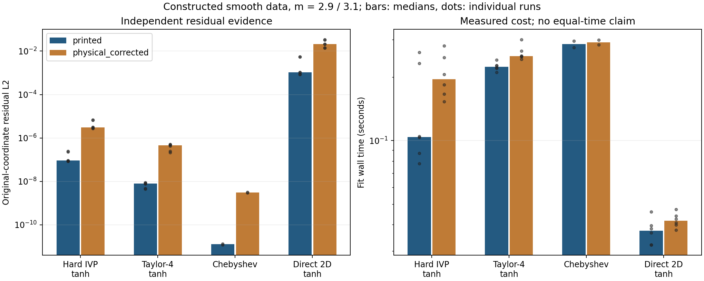

# 2026-10-10：实际完成结果与疑点处理

主要结论：X5 的一阶点生成元延续确实受阻；一般 m 的共同缩放约化仍可精确推进。床面对流项可在明确变量定义下修正，约化方程还有显式一阶积分。

## 疑点处理状态

| 疑点 | 本次结果 | 结论范围 |
|---|---|---|
| 是否只是对角缩放类失败？ | 已获得任意光滑点系数的一阶障碍 | 两种明确标量模型；非最大分类 |
| 一般 m 是否还能约化？ | 可以，共同缩放给出 ODE 与一阶积分 | 仅选定不变图与兼容数据 |
| 缺少床面对流项怎么办？ | 从 Eulerian 系统重新推导，得到修正标量方程 | 正深度、光滑、速度幂律闭合 |
| 床面如何重构？ | B_profile(z)+(I0/g)log(t) | 局部单连通域与匹配床面数据 |
| 整个参考区间是否正则？ | 有精确有理数 bootstrap 证明 | 固定构造数据，连续 m∈[1,4] |
| 学习候选是否全区间已认证？ | 尚未；独立网格检查分支和 leading margin | 不把采样当成区间定理 |
| 神经网络是否必需或更快？ | 当前证据不支持；经典控制精度最好 | 此次小规模固定特征实验 |

## 数学与经典验证

- 38 项验证通过：任意点延拓、缺陷符号、独立链式代入、物理相容性、一阶积分、二阶/三阶求解一致性和数据硬约束。
- 12 个经典参考算例：两种模型 × m=1,2,2.9,3,3.1,4。
- 二阶与三阶求解最大数值差：1.776e-15。
- 床面时间方程最大数值缺陷：7.772e-16。
- 一阶积分最大数值漂移：1.799e-14。
- 上述差值表示交叉验证的一致性，不能解释为绝对解误差的严格上界。

## 40 次近似比较

参数 m=2.9,3.1；两种模型。tanh 方法用种子 17,23,41，Chebyshev 方法确定性运行。每次 12 个可训练输出权重、64 个配点、150 次函数评价预算上限，权重界 [-10,10]。
初值 (F,F′,F″)(1)=(2,0.5,0.1)，g=1，κ=1/30，z∈[1,1.4]，t∈[1,2]。参考解没有参与训练。最终验证使用新的 25×161 网格。

| 模型 | 方法 | 次数 | max U 参考误差中位数 | 原坐标残差 L² 中位数 | 拟合秒数中位数 | 预算耗尽 |
|---|---|---:|---:|---:|---:|---:|
| printed | hard_ivp_tanh | 6 | 1.158e-11 | 9.000e-08 | 0.104 | 2 |
| printed | taylor4_tanh | 6 | 1.830e-12 | 7.885e-09 | 0.223 | 6 |
| printed | hard_ivp_chebyshev | 2 | 2.442e-15 | 1.267e-11 | 0.286 | 0 |
| printed | direct_2d_tanh | 6 | 2.120e-05 | 1.064e-03 | 0.037 | 0 |
| physical_corrected | hard_ivp_tanh | 6 | 1.219e-10 | 3.067e-06 | 0.195 | 2 |
| physical_corrected | taylor4_tanh | 6 | 7.205e-11 | 4.532e-07 | 0.251 | 6 |
| physical_corrected | hard_ivp_chebyshev | 2 | 1.612e-13 | 3.107e-09 | 0.292 | 0 |
| physical_corrected | direct_2d_tanh | 6 | 3.659e-05 | 2.132e-02 | 0.042 | 0 |

16/40 次达到预算上限，没有被改写为“优化收敛”。所有冻结候选都保留了权重、特征、先验、独立网格值和原坐标残差。残差经过新网格求积，但不是严格连续范数界。

四阶先验在这些匹配运行中降低了原坐标残差，训练时间没有因此普遍减少；一些 profile 参考误差已接近浮点/参考精度，不能夸大其细微排序。

Chebyshev 控制在本次精度比较中最好。直接二维 tanh 候选更快停止，精度更低；这是固定小特征类和所选不变目标的结果，不能推断普遍的二维 PINN 劣势。

## 仍然未建立的命题

- 接触、广义、非局部或依赖床面额外场的完整系统对称分类。
- 任意真实渠段初边值/通量条件下的共同缩放不变解覆盖。
- 学习候选的区间一致误差证书、深度 PINN 优越性或样本复杂度定理。
- 超出当前正则管的全局延拓、冲击波/弱解及其他输沙闭合。

这些是明确的结论边界，当前的障碍证明、一般 m 约化和物理修正不依赖它们完成。

完整证明见 [THEORY.md](THEORY.md)，复现入口见 [README.md](../README.md)。
