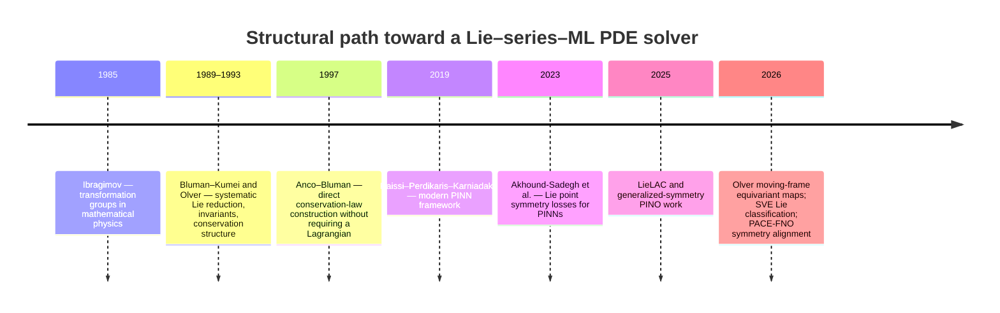

# Lie–Series–PINN Semi-Analytic PDE Reduction: Similarity Geometry, Local Series, Analytic Continuation, and Learned Closure

## Executive summary

The uploaded review points toward the right conceptual center: a useful Lie–ML system should first make **reduction, reconstruction, compatibility, parameter strata, and regularity conditions explicit**, and only then ask whether learning improves a computation that remains genuinely expensive. It also correctly separates three notions that are often conflated: an invariant-solution reduction, quotienting equivalent solutions by a symmetry group, and approximate low-dimensional reduction of general dynamics. fileciteturn0file0 This distinction is fully consistent with the classical Lie-theoretic framework of Olver, Bluman–Kumei, and Ibragimov, in which a symmetry acts on a differential equation in jet space and invariant solutions are obtained by imposing the associated invariant-surface condition. citeturn2search5turn2search1turn10search4

**Question A — what should a similarity solution be in a good Lie–PINN reducer?** It should not merely be an empirically guessed scaling ansatz. For a selected Lie subalgebra \(\mathfrak h\subset\mathfrak g_\lambda\), it should be the reconstruction of a reduced profile \(F\) from the exact invariants of \(\mathfrak h\):

\[
\boxed{
u=\mathcal R_{\mathfrak h}[F],\qquad
Q_X[u]=0\quad(X\in\mathfrak h),
}
\]

where \(Q_X\) is the evolutionary characteristic of the generator. The profiles \(F\) live on the quotient variables—e.g. a similarity coordinate \(\zeta\)—and satisfy an ODE or DAE obtained by pulling the original PDE back to that invariant manifold. This is the classical meaning of group-invariant or similarity reduction. citeturn2search5turn10search3 The neural network should normally approximate \(F\), a correction to \(F\), or a map between reduced objects—not relearn the already-known symmetry coordinates.

For arbitrary initial functions, however, exact invariant reduction is usually too restrictive. A generic datum is not fixed by the symmetry group. The relevant structure then becomes **equivariance of the solution operator**, canonicalization/moving frames, or a transverse correction away from the invariant manifold. The uploaded review emphasizes this point, and recent symmetry-ML work is increasingly moving in this direction: LieLAC canonicalizes using infinitesimal Lie information, Olver's 2026 moving-frame paper gives a mathematical construction of equivariant maps, and the 2026 PACE-FNO preprint explicitly separates symmetry-induced frame alignment from learned physical evolution. fileciteturn0file0 citeturn3academia30turn8search0turn12academia0

**Question B — how should the reduced ODE series be obtained?** The important difference from ordinary numerical integration is that the series coefficients should be obtained **algebraically from the reduced differential operator**. At a regular point one inserts

\[
F(\zeta)=\sum_{n\ge 0}a_n(\zeta-\zeta_0)^n
\]

into the ODE and solves coefficient equations exactly or symbolically. At singular points the algorithm should first classify the singularity and choose a suitable representation: Frobenius for regular singularities, Puiseux for algebraic branching, logarithmic extensions at resonances, and asymptotic/transseries sectors for irregular singularities. Fuchs–Frobenius theory explicitly distinguishes ordinary and regular singular points; Puiseux methods handle fractional-power branching; resurgence/transseries theory treats exponentially small sectors and Stokes behavior beyond ordinary convergent power series. citeturn4search12turn6search1turn6search18

That distinction is substantial. A Runge–Kutta solver produces values

\[
\{F(\zeta_j)\},
\]

whereas a symbolic recurrence can produce

\[
a_{n+k}
=
\Phi_n(a_0,\dots,a_{n+k-1};\lambda),
\]

thereby exposing dependence on integration constants and model parameters, resonance denominators, exceptional parameter loci, parity, possible truncation, and singular branches. A Padé or other rational continuation layer can then extend a locally known power series beyond the disk where a polynomial truncation is useful; Padé theory has rigorous convergence results in important meromorphic settings. citeturn4search3turn4search4

The resulting architecture is therefore better characterized as

\[
\boxed{
\text{PDE geometry}
\rightarrow
\text{exact reduction}
\rightarrow
\text{analytic local representation}
\rightarrow
\text{continuation}
\rightarrow
\text{learned unresolved remainder},
}
\]

rather than as “a PINN with an extra symmetry loss.” This matters because the 2023 Lie-PINN paper showed that Lie symmetry information can improve PINN sample efficiency, while subsequent work observed that ordinary point-symmetry loss terms can provide little or redundant training signal and proposed evolutionary representatives instead. citeturn3search9turn12academia3 The uploaded project evidence goes further: in some tested formulations its explicit prolongation loss reduced exactly to a residual reweighting, which reinforces the case for exploiting symmetry structurally rather than assuming every symmetry penalty adds independent information. fileciteturn0file0

The proposed **Lie–series–PINN hybrid is therefore a research architecture, not an already-established universally superior solver**. Its scientific case should be evaluated against strong analytic and numerical baselines at matched accuracy and full cost, exactly as the uploaded review recommends. fileciteturn0file0

## Reconsidering similarity solutions and ODE series

Let a parameterized PDE system be written as

\[
\Delta_\lambda^\alpha
\left(
x,u^{(n)}
\right)=0,
\qquad
\alpha=1,\ldots,N,
\]

with equation locus

\[
\mathcal E_\lambda^{(n)}
=
\{j^n u:\Delta_\lambda(j^nu)=0\}
\subset J^n(E).
\]

Classical Lie theory determines infinitesimal generators

\[
X
=
\xi^i(x,u)\frac{\partial}{\partial x^i}
+
\phi^a(x,u)\frac{\partial}{\partial u^a}
\]

whose prolongations preserve the equation locus. Olver, Bluman–Kumei, and Ibragimov all treat this prolongation-and-invariant-solution construction as fundamental to differential-equation symmetry analysis. citeturn2search5turn2search1turn10search4

The evolutionary characteristic is

\[
\boxed{
Q_X^a
=
\phi^a-\xi^i u_i^a.
}
\]

A solution invariant under the corresponding one-parameter subgroup satisfies

\[
\boxed{
Q_X^a[u]=0.
}
\]

Solving the characteristic equations

\[
\frac{dx^1}{\xi^1}
=
\cdots
=
\frac{dx^p}{\xi^p}
=
\frac{du^1}{\phi^1}
=
\cdots
=
\frac{du^q}{\phi^q}
\]

produces independent differential/geometric invariants. When one independent invariant is \(\zeta\), the dependent invariants produce a reconstruction map such as

\[
u^a(x)
=
A^a(x;\lambda)\,
F^a(\zeta)
+
B^a(x;\lambda).
\]

The phrase “similarity solution” should therefore mean

\[
\boxed{
u_{\rm sim}=\mathcal R_X[F],
}
\]

where \(\mathcal R_X\) is obtained from the symmetry, not guessed afterward. This is precisely the role played by invariant functions in the 2026 Saint–Venant–Exner Lie analysis, where the authors use one-dimensional symmetry subalgebras to reduce a two-variable master PDE to ODEs. citeturn0search0

The central commuting relation is not merely heuristic. On the invariant manifold there is a reduced differential operator \(\mathscr R_{\lambda,X}\) satisfying schematically

\[
\boxed{
\Delta_\lambda\!\left[\mathcal R_XF\right]
=
\mathcal P_X
\left(
\mathscr R_{\lambda,X}[F]
\right),
}
\]

where \(\mathcal P_X\) is the coordinate/reconstruction factor arising in the pullback. Consequently,

\[
\mathscr R_{\lambda,X}[F]=0
\quad\Longrightarrow\quad
\Delta_\lambda[\mathcal R_XF]=0.
\]

That implication is the mathematical reason the reduced neural model can operate in fewer variables while preserving the exact invariant ansatz. citeturn2search5turn10search3

There is a major caveat. A generic initial condition \(a(x)\) does **not** satisfy \(Q_X[a]=0\). In that case the right structure is not

\[
S_t(a)\in\operatorname{Fix}(G),
\]

but, when the initial/boundary problem admits the action,

\[
\boxed{
S_t(T_g a)=T_gS_t(a),
}
\]

with the time argument transformed as well when the group acts nontrivially on time. The uploaded review rightly insists on distinguishing the equation symmetry, the symmetry surviving the domain/boundary contract, and the stabilizer of an individual datum. fileciteturn0file0 Recent canonicalization approaches likewise treat symmetry as an operator-level equivariance rather than requiring every field to be invariant. citeturn3academia30turn8academia18turn12academia0

For the second question, suppose reduction and first-integral processing produce

\[
\mathscr R
\left(
\zeta,F,F',\ldots,F^{(k)};\lambda
\right)=0.
\]

At a regular point \(s=\zeta-\zeta_0=0\), let

\[
F(s)=\sum_{n=0}^{\infty}a_ns^n.
\]

Then

\[
F^{(j)}(s)
=
\sum_{n=0}^{\infty}
\frac{(n+j)!}{n!}a_{n+j}s^n.
\]

Substitution followed by coefficient extraction gives

\[
\mathscr R[F]
=
\sum_{n=0}^\infty
R_n(a_0,\ldots,a_{n+k};\lambda)s^n,
\]

hence

\[
\boxed{
R_n=0,\qquad n=0,1,\ldots.
}
\]

When the highest unknown coefficient enters nondegenerately,

\[
\boxed{
a_{n+k}
=
\Phi_n
(a_0,\ldots,a_{n+k-1};\lambda).
}
\]

This is fundamentally different from interpolating coefficients from an already-computed trajectory: the recurrence is an algebraic consequence of the ODE itself.

One should not, however, call every formal series a convergent solution. Regular-singular linear equations lead naturally to the Fuchs–Frobenius form

\[
F(s)
=
s^\rho\sum_{n=0}^\infty a_ns^n,
\]

with \(\rho\) determined by an indicial equation. citeturn4search12 Algebraic branching suggests a Puiseux representation

\[
F(s)
=
\sum_{n=n_0}^\infty a_ns^{n/q},
\]

and convergent Puiseux expansions are a standard local representation of algebraic branching. citeturn6search14turn6search2 At irregular singular points, formal expansions may be divergent but asymptotic; exponentially small sectors, Stokes transitions, and Borel summation then motivate transseries/resurgent representations rather than a naive Taylor polynomial. citeturn5search1turn6search18turn7search1

A good implementation therefore decides **which class of local representation the equation demands before asking a neural network to approximate anything**.

## The inner structure and the commutative reduction diagram

The “real nature” of the pipeline is a composition of maps between different mathematical objects: the PDE equation locus in jet space, its parameter-dependent Lie algebra, an invariant-surface manifold, a quotient coordinate chart, a reduced ODE/DAE, its conservation-law/first-integral structure, a local analytic branch, and finally a reconstruction into the original field variables. Classical Lie texts support the first half of this chain, multiplier theory provides conservation laws even without a Lagrangian, while recent symmetry-ML work supplies plausible interfaces for operator equivariance and canonicalization. citeturn2search5turn9search0turn3academia30turn8search0

```mermaid
flowchart TD
    P["Parameterized PDE / IBVP
    Δ_λ(x,u^(n)) = 0"] -->|prolongation determining equations| G["Symmetry algebra
    𝔤_λ = ker D_λ"]

    G -->|choose subalgebra 𝔥| X["Generator(s) X
    characteristic Q_X"]

    X -->|solve characteristic system| I["Invariants
    ζ, I¹,...,I^q"]

    X -->|Q_X[u]=0| M["Invariant manifold
    ℳ_𝔥 ⊂ Sol(Δ_λ)"]

    I --> A["Similarity reconstruction
    u = ℛ_𝔥[F](x)"]
    M --> A

    A -->|pull back PDE| R["Reduced ODE / DAE
    ℛ_{λ,𝔥}[F]=0"]

    R -->|multiplier / Noether / exact differential| C["Conservation laws
    and first integrals"]
    C -->|order reduction| RR["Lower-order reduced system"]
    R --> RR

    RR --> S{"Local singularity
    classification"}

    S -->|ordinary point| T["Taylor branch"]
    S -->|regular singular| F["Frobenius branch"]
    S -->|algebraic branching| U["Puiseux branch"]
    S -->|irregular / asymptotic| TS["Transseries / Borel branch"]

    T --> REC["Exact coefficient recurrences"]
    F --> REC
    U --> REC
    TS --> REC

    REC --> AC["Padé / Borel-Padé /
    patchwise analytic continuation"]

    RR --> N["Reduced neural branch
    F_θ or closure"]
    AC --> H["Hybrid profile
    F = F_analytic + remainder_θ"]
    N --> H

    H --> RECON["Reconstruction
    u_θ = ℛ_𝔥[F]"]

    RECON --> CHECK["PDE, boundary,
    conservation and regularity checks"]

    P -. generic non-invariant data .-> OP["Equivariant solution-operator branch"]
    G -. group action .-> OP
    OP -. moving frame / canonicalization .-> N
```

The mathematically important square is

\[
\begin{array}{ccc}
F & \xrightarrow{\;\mathcal R_X\;} & u\\[1mm]
\mathscr R_{\lambda,X}\downarrow
&&
\downarrow\Delta_\lambda\\[1mm]
0&\longrightarrow&0,
\end{array}
\]

which commutes on the admissible chart in the sense that

\[
\boxed{
\Delta_\lambda\circ\mathcal R_X
=
\mathcal P_X\circ\mathscr R_{\lambda,X}.
}
\]

Thus the network does not get credit for enforcing a relation the reconstruction map already enforces exactly.

Conservation laws can intervene **before** series generation. A local law

\[
D_iJ^i=0
\]

may reduce, after the similarity substitution, to an exact derivative

\[
\frac{d}{d\zeta}
C(F,F',\ldots)=0,
\]

and hence to

\[
C(F,F',\ldots)=C_0.
\]

The direct multiplier approach of Anco and Bluman is particularly useful here because it does not require the system to possess a variational/Lagrangian formulation. citeturn9search0turn9search3 This is relevant to the 2026 SVE analysis, whose authors explicitly state that they did not find a Lagrangian formulation for their master equation. citeturn0search0

The analytic-continuation branch should also be interpreted structurally. If a Taylor series around \(\zeta_0\) has radius

\[
R
=
\frac{1}{
\limsup_{n\to\infty}|a_n|^{1/n}
},
\]

then the obstruction generally reflects the nearest complex singularity of the analytic continuation, not necessarily a failure of the real solution at \(|\zeta-\zeta_0|=R\). Rational Padé approximants can represent poles and, for important meromorphic classes, possess convergence results beyond what a fixed Taylor polynomial offers. citeturn4search4

A useful research timeline is:



The bibliographic milestones in that timeline correspond to the classical Lie sources, the original PINN paper, NeurIPS 2023 Lie-PINNs, the ICLR 2025 LieLAC work, the 2025 generalized-symmetry PINO preprint, Olver's 2026 paper, the 2026 SVE paper, and the 2026 PACE-FNO preprint. citeturn10search4turn2search1turn2search5turn9search0turn3search0turn3search9turn11search0turn12academia3turn8search0turn0search0turn12academia0

## Burgers and Saint–Venant–Exner examples

For viscous Burgers,

\[
u_t+uu_x=\nu u_{xx},
\qquad \nu>0,
\]

a scaling generator is

\[
X=2t\partial_t+x\partial_x-u\partial_u.
\]

Scaling reductions of this kind are standard examples of group-invariant PDE reduction in the classical Lie framework. citeturn2search5turn10search3 Solving the characteristic equations gives

\[
\zeta=\frac{x}{\sqrt t},
\qquad
u(x,t)=t^{-1/2}F(\zeta).
\]

Direct substitution yields

\[
u_t
=
t^{-3/2}
\left(
-\frac12F-\frac12\zeta F'
\right),
\]

\[
uu_x=t^{-3/2}FF',
\qquad
\nu u_{xx}=\nu t^{-3/2}F'',
\]

and therefore

\[
\boxed{
\nu F''
+\frac12\zeta F'
+\frac12F
-FF'=0.
}
\]

An important semi-analytic improvement appears immediately: this equation possesses the elementary first integral

\[
\boxed{
\nu F'
+\frac12\zeta F
-\frac12F^2=C,
}
\]

because differentiating it gives the second-order equation. Thus the pipeline should not send the unreduced second-order residual directly to ML; it should first exploit the exact order reduction.

For a regular expansion around \(\zeta=0\),

\[
F(\zeta)
=
\sum_{n=0}^{\infty}a_n\zeta^n,
\]

the unreduced equation gives

\[
FF'
=
\sum_{n=0}^{\infty}
\left[
\sum_{j=0}^{n}
(n-j+1)
a_ja_{n-j+1}
\right]\zeta^n.
\]

Coefficient matching gives the exact recurrence

\[
\boxed{
a_{n+2}
=
\frac{
\displaystyle
\sum_{j=0}^{n}
(n-j+1)a_ja_{n-j+1}
-\frac{n+1}{2}a_n
}{
\nu(n+2)(n+1)
}.
}
\]

Hence

\[
a_2
=
\frac{a_0a_1-\tfrac12a_0}{2\nu},
\]

\[
a_3
=
\frac{a_1^2+2a_0a_2-a_1}{6\nu}.
\]

The coefficients are symbolic functions of the integration data \((a_0,a_1)\) and viscosity \(\nu\). This is information a numerical trajectory alone does not automatically expose.

Using the first integral gives an even cheaper recurrence. From

\[
\nu F'
+\frac12\zeta F
-\frac12F^2=C,
\]

the coefficient equations are

\[
\nu(n+1)a_{n+1}
+
\frac12a_{n-1}
-
\frac12
\sum_{j=0}^{n}a_ja_{n-j}
=
C\delta_{n0},
\]

with \(a_{-1}=0\). Thus one coefficient is obtained per order from a first-order recurrence. A rational continuation such as

\[
P_{L,M}(\zeta)
=
\frac{\sum_{j=0}^{L}p_j\zeta^j}
{1+\sum_{k=1}^{M}q_k\zeta^k}
\]

can then be matched to the generated series through order \(L+M\); Padé's utility and convergence theory for meromorphic functions are classical. citeturn4search0turn4search4

For Saint–Venant–Exner, consider the one-dimensional Eulerian system used in the 2026 paper,

\[
h_t+(hu)_x=0,
\]

\[
(hu)_t+
\left(
hu^2+\frac12gh^2
\right)_x
+ghB_x=0,
\]

\[
B_t+\beta u^{m-1}u_x=0.
\]

The paper obtains this last form from a bedload law \(Q=A_gu^m\), with \(\beta=mA_g\xi\), and reports that its Lagrangian master equation admits an additional Lie generator precisely at \(m=3\). citeturn0search0

The exceptional cubic exponent can also be seen directly from Eulerian scaling. Assume

\[
t\mapsto\Lambda t,\qquad
x\mapsto\Lambda^{b+1}x,
\]

\[
u\mapsto\Lambda^b u,
\qquad
h\mapsto\Lambda^{2b}h,
\qquad
B\mapsto\Lambda^{2b}B.
\]

Thus

\[
\zeta=\frac{x}{t^{b+1}},
\]

and take

\[
\boxed{
h=t^{2b}H(\zeta),\qquad
u=t^bU(\zeta),\qquad
B=t^{2b}Z(\zeta).
}
\]

The water equations are homogeneous under this scaling. In Exner,

\[
B_t\sim t^{2b-1},
\]

while

\[
u^{m-1}u_x
\sim
t^{b(m-1)-1}.
\]

For a nontrivial scaling \(b\neq0\),

\[
2b-1=b(m-1)-1
\]

implies

\[
\boxed{m=3.}
\]

This direct homogeneity calculation agrees with the exceptional \(m=3\) symmetry enlargement reported in the 2026 Lie classification. citeturn0search0 For a more general homogeneous sediment law

\[
Q=K h^r u^m,
\]

the same argument gives the exceptional surface

\[
\boxed{
2r+m=3.
}
\]

That latter equation is a derived generalization of the cubic case, not a claim made by the cited 2026 paper.

At \(m=3\), direct substitution gives the reduced Eulerian system

\[
\boxed{
2bH-(b+1)\zeta H'+(HU)'=0,
}
\]

\[
\boxed{
bU-(b+1)\zeta U'
+UU'
+g(H'+Z')=0,
}
\]

\[
\boxed{
2bZ-(b+1)\zeta Z'
+\beta U^2U'=0.
}
\]

Thus a three-field PDE has become a first-order nonlinear ODE system for

\[
(H,U,Z)(\zeta).
\]

Now expand

\[
H=\sum_{n=0}^{\infty}h_n\zeta^n,\qquad
U=\sum_{n=0}^{\infty}u_n\zeta^n,\qquad
Z=\sum_{n=0}^{\infty}z_n\zeta^n.
\]

Coefficient matching gives, for \(n\ge0\),

\[
\boxed{
[2b-(b+1)n]h_n
+
(n+1)
\sum_{j=0}^{n+1}
h_j u_{n+1-j}
=0,
}
\]

\[
\boxed{
[b-(b+1)n]u_n
+
\sum_{j=0}^{n}
(n-j+1)u_j u_{n-j+1}
+
g(n+1)(h_{n+1}+z_{n+1})
=0,
}
\]

and, using \(U^2U'=\frac13(U^3)'\),

\[
\boxed{
[2b-(b+1)n]z_n
+
\frac{\beta(n+1)}{3}
\sum_{i+j+k=n+1}
u_i u_j u_k
=0.
}
\]

At each regular order this can be organized as

\[
\boxed{
M_n
\begin{pmatrix}
h_{n+1}\\
u_{n+1}\\
z_{n+1}
\end{pmatrix}
=
r_n,
}
\]

where the unknown-coefficient matrix at \(\zeta=0\) is

\[
M_n
=
(n+1)
\begin{pmatrix}
u_0 & h_0 & 0\\
g & u_0 & g\\
0 & \beta u_0^2 & 0
\end{pmatrix},
\]

so

\[
\det M_n
=
-\beta g u_0^3(n+1)^3.
\]

This illustrates an important distinction. The exceptional **symmetry locus** \(m=3\) is found from the determining equations/homogeneity classification; a zero such as \(u_0=0\) in the series recurrence is instead a **local recurrence degeneracy**. A good algorithm should record these as different types of exceptional sets rather than label every degeneracy a symmetry bifurcation.

The published Lagrangian SVE analysis provides a second and especially useful test case. At \(m=3\) it reports the extra generator

\[
X_5=t\partial_t-2s\partial_s,
\]

so an invariant coordinate is

\[
\boxed{\sigma=st^2.}
\]

It obtains a scaling profile of the form

\[
\Phi(\sigma)
=
\Phi_0\sigma^{1/3},
\]

with

\[
(4\beta g-1)\Phi_0^3+27g=0.
\]

This is exactly the type of fractional-power branch for which a reducer should be able to recognize that an ordinary integer-power Taylor ansatz at \(\sigma=0\) is inappropriate. citeturn0search0 The uploaded review additionally records an audit warning: some commutator signs in the paper's printed table violate antisymmetry, while separately checked prolongation/reduction identities remain usable. That is a strong practical argument for an **exact verification stage after every automatically discovered or externally supplied symmetry**. fileciteturn0file0

## Comparative assessment and design dimensions

The table below is deliberately qualitative. The first two columns describe established classes of methods; the third is the proposed synthesis. Published PINNs minimize differential-equation/data residuals, NeurIPS 2023 demonstrated gains from Lie point symmetry information on its benchmarks, while subsequent generalized-symmetry work notes that point-symmetry loss terms can sometimes be uninformative. LieLAC and more recent symmetry-alignment methods instead exploit the group action structurally. citeturn3search0turn3search9turn12academia3turn3academia30turn12academia0

| Metric | Pure numerical PINN | Lie-informed PINN using symmetry loss | Lie–series–PINN semi-analytic hybrid |
|---|---|---|---|
| Representation | \(u_\theta(x,t,\lambda)\) directly | Usually \(u_\theta(x,t,\lambda)\), plus a Lie-derived loss | Exact symmetry coordinates/reconstruction plus analytic reduced profile and learned remainder |
| Accuracy | Can be high, but training error and PDE residual are not automatically equivalent to solution error | Can improve on suitable benchmarks; depends strongly on whether the symmetry term supplies genuinely new information | Potentially high near analytically controlled branches because leading structure is exact; **must be empirically established** |
| Interpretability | Low-to-moderate: network approximates the field | Moderate: symmetry generators are known, but the learned field remains largely black-box | High in the analytic component: invariants, recurrence, singularities, constants, parameter loci and reconstruction are explicit |
| Computational cost | Low symbolic setup, potentially expensive optimization and AD | Additional prolongation/derivative or augmentation cost | Higher symbolic setup; potentially much smaller learned problem; only advantageous when setup can be cached/reused |
| Structural-transition detection | Weak unless parameter scans reveal failure empirically | Symmetry information can be supplied, but a fixed loss does not itself perform classification | Stronger by design: rank changes, minors, recurrence degeneracies and resonance conditions are explicit targets |
| Data requirement | PINNs may use no labeled solution data but require collocation/BC/IC data; operator variants require families of inputs | Literature reports improved sample efficiency in some settings | Ideally smallest learned target because exact structure is removed first; this remains a hypothesis requiring matched tests |
| Generic initial functions | Yes in principle, especially operator-learning variants | Yes if formulated as an equivariant operator rather than invariant field | Exact similarity branch alone: no. Hybrid operator/transverse branch: potentially yes |
| Conservation structure | Usually soft penalty unless built into architecture | Same unless conservation is treated separately | First integrals and exact reductions are applied before training whenever available |
| Exceptional parameter loci | Normally hidden in optimizer behavior | May be known if symmetry analysis was performed beforehand | Explicit part of the symbolic front end |
| Main failure mode | Optimization error, stiffness, poor loss scaling, extrapolation | Redundant or weak symmetry signal; cost of higher derivatives | Symbolic complexity; local series breakdown; wrong branch choice; analytic stage may already solve the problem cheaply, making ML unnecessary |

The empirical claims about Lie-PINNs are supported by the NeurIPS 2023 paper; the caution about weak point-symmetry loss is central to the 2025 generalized-symmetry PINO paper. citeturn3search9turn12academia3 The hybrid column is a proposed architecture motivated by those results and the uploaded review, not a literature-established performance ranking. fileciteturn0file0

The analytic-series branch itself needs a classifier:

| Method | Natural applicability | Strength | Main limitation | What the algorithm should test |
|---|---|---|---|---|
| Taylor / ordinary power series | Analytic solution about an ordinary point | Exact coefficient recursion; simple parameter dependence; easy differentiation | Radius limited by nearest complex singularity; unsuitable at branch points | Highest-derivative Jacobian nonzero; coefficient growth; ratio/root tests |
| Frobenius | Linear or suitably linearized equation at a regular singular point | Captures noninteger indicial exponents and logarithmic resonances | Standard Fuchs theory is fundamentally linear; nonlinear extensions need additional analysis | Indicial polynomial, exponent differences, compatibility at resonant indices |
| Puiseux | Algebraic branch points, fractional-power local branches | Represents root-type branching naturally | Requires determining ramification denominator and branch; not every nonlinear singularity is algebraic | Newton polygon/dominant balance, rational exponents, recurrence compatibility |
| Transseries / Borel-resurgent form | Irregular singularities, divergent asymptotic expansions, exponentially small sectors | Captures beyond-all-orders terms and Stokes effects | Substantially more complex; summability is not automatic | Gevrey growth, exponential scales, Borel singularities, Stokes directions |
| Padé / rational continuation | Continuation of known power/asymptotic data, especially near meromorphic structure | Can represent poles and often extends usefulness well beyond a Taylor polynomial | Spurious pole-zero pairs; convergence depends on analytic class | Pole stability across orders, defect cancellation, comparison on overlaps |

Fuchs–Frobenius classification is summarized in NIST's DLMF; modern work explicitly constructs Puiseux solutions of nonlinear algebraic ODE systems; resurgence sources cover summability and nonlinear Stokes structure; and Baker–Graves-Morris give the standard systematic treatment of Padé definitions and convergence. citeturn4search12turn6search1turn6search18turn4search3turn4search4

The implementation should explicitly carry the following dimensions rather than leave them implicit:

| Attribute | Object to store/test | Why it matters |
|---|---|---|
| Parameter dependence | \(\lambda\mapsto\mathfrak g_\lambda\), \(R[F;\lambda]\), coefficient maps \(a_n(\lambda)\) | Symmetry dimension, recurrence rank and singular branches can change at special parameter values |
| Singularity classification | ordinary / regular singular / algebraic branch / irregular | Determines whether Taylor, Frobenius, Puiseux or transseries is legitimate |
| First integrals | \(C(F,F',\ldots)=C_0\) | Can reduce differential order before series generation or training |
| Resonance conditions | indicial roots, dominant-balance resonances, vanishing recurrence pivots | Identify free constants, compatibility conditions, logarithmic branches and obstructions |
| Radius of convergence | coefficient asymptotics and nearest inferred singularity | Controls the domain where a local series is a convergent representation |
| Analytic continuation | overlapping series charts, Padé/Borel-Padé, re-expansion centers | Converts a local representation into a larger-domain solver |
| ML role | tail, closure, continuation selector, or transverse correction | Prevents the network from relearning exact structure |
| Symbolic versus numerical work | exact identities/rank/recurrences versus evaluation/conditioning/error estimation | Makes correctness claims and numerical evidence distinguishable |
| Exceptional loci | determining-equation rank drops, denominator zeros, recurrence singularities, discriminants | Detects structural transitions rather than treating them as optimizer accidents |

Parameter-dependent Lie algebras with exceptional cases are not hypothetical here: the 2026 SVE paper finds four admitted point symmetries generically and an additional one at \(m=3\). citeturn0search0 The uploaded review stresses that such an algebra-dimension jump need not imply that the physical solution map itself becomes nonsmooth; the two phenomena should therefore be tested separately. fileciteturn0file0

## Implementation strategy and tests for exceptional parameter surfaces

A practical implementation should use a staged symbolic–numeric contract rather than one monolithic training program. The classical symmetry computation can be automated because the infinitesimal invariance criterion yields an overdetermined determining system for the generator coefficients; Ibragimov's handbook explicitly treats computational and symbolic symmetry analysis, while the uploaded project already contains timing evidence showing that expression construction, simplification and splitting—not merely the final nullspace solve—can dominate small symbolic searches. citeturn10search1 fileciteturn0file0

| Stage | Operation | Preferred mode | Mandatory checks |
|---|---|---|---|
| Problem contract | Freeze PDE, parameters, domain, BCs, initial-data class and regularity guards | Symbolic/specification | Distinguish equation symmetry from boundary/data symmetry |
| Lie classification | Form prolonged determining equations and split by jet monomials | Exact symbolic | Verify every returned generator by direct prolongation |
| Parameter stratification | Treat determining system \(D(\lambda)c=0\) as parameter-dependent | Exact algebra + numeric reconnaissance | Rank, minors, denominator factors, discriminants |
| Subalgebra selection | Compute useful one-dimensional or higher-dimensional reductions | Symbolic | Adjoint equivalence where needed; chart/stabilizer restrictions |
| Invariants | Solve \(X(I)=0\) and build \(\mathcal R_X\) | Symbolic | Jacobian independence and inverse reconstruction |
| PDE reduction | Compute \(\Delta[\mathcal R_XF]\) | Exact symbolic | Factor out nonzero reconstruction multiplier and record guards |
| Conservation reduction | Search known or multiplier-derived laws and exact derivatives | Symbolic | Verify divergence identity off shell when claiming a multiplier |
| ODE/DAE analysis | Determine order, derivative Jacobian rank, singular points and dominant balances | Symbolic + high-precision numeric | DAE rank/index changes; inaccessible branches |
| Series generation | Build Taylor/Frobenius/Puiseux/transseries recurrence | Exact/rational symbolic where possible | Resonances, compatibility, free constants, coefficient growth |
| Continuation | Re-center, Padé, Borel-Padé or chart transition | Numerical/high precision | Overlap consistency, pole stability, truncation error |
| ML closure | Learn only the unresolved tail, continuation map or generic-data transverse component | ML | Compare against zero correction, interpolation and classical solver |
| Reconstruction | Map reduced result back to \(u(x,t)\) | Symbolic + numeric | Derivative-sensitive reconstruction errors and denominator guards |
| Certification layer | Evaluate PDE/BC/IC residuals, conservation balance and state error where references exist | Numerical, optionally rigorous | Never equate a small residual with a state-error theorem without stability control |

For parameter stratification, suppose a finite symmetry ansatz produces

\[
D(\lambda)c=0.
\]

Generic symmetry dimension is

\[
\dim\ker D(\lambda)
=
N-\operatorname{rank}D(\lambda).
\]

An exceptional locus occurs where the rank drops. For polynomial or rational dependence on \(\lambda\), a systematic detector can form maximal minors and denominator conditions. Schematically,

\[
\boxed{
\Sigma_{\rm Lie}
=
\left\{
\lambda:
\operatorname{rank}D(\lambda)
<
r_{\rm generic}
\right\}.
}
\]

One can compute candidate components from vanishing minors and then verify them by exact substitution. This is the proper place to discover the SVE cubic stratum \(m=3\), rather than hoping a trained network notices it indirectly. The 2026 SVE classification provides a concrete real example of such a parameter-dependent algebra enlargement. citeturn0search0

The reduced-series stage has its own exceptional set. If coefficient matching gives

\[
M_n(\lambda,a_0,\ldots)a_{n+k}=r_n,
\]

record

\[
\boxed{
\Sigma_{\rm rec}
=
\bigcup_n
\{
\det M_n=0
\},
}
\]

or the appropriate rank condition for vector coefficients. A zero of \(M_n\) may indicate a resonance, a free coefficient, a compatibility condition, a logarithmic correction, or simply that a chosen local chart is singular. It should **not automatically be identified with \(\Sigma_{\rm Lie}\)**.

A nonlinear dominant-balance module should test

\[
F\sim A(\zeta-\zeta_*)^p.
\]

Substitution into the dominant monomials determines possible \(p\) and \(A\). Perturbing

\[
F
=
A s^p+\varepsilon B s^{p+r}
\]

and linearizing in \(\varepsilon\) yields a resonance equation for \(r\). Painlevé-type singularity analysis uses precisely this logic to identify admissible local singular structures and resonance positions; modern treatments present it as an algorithmic tool for nonlinear differential equations. citeturn7search2turn7search13

The ML interface should then be chosen from the cheapest mathematically meaningful target. A particularly strong local construction is

\[
\boxed{
F_\theta(s)
=
\sum_{n=0}^{N}a_ns^n
+
s^{N+1}N_\theta(s).
}
\]

It guarantees

\[
F_\theta^{(k)}(0)
=
k!a_k,
\qquad
0\le k\le N,
\]

irrespective of the network weights. The network learns only the normalized remainder. With Frobenius exponent \(\rho\), the analogous form is

\[
F_\theta(s)
=
s^\rho
\left(
\sum_{n=0}^{N}a_ns^n
+
s^{N+1}N_\theta(s)
\right).
\]

For Puiseux denominator \(q\),

\[
F_\theta(s)
=
\sum_{n=n_0}^{N}
a_ns^{n/q}
+
s^{(N+1)/q}
N_\theta(s^{1/q}).
\]

Those architectures are more faithful to the differential equation than asking a generic network to discover the local exponent, coefficients, and remainder simultaneously.

For generic non-invariant data, a complementary construction is

\[
\boxed{
u
=
\mathcal R_X[F]
+
u_\perp,
}
\]

where \(u_\perp\) denotes departure from the invariant manifold. The notation “\(\perp\)” should only be used once a metric/projection or gauge has been specified; the uploaded review correctly warns that there is no canonical orthogonal decomposition for a general PDE solution space. fileciteturn0file0 A moving-frame/canonicalization architecture can instead normalize group-orbit coordinates exactly and ask ML to approximate variation between inequivalent shapes. Olver's moving-frame theory and LieLAC provide mathematically and computationally relevant precedents for this separation. citeturn8search0turn3academia30

Recent work strengthens the case for this division of labor. LieLAC was presented at ICLR 2025 and uses infinitesimal Lie information to canonicalize inputs for otherwise unconstrained models. citeturn11search0 The 2025 generalized-symmetry PINO work argues that evolutionary representatives can supply stronger residual-derivative information than ordinary point-symmetry losses. citeturn12academia3 The 2025 LieSolver preprint goes further in another direction, using Lie structure to enforce PDE constraints by construction for classes of linear homogeneous IBVPs rather than merely penalizing the PDE residual. citeturn12academia2 The 2026 PACE-FNO preprint separates symmetry-frame alignment from neural evolution and reports substantial out-of-distribution gains on its tested Burgers, shallow-water and Navier–Stokes problems. citeturn12academia0 These methods are not identical to a Lie–series–PINN, but collectively they support the principle that **known symmetry geometry should be implemented as geometry wherever possible, not represented only as another soft loss term**.

The strongest experimental program would therefore compare, at matched accuracy and workload,

\[
\text{direct high-quality numerical solver},
\]

\[
\text{PINN/PINO},
\]

\[
\text{Lie-loss PINN/PINO},
\]

\[
\text{exact Lie reduction + classical ODE solver},
\]

\[
\text{Lie reduction + series/Padé only},
\]

and finally

\[
\boxed{
\text{Lie reduction + series/continuation + learned remainder}.
}
\]

The uploaded review's economics analysis makes this essential: in its existing scalar reduced experiments, the classical reduced ODE solves are already so inexpensive that network training is difficult to justify purely as a speedup. A negative ML result in such a regime is scientifically informative rather than a failure. fileciteturn0file0

## Conclusions and prioritized references

The two original questions can now be answered more sharply.

A **similarity solution** in a rigorous Lie–PINN semi-analytic reducer is an exact section of an invariant solution manifold,

\[
\boxed{
Q_{\mathfrak h}[u]=0,\qquad
u=\mathcal R_{\mathfrak h}[F],
}
\]

whose profile \(F\) satisfies a reduced ODE/DAE obtained by pulling the PDE back through the Lie invariants. It is not the same object as an equivariant solution operator on arbitrary initial functions. The latter requires treatment of group orbits, canonicalization, domain/boundary compatibility, and unresolved shape information. This distinction is classical Lie theory and is also central to the uploaded project's review. citeturn2search5turn2search1 fileciteturn0file0

An **ODE series solution** should be obtained by exact/formal substitution into the reduced differential operator, after first-integral and singularity analysis:

\[
\boxed{
\mathscr R[F]=0
\Longrightarrow
\{R_n(a_0,\ldots,a_{n+k};\lambda)=0\}_{n\ge0}.
}
\]

Those equations expose analytic structure that pointwise numerical integration normally leaves implicit. A robust solver must distinguish convergent Taylor series, Frobenius series, Puiseux branching and divergent asymptotic/transseries expansions, and it should use Padé or related continuation only with branch and stability diagnostics. citeturn4search12turn6search1turn6search18turn4search4

The most defensible final architecture is therefore

\[
\boxed{
\begin{aligned}
&\text{PDE/IBVP contract}
\\
&\downarrow\\
&\text{parameter-dependent Lie classification}
\\
&\downarrow\\
&\text{invariants + invariant manifold}
\\
&\downarrow\\
&\text{reduced ODE/DAE}
\\
&\downarrow\\
&\text{first integrals + singularity analysis}
\\
&\downarrow\\
&\text{Taylor/Frobenius/Puiseux/transseries recurrence}
\\
&\downarrow\\
&\text{Padé/Borel/patchwise continuation}
\\
&\downarrow\\
&\text{ML tail, closure, continuation, or transverse operator}
\\
&\downarrow\\
&\text{exact reconstruction + structural checks}.
\end{aligned}
}
\]

Its principal research hypothesis is not “Lie symmetry makes PINNs better.” It is more precise:

\[
\boxed{
\text{After exact quotient/reduction and analytic local structure are removed,
is the remaining map simpler enough that learning improves the
accuracy–cost–coverage tradeoff?}
}
\]

That formulation is compatible with the classical mathematics, the uploaded project's strongest conclusions, and the direction of recent symmetry-aware neural PDE research. fileciteturn0file0 citeturn3search9turn3academia30turn12academia3turn12academia0

**Prioritized references**

1. **Peter J. Olver, _Applications of Lie Groups to Differential Equations_.** Foundational reference for prolongation, evolutionary representatives, invariant solutions, differential invariants, reduction and conservation-law relations. citeturn2search5

2. **George W. Bluman and Sukeyuki Kumei, _Symmetries and Differential Equations_.** Classical constructive treatment of Lie transformations, determining equations and similarity solutions for differential equations. citeturn2search1

3. **N. H. Ibragimov, _Transformation Groups Applied to Mathematical Physics_; CRC Handbook of Lie Group Analysis of Differential Equations.** Foundational and computational treatments of symmetry analysis, exact solutions, conservation laws, generalized and conditional symmetries, and symbolic methods. citeturn10search4turn10search3turn10search1

4. **Stephen C. Anco and George Bluman, “Direct Construction of Conservation Laws from Field Equations,” _Physical Review Letters_ 78 (1997).** Primary source for multiplier-based conservation-law construction without requiring a Lagrangian. citeturn9search0

5. **George Bluman, “Connections Between Symmetries and Conservation Laws,” SIGMA (2005).** Useful clarification of the relationships—and non-equivalence—between symmetries, Noether methods, multipliers and conservation laws. citeturn9search3

6. **Maziar Raissi, Paris Perdikaris and George Em Karniadakis, “Physics-informed neural networks,” _Journal of Computational Physics_ 378 (2019).** Canonical modern PINN formulation against which the proposed hybrid should be compared. citeturn3search0

7. **Tara Akhound-Sadegh et al., “Lie Point Symmetry and Physics-Informed Networks,” NeurIPS 2023.** Primary modern Lie-PINN reference demonstrating symmetry-based data/loss augmentation and reported sample-efficiency benefits. citeturn3search9

8. **Zakhar Shumaylov et al., “Lie Algebra Canonicalization: Equivariant Neural Operators under Arbitrary Lie Groups,” ICLR 2025.** Important shift from symmetry penalties toward canonicalization/equivariance using infinitesimal Lie information. citeturn11search0turn3academia30

9. **Amy Xiang Wang et al., “Generalized Lie Symmetries in Physics-Informed Neural Operators” (2025 preprint).** Directly relevant warning that point-symmetry loss terms may yield weak/trivial training signals and proposal to use evolutionary representatives. citeturn12academia3

10. **Peter J. Olver, “Using Moving Frames to Construct Equivariant Maps,” _Bulletin of the Iranian Mathematical Society_ 52 (2026).** Particularly relevant mathematical bridge from moving-frame geometry to explicit equivariant-map construction. citeturn8search0

11. **Andronikos Paliathanasis, Genly Leon and Peter G. L. Leach, “Lie Symmetries and Similarity Solutions for a Shallow-Water Model with Bed Elevation in Lagrange Variables,” _Mathematics_ 14, 433 (2026).** Current SVE example with a parameter-dependent symmetry enlargement at \(m=3\), similarity reductions and closed-form branches. citeturn0search0

12. **Jiaxiao Xu et al., “Physics-Aligned Canonical Equivariant Fourier Neural Operator under Symmetry-Induced Shifts” (2026 preprint).** Recent example of explicitly separating symmetry-frame alignment from learned PDE evolution. citeturn12academia0

13. **NIST Digital Library of Mathematical Functions, Fuchs–Frobenius theory.** Authoritative reference for ordinary versus regular singular points and Frobenius local solutions. citeturn4search12

14. **José Cano, Sebastian Falkensteiner and J. Rafael Sendra, “Algebraic, Rational and Puiseux Series Solutions of Systems of Autonomous Algebraic ODEs,” _Mathematics in Computer Science_ (2021).** Directly relevant modern work on formal Puiseux solutions of nonlinear algebraic ODE systems. citeturn6search1

15. **George A. Baker and Peter Graves-Morris, _Padé Approximants_.** Standard reference for rational approximation, numerical uses and convergence theory. citeturn4search3turn4search4

16. **Claude Mitschi and David Sauzin, _Divergent Series, Summability and Resurgence I_.** Rigorous modern reference for analytic continuation, summability and resurgence beyond ordinary power-series convergence. citeturn6search18

17. **Robert Conte and Micheline Musette, _The Painlevé Handbook_.** Systematic reference for dominant balances, resonance tests and singularity analysis of nonlinear differential equations. citeturn7search2

18. **The uploaded _Lie–ML review and exploration plan_ (6 October 2026).** The most directly relevant project-specific source: it separates invariant reduction from quotient/operator equivariance, audits the SVE source, documents symmetry-loss redundancy in tested cases, evaluates series-first experiments, and argues that ML should be introduced only after exact and inexpensive analytic computations have been exhausted. fileciteturn0file0